# Architecture (MVP, pre-product)

```
files (PDF/CSV/TXT)
   |  ingest/        bytes -> RawDocument (text, doc_type, sha256)
   v
 extraction/        RawDocument -> Invoice | RateConfirmation | BillOfLading   (swappable provider)
   |  extract_bundle -> ExtractedBundle (+ warnings)
   v
 rules/             ExtractedBundle -> Findings -> RecoveryResult (per perspective)
   v
 evidence/          documents + findings + calculations + DRAFT letter -> EvidencePacket (+ markdown)
   v
 api/ (FastAPI) and cli.py     thin adapters over pipeline.run_pipeline
```

Request path in the API (production foundation):

```
request -> BodySizeLimitMiddleware -> AuthenticatedRoute (API key -> tenant, BEFORE the body is parsed)
        -> persist Analysis(running) + raw docs via StorageProvider      [db/, storage/; tenant-scoped]
        -> sandbox worker process: ingest -> extract -> rules -> evidence  [sandbox/; time+memory bounded]
        -> mark Analysis succeeded|failed (+ result JSON)                  [tenant-scoped repository]
```

## Modules (`src/freight_recovery/`)
| Module | Responsibility |
|---|---|
| `models.py` | pydantic v2 domain types; money is `Decimal`; `Finding`, `RecoveryResult`, `EvidencePacket` |
| `config.py` | env-driven `Settings` (`FR_*`), secrets excluded from `repr`, `validate_for_production()` guard |
| `keys.py`, `auth.py` | API-key format/HMAC hashing; `AuthenticatedRoute` resolves the tenant from the key before the body is read (401 no key / 403 invalid) |
| `admin.py` | operator CLI: tenants and API keys (`python -m freight_recovery.admin`) |
| `db/` | SQLAlchemy 2 tables (`tables.py`), tenant-bound `AnalysisRepository` and unscoped `TenantAdminRepository` (`repository.py`), engine/session factories, Alembic migrations (`migrations/`, `migrate.py`) |
| `storage/` | `StorageProvider` interface: `LocalFilesystemStorage` (default), `S3Storage` stub behind two flags; tenant-prefixed keys built only from validated ids |
| `sandbox/` | `run_isolated` / `SandboxRunner`: one worker subprocess per job with wall-clock, memory, CPU and output limits and a clean environment; `targets.analyze` is the analysis job |
| `ingest/` | decode PDF (pdfplumber, lazy import) / CSV (flattened to `Key: Value`) / TXT; classify doc type; sha256 |
| `extraction/` | `ExtractionProvider` Protocol; `DeterministicStubProvider` (default, offline); `LLMExtractionProvider` placeholder; `extract_bundle` |
| `rules/` | `detention.py` (auditable calculation), `invoice_checks.py` (rate/fuel/accessorial/duplicate/total), `engine.py` (perspective totals) |
| `evidence/` | `letter.py` deterministic draft letter; `packet.py` assembles packet and markdown |
| `pipeline.py` | `run_pipeline(files, perspective)` - the single orchestration entry point |
| `api/main.py` | `create_app()` factory + `app`; authenticated routes, tenant-scoped persistence, gated docs; `cli.py` for local use (no auth/DB) |

## Key decisions
- **Provider interface, deterministic default.** The pipeline depends only on `ExtractionProvider`. The stub makes tests reproducible and offline; a hosted-model provider can be added without touching rules or evidence. Model output must be validated by pydantic and never trusted for arithmetic: **all money math is in `rules/`, in Decimal.**
- **Rules produce explainable findings.** Every finding carries rule id, amount, confidence, and a step-by-step calculation; uncertain ones set `needs_human_review`. Duplicates are removed before rate comparisons to avoid double counting.
- **Two perspectives, one engine.** Findings are directional (`overcharge` vs `underbilled`); the chosen perspective sums its direction and reports the rest as ignored.
- **Human in the loop.** Output is a draft packet; nothing is sent. Every packet carries a disclaimer.
- **Tenant isolation by construction.** The tenant comes only from the API key. `AnalysisRepository` is bound to one tenant at construction and every query filters on it; another tenant's id is a 404; storage keys carry the tenant prefix and are re-checked on read. PostgreSQL row-level security is the next layer of defense in depth.
- **Persistence behind a repository.** SQLAlchemy 2 + Alembic; SQLite locally/tests, PostgreSQL (RDS) in production. An `analyses` row is both the job record (queued/running/succeeded/failed) and the result, so an async worker can adopt it without a schema change. Money is stored as integer cents plus the exact packet JSON.
- **Bounded parsing.** Hostile input is parsed in a separate, resource-limited worker process, never in the API process. This is process isolation, not an OS sandbox; seccomp/read-only-rootfs/no-egress containment is a deployment-layer control (`deploy/aws.md`).
- **No queue yet.** Analyses run synchronously within the request (bounded by the worker pool and a 503 back-pressure); an async job queue is a next step for large documents.
- **Evidence integrity.** Original-bytes sha256 recorded per document.

## Forecasting (roadmap)
`forecast/` is an optional, future capability (not in the core flow): a `Forecaster` interface, a stdlib seasonal-naive/moving-average baseline (default, tested), and a lazily-imported `neuralforecast` backend behind the `[forecast]` extra, off by default and not validated (needs real multi-series data; often only ties baselines). No accuracy claims.

## Known gaps
Scanned-PDF OCR; multi-document/multi-stop loads; timezone-aware timestamps; contract/tariff-specific rules; carrier-specific charge codes; dispute deadlines and status tracking; integrations (TMS/EDI/carrier portals); payments/credit reconciliation; rate limiting, malware scanning, retention policy, an async job queue; and the external security audit / compliance sign-off. The project's research plan (eval set first, independent verifier, measured pass^k) lives in `technical/` and is not yet implemented here.

---

# Web platform (TypeScript, steps 1-2)

> Written by scriber for run `REQ-20261008-webapp-foundation` on 2026-10-08. **Pre-product, synthetic
> data only, never deployed.** The Python service above and the `webapp/` pilot dashboard are unchanged and
> still run on their own. Threat model and known gaps:
> [technical/web-platform-security.md](technical/web-platform-security.md).

## Overview

An npm-workspaces monorepo next to the Python service. `web/` is a React 19 + Vite SPA (React Router,
TanStack Query, Zustand, Tailwind). `api/` is Node 22 + Fastify 5 + Prisma 7 on PostgreSQL 16, with Zod
validation and Pino logs. `packages/shared/` (`@fr/shared`) holds the roles, the permission matrix,
canonical JSON, text safety and the DTO schemas; both sides import it. `infra/` is a Terraform skeleton for
AWS. Build-order steps 1 and 2 are implemented: authN (argon2id, access JWT plus a rotating refresh
cookie, TOTP MFA, lockout), RBAC across 8 roles, 3-layer tenant isolation, app hardening, a hash-chained
append-only audit trail, the claims list, the evidence-packet viewer and the approvals human gate.
Step 3 (import and export) is described in its own section below:
[Web platform: import and export (step 3)](#web-platform-import-and-export-step-3). Step 4 (Dev
dashboard, Recovery intelligence, tenant API keys and the evaluation tool) has its own section too:
[Web platform: Dev dashboard, Recovery intelligence and API keys (step 4)](#web-platform-dev-dashboard-recovery-intelligence-and-api-keys-step-4).
Step 5 (the TS port of the Python rules and evidence letter, and the analyze action that turns an imported
claim into packet revision 1) is described in
[Web platform: claim analysis (step 5)](#web-platform-claim-analysis-step-5). Step 6 (charge-line suggestions
from labelled examples, a team label memory, review-only learned findings and a tariff detention
calculator) is described in [Web platform: charge intelligence (step 6)](#web-platform-charge-intelligence-step-6).
There is no trained model and no LLM call: the step 6 classifier compares a charge name with labelled
examples. Step 7 is in
[Web platform: fuel check, public price data and cost outlook (step 7)](#web-platform-fuel-check-public-price-data-and-cost-outlook-step-7).
Step 8 (the ocean demurrage and detention invoice audit against 46 CFR Part 541 and 545.5, with the claim kind
`OCEAN_DD`) is in
[Web platform: ocean demurrage and detention audit (step 8)](#web-platform-ocean-demurrage-and-detention-audit-step-8).
The seeded claims and packets come from
the Python CLI output on `tests/fixtures/` (synthetic).

## Module Structure

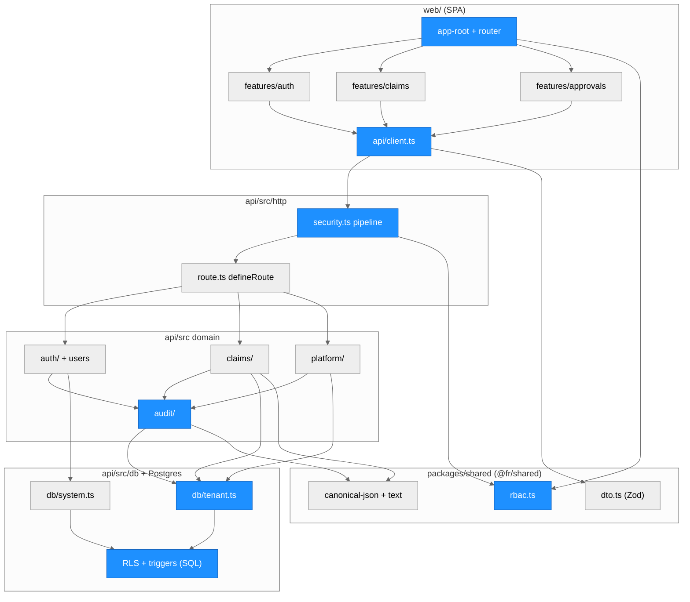

> Everything in this diagram is new in this run. Blue marks the security-critical modules.

### Module Reference

| Module / File | Layer | Purpose | Key Exports | Changed |
| --- | --- | --- | --- | --- |
| `packages/shared/src/rbac.ts` | Shared | **Single source of truth** for roles and the frozen permission matrix | `ROLES`, `PERMISSION_MATRIX`, `can`, `canAssignRole`, `canManageUserWithRole`, `MFA_REQUIRED_ROLES` | new |
| `packages/shared/src/dto.ts` | Shared | Strict request schemas and response DTOs (also `CLAIM_SORT_FIELDS`) | Zod schemas | new |
| `packages/shared/src/canonical-json.ts`, `text.ts`, `money.ts` | Shared | Canonical JSON for hashing; `displayText` and unsafe-character checks; integer-cent formatting | `canonicalJson`, `GENESIS_HASH`, `displayText`, `formatUsdCents` | new |
| `api/src/app.ts`, `server.ts`, `config.ts` | API | App factory; fail-safe config (production guards, secret checks) | `buildApp`, `loadConfig`, `secretEntropyProblem` | new |
| `api/src/http/security.ts` | API | One `onRequest` pipeline: rate limit → Origin → CSRF → authN → permission; security headers | `registerSecurityPipeline` | new |
| `api/src/http/route.ts` | API | `defineRoute`; the boot fails if a route lacks an access declaration; Zod validation in `preHandler` | `defineRoute` | new |
| `api/src/security/*` | API | argon2id, HS256 JWT (per-purpose key/typ/aud), TOTP, CSRF, HKDF/AES-GCM, lockout math | | new |
| `api/src/auth/*` | API | Login, MFA, refresh rotation + reuse detection, forgot/reset, invites, users (R3-R23), dev outbox (R38) | `authenticateAccessToken`, `rotateRefreshToken`, route registrars | new |
| `api/src/claims/*` | API | List/sort/search (`escapeLike`), packet viewer, content hash, review state machine, approvals (R26-R34) | `canTransition`, `packetContentHash` | new |
| `api/src/platform/*` | API | Health, tenant stats, SUPER_ADMIN cross-tenant read (audited first) | `crossTenantRead` | new |
| `api/src/audit/*` | API | Hash chain, append under an advisory lock, verifier, list/verify routes | `appendAudit`, `ChainVerifier` | new |
| `api/src/db/tenant.ts`, `system.ts` | Data | Layer-2 fail-closed tenant extension; system-mode transactions (restricted by lint) | `withTenantTx`, `withSystemTx` | new |
| `api/prisma/migrations/20261008000000_init/migration.sql`, `api/db/init/00-roles.sql` | Data | Schema, RLS + FORCE, least-privilege grants, append-only and state-machine triggers, DB roles | | new |
| `web/src/api/client.ts` | Web | Access token in memory, CSRF header, single-flight refresh (Web Locks across tabs) | `ApiClient` | new |
| `web/src/features/{auth,shell,claims,approvals}` | Web | Login/MFA/reset/invite pages, shell + command palette, claims table + detail sheet, approvals queue | pages | new |
| `infra/*.tf` | Infra | AWS skeleton (fmt/validate only, never applied) | | new |
| `compose.web.yml`, `.github/workflows/web-ci.yml` | Ops | Separate local stack and CI; the Python `docker-compose.yml` and `ci.yml` are untouched | | new |

## Request pipeline (data flow)

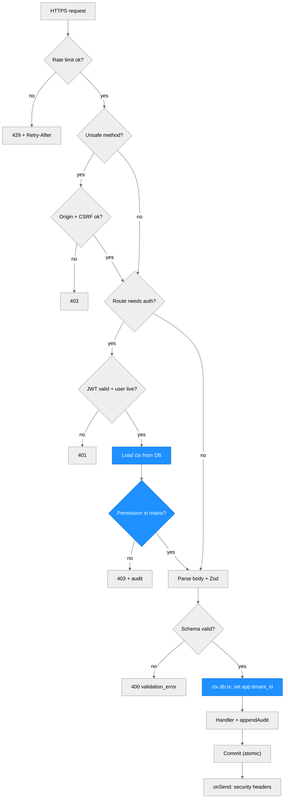

AuthN and authZ run in `onRequest`, before the body is parsed. An unauthenticated or forbidden request
therefore gets 401/403 even when its body is invalid. A business change and its audit event commit in
the same transaction: if the audit append fails, the request returns 500 and nothing changes.

## Authentication flows

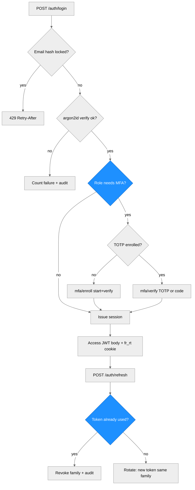

| Flow | Routes (under `/api/v1`) | Key rules |
| --- | --- | --- |
| Login | `POST /auth/login` | argon2id with a dummy verify for unknown or disabled users; per-email-hash lockout `min(30·2^(f-5), 900)` s after 5 failures; auth rate limit 20/60 s per IP |
| MFA | `/auth/mfa/verify`, `/auth/mfa/enroll/start`, `/auth/mfa/enroll/verify` | mandatory for OWNER, ADMIN, PLATFORM_DEV, SUPER_ADMIN; RFC 6238 ±1 step; accepted step strictly increasing (no replay); single-use recovery codes |
| Session | `/auth/refresh`, `/auth/logout`, `GET /me` | access JWT (10 min) is kept in JS memory; `fr_rt` cookie `HttpOnly; Secure; SameSite=Strict; Path=/api/v1/auth`; DB stores an HMAC of the token; reuse revokes the family; family max 30 days |
| CSRF | `GET /auth/csrf` | `fr_csrf` cookie == `X-CSRF-Token` == `nonce.HMAC(secret, nonce)`, plus an Origin check |
| Recovery | `/auth/forgot`, `/auth/reset`, `/auth/change-password` | same response for unknown emails; reset revokes all sessions; forgot limited to 5/15 min |
| Invites | `/users/invites`, `/auth/invites/inspect`, `/auth/invites/accept` | role assignment is rank-based (`canAssignRole`); OWNER is never assignable |

## RBAC

`packages/shared/src/rbac.ts` is the single source of truth. The API checks `can(role, permission)`
on every request. The web app imports the same frozen data only to hide controls.

| Permission | OWNER | ADMIN | MANAGER | REVIEWER | ANALYST | VIEWER | PLATFORM_DEV | SUPER_ADMIN |
| --- | --- | --- | --- | --- | --- | --- | --- | --- |
| `claims:read` | x | x | x | x | x | x | | |
| `claims:assign` | x | x | x | | | | | |
| `packets:edit`, `packets:approve` | x | x | x | x | | | | |
| `demands:send` | x | x | x | | | | | |
| `import:run` (step 3: batches, upload, documents, download, commit) | x | x | x | x | x | | | |
| `import:review` (step 3: review queue and decisions) | x | x | x | x | | | | |
| `export:claims` (step 3) | x | x | x | x | x | | | |
| `export:packets`, `export:outcomes` (step 3) | x | x | x | x | | | | |
| `users:read`, `users:manage`, `audit:read`, `settings:manage`, `integrations:manage` | x | x | | | | | | |
| `admins:manage`, `billing:manage`, `tenant:delete` | x | | | | | | | |
| `apikeys:manage` (step 4: create, list and revoke tenant API keys) | x | x | | | | | | |
| `claims:analyze` (step 5: analyze one claim, bulk analyze; no API-key scope) | x | x | x | x | x | | | |
| `charge_labels:manage` (step 6: set and delete team charge labels; no API-key scope) | x | x | x | x | | | | |
| `platform:health` (step 4: also pipeline health and telemetry) | | | | | | | x | x |
| `platform:flags`, `platform:logs` | | | | | | | x | |
| `platform:eval` (step 4: evaluation runs) | | | | | | | x | |
| `platform:audit` (step 4: platform audit chain) | | | | | | | | x |
| `platform:tenants:list`, `platform:cross_tenant_read` | | | | | | | | x |

Platform roles have no tenant and no tenant data permission. A SUPER_ADMIN cross-tenant read is
read-only, needs a reason of at least 10 characters, and is audited into the target tenant's chain first.
There is no Team model, so every tenant role sees all claims of its tenant (assumption A4).

## Tenant isolation (three layers, fail closed)

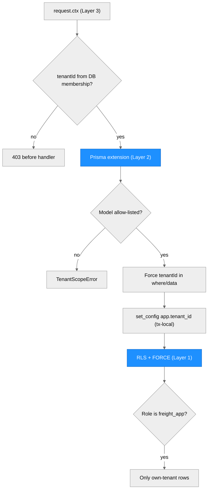

- **Layer 1, PostgreSQL RLS.** Every tenant-scoped table (`claims`, `evidence_packets`, the packet child
  tables, `approvals`, `memberships`, `invites`, `audit_events`) has `ENABLE` and `FORCE ROW LEVEL
  SECURITY` with `USING/WITH CHECK (tenant_id = fr_current_tenant())`. With no `app.tenant_id` set,
  queries see zero rows. Only `memberships` and `invites` also allow `fr_system_mode()` (auth bootstrap),
  and the `platform` audit chain is visible only in system mode.
- **Roles.** The API runs as `freight_app` (`NOSUPERUSER NOBYPASSRLS NOINHERIT`, not the owner; DML
  grants only; `evidence_packets` gets `UPDATE (status)` only; append-only tables get `SELECT, INSERT`
  only). `freight_owner` owns the schema and runs migrations, the seed and test fixtures (BYPASSRLS).
- **Layer 2, fail-closed Prisma extension** (`api/src/db/tenant.ts`). Models are allow-listed;
  `tenantId` is injected into every where clause and create, and a conflicting value throws. Raw SQL is
  blocked on the tenant client.
- **Layer 3, request context.** User, role, tenant status and refresh-family liveness are reloaded from
  the DB on every request, never from token claims. Platform users get `db = null`.

## Audit hash chain

- One chain per tenant (`chain_key = t:<tenantId>`) plus a `platform` chain.
  `hash_n = SHA-256(hash_{n-1} + "\n" + canonicalJson(event_n))`; genesis is 64 zeros; `seq` is contiguous
  under `pg_advisory_xact_lock(hashtextextended(chain_key, 0))`.
- Triggers block UPDATE, DELETE and TRUNCATE on `audit_events` (and on `approvals`, `login_attempts`
  and the packet child tables), even for the owner. Only `db:seed -- --reset` in dev/test bypasses them
  through `session_replication_role`.
- `GET /api/v1/audit/verify` (`audit:read`) recomputes the chain and reports `brokenAtSeq`. Metadata
  passes through a whitelist; failed logins are recorded with `actor = null`.

## Approval state machine

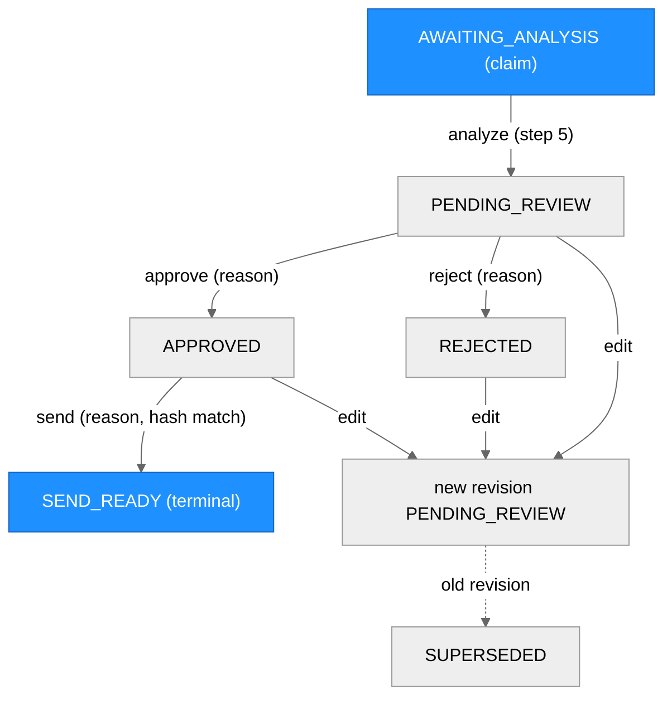

`AWAITING_ANALYSIS` is a claim status only (imported claims, no packet yet). Since run
`REQ-20261010-step5-analysis` the analyze action creates packet revision 1 in `PENDING_REVIEW` and moves the
claim there; nothing returns to `AWAITING_ANALYSIS`. See
[claim analysis (step 5)](#web-platform-claim-analysis-step-5).

Every action needs a reason and writes an append-only `approvals` row plus an audit event in one
transaction, with the claim row locked `FOR UPDATE`. Approve records the packet's canonical content hash.
Send recomputes it and requires it to equal both the approval's hash and the stored hash. "Send" only
marks the demand send-ready: no email, no payment. The DB trigger `fr_packet_update_guard` enforces
the same transitions and makes every column except `status` immutable. Edit creates a new revision; the
approval row records the base revision (deviation 18). Since run `REQ-20261009-four-eyes`, approve and
reject are also refused (403 `four_eyes_required`) for anyone who created any revision of the claim's
packet; see [four-eyes](#web-platform-four-eyes-separation-of-duties).

| Function | Defined In | Called By | Purpose |
| --- | --- | --- | --- |
| `canTransition`, `targetStatus` | `api/src/claims/state-machine.ts` | claims service | transition table (mirrors the SQL trigger) |
| `packetContentHash` | `api/src/claims/content-hash.ts` | approve, edit, send, viewer integrity | canonical hash with ordinals instead of UUIDs |
| `lockClaimForUpdate` | `api/src/db/tenant.ts` | claims service | serializes concurrent decisions |
| `appendAudit` | `api/src/audit/audit.ts` | every mutating handler, cross-tenant read | chain append in the caller's transaction |
| `crossTenantRead` | `api/src/platform/cross-tenant.ts` | platform routes | audit first, then read, fail closed |

## AWS mapping (web stack)

`infra/` replaces `deploy/terraform/` **for the web stack only**. It follows the principles in
[deploy/aws.md](deploy/aws.md): secrets come from Secrets Manager through the task definition and are
never in state, migrations run as a one-shot ECS task before the rollout, the WAF sits in front, and
nothing is applied automatically.

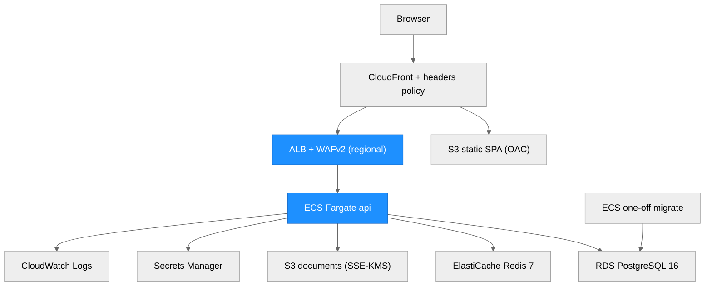

| Component | Local (`compose.web.yml`) | AWS (`infra/`) |
| --- | --- | --- |
| SPA | nginx-unprivileged, headers from `web/security-headers.json` | S3 + CloudFront (OAC), response-headers policy generated from the same JSON |
| API | `api` container (uid 10001, read-only root fs, caps dropped) | ECS Fargate, same hardening, private subnets, VPC endpoints (no NAT) |
| Edge | loopback only | ALB reachable only from CloudFront origin ranges, TLS 1.2/1.3 policy, WAFv2 (managed rules, IP rate limit, Content-Length > 64 KiB; step 3: the upload route has its own > 10 MiB rule) |
| DB | `postgres:16.15-alpine` + `00-roles.sql` | RDS PostgreSQL 16, KMS, `rds.force_ssl=1`, managed master password; roles applied by an operator |
| Rate-limit store | `redis:7-alpine` | ElastiCache Redis 7, TLS + at-rest encryption, AUTH token set out of band |
| Documents | MinIO (`chainguard/minio`) with built-in KMS (`fr-dev-key`) and versioning | S3 SSE-KMS (puts without the CMK are denied by bucket policy), versioning, lifecycle; task role limited to the `t/*` prefix, `s3:DeleteObject` only on `t/*/imports/*` |
| Secrets | public `local-dev-*` values (refused in production) | 7 Secrets Manager containers; values set out of band |

## Architectural Patterns

- **Security pipeline as one hook**: an exact, testable order (rate → Origin → CSRF → authN → authZ → validation).
- **Fail closed everywhere**: unknown routes refuse to boot; unset tenant means zero rows; an audit failure rolls back the business change; the production config refuses dev values.
- **Shared contract package**: roles, matrix and DTOs are defined once in `@fr/shared` and used by API and web.
- **Defense in depth in the database**: RLS, grants and triggers enforce the invariants even if application code is wrong.
- **Content-addressed approvals**: decisions bind to a canonical hash, not to a mutable row.

## Notes

- Deviations from the brief: Node 22 instead of 20 (Node 20 is EOL); a Prisma client extension instead of the removed `$use` middleware; eslint 9; framer-motion omitted. The full list (22 items) is in the run's `implementation.md`.
- Not verified: Docker images and the compose stack, Playwright e2e, any AWS deployment. See the threat model's "Known gaps".

---

# Web platform: import and export (step 3)

> Written by scriber for run `REQ-20261008-step3-import-export` on 2026-10-09 (branch
> `feat/import-export`). **Pre-product, synthetic data only, never deployed.** Threat rows for this step
> are T18-T31 in [technical/web-platform-security.md](technical/web-platform-security.md). The
> email-forward path is design only: [docs/design/email-ingest.md](docs/design/email-ingest.md).

## Overview (step 3)

Step 3 adds document **import** and **export**. Import covers upload, sniffing, encrypted storage,
sandboxed parsing, deterministic extraction with provenance, human review and commit to claims. Export
streams claims, packets and approval outcomes as CSV or XLSX, with formula neutralization. Step 3 does
not add OCR, AI or LLM calls, outbound email or email-forward ingestion. The parsing and extraction
logic is a TypeScript port of the Python `ingest/` and `extraction/` modules. Parity tests check it
against the Python code. Python is a test oracle only and never runs in production.

Main decisions:

- The pipeline is **synchronous** inside the upload request and bounded by timeouts. The status model
  already allows a queue later.
- The API **proxies** originals. There are no signed URLs.
- PDFs are read from the text layer only. Images are stored and flagged for manual entry.
- Claims created from imports start in the new status `AWAITING_ANALYSIS`, with no money and no packet.
  Step 5 adds the analysis ([claim analysis (step 5)](#web-platform-claim-analysis-step-5)).

## Module Structure (step 3)

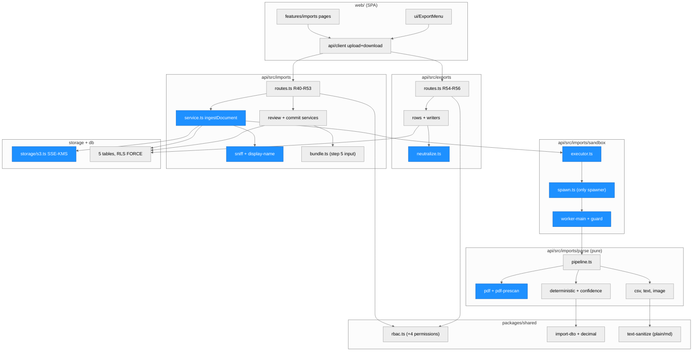

> Everything in this diagram is new or changed in step 3. Blue marks the modules that handle hostile
> bytes or hostile cell content.

### Module Reference (step 3)

| Module / File | Layer | Purpose | Key Exports | Changed |
| --- | --- | --- | --- | --- |
| `packages/shared/src/rbac.ts` | Shared | Adds `import:review`, `export:claims`, `export:packets`, `export:outcomes`; `import:run` now has routes | `PERMISSION_MATRIX`, `can` | changed |
| `packages/shared/src/import-dto.ts`, `import-fields.ts`, `extraction.ts` | Shared | Strict Zod DTOs for R40-R56, field keys and labels, reason codes, TS mirror of the Python `ExtractedBundle` | schemas, `FIELD_LABELS` | new |
| `packages/shared/src/decimal.ts` | Shared | Python-compatible `parseMoney`, integer micros, compare; no floating point | `parseMoney`, `toMicros`, `fromMicros`, `compareDecimal` | new |
| `packages/shared/src/text-sanitize.ts` | Shared | Port of `evidence/sanitize.py` with parity | `plain`, `md` | new |
| `api/src/imports/routes.ts` | API | R40-R53; raw `application/octet-stream` body on R43 only | `registerImportRoutes` | new |
| `api/src/imports/service.ts` | API | `ingestDocument` (single entry for upload and a future email worker), batch reads, stale reaper, verifying download stream | `ingestDocument`, `reapStale`, `prepareDownload`, `VerifyingStream` | new |
| `api/src/imports/sniff.ts`, `display-name.ts`, `body.ts` | API | Magic-byte sniffing and the extension rule; display-name sanitizing; bounded streaming body reader with idle timeout | `sniff`, `displayNameFor` | new |
| `api/src/imports/review-service.ts` | API | Confirm, correct or reject fields; add manual fields; set the type; accept or reject the document (row lock, decision row, audit) | `resolveField`, `addField`, `setDocType`, `acceptDocument`, `rejectDocument`, `reviewQueue` | new |
| `api/src/imports/commit-service.ts` | API | Groups accepted documents by normalized load number; creates or links claims (`AWAITING_ANALYSIS`) | `commitBatch`, `claimDocuments`, `normalizeLoadNumber` | new |
| `api/src/imports/bundle.ts` | API | Builds the TS `ExtractedBundle` from effective field values; citation locators (step 5 input) | `assembleBundle`, `loadBundleForClaim`, `pointerToLocator` | new |
| `api/src/imports/sandbox/executor.ts` | API | Semaphore, wall clock, output cap, RSS poll (Linux), exit-code mapping, strict response validation | `ChildProcessExecutor`, `ParseExecutor`, `ParserBusyError` | new |
| `api/src/imports/sandbox/spawn.ts` | API | The only `child_process` importer: fixed argv, `shell:false`, empty env, empty cwd, `--permission` | `startWorker`, `workerArgs`, `workerEnv` | new |
| `api/src/imports/sandbox/worker-main.ts`, `guard.ts`, `protocol.ts` | Worker | Worker entry (stdin to stdout); network and module guard preloaded with `--import`; versioned protocol | `validateWorkerResponse` | new |
| `api/src/imports/parse/*` | Parse | Pure port of `ingest/loader.py` and `extraction/stub.py`: text primitives, classification, CPython-compatible CSV and `strptime`, PDF text layer, PDF pre-scan, image structure checks, deterministic provider, confidence | `parseDocument`, `prescanPdf`, `ExtractionProvider`, `getProvider` | new |
| `api/src/exports/*` | API | R54-R56: count, `export.started`, keyset batches of 500, streaming CSV and XLSX (fflate), neutralization, `export.completed` / `export.aborted` | `registerExportRoutes`, `csvStream`, `xlsxStream`, `neutralizeFormula`, `cleanText`, `formatCents` | new |
| `api/src/storage/s3.ts` | Data | `putObject` (SHA-256 checksum, SSE-KMS), `headObject` verify, `getObjectStream`, `deleteObject`; every call checks the tenant prefix | `ObjectStore`, `tenantKey`, `isKeyInTenant` | changed |
| `api/src/db/claim-numbers.ts`, `claim-load-key.ts`, `import-locks.ts` | Data | `CLM-%04d` numbers under a tenant advisory lock; normalized load-number lookup; batch and document row locks | `nextClaimNumber` | new |
| `api/prisma/migrations/20261009000000_import_export/` | Data | 5 tenant tables, enums, CHECKs, RLS FORCE, column grants, immutability and append-only triggers, `AWAITING_ANALYSIS` | | new |
| `api/scripts/ensure-bucket.ts` | Ops | Creates the dev/CI bucket and enables versioning; refuses `NODE_ENV=production` | | new |
| `web/src/features/imports/*`, `web/src/components/ui/ExportMenu.tsx`, `web/src/api/client.ts` | Web | Import page, review queue, fields table, export menus, XHR upload with progress, blob download | pages, `ApiClient.upload`, `ApiClient.download` | new / changed |
| `tools/parity/extract_dump.py`, `sanitize_dump.py`, `api/test/parity/` | Test | Python oracle dumps and the parity comparison (registered divergences only) | | new |
| `infra/{s3,iam,ecs,waf,variables}.tf`, `compose.web.yml`, `.github/workflows/web-ci.yml` | Ops | Bucket deny rules and lifecycle, scoped `s3:DeleteObject`, ECS env, WAF upload exception, MinIO KMS and versioning, CI MinIO and build order | | changed |

## Import pipeline (data flow)

One upload is one `POST /api/v1/imports/:batchId/documents?filename=` request with the raw file bytes.
The pipeline runs synchronously, and the response carries the final document state.

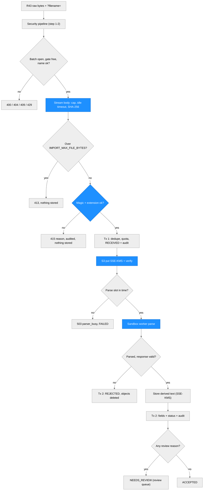

The steps in detail:

1. **Upload.** The client sends the raw bytes (`Content-Type: application/octet-stream`, no multipart).
   The file name is a query parameter and is sanitized into a display name. The client's media type is
   never used. Rate limit, Origin, CSRF, authentication and permission all run before the body is read.
2. **Sniff.** The API accepts `%PDF-` at offset 0, the PNG signature or `FF D8 FF`. Anything else is a
   text candidate. A text candidate must contain no NUL, C0 control or DEL byte other than HT, LF, CR
   and FF, and must not start like HTML, SVG, XML or PHP. Known non-allowed signatures are refused (zip,
   gzip, PE, ELF, GIF, RIFF, OLE, PostScript, rar, 7z). The last extension must be one of
   `.pdf .png .jpg .jpeg .csv .txt` and must agree with the sniffed type.
3. **Store.** Transaction 1 inserts the `RECEIVED` row and its audit event before any slow I/O. The
   original goes to `t/<tenantId>/imports/<batchId>/<docId>/original` with SSE-KMS and a SHA-256
   checksum. In production a `HEAD` request verifies the encryption. Keys never contain the client file
   name.
4. **Isolated parse worker.** `ChildProcessExecutor` takes a slot from a per-instance semaphore. It
   starts `node` with `--permission`, which grants read access to the worker files only. The worker gets
   no write, child-process, worker, addon or WASI permission. It also gets `--max-old-space-size`, an
   **empty environment** and an empty working directory. A best-effort, in-process guard module deletes
   `fetch`, `WebSocket`, `EventSource` and `XMLHttpRequest`, blocks the network, process and VM modules,
   and locks socket `connect` on the classes reachable from the stdio streams. It is not a security
   boundary: the real network control is a no-egress network (in AWS the no-NAT task network), and a
   dedicated no-egress parser task is a launch gate. The parent
   enforces the wall clock, the output cap and (on Linux) an RSS limit. The parent also treats the
   worker as untrusted. It re-validates the whole response (allowed keys, counts, pointer bounds,
   re-sanitized strings), and an invalid response becomes `parse_failed`.
5. **PDF pre-scan.** `pdf-prescan.ts` walks the PDF structure with fixed bounds before pdf.js sees the
   file. It rejects these as `malformed_pdf`: more than 3 chained filters, an indirect `/Filter`,
   decompression bombs (32 MiB per stream, 64 MiB in total), `/Prev` loops, more than 64 xref sections,
   page trees larger than the page count plus 16, and zero pages. It also counts the string operands of
   the content streams, including text drawn outside the page box, so the `PARSE_MAX_TEXT_CHARS` cap
   holds (`text_too_large`). pdf.js then reads the text layer only. It reads no annotations,
   attachments, JavaScript or XFA.
6. **Extraction with provenance.** The deterministic provider (`deterministic`, version 1) reads
   `Key: value` lines and produces allow-listed fields only. Every field has a source pointer (page,
   line, UTF-16 start and end, CSV row, sanitized excerpt) and a rule-based confidence. A field is
   flagged when its confidence is below `REVIEW_CONFIDENCE_THRESHOLD` (0.90), when its value is
   unparseable, or when duplicates conflict. PDF fields start at 0.85, so every PDF field is flagged by
   default.
7. **Review.** A document with any review reason is `NEEDS_REVIEW` and appears in the review queue
   (`GET /reviews`). A reviewer confirms, corrects or rejects each flagged field. For images the
   reviewer can also set the type and add manual fields. Then the reviewer accepts or rejects the
   document. Every action needs a reason. Each decision is an append-only `import_review_decisions` row
   plus an audit event. ACCEPTED documents are immutable.
8. **Commit.** `POST /imports/:batchId/commit` groups the batch's ACCEPTED documents by normalized load
   number (NFKC, whitespace collapsed, upper case). It then creates an `AWAITING_ANALYSIS` claim or links
   to an existing one. If the claim already has a packet, the documents are only linked
   (`new_evidence_not_in_packet`), and its packet and fields never change. The commit is atomic and
   idempotent.

### Function call graph (upload)

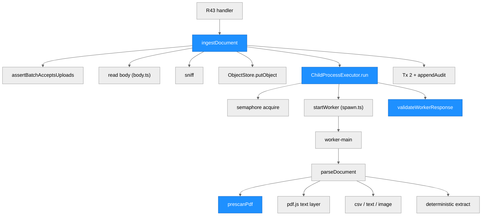

| Function | Defined In | Called By | Purpose |
| --- | --- | --- | --- |
| `ingestDocument` | `api/src/imports/service.ts` | R43 (later also an email worker) | the whole synchronous pipeline |
| `sniff` | `api/src/imports/sniff.ts` | `ingestDocument` | magic bytes, text gate, extension rule |
| `ChildProcessExecutor.run` | `api/src/imports/sandbox/executor.ts` | `ingestDocument` | slot, spawn, limits, outcome mapping |
| `startWorker` | `api/src/imports/sandbox/spawn.ts` | executor | the only process spawn in `api/src` |
| `parseDocument` | `api/src/imports/parse/pipeline.ts` | worker-main (and unit tests) | PDF/CSV/TXT/image to text, classify, extract |
| `prescanPdf` | `api/src/imports/parse/pdf-prescan.ts` | `pdf.ts` | bounded structural checks before pdf.js |
| `validateWorkerResponse` | `api/src/imports/sandbox/protocol.ts` | executor | strict re-validation of the worker output |
| `resolveField`, `acceptDocument` | `api/src/imports/review-service.ts` | R48, R49 | human review gate |
| `commitBatch` | `api/src/imports/commit-service.ts` | R52 | documents to claims under an advisory lock |
| `loadBundleForClaim` | `api/src/imports/bundle.ts` | step 5 analysis (via `loadAnalysisInput`, which adds provenance) | claim documents to `ExtractedBundle` |

## Document and field states

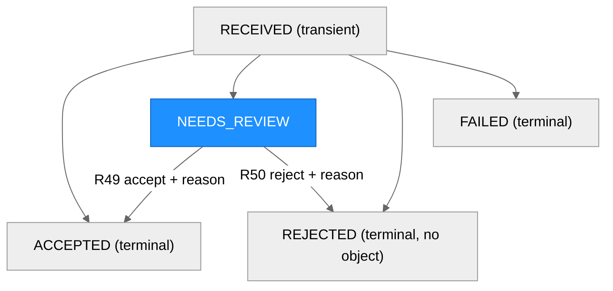

A field moves once from `PROPOSED` to `CONFIRMED`, `CORRECTED` or `REJECTED`. A BEFORE UPDATE trigger
enforces the transitions and keeps the extracted value, raw value, confidence and pointers immutable. A
`RECEIVED` document older than `IMPORT_STALE_SECONDS` becomes `FAILED` the next time its batch is read,
and its object is removed.

Since run `REQ-20261009-four-eyes`, R49 (accept) is refused with 403 `four_eyes_required` for the
document's uploader and for anyone who recorded a field `CORRECT` or `ADD` on it; see
[four-eyes](#web-platform-four-eyes-separation-of-duties). A document that goes straight from `RECEIVED`
to `ACCEPTED` (no review reasons) has no human acceptor (residual FE-S1).

## Data model and storage

| Table | Purpose | Notable rules |
| --- | --- | --- |
| `import_batches` | one upload session (later also one email) | insert and select only |
| `import_documents` | one file: sniffed type, sha256, status, reasons, counts, `storage_key` | `UNIQUE (tenant_id, batch_id, sha256)`; `storage_key LIKE 't/<tenant_id>/%'`; identity columns immutable; status transitions enforced by trigger; no DELETE |
| `extracted_fields` | one field with value, raw value, confidence, pointer and review status | immutable except status and correction; one live field per key (partial unique index) |
| `import_review_decisions` | every reviewer decision, with the reason and value hashes (never values) | append-only |
| `claim_documents` | links a document to at most one claim | insert-only |

All five tables have `ENABLE` and `FORCE ROW LEVEL SECURITY` with the tenant policy and column-level
grants for `freight_app`. They are allow-listed in `TENANT_MODELS`. Object storage is private.
Originals and derived text live under `t/<tenantId>/imports/<batchId>/<docId>/{original,text}`. Every
`ObjectStore` call re-checks the tenant prefix, and the API never returns a storage URL.
`GET .../original` streams the object through the API under a synthesized file name. It verifies the
SHA-256 of the streamed bytes and aborts on a mismatch.

## Export streaming

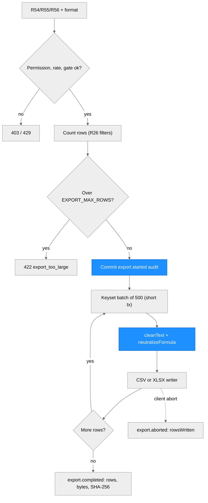

- **Formats.** CSV is UTF-8 with a BOM and CRLF, and every text cell is quoted. XLSX is one sheet,
  written as a streaming ZIP by `fflate`. It has typed strings and numbers and a bold, frozen header. It
  has no formulas, links, macros, drawings or external relationships.
- **Formula neutralization.** Text cells lose C0/C1 controls and bidi and zero-width characters. Tab,
  CR, LF, LS and PS become one space. Cells are capped at 10,000 characters. If the first
  non-whitespace character is `=`, `+`, `-`, `@` or a full-width form (U+FF1D, U+FF0B, U+FF0D, U+FF20),
  the cell gets a leading `'`. Numbers are written as numbers and are never neutralized.
- **Bounded memory.** Each batch of 500 rows uses its own short transaction, so no transaction stays
  open while the client reads. The writers honour backpressure.
- **Content.** Exports contain no user names, emails or ids. The claim assignee is excluded, and so is
  the demand letter text. Money is USD with two decimals, computed with integer arithmetic.
  `Invoice Date` is `YYYY-MM-DD`; timestamps are ISO-8601 UTC.

## Python parity: registered divergences (D1-D8)

The TypeScript parser must match the Python reference (`ingest_bytes`, `classify`,
`DeterministicStubProvider.extract`) for the supported subset. `api/test/parity/extract.parity.test.ts`
runs the Python code through `tools/parity/extract_dump.py`. It covers the fixture corpus, a generated
corpus and generated text-layer PDFs, and compares document type, sha256, text and fields. The
divergences below are the **only** allowed differences. Any other difference is a defect.

| ID | Divergence (TS vs Python) | Rationale |
| --- | --- | --- |
| D1 | PDF magic `%PDF-` must be at offset 0. Python tolerates up to 1024 junk bytes before it. | Leading junk is a classic polyglot trick (one file that is both a PDF and something else). Offset 0 makes the sniffed type unambiguous. |
| D2 | PDF text comes from pdf.js, not pdfplumber. Parity is claimed only for simple text-layer PDFs: one text line per line, standard Helvetica or Times, single column. | pdfplumber is Python-only, and the TS port must not call Python at runtime. Two engines order and space text differently on complex layouts. |
| D3 | The extension and the sniffed content type must agree. Allowed extensions: `.pdf .png .jpg .jpeg .csv .txt` (case-insensitive, last extension only). Python dispatches on the extension alone. | Stops a PDF or script disguised as `.csv` (and the reverse) from reaching the wrong parser. |
| D4 | Invalid UTF-8 is decoded with U+FFFD, as in Python, but adds the warning and review reason `DECODE_REPLACEMENTS`. A NUL byte, a C0 control byte other than HT, LF, CR and FF, **or DEL (0x7F)** rejects the file as `binary_content`. Python would continue. | Binary content in a "text" file signals a disguised or corrupted file. The DEL rule was added in fix round 1 (leader ruling SQ2). Python has no binary gate, so DEL has no Python counterpart. |
| D5 | Text longer than `PARSE_MAX_TEXT_CHARS` (default 2,000,000) is rejected as `text_too_large`. Python's cap is 5,000,000. For PDFs the cap also counts text drawn outside the page box (fix round 1 pre-scan). | A smaller bound on parser memory and time. |
| D6 | String values lose unsafe characters (controls, line separators, bidi controls) and are capped at 200 characters. The field gets reason `SANITIZED_VALUE` when anything changed. | Extracted strings are shown in the UI and exported, so they must be safe, single-line text. |
| D7 | Non-ASCII digits and exotic Unicode case folding are refused where Python's regexes would accept them. Date and time digits are ASCII `0-9` only, and the `USD` suffix matches ASCII letters only. | Stops look-alike digits and letters from changing amounts or dates. |
| D8 | PNG and JPEG are accepted and structurally validated but yield **no fields** (no OCR). The status is `NEEDS_REVIEW` with reason `IMAGE_NO_TEXT_LAYER`. A reviewer may set the type (R46) and enter fields (R47). | Python does not read images, and OCR is out of scope for step 3. |

Related notes (not new divergences):

- **Money format** (leader ruling SQ1): `parseMoney` keeps CPython parity, so `"1,2,3"` parses as `123`
  and `"$-5"` as `-5`. A later step may make money parsing stricter (step 5 did not). That change would be
  registered as a new divergence. Step 5 refuses a negative result at persistence instead (RD3, 422).
- **PDF pre-scan** (fix round 1): the pre-scan refuses bombs, filter chains longer than 3, an indirect
  `/Filter`, `/Prev` loops and oversized page trees before pdf.js runs. These hostile PDFs lie outside
  the D2 parity subset.
- **PNG trailing bytes** (fix round 1): up to 16 zero bytes after `IEND` are tolerated, the same rule as
  for JPEG. Images have no Python counterpart (D8).
- **`strptime` edge case**: parity follows CPython 3.12 for a leading space before `%H` or `%d`. CPython
  3.14 differs. The corpus avoids that case, and both versions show zero differences.
- **Field order** (ruling SQ4): fields are ordered by the N7 key order, then by `groupIndex`.

## Interfaces for step 5 (rules and evidence port)

**Status: delivered** in run `REQ-20261010-step5-analysis` (see
[claim analysis (step 5)](#web-platform-claim-analysis-step-5)). Items 1-6 are used as described below;
item 7 (an LLM provider) and stricter money parsing remain future work. Step 5 ported the Python rules and
evidence generation to TypeScript, with parity tests. It plugs into these step 3 interfaces:

1. **Input.** `loadBundleForClaim(tx, claimId)` returns `{bundle, sources}`. `bundle` is the TS
   `ExtractedBundle`, built from the effective field values of the claim's linked documents. Step 5
   added `loadAnalysisInput(tx, claimId)` (same document selection and order, plus field provenance and
   `sizeBytes`); `loadBundleForClaim` now delegates to it with an unchanged signature. The engine entry is
   `buildEvidence(docs, bundle, perspective, settings, now)` in `@fr/shared/analysis`. The Python
   counterpart is `run_pipeline` after `extract_bundle`.
2. **Provenance.** `pointerToLocator(displayName, pointer)` produces citation locators such as
   `invoice.txt:L5`, or `file.pdf:p2:L14` for PDFs. The seed already uses this convention. `sources[]`
   carries `documentId`, `displayName`, `sha256` and `docType` for `PacketSource`.
3. **Money.** `packages/shared/src/decimal.ts` is the base for money parsing. Step 5 added
   `packages/shared/src/analysis/py-decimal.ts`, a CPython-exact `Decimal` (precision 28, ROUND_HALF_EVEN,
   quantize, `str` and `.2f` formatting) for the rules arithmetic.
4. **Text.** `plain` and `md` (`packages/shared/src/text-sanitize.ts`) are already ported with parity.
   The letter renderer reuses them.
5. **Claim lifecycle.** Step 5 added the transition `AWAITING_ANALYSIS -> PENDING_REVIEW`. The same
   transaction creates packet revision 1 (with its content hash) and the `claim.analyzed` audit event.
   `claim_documents` names the source documents. Revision 1 records `created_by_id` as the user who
   triggered the analysis, so that user cannot approve it (four-eyes FE-N2 closed; the migration
   `20261012000000_analysis` refuses a revision 1 without an author for an awaiting claim).
6. **Parity pattern.** `tools/parity/` and `api/test/parity/` are the pattern for the rules dump
   script. CI already sets up Python. Step 5 added `tools/parity/rules_dump.py` and
   `api/test/parity/rules.parity.test.ts` (registered divergences RD1-RD6).
7. **Providers.** `ExtractionProvider` is where an LLM provider will plug in later, behind sanitization
   and with mandatory provenance. A future provider must return the same draft shape and pass the same
   validators. It can never lower a flag raised by the deterministic checks.

## How to run the step 3 checks

```bash
npm run db:migrate:deploy && npm run db:seed -- --reset
npm run ensure-bucket        # creates the dev/test bucket (MinIO), enables versioning; refuses production
npm run build                # builds the parser worker; run it before the integration and acceptance tests
npm run test:integration     # needs Postgres, S3 (MinIO) and Python for the parity suite (PYTHON=<interpreter>)
npm run test:acceptance      # black-box suites; same services
```

The README section "Import and export (step 3)" describes the local setup without Docker: portable
PostgreSQL, MinIO with KMS, and Python for parity.

## Notes (step 3)

- The run's `implementation.md` lists the deviations from the spec (14 items plus fix round 1). The most
  important two: the worker is not started with `--no-experimental-fetch` (the guard deletes the network
  globals instead), and the WAF Content-Length rule has a dedicated exception for the upload route.
- Concurrency gates (uploads, exports, parse slots) are per API instance, not distributed.
- Not verified: container images, the compose stack, Playwright end-to-end tests, any AWS deployment.

---

# Web platform: Dev dashboard, Recovery intelligence and API keys (step 4)

> Written by scriber for run `REQ-20261009-step4-intelligence` on 2026-10-09 (branch
> `feat/intelligence`). **Pre-product, synthetic data only, never deployed.** Threat rows for this step are
> T32-T45 in [technical/web-platform-security.md](technical/web-platform-security.md). Every secret is
> listed in [docs/secrets.md](docs/secrets.md). User-facing description:
> [README, step 4](README.md#dev-dashboard-recovery-intelligence-and-api-keys-step-4).

## Overview (step 4)

Step 4 adds four things on top of steps 1-3:

1. **Dev dashboard** (`/dev`, routes R60-R68) for `PLATFORM_DEV` and `SUPER_ADMIN`: pipeline health
   aggregated over all tenants, request telemetry and a filtered log view of the serving API instance,
   feature flags, read-only evaluation runs, and the platform audit chain. Platform responses carry
   aggregates and telemetry only.
2. **Recovery intelligence** (routes R70-R73) for tenant users: a prioritised worklist (`priority-v1`),
   similar past claims (`similar-v1`) and a provenance summary per claim. All three are deterministic
   functions of persisted columns of the caller's own tenant.
3. **Tenant API keys** (routes R80-R82 plus a machine-authentication path): HMAC-hashed, shown once,
   three scopes over exactly nine opted-in routes.
4. **Evaluation tool** (`api/src/eval/`, a command-line program): pass^k over the synthetic set
   `api/eval/sets/extraction-v1`, run through the real sandboxed parse pipeline; the only writer of
   evaluation data.

Binding rule for all of it (the **honest-labeling rule**): nothing is shown that is not computed from data
held by the system at request time or recorded by a measuring tool, every figure names its basis, and no
accuracy, speed-up, learning or "AI" claim appears. The fixed texts live in
`packages/shared/src/honest-copy.ts`; the UI renders them verbatim. An architecture test fails the build
if the strings "neural mesh", "Hebbian", "solved-problems cache", "AI-powered", "faster than" or an
"Nx faster" pattern appear in `api/src`, `packages/shared/src` or `web/src`.

## Brief terms vs what is built

The product brief uses vocabulary that this code does **not** implement. None of the following exists in
the repository, and no figure from the brief has been measured:

| Brief term | Status | What is built instead (honest equivalent) |
| --- | --- | --- |
| "Hebbian router" (ranks claims/lanes by expected recoverable value) | **Not implemented.** A Hebbian or any learned ranker needs recorded recovery outcomes (paid, short-paid, denied), and none exist. Lanes are not modelled. | `priority-v1`: a fixed formula `recoverable + floor(pending_review * W / 100)` with W = 25% as stated policy, explicit tie-breaks and a "why" list per row. Not called "expected value" (there are no probabilities). |
| "Neural mesh" (panel / metrics) | **Not implemented.** There is no neural component in the product. (`src/freight_recovery/forecast/neural.py` is optional, unvalidated roadmap scaffolding for the Python service and is wired to nothing.) | The "Intelligence components" table on the Telemetry tab: the two components `priority-v1` and `similar-v1` with measured calls, errors, duration bounds and candidate counts from real requests, labeled Method "Fixed rules" and Learned model "None". |
| "Solved-problems cache" with "~250x" | **Not implemented.** There is no cache of any kind, and the ~250x figure was never measured. "Winning evidence pattern" would need outcomes that do not exist. | `similar-v1`: explainable integer similarity (same carrier 35, shared rules up to 40, similar amount up to 15, same perspective 10; anchor required; minimum 30) over the tenant's own decided claims, showing how the team handled each one. It shows the measured `computeMs` of that single request and nothing resembling a speed-up ratio. |
| "AI extraction with provenance" | Exists since step 3 as **deterministic, rule-based** extraction with source pointers (no LLM). | Step 4 adds the per-claim provenance summary (field counts by review status, lowest rule-based confidence). |
| "pass^k metrics" | **Built, on synthetic fixtures only.** | The evaluation tool and the read-only Evaluation tab. With this deterministic pipeline pass^k equals pass^1, and the UI says so. Never presented as accuracy on customer documents. |

What a learned ranker would need (deferred, design only): recorded outcomes per claim; an offline
comparison against `priority-v1` on a held-out period with a pre-registered metric (for example captured
dollars at fixed review capacity) and an interval; and shipping only behind a new flag if it beats the
fixed formula with the interval excluding zero. The seam is the pure `scoreClaim`/`compareWorklist` pair
plus the `formula.version` field.

## Module Structure (step 4)

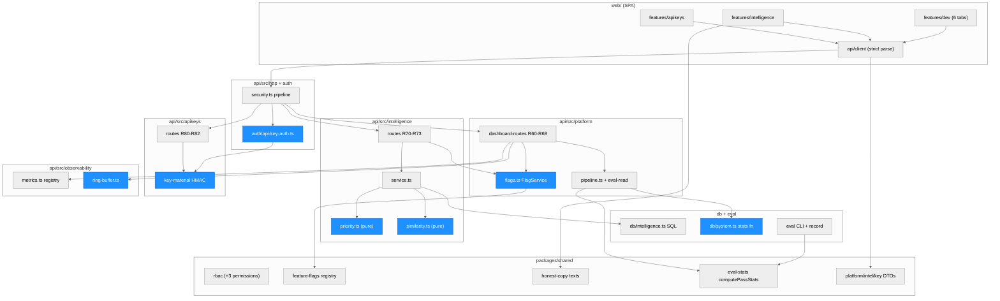

> Everything in this diagram is new or changed in step 4. Blue marks the security-relevant modules (key
> authentication, key hashing, the flag cache, log derivation, the cross-tenant aggregate function) and
> the two scoring cores.

### Module Reference (step 4)

| Module / File | Layer | Purpose | Key Exports | Changed |
| --- | --- | --- | --- | --- |
| `packages/shared/src/rbac.ts` | Shared | Adds `platform:eval` (PLATFORM_DEV), `platform:audit` (SUPER_ADMIN), `apikeys:manage` (OWNER, ADMIN) | `PERMISSION_MATRIX`, `can` | changed |
| `packages/shared/src/feature-flags.ts` | Shared | The flag registry: exactly `intelligence.provenance`, `intelligence.similar_claims`, `intelligence.worklist` (architecture test) | `FEATURE_FLAGS`, `isKnownFlag` | new |
| `packages/shared/src/honest-copy.ts` | Shared | The fixed honest texts (worklist, similar, provenance, no-accuracy, eval, telemetry, logs, pipeline notes) | `WORKLIST_NOTE`, `worklistNote`, `EVAL_NOTE`, ... | new |
| `packages/shared/src/eval-stats.ts` | Shared | pass^k statistics: per-run rate, pass^k, unbiased pass^j curve, flaky counts, Wilson 95% interval (z = 1.959964) | `computePassStats`, `binomial`, `wilsonInterval` | new |
| `packages/shared/src/{platform,intelligence,api-key}-dto.ts` | Shared | Strict Zod schemas for every step 4 request and response; the web client and the API both parse with them | schemas, `API_KEY_SCOPES`, `SCOPE_PERMISSION` | new |
| `api/src/http/security.ts`, `http/route.ts`, `http/context.ts` | API | URL guard (`fr_live_` in a URL = 400), the key branch of the pre-handler, `apiKeyScope` on route access, `RequestCtx.role = 'API_KEY'` with `viaApiKey` | `registerSecurityPipeline`, `defineRoute` | changed |
| `api/src/auth/api-key-auth.ts` | API | Machine authentication: per-IP failure gate, format, lookup, constant-time HMAC compare, state checks, route and scope checks, creator re-check, per-key limit, context | `ApiKeyAuthenticator`, `FailureGate` | new |
| `api/src/apikeys/{key-material,service,routes}.ts` | API | Key generation (`randomBytes`), HMAC-SHA-256 with the pepper, quota under a tenant lock, R80-R82 | `generateKey`, `verifySecret`, `createApiKey`, `revokeApiKey` | new |
| `api/src/audit/attribution.ts` | API | Adds `viaApiKey` and actor role `API_KEY` centrally in `appendAudit` for key-authenticated requests (DV-7) | `registerApiKeyRequest`, `apiKeyFor` | new |
| `api/src/platform/dashboard-routes.ts` | API | R60-R68: audited platform reads, strict outgoing schemas (`strictBody`), `platform` rate group | `registerPlatformDashboardRoutes` | new |
| `api/src/platform/flags.ts` | API | `FlagService`: per-instance TTL cache, fail closed, row lock + optimistic version + audit in one system transaction | `FlagService`, `validFlagReason` | new |
| `api/src/platform/pipeline.ts`, `eval-read.ts` | API | Assemble `PipelineHealth` from the SQL function (zero-fill, rates); read eval runs | `assemblePipelineHealth`, `listEvalRuns`, `getEvalRun` | new |
| `api/src/intelligence/priority.ts` | Core | `priority-v1`: score, 4-key order, "why" texts, next action (pure, integer cents) | `scoreClaim`, `compareWorklist`, `buildWhy`, `nextAction` | new |
| `api/src/intelligence/similarity.ts` | Core | `similar-v1`: carrier normalization, point scoring, inclusion rule, ranking (pure) | `scoreSimilarity`, `rankSimilar`, `normalizeCarrier` | new |
| `api/src/intelligence/{service,routes}.ts` | API | R70-R73: flag check first (off = 404), tenant-tx reads, component telemetry, `intelligence.viewed` audit | `buildWorklist`, `findSimilar`, `provenanceFor` | new |
| `api/src/db/intelligence.ts` | Data | Parameterized raw SQL for worklist, similarity features and provenance, run on the caller's tenant transaction (raw SQL stays in `db/`, DV-1) | `worklistPage`, `similarityFeatures`, `provenanceRows` | new |
| `api/src/db/system.ts` | Data | Adds `platformPipelineStats` (calls `fr_platform_pipeline_stats`) and `lockFeatureFlag` | | changed |
| `api/src/observability/metrics.ts` | API | `MetricsRegistry`: 11 fixed duration buckets, at most 200 route keys, nearest-rank bucket bounds, component stats; no I/O | `MetricsRegistry`, `DURATION_BOUNDS` | new |
| `api/src/observability/ring-buffer.ts`, `api/src/logging.ts` | API | Logger tee into a bounded ring of derived 8-field records; `route` in `serializeRes`; `fr_live_` scrubbing | `LogRingBuffer`, `deriveRecord`, `safeEvent` | new / changed |
| `api/src/eval/{manifest,runner,canonical,record,cli,git-sha}.ts` | Tool | Manifest guards, k runs through the real sandbox, canonical digests, stats, `--record` (only DB writer, system tx) | `loadSet`, `runEval`, `EVAL_STAGES`, `recordRun` | new |
| `api/eval/sets/extraction-v1/` | Data | 30 synthetic cases (9 Python-oracle, 9 rejected, 12 hand-authored) and a README | | new |
| `api/prisma/migrations/20261010000000_intelligence/` | Data | `feature_flags`, `eval_runs`, `eval_case_results`, `api_keys`, `fr_platform_pipeline_stats`, RLS FORCE, grants, triggers | | new |
| `web/src/features/dev/*`, `features/intelligence/*`, `features/apikeys/ApiKeysPage.tsx`, `api/client.ts`, `AppShell.tsx` | Web | Dev dashboard (6 lazy tabs), Intelligence page, claim-sheet Similar/Provenance tabs, API keys page, role-aware navigation | pages | new / changed |
| `.github/workflows/web-ci.yml`, `compose.web.yml`, `.env.example`, `infra/{ecs,iam,locals,variables}.tf` | Ops | CI eval gate and public CI pepper, knob passthrough, Secrets Manager container and reference `api-key-pepper` | | changed |

## Request flow: API key vs cookie/JWT authentication

Both kinds of request share the pre-handler in `api/src/http/security.ts`. The branch is chosen only by
the `Authorization` header: `Bearer fr_live_...` is a key request, any other bearer value is a user
access token exactly as before. A key request never consults a cookie, never needs a CSRF token and never
receives a cookie.

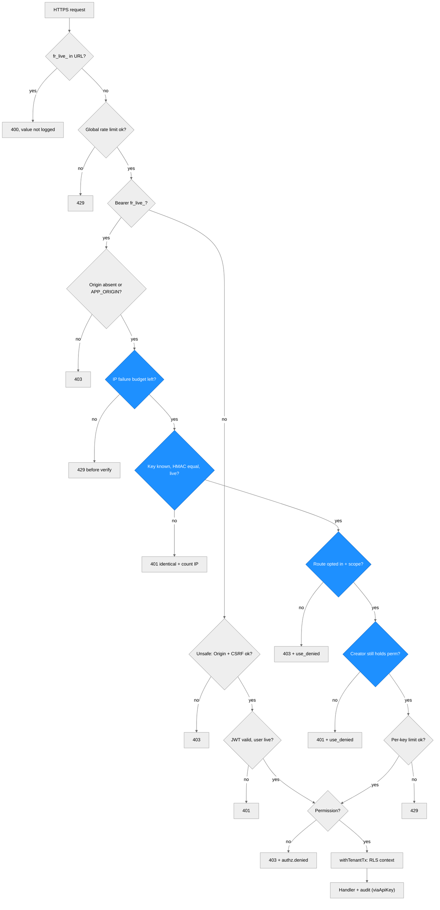

Details of the key path (`ApiKeyAuthenticator.authenticate`):

- **Lookup and compare.** The key is parsed with `^fr_live_[0-9a-f]{16}_[A-Za-z0-9_-]{43}$`. The row is
  found by `key_id` in a system transaction (the `api_keys` RLS policy allows system mode). The presented
  secret is hashed with `HMAC-SHA-256(API_KEY_PEPPER, secret)` and compared with `timingSafeEqual`; an
  unknown key id is compared against a fixed dummy digest, so the work is the same. Unknown, malformed,
  wrong secret, revoked and expired all answer the identical 401.
- **State on every request.** Revocation, expiry, tenant suspension and the creator's status are read
  from the database on every request; nothing about key state is cached, so a revocation is effective on
  the next request on every instance.
- **Route opt-in.** Only routes declared with `access.apiKeyScope` accept keys. An architecture test
  enumerates every route and requires the set to be exactly R26, R27, R53 (`claims.read`), R54
  (`exports.claims`) and R40-R44 (`imports.write`). Any other route answers 403 after a successful key
  authentication, so the denial can be audited (`apikey.use_denied` reason `route`).
- **Confused-deputy guard.** The key's permissions are `SCOPE_PERMISSION[scope]` for its scopes, and the
  creator's **current** role must still hold each one; otherwise 401 (reason `creator`). The tenant comes
  only from the key row; tenant ids in headers, query or body are ignored.
- **Abuse limits.** Failed authentications count per client address in the shared limiter store. Once
  `RATE_LIMIT_API_KEY_FAIL_MAX` (30) failures are reached in 10 minutes, the address is refused with 429
  before any verification until the window ends (the boundary fix D-4: the 31st attempt is refused, using
  the limiter's `remaining` count). The "refuse early" cache is per instance; the counts are shared.
  Successful requests then pass the per-key limiter (`RATE_LIMIT_API_KEY_MAX`, 300 per 60 s).
- **Attribution.** The context is `{tenantId: key.tenant_id, actor: creator, role: 'API_KEY',
  viaApiKey: keyId}`, and the request continues through the same `withTenantTx` path as a user request.
  `appendAudit` adds `viaApiKey` from a request registry (DV-7). `last_used_at` is updated at most once
  per 60 seconds, best effort.

### Function call graph (step 4)

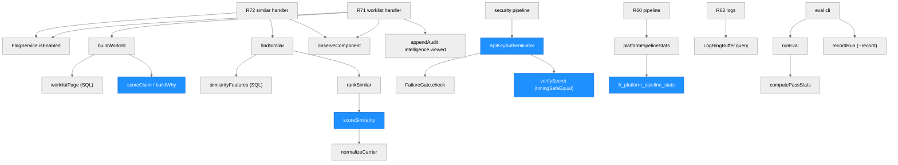

| Function | Defined In | Called By | Purpose |
| --- | --- | --- | --- |
| `scoreClaim`, `compareWorklist`, `buildWhy`, `nextAction` | `api/src/intelligence/priority.ts` | `buildWorklist` | `priority-v1` arithmetic, order and explanation; the SQL `ORDER BY` must agree with `compareWorklist` (integration test on 48 random claims) |
| `scoreSimilarity`, `rankSimilar`, `normalizeCarrier` | `api/src/intelligence/similarity.ts` | `findSimilar` | `similar-v1` points, inclusion (anchor + minimum 30), order; no caching of any kind |
| `worklistPage`, `similarityFeatures`, `provenanceRows` | `api/src/db/intelligence.ts` | intelligence service | parameterized SQL on the caller's tenant transaction, plus explicit `tenant_id = fr_current_tenant()` predicates |
| `FlagService.isEnabled` / `change` | `api/src/platform/flags.ts` | intelligence routes, R63/R64 | TTL-cached read, fail closed; locked, versioned, audited change |
| `ApiKeyAuthenticator.authenticate` | `api/src/auth/api-key-auth.ts` | security pipeline | machine authentication (see above) |
| `MetricsRegistry.observeRequest` / `observeComponent` / `snapshot` | `api/src/observability/metrics.ts` | `onResponse` hook, R71/R72, R61 | in-process telemetry |
| `LogRingBuffer.ingest` / `query` | `api/src/observability/ring-buffer.ts` | logger tee, R62 | derived log records |
| `platformPipelineStats` | `api/src/db/system.ts` | R60 | calls the `SECURITY DEFINER` function in a system transaction |
| `runEval`, `computePassStats`, `recordRun` | `api/src/eval/runner.ts`, `packages/shared/src/eval-stats.ts`, `api/src/eval/record.ts` | eval CLI | k runs per case, statistics, optional recording |

## Data model additions (step 4)

| Object | Purpose | Notable rules |
| --- | --- | --- |
| `feature_flags(key, enabled, version, updated_by_id, updated_at, last_reason)` | Global flags; the migration inserts the 3 registry rows | Not tenant-scoped (holds no tenant data). RLS FORCE; SELECT for all, UPDATE only in system mode; `freight_app` has `SELECT` and column-level `UPDATE` only; a trigger requires `key` unchanged and `version = old + 1`; DELETE and TRUNCATE raise for every role |
| `eval_runs`, `eval_case_results` | Recorded evaluation runs and per-case results (no document content, values or file names) | RLS FORCE with a system-mode-only policy (a raw connection sees zero rows and cannot insert); `SELECT, INSERT` grants only; UPDATE, DELETE and TRUNCATE raise in every mode; CHECKs tie the counts together (`runs_passed <= runs_total`, `pass_hat_k_count <= pass_at_least_one_count <= case_count`, curve length = k, `passed_all = (runs_passed = k)`) |
| `api_keys(id, tenant_id, key_id, name, secret_hash, scopes, created_by_id, created_at, expires_at, last_used_at, revoked_at, revoked_by_id, revoke_reason)` | Tenant API keys | Tenant-scoped, in `TENANT_MODELS`; policy `tenant_id = fr_current_tenant() OR fr_system_mode()` (system mode for the lookup by `key_id`); CHECKs on `key_id` (16 hex), `secret_hash` (64 hex), 1-3 scopes from the three, name length, revoke-reason length and all-or-nothing revoke columns; only `last_used_at` and the revoke columns are updatable, revocation is set once and never cleared; DELETE/TRUNCATE raise |
| `fr_platform_pipeline_stats(window_seconds, stale_seconds)` | Cross-tenant aggregate for R60 | `SECURITY DEFINER`, `search_path` pinned, raises unless system mode, range-checks its inputs, `EXECUTE` granted to `freight_app` only; returns `(metric, label, n, p50_ms, p95_ms)` rows and never selects a tenant id, user id, name, file name, storage key, hash or claim number |
| index `claims (tenant_id, status, updated_at DESC, id)` | Worklist and similarity queries | plans recorded in the run's `implementation.md` (no timings claimed) |

## Flag cache

`FlagService.isEnabled(key)` keeps a per-instance cache keyed by flag with TTL `FLAGS_CACHE_TTL_MS`
(default 5000 ms, production ceiling 30000 ms, 0 disables it). A read error returns **false** (fail
closed) and is not cached for more than 1 second. A change (`PUT /platform/flags/:key`) runs in one system
transaction: registry check (unknown key = 404 before any DB access), `SELECT ... FOR UPDATE`, version
compare (409 `stale_revision`), same value (409 `conflict`, nothing written), update with `version + 1`,
`platform.flag_changed` audit; the local cache is invalidated after commit. Other instances see the change
within their TTL. Flags gate only the three intelligence features; they cannot reach auth, CSRF, RLS or
audit code paths (architecture test).

## Observability: telemetry registry and log ring buffer

- **Telemetry.** A Fastify `onResponse` hook (registered before the routes, so health routes count)
  records the route **pattern** (`routeOptions.url`, or `(unmatched)`), the method (unknown methods
  become `OTHER`), the status and `reply.elapsedTime`. It never reads the URL, query, headers or body.
  Memory is bounded: at most 200 route keys (overflow into `(other)`) times 11 buckets. Percentiles are
  reported as the upper bound of the bucket that holds the nearest rank. The parser executor counters and
  the two component stats are added at snapshot time. Nothing touches the database.
- **Log ring buffer.** `createLogger` tees every formatted (already redacted) line into
  `LogRingBuffer(LOG_BUFFER_SIZE)`. `ingest` parses the line inside try/catch and keeps only a derived
  record of 8 fields (time, level, request id if a UUID, method if standard, route if it starts with `/`,
  has no `?` and is at most 200 characters, status 100-599, finite duration, event if it passes the
  message rule); everything else is discarded, and the buffer never throws into the logger. The logger
  additionally replaces any `fr_live_...` string at any depth with `[REDACTED]`. Telemetry and logs are
  **per instance and ephemeral**, and the UI says so.

## Evaluation tool (data flow)

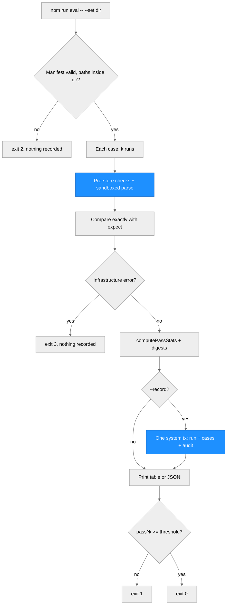

The stage registry `EVAL_STAGES` currently holds `extraction` only. A `rules` stage was planned for
step 5 but deferred; the rules are checked against Python by the parity suite instead. The set
hash `evalSetSha256` covers the manifest and every case file in order; fixtures are kept byte-exact by
`.gitattributes` (`api/eval/sets/** -text`).

## Interfaces for step 5

Status after run `REQ-20261010-step5-analysis`: item 1 is delivered; items 2 and 3 were deferred and
remain open.

1. **Delivered.** The intelligence features read only persisted columns (`claims` amounts, status, carrier,
   perspective, `updated_at`; the latest `evidence_packets` revision; `packet_findings.rule_id` and
   `needs_human_review`; `packet_sources.doc_type`; `approvals.created_at`). Step 5 now creates packet
   revision 1 (`AWAITING_ANALYSIS -> PENDING_REVIEW`), so analyzed imported claims enter the worklist,
   similarity and provenance without a step 4 change. `rule_id` is one of the eight stable, non-empty
   `RULE_IDS` (`rules-v1`), or since step 6 the review-only `LRN-ACCESSORIAL-REVIEW`.
2. **Open.** A `rules` stage in `EVAL_STAGES` (and a migration widening the `stage` CHECK), reusing
   `computePassStats`, the recorder and the dashboard, with the Python `run_pipeline` as the oracle.
3. **Open.** Telemetry `observeComponent('rules-v1', ...)`. No flag was added (analyze-on-commit is not
   built).

## Notes (step 4)

- Deviations recorded by the builder (DV-1..DV-11), most relevant: raw SQL lives in `db/` (DV-1); the
  route table has 199 keys plus `(other)` (DV-2); audited reads append in their own transaction after
  the data is computed, and a failed append still returns 500 with no data (DV-3); `API_KEY_PEPPER` has
  a public default outside production (DV-4); a key on a non-key route gets 403 even for `/healthz`, and
  an `Origin` on a key request is checked for every method (DV-5); the per-IP "refuse early" cache is per
  instance (DV-6); platform users land on `/dev` (DV-11).
- Deferred (design only, not built): per-key IP allow-lists, key rotation helpers (create-then-revoke is
  the manual path), HMAC request signing, per-key usage dashboards, more scopes, four-eyes on flag
  changes, cluster-wide telemetry and logs, any learned ranker.
- Not verified: container images, the compose stack, Playwright end-to-end tests, any AWS deployment.

---

# Web platform: four-eyes (separation of duties)

> Written by scriber for run `REQ-20261009-four-eyes` on 2026-10-10 (branch `feat/four-eyes`, build
> commit `8eb7062`). **Pre-product, synthetic data only, never deployed.** Threat row T46, the policy
> defaults and the accepted residuals are in
> [technical/web-platform-security.md, section 8](technical/web-platform-security.md#8-four-eyes-separation-of-duties).
> User-facing description: [README, four-eyes](README.md#four-eyes-separation-of-duties).

## Overview (four-eyes)

Two decisions now need a second person:

1. **Claims.** A user who created **any** packet revision of a claim (current or superseded) cannot
   approve or reject the claim's current revision. A revision with no recorded creator (seeded revision
   1) excludes nobody. Since step 5, revision 1 created by analysis records the analyzer. Send-ready is
   unchanged.
2. **Imported documents.** The uploader and every user who recorded a field `CORRECT` or `ADD` cannot
   accept the document. Reject is unchanged. API-key uploads count as uploads by the key's creator.

The service check is the primary control. Database triggers back it up, a refusal is one fixed 403 for
every caller and is audited, and the UI hides the button for the excluded person (cosmetic only). No
table, column, tenant table, RBAC entry or route was added. The only schema change is the trigger
migration `20261011000000_four_eyes`.

## Module Structure (four-eyes)

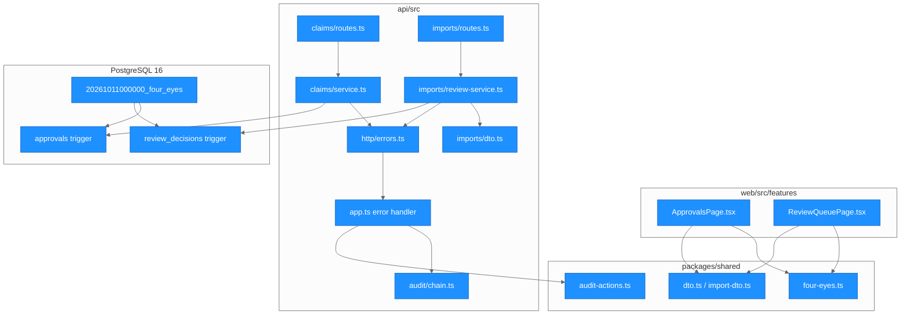

| Module/Function | Purpose | Key Dependencies | Changed in This Run |
| --- | --- | --- | --- |
| `packages/shared/src/four-eyes.ts` | `FOUR_EYES_ERROR_CODE`, `FOUR_EYES_CLAIM_TEXT`, `FOUR_EYES_DOCUMENT_TEXT` (exact UI copy) | none | new |
| `packages/shared/src/audit-actions.ts` | adds `authz.four_eyes_denied` (last entry) | none | changed |
| `packages/shared/src/dto.ts`, `import-dto.ts` | required `selfAuthored: boolean` on `ApprovalItem` and `ImportDocumentDetail` only | zod | changed |
| `api/src/http/errors.ts` | `four_eyes_required` message; `FourEyesRefusal` (403, carries the audit context); `errors.fourEyes(audit)` | `HttpError` | changed |
| `api/src/app.ts` | async error handler: appends `authz.four_eyes_denied` in its own tenant transaction, 500 if that fails; `isFourEyesDbError` maps a trigger refusal to 403 | `appendAudit`, `requireTenant` | changed |
| `api/src/audit/chain.ts` | `basis` allow-listed in `METADATA_KEYS` | none | changed |
| `api/src/claims/service.ts` | `FOUR_EYES_GUARDED_TRANSITIONS`; author check in `transition()`; `listApprovalQueue(tx, query, viewerId)` computes `selfAuthored` | `lockAndLoadLatest` | changed |
| `api/src/claims/routes.ts` | passes `requireTenant(req).user.id` as the viewer | claims service | changed |
| `api/src/imports/review-service.ts` | `assertNotDocumentEditor` in `acceptDocument`; all detail call sites pass the viewer | `lockReviewable`, `documentDetail` | changed |
| `api/src/imports/dto.ts` | `EDITOR_DECISIONS = {CORRECT, ADD}`; `isDocumentEditor(uploadedById, decisions, viewerId)` | none | changed |
| `api/src/imports/service.ts`, `routes.ts`, `deps.ts` | `documentDetail(..., viewerId)`; `uploadedById` loaded internally (no DTO exposes it); ingest refuses a `user` actor with a non-UUID id; attribution rule documented | storage, DB | changed |
| `api/prisma/migrations/20261011000000_four_eyes/` | `fr_approval_four_eyes_guard`, `fr_review_four_eyes_guard` and their `BEFORE INSERT` triggers | `evidence_packets`, `import_documents`, `import_review_decisions` | new |
| `web/src/features/approvals/ApprovalsPage.tsx` | hides Approve/Reject when `selfAuthored`; maps a 403 `four_eyes_required` to the claim text and refetches | shared constants | changed |
| `web/src/features/imports/ReviewQueuePage.tsx` | hides Accept document when `selfAuthored`; maps the 403 to the document text and refetches | shared constants | changed |

## Function Call Graph (four-eyes)

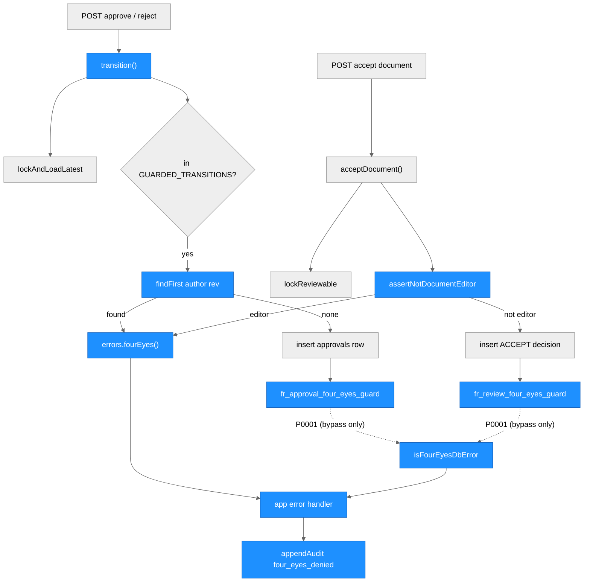

| Function | Defined In | Called By | Purpose |
| --- | --- | --- | --- |
| `transition` | `api/src/claims/service.ts` | claims routes (approve, reject, send) | state machine, then the author check for approve/reject, then the acknowledgement check |
| `listApprovalQueue` | `api/src/claims/service.ts` | `GET /api/v1/approvals` | one `distinct` query over the page's claim ids sets `selfAuthored` |
| `acceptDocument`, `assertNotDocumentEditor` | `api/src/imports/review-service.ts` | `POST .../accept` | uploader check (`basis: uploader`), then CORRECT/ADD check (`basis: field_editor`), before the unresolved-field checks |
| `documentDetail`, `isDocumentEditor` | `api/src/imports/service.ts`, `api/src/imports/dto.ts` | detail, upload, set type, accept, reject, ingest | `selfAuthored` from the decisions already loaded (no extra query) |
| `FourEyesRefusal`, `errors.fourEyes` | `api/src/http/errors.ts` | both services | 403 `four_eyes_required` carrying `{tenantId, targetType, targetId, metadata}` |
| `isFourEyesDbError` | `api/src/app.ts` | `toHttpError` | matches SQLSTATE `P0001` and the exact message `four_eyes_required` on the error or its `cause`/`meta` chain (depth 5, cycle-safe) |
| `fr_approval_four_eyes_guard` | migration `20261011000000_four_eyes` | `BEFORE INSERT ON approvals` | refuses `APPROVE`/`REJECT` by any `created_by_id` of the claim's packets (same tenant) |
| `fr_review_four_eyes_guard` | migration `20261011000000_four_eyes` | `BEFORE INSERT ON import_review_decisions` | refuses `ACCEPT` by the uploader or a CORRECT/ADD actor of the document (same tenant) |

## Data Flow (four-eyes refusal)

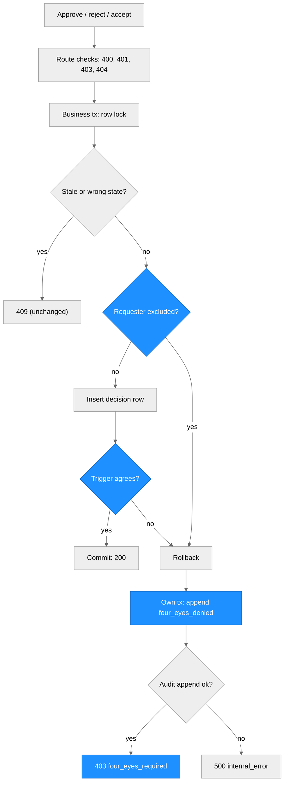

The "Trigger agrees?" branch is a backstop: it is reached only if application code skipped the service
check. In that case the API also answers 403 and logs `four_eyes_db_guard`, but writes no audit event
(FE-N1). Every edit and decision on one claim takes the claim row lock, and every field edit and
decision on one document takes the document row lock. So the author or editor set read inside the
transaction cannot change before commit.

| Step | Where | Notes |
| --- | --- | --- |
| Precedence, approve/reject | `transition()` | 400 -> 401 -> 403 `forbidden` -> 404 -> 409 `stale_revision` -> 409 `invalid_state` -> **403 `four_eyes_required`** -> 422 |
| Precedence, accept | `acceptDocument()` | 400 -> 401 -> 403 `forbidden` -> 404 -> 409 `invalid_state` -> **403 `four_eyes_required`** -> 409 `unresolved_fields` |
| Error body | `sendError` | `{ code, message: "A different person must make this decision.", requestId }`, identical for UI and API callers; no `authz.denied` event |
| Audit | error handler, tenant chain | claim: `claimId`, `packetId`, `packetRevision`, `action`, `basis: revision_author`; document: `documentId`, `batchId`, `action: ACCEPT`, `basis` |
| UI | `selfAuthored` | hides the button and shows the fixed text; cosmetic only, the server decides |

## Policy defaults (four-eyes)

D1 a revision author may not reject either; D2 send-ready is unrestricted; D3 only the uploader and
CORRECT/ADD actors are document editors; D4 document reject is unrestricted. The flip points are
`FOUR_EYES_GUARDED_TRANSITIONS` (claims) and `EDITOR_DECISIONS` (documents), each plus a new migration
for the matching trigger. Details are in the threat model, section 8.4.

## Interfaces for step 5 (four-eyes)

- **Delivered (FE-N2 closed).** Step 5 creates packet revision 1 for imported claims and sets
  `evidence_packets.created_by_id` to the user who triggered the analysis (single and bulk). That user is
  then a revision author and cannot approve or reject the claim. The trigger
  `evidence_packets_analysis_guard` refuses a revision 1 without an author for an `AWAITING_ANALYSIS`
  claim. Decision (policy D2 of step 5): the uploaders and field editors of a claim's documents are
  **not** claim authors. Document four-eyes already forced a second person to accept those inputs
  (except auto-accepted documents, FE-S1).
- Any new code path that inserts an `approvals` row (`APPROVE`/`REJECT`) or an `ACCEPT` decision must run
  the service check under the same row lock. The triggers refuse the insert otherwise.

## Notes (four-eyes)

- Verified locally on Node 22.23.3 (the CI version), **not in GitHub CI**: unit shared 136, api 356, web
  67; integration 95 passed (2 pre-existing skips); acceptance shared 36, api 690 passed (9 skipped, 2
  todo), web 150 passed (1 skipped). The audit fail-closed path and the trigger-to-403 mapping are
  covered only by the builder's integration and unit tests (not reachable black-box).
- Accepted residuals FE-S1..S4, FE-N1 and FE-N2 are listed in the threat model, section 8.5.

---

# Web platform: claim analysis (step 5)

> Written by scriber for run `REQ-20261010-step5-analysis` on 2026-10-10 (branch `feat/analysis`, build
> commits `d27c4a2`..`5c047fb`). **Pre-product, synthetic data only, never deployed.** Threat rows T47-T52,
> the policy defaults and the accepted residuals are in
> [technical/web-platform-security.md, section 9](technical/web-platform-security.md#9-step-5-claim-analysis).
> User-facing description: [README, claim analysis](README.md#claim-analysis-step-5).

## Overview (step 5)

Before step 5, a claim created by import stayed `AWAITING_ANALYSIS` with no amounts and no packet, because
the rules engine existed only in the Python reference service. Step 5 closes the loop:
import -> review -> commit -> **analyze** -> packet revision 1 -> four-eyes review.

- **Engine (`@fr/shared/analysis`).** A TypeScript port of the Python `rules/` (`detention.py`,
  `invoice_checks.py`, `engine.py`) and `evidence/` (`letter.py`, the Markdown of `packet.py`). The module is
  pure: no Node built-ins and no floating point on money or hours. It uses a CPython-exact decimal
  (`py-decimal.ts`: precision 28, ROUND_HALF_EVEN, CPython `str` and `.2f` formatting), CPython `repr` for
  strings and lists, and naive `YYYY-MM-DDTHH:MM:SS` datetimes with integer day arithmetic. Rules version
  `rules-v1`, eight rule ids (`INV-DUPLICATE`, `INV-LINEHAUL-RATE`, `INV-FUEL-SURCHARGE`,
  `INV-ACCESSORIAL-UNAUTH`, `INV-TOTAL-MISMATCH`, `DET-UNBILLED`, `DET-UNDERBILLED`, `DET-OVERBILLED`).
  Settings are constants (`DEFAULT_ANALYSIS_SETTINGS`: 15-minute detention increments, tolerance 0.01,
  90-day dispute window).
- **What a finding is.** A finding is the output of a fixed, deterministic rule applied to the field values
  of the claim's accepted documents (extracted by the step 3 parser and, where flagged, reviewed by a
  person). It is a **draft for human review, not a verified result**. The confidence on a finding is a
  fixed constant per rule copied from the Python reference (0.6, 0.85, 0.9 or 0.95), not a measured
  probability, and the product makes no accuracy claim. The step 4 evaluation gate runs on synthetic
  fixtures and is not an accuracy measure.
- **Routes.** `POST /api/v1/claims/:id/analyze` (201) and `POST /api/v1/claims/analyze-awaiting` (200,
  bulk). Both need the new permission `claims:analyze` (OWNER, ADMIN, MANAGER, REVIEWER, ANALYST), have no
  API-key scope, and share the per-user rate group `analysis` (`RATE_LIMIT_ANALYSIS_MAX`, default 30 per 10
  minutes).
- **Lifecycle.** One analyze runs in one tenant transaction under the claim row lock. It creates packet
  revision 1 (`PENDING_REVIEW`, created by the requester) with sources, findings (with citations and a
  governing clause), a timeline and the content hash. It sets the claim to `PENDING_REVIEW` with
  `recoverableCents`, `pendingReviewCents` and `amountClaimedCents`, increments `version`, and appends
  `claim.analyzed`. No `approvals` row is written. After that, the existing review flow applies unchanged.
- **Database guards.** Migration `20261012000000_analysis` adds two triggers and no table, column, enum or
  grant change.
- **Web.** An **Analyze claim** section on the claim sheet (Summary and Evidence tabs) and an **Analyze
  awaiting claims** dialog on the claims page, both shown only with `claims:analyze`.

Deferred (not built): analyze-on-commit (no flag; the bulk action is the automation, with an explicit human
trigger), a `rules` stage in the evaluation tool, telemetry component `rules-v1`, a Markdown download
endpoint, stricter money parsing, per-carrier letter templates.

## Module Structure (step 5)

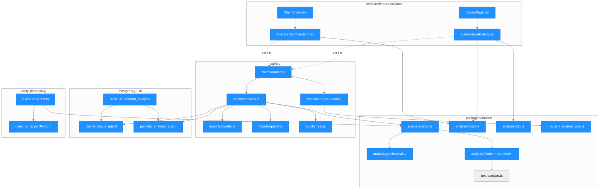

| Module/Function | Purpose | Key Dependencies | Changed in This Run |
| --- | --- | --- | --- |
| `packages/shared/src/analysis/py-decimal.ts` | CPython `Decimal` semantics: parse, add, sub, mul, true and integer division, compare, quantize, `str`, `.2f`, Python `max`/`sum` | none (BigInt) | new |
| `packages/shared/src/analysis/py-text.ts`, `local-datetime.ts` | CPython `repr(str)` and list repr, `_norm_text`; naive datetimes, days-from-civil epoch seconds, `%Y-%m-%d %H:%M` | none | new |
| `packages/shared/src/analysis/invoice-checks.ts`, `detention.ts`, `engine.ts` | Port of `rules/*.py`: `classifyLine`, dedupe, invoice checks, `computeDetention`, `applyRules`; `applyRulesTraced` also returns per-finding traces for citations | `py-decimal`, `py-text`, `local-datetime` | new |
| `packages/shared/src/analysis/letter.ts`, `markdown.ts`, `evidence.ts` | Port of `evidence/letter.py` and the Markdown of `packet.py`: `buildDemandLetter`, `renderPacketMarkdown`, `buildEvidence` (`buildEvidenceTraced`), `packetLoadNumber` | `text-sanitize.ts` (`plain`, `md`) | new |
| `packages/shared/src/analysis/types.ts`, `copy.ts`, `index.ts` | `AnalysisInputError`, `DEFAULT_ANALYSIS_SETTINGS`, `RULES_VERSION`, `RULE_IDS`, `DRAFT_BANNER`, `PACKET_DISCLAIMER`; UI copy `ANALYSIS_NOTE`, `ANALYZE_AUTHOR_NOTE`, `ANALYSIS_TEXT`; subpath `@fr/shared/analysis` | none | new |
| `packages/shared/src/analysis-dto.ts` | `AnalyzeBody` (strict `{}`), `BulkAnalyzeBody` (`limit` 1..25), response schemas, `ANALYZE_BATCH_MAX = 25`, `ANALYZE_BATCH_DEFAULT = 10` | zod | new |
| `packages/shared/src/rbac.ts`, `audit-actions.ts` | `claims:analyze` appended (5 roles); `claim.analyzed`, `claim.bulk_analyzed` appended | none | changed |
| `api/src/imports/bundle.ts` | `assembleBundleWithProvenance` (records which document and field filled each bundle slot); `loadAnalysisInput` (sources with `sizeBytes`, fields with page, line, excerpt; fields ordered by `ordinal, id`); `loadBundleForClaim` delegates, signature unchanged | Prisma tenant tx | changed |
| `api/src/claims/analysis.ts` | `buildAnalysisPacket` (pure: rows, citations, clauses, timeline, hash, storability), `analyzeClaim` (single, one tx), `analyzeAwaiting` (bulk), `storableCents`, `INT4_MAX` | `@fr/shared/analysis`, `bundle.ts`, `lockClaimForUpdate`, `appendAudit`, `packetContentHash` | new |
| `api/src/claims/routes.ts` | `POST /claims/:id/analyze` (201), `POST /claims/analyze-awaiting` (200); permission `claims:analyze`, no `apiKeyScope`, `rateGroup: 'analysis'` | `analysis.ts` | changed |
| `api/src/http/security.ts`, `context.ts`, `config.ts`, `app.ts` | Rate group `analysis` (per user, 10-minute window); `RATE_LIMIT_ANALYSIS_MAX` (default 30, 1..100000); `app.analysisLimiter` (null when rate limiting is off) passed to bulk | limiter store (Redis) | changed |
| `api/src/http/db-guard.ts` | Exact trigger-raise matcher (SQLSTATE `P0001` + exact message, through `cause`/`meta`/`driverAdapterError`, depth 5) shared by four-eyes and analysis; `isAnalysisDbError` | none | new (moved from `app.ts`) |
| `api/src/http/errors.ts`, `audit/chain.ts` | 422 `analysis_input_invalid`; step 5 metadata keys allow-listed | none | changed |
| `api/prisma/migrations/20261012000000_analysis/` | `fr_claim_status_guard` + trigger `claims_status_guard`; `fr_analysis_packet_guard` + trigger `evidence_packets_analysis_guard` | `claims`, `evidence_packets` | new |
| `web/src/features/claims/AnalyzeClaimSection.tsx`, `ClaimSheet.tsx` | Analyze button with both notes in the Summary and Evidence tabs; fixed error texts per status code; on success reload claim, packet, claims, approvals and show the Evidence tab | `useCan('claims:analyze')`, shared copy | new / changed |
| `web/src/features/claims/BulkAnalyzeDialog.tsx`, `ClaimsPage.tsx` | Toolbar button and modal dialog; POST `{ limit: 10 }`; summary in a `role="status"` region; failed claim numbers via `SafeText` | `Dialog`, shared copy | new / changed |
| `tools/parity/rules_dump.py`, `api/test/parity/rules.parity.test.ts` | Python oracle dump (test only, never at runtime) and the TS-vs-Python comparison in `test:integration` | Python reference service | new |

## Function Call Graph (step 5)

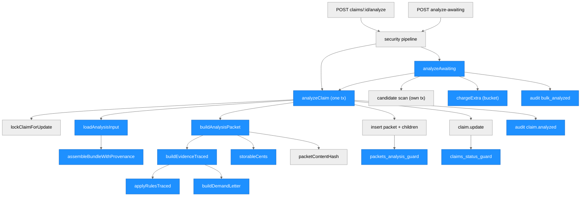

| Function | Defined In | Called By | Purpose |
| --- | --- | --- | --- |
| `analyzeClaim(tx, claimId, actor, { bulk })` | `api/src/claims/analysis.ts` | single route (inside `db.tx`), `analyzeAwaiting` (one `db.tx` per candidate) | UUID check and row lock (404), re-check status and "no packet" under the lock (409), load input (409 if no accepted document), build (422), insert, update, audit |
| `analyzeAwaiting(db, actor, limit, chargeExtra)` | `api/src/claims/analysis.ts` | bulk route | candidates once, per-candidate tx, outcome lists, budget stop, summary audit |
| `loadAnalysisInput(tx, claimId)` | `api/src/imports/bundle.ts` | `analyzeClaim` | linked `ACCEPTED` documents (oldest link first, ties by link id) to `{ bundle, provenance, sources }` |
| `buildAnalysisPacket({ input, claim, now, actorId })` | `api/src/claims/analysis.ts` | `analyzeClaim` | pure: engine run, storability check, source, finding, citation, clause and timeline rows, `HashPacket` and content hash |
| `buildEvidenceTraced` / `buildEvidence` | `packages/shared/src/analysis/evidence.ts` | `buildAnalysisPacket`, parity test | result, letter (UTC date of `now`), Markdown (not persisted), load number |
| `applyRules` / `applyRulesTraced` | `packages/shared/src/analysis/engine.ts` | `buildEvidence*`, parity test | invoice findings, detention findings, perspective split, totals |
| `isAnalysisDbError` | `api/src/http/db-guard.ts` | `app.ts` `toHttpError`, `analyzeAwaiting` | maps `claim_transition_invalid` / `analysis_packet_invalid` to 409 `invalid_state` (single) or `skipped` (bulk) |
| `fr_claim_status_guard`, `fr_analysis_packet_guard` | migration `20261012000000_analysis` | `BEFORE UPDATE OF status ON claims`, `BEFORE INSERT ON evidence_packets` | database backstop for the lifecycle (below) |

## Data Flow (single analyze)

```mermaid
%%{init: {'theme': 'neutral'}}%%
graph TD
    A["POST claims/:id/analyze"] --> B["Pipeline: 403, 401, 429, 403, 400"]
    B --> C["Tenant tx: lock claim row"]
    C --> D{"Claim visible?"}
    D -- no --> E["404 not_found"]
    D -- yes --> F{"AWAITING, no packet, accepted doc?"}
    F -- no --> G["409 invalid_state"]
    F -- yes --> H["Load bundle + provenance"]
    H --> I["Rules, letter, rows, hash"]
    I --> J{"Input valid and storable?"}
    J -- no --> K["422 analysis_input_invalid"]
    J -- yes --> L["Insert rev 1 + children"]
    L --> M["Claim to PENDING_REVIEW"]
    M --> N{"Triggers agree?"}
    N -- no --> O["Rollback: 409 invalid_state"]
    N -- yes --> P["Append claim.analyzed: 201"]

    style F fill:#1e90ff,stroke:#1565c0,color:#fff
    style J fill:#1e90ff,stroke:#1565c0,color:#fff
    style N fill:#1e90ff,stroke:#1565c0,color:#fff
    style P fill:#1e90ff,stroke:#1565c0,color:#fff
```

Nothing is written before the 422 check, so a refused analyze (404, 409, 422) changes nothing and writes no
`claim.analyzed`. The "Triggers agree?" branch is a backstop that the service checks make unreachable
through the API; if it is ever reached the API answers 409 `invalid_state` (never 500, never the database
text) and logs `analysis_db_guard` at error level.

| Step | Where | Notes |
| --- | --- | --- |
| Precedence, single | security pipeline, `analyzeClaim` | origin/CSRF 403 -> 401 -> 429 (`analysis` bucket) -> 403 `forbidden` -> 400 -> 404 -> 409 `invalid_state` -> 422 `analysis_input_invalid` |
| Precedence, bulk | security pipeline | origin/CSRF 403 -> 401 -> 429 -> 403 -> 400 -> 200 (per-claim outcomes in the body) |
| 422 | `buildAnalysisPacket` | the engine refuses an input (malformed decimal or datetime, increment 0), or a result is not storable: any persisted finding amount or total negative, or above 2,147,483,647 cents, or the two totals together above it (RD3) |
| Concurrency | `lockClaimForUpdate` + re-check | N parallel analyzes of one claim: exactly one 201, the rest 409; one packet, one event, `version` +1 once. Unique `(claim_id, revision)` and the one-live-revision index are a further backstop |
| Response | `AnalyzeResponse` | `claim` (id, status, three cent amounts), `packet` (id, revision 1, status, `contentHash`), `analysis` (`rulesVersion`, `findingsCount`, `pendingFindingsCount`, `ignoredFindingsCount`) |

## Claim lifecycle and database guards (step 5)

```mermaid
%%{init: {'theme': 'neutral'}}%%
graph TD
    CM["import commit"] --> AW["AWAITING_ANALYSIS"]
    AW -- "analyze: rev 1 with author" --> PR["PENDING_REVIEW"]
    PR --> FL["existing review flow"]
    FL -. "back to AWAITING: refused" .-> AW

    style AW fill:#1e90ff,stroke:#1565c0,color:#fff
    style PR fill:#1e90ff,stroke:#1565c0,color:#fff
```

| Trigger (function) | Fires on | Refuses | Error |
| --- | --- | --- | --- |
| `claims_status_guard` (`fr_claim_status_guard`) | `BEFORE UPDATE OF status ON claims` | a status change **to** `AWAITING_ANALYSIS`; a change **from** `AWAITING_ANALYSIS` to anything other than `PENDING_REVIEW`, or to `PENDING_REVIEW` when no `evidence_packets` row of the same claim and tenant with `revision = 1` and a non-null `created_by_id` exists | `P0001` `claim_transition_invalid` |
| `evidence_packets_analysis_guard` (`fr_analysis_packet_guard`) | `BEFORE INSERT ON evidence_packets` | a packet for an `AWAITING_ANALYSIS` claim unless `revision = 1`, `created_by_id` is not null and `status = 'PENDING_REVIEW'` | `P0001` `analysis_packet_invalid` |

Both functions are `SECURITY DEFINER` (owner = the migration role), `search_path = public, pg_temp`, match
`tenant_id` explicitly (so a missing `app.tenant_id` cannot hide rows), and have `EXECUTE` revoked from
`PUBLIC`. Existing rows are not re-validated. Updates that do not change `status`, other status changes,
claim inserts and packet inserts for other claims are unaffected; in particular the amount and `version`
columns of an `AWAITING_ANALYSIS` claim are **not** guarded by the database (residual SA-6 in the threat
model). The four earlier migrations are byte-for-byte unchanged.

## Bulk analyze and the `analysis` rate budget

`POST /api/v1/claims/analyze-awaiting` with `{ "limit": n }` (1..25, default 10; the web dialog always sends
10):

1. **Candidates**, fetched once in a short tenant transaction: the tenant's claims in `AWAITING_ANALYSIS`
   with at least one linked `ACCEPTED` document, oldest `createdAt` first (ties by id), at most
   `min(4 x limit, 100)`.
2. **Each candidate in its own transaction**, exactly like the single route. A candidate that is no longer
   analyzable (404/409, or a database guard refusal) goes to `skipped` (`invalid_state`); one that gets 422
   goes to `failed` (`analysis_input_invalid`). Any other error ends the request with 500; analyses already
   committed stay committed.
3. **Budget (fix round 1, S5-1).** The request's own `analysis` token covers the first candidate. Before
   each further candidate, one more token is taken from the requester's per-user `analysis` bucket
   (`app.analysisLimiter`). Tokens are charged per candidate **attempted**, so skipped and failed
   candidates also cost one. With `RATE_LIMIT_ENABLED=false` (dev/test only; production refuses it) nothing
   extra is charged.
4. **Stop conditions:** `analyzed` reaches `limit`, the candidates are exhausted, or the bucket is empty.
   A budget stop still returns 200 with the same shape; unattempted claims stay `AWAITING_ANALYSIS` and
   count in `remaining`. `examined` = candidates attempted = analyzed + skipped + failed.
5. **Summary.** One `claim.bulk_analyzed` event (target `tenant`) in its own transaction, with `limit`,
   `examined`, `analyzed`, `skipped`, `failed` and `remaining` (the tenant's claims still awaiting analysis
   after the run).

Effect: a user can perform at most `RATE_LIMIT_ANALYSIS_MAX` analyses per 10-minute window whether they use
the single or the bulk route. Before fix round 1, one bulk request cost one token for up to 25 analyses (a
25x amplification, security finding S5-1, Low). Concurrent bulk requests never analyze a claim twice; the
loser of a race reports it as `skipped`.

Known limits (threat model section 9.5): skipped and failed candidates consume budget (SA-1); a limiter
failure mid-run (for example the Redis store unreachable) ends the request with 500 and no
`claim.bulk_analyzed` event (SA-2); the dialog does not say that the budget stopped the run, although its
summary ("n still awaiting analysis") stays true (SA-3); a claim that fails with 422 stays a candidate and,
being old, is attempted first on every run (SA-8).

## Packet content (revision 1)

| Part | Content |
| --- | --- |
| Packet | `revision 1`, `PENDING_REVIEW`, claim perspective, `loadNumber` (first non-empty of invoice, rate confirmation, bill of lading), `generatedAt` = analysis time, `PACKET_DISCLAIMER`, the draft demand letter (dated with the UTC date of `generatedAt`), USD, `verifier NOT_RUN`, `createdBy` = requester, content hash |
| Sources | one per linked `ACCEPTED` document in link order: display name, type, SHA-256, size of the stored original |
| Findings | own-perspective findings in engine order (rule id, title, direction, amount in cents, explanation, calculation steps, confidence, `needsHumanReview`); other-direction findings are counted (`ignoredFindingsCount`) but not stored |
| Citations | per rule, the fields that fed it, as `{sourceId, locator, excerpt}` with locator `<name>:L<line>`, `<name>:p<page>:L<line>` or `<name>:manual`; excerpt through `plain(..., 200)`; duplicates removed |
| Governing clause | the rate-confirmation field the rule compares against (linehaul rate, fuel surcharge, authorized accessorials, detention free time), or null |
| Timeline | appointment, arrival, departure (bill of lading) and invoice date, stored with naive local times read as UTC; facility and invoice number through `plain(..., 100)` |

Citations, governing clauses and the timeline are TS-only additions with no Python counterpart. They are
part of the content hash, so the approve/send hash binding covers them.

## Audit (step 5)

| Action | When | Target | Metadata (exact key set) |
| --- | --- | --- | --- |
| `claim.analyzed` | each successful analyze, same transaction as the writes | `claim` | `claimId`, `claimNumber`, `packetId`, `revision`, `contentHash`, `perspective`, `fromStatus`, `toStatus`, `documentIds`, `findingsCount`, `pendingFindingsCount`, `ignoredFindingsCount`, `recoverableCents`, `pendingReviewCents`, `rulesVersion`, `bulk` |
| `claim.bulk_analyzed` | once per bulk request that reaches the handler and finishes, after the per-claim transactions | `tenant` | `limit`, `examined`, `analyzed`, `skipped`, `failed`, `remaining` (all integers) |

No names, file names, extracted values, letter text or reasons go into metadata. Refused analyzes (409, 422)
write no event; permission refusals keep the existing `authz.denied` behaviour. The audit metadata
sanitizer caps arrays at 50 entries, so `documentIds` would be incomplete for a claim with more than 50
linked accepted documents; the `packet_sources` rows stay complete (SA-4).

## Python parity: registered divergences (RD1-RD6)

`api/test/parity/rules.parity.test.ts` (part of `npm run test:integration`; same Python discovery rule as
the step 3 parity suite: CI without Python fails, a local run without Python skips with a message) feeds
the same cases to the TS engine and to `tools/parity/rules_dump.py`, which calls the Python reference with
explicit `Settings`. It compares with exact string equality: `classifyLine`, `computeDetention` JSON,
`applyRules` JSON, the letter, the Markdown and the load number, and checks that both sides refuse the same
inputs. Parity domain: decimals `-?(0|[1-9][0-9]{0,14})(\.[0-9]{1,6})?`; datetimes
`YYYY-MM-DDTHH:MM:SS`, years 1000-9999; strings of assigned code points without controls, bidi controls or
U+2028/U+2029, at most 200 code points; increments 1..240; window 1..3650 days.

| ID | Divergence (TS vs Python) | Rationale |
| --- | --- | --- |
| RD1 | Timestamps are naive `YYYY-MM-DDTHH:MM:SS` only; offsets are refused (`AnalysisInputError`). Python's timezone-aware paths have no TS input. | The step 3 extraction stores naive local times; there is no time zone to apply. |
| RD2 | `%Y` pads years below 1000 to 4 digits (CPython on Linux does not). | The corpus uses years 1000 and later. |
| RD3 | The API refuses negative or over-INT4 results (422) where Python would emit them. The pure engine still matches Python. | Amounts are stored as int4 cents; a negative claim amount has no meaning. |
| RD4 | Case mapping and printability follow Node 22's ICU tables, not Python's Unicode database. | The corpus excludes unassigned code points. |
| RD5 | End to end, the TS packet lists the claim's accepted linked documents; Python lists every ingested file. | Only accepted documents feed a claim. |
| RD6 | The letter date is the UTC date of `generatedAt`; Python uses the local date of `datetime.now()`. | Independent of the server time zone; parity runs pass the same `now`. |

Builder corpus (seed `20261010`): 2,132 cases (4 fixture end-to-end, 623 inputs from the Python test
files, 1,200 generated bundles, 300 generated detention cases, 5 classification batches of 200
descriptions). Result in the builder's run: zero differences on Node 22 and Node 24, every rule id
exercised, no registered divergence needed inside the corpus. The tester's independent oracle
(`api/test-acceptance/helpers/rules_oracle.py`) passed P01-P05 in acceptance run 1; its per-corpus counts
were not yet recorded.

## Policy defaults (step 5)

| ID | Default | Flip point |
| --- | --- | --- |
| D1 | `claims:analyze` = OWNER, ADMIN, MANAGER, REVIEWER, ANALYST; no API-key scope | `rbac.ts` matrix row |
| D2 | Revision-1 author = the requester (single and bulk); document uploaders and field editors are not claim authors | `analysis.ts` + four-eyes predicate |
| D3 | Analyze-on-commit not built; bulk is the automation | future flag + migration row |
| D4 | Only own-perspective findings are persisted | `buildAnalysisPacket` |
| D5 | Zero findings still create revision 1 with zero amounts and the "No amount is requested" letter | `analyzeClaim` |
| D6 | Negative or over-INT4 results -> 422, claim unchanged | `buildAnalysisPacket` |
| D7 | Settings are constants (15 min, 0.01, 90 days) | `DEFAULT_ANALYSIS_SETTINGS` |
| D8 | Letter date = UTC date of `generatedAt`; naive timeline times stored as UTC | `buildEvidence`, timeline |
| D9 | Bulk `limit` 1..25 (default 10), scan cap `min(4 x limit, 100)`, oldest first | `analyzeAwaiting` |
| D10 | Rate group `analysis`, `RATE_LIMIT_ANALYSIS_MAX` 30 per 10 minutes, charged per bulk candidate | config, `analyzeAwaiting` |

## Interfaces for later steps (after step 5)

- Keep `rule_id` within `RULE_IDS` and bump `RULES_VERSION` when a rule changes; step 4 intelligence and
  the parity suite depend on both. Step 6 keeps this for the rules and adds the learned id
  `LRN-ACCESSORIAL-REVIEW` outside `RULE_IDS`, versioned by `CHARGE_CLASSIFIER_VERSION` and `SEED_VERSION`
  (see [charge intelligence (step 6)](#web-platform-charge-intelligence-step-6)).
- Open: the `rules` evaluation stage, telemetry `rules-v1`, analyze-on-commit, a Markdown download
  endpoint, stricter money parsing.
- Any future HTML, Markdown or PDF renderer of stored findings must sanitize `explanation` and
  `calculation`: they contain the raw invoice line description (SA-5). Only the letter applies `plain()`.
- A new code path that writes claim amounts must keep to the analyze transaction or extend the status guard
  (SA-6).

## Notes (step 5)

- What ran (local, Windows, **not GitHub CI**): the builder ran lint, typecheck and unit tests (shared 165,
  api 370, web 78), the rules parity suite (2,132 cases, zero differences on Node 22 and 24) and the
  integration suite on Node 22.23.3 (16 files, 107 passed, 3 local-skip placeholders), all at `b12ce2a`.
  The independent acceptance run 1 (Node 22.23.3, `CI=true`, at `b12ce2a`) gave shared 81/81 and api 754
  passed, 4 failed, 10 skipped; all 4 failures were classified as test design and fixed in the test files,
  but the verification rerun was stopped by low system memory. The web acceptance suite (AN-W01..W11) has
  not run yet. Fix round 1 (`5c047fb`) was checked only with lint, typecheck and targeted unit tests; no
  integration or acceptance run exists at `5c047fb`.
- Review verdict at the time of writing: FAIL (validation incomplete), no code defect found. The deviations
  1-8 in the run's `implementation.md` were accepted.
- `.env.example` lists `RATE_LIMIT_ANALYSIS_MAX=30` uncommented, unlike the commented step 4 knobs; the
  value equals the default.
- Not verified: GitHub CI, container images, the compose stack, Playwright, any AWS deployment.

---

# Web platform: charge intelligence (step 6)

> Written by scriber for run `REQ-20261011-charge-intelligence` on 2026-10-11 (branch
> `feat/charge-intelligence` from `feat/analysis` at `51ea826`, build commits `959aa36`..`43d7d4c`, plus
> `a1b1c2a`, which only exports one more constant from the package root).
> **Pre-product, never deployed.** The platform still holds synthetic data only; the one exception is the
> seed set of public tariff charge names described below (an owner decision, open question OQ1). Threat
> rows T53-T57 and the residuals SC-1..SC-11 are in
> [technical/web-platform-security.md, section 10](technical/web-platform-security.md#10-step-6-charge-intelligence).
> User-facing description: [README, charge suggestions](README.md#charge-suggestions-and-team-labels-step-6).

## Why (step 6)

The step 5 rules decide the category of an invoice charge line with the keyword tables of the Python
reference (`classifyLine`: detention, linehaul, fuel, accessorial or `other`). `INV-ACCESSORIAL-UNAUTH`
only checks lines that `classifyLine` calls `accessorial`, so a line it calls `other` is never compared with
the rate confirmation's authorized accessorials.

The planner measured this on 175 billable charge names taken verbatim from six public carrier rules
tariffs (names only). The keyword rules recognised **19 of the 159 accessorial names** (34 of 175 names
overall). Most real accessorial wordings would therefore pass the unauthorized-accessorial check unseen.
A dependency-free character n-gram nearest-neighbour prototype, evaluated leave-one-carrier-out on the same
names, recognised far more of them (numbers in [the evaluation gate](#evaluation-gate-seed-set-regression-check)).
An embedding model (MiniLM through ONNX) was also tried in the run's prototype. It was not adopted, because
it would add a large native dependency to the core package. The evidence (the labelled name file, the text
extracts of the six tariffs and the prototype) is in the run directory and is not committed.

Step 6 adds, without changing any step 5 rule output:

1. a deterministic charge-line classifier `charge-knn-v1` in `@fr/shared` (pure TypeScript, no new
   dependency): nearest labelled example by n-gram similarity, with an abstain threshold;
2. the attributed seed set `tariff-seed-v1` (175 names from 6 public tariffs);
3. a **team label memory**: reviewers confirm or correct a line's category; the label is stored in a new
   tenant table and used by every later suggestion and analysis of that tenant. This is memory consulted at
   classification time. Nothing is trained and there are no model weights;
4. a **learned layer** in analysis that only adds review items: `LRN-ACCESSORIAL-REVIEW` findings, and
   `DET-UNBILLED` / `DET-UNDERBILLED` switched to review when a line looks like detention under another name;
5. a leave-one-carrier-out **evaluation gate** in CI (a seed-set regression check, not an accuracy measure
   on invoices);
6. a pure **tariff detention calculator** (`computeTariffDetention`) that is not wired to any route yet;
7. a **Charges** tab on the claim sheet.

Items 3, 4 and 7 sit behind the platform kill switch `intelligence.charge_suggestions` (default on). With it
off, analysis is exactly step 5 and the four charge routes answer 404.

**What it is not.** No LLM call, no network call, no training and no stored model. A suggestion is a
similarity to a labelled example. It is not verified. It can only add items for human review and never
confirms an amount. The evaluation numbers come from 175 public tariff names, not from customer invoices,
and are not an accuracy measure.

## Seed set v1 and data provenance

`packages/shared/src/charge-intel/seed-v1.ts` holds `SEED_V1`: a frozen array of 175 `{ text, label, source }`
entries, equal in order and text to the run's `data/seed-charge-names-6carriers.json`. Labels: accessorial
159, detention 12, fuel 3, linehaul 1. The longest name has 82 characters. The names give 157 distinct
normalized texts, and 14 normalized texts appear at 2 to 4 carriers. `SEED_SOURCES` gives the attribution
for each source; every URL was retrieved on 2026-10-11.

| Source key | Tariff | Effective | Names | URL |
| --- | --- | --- | --- | --- |
| `magnum_2026` | Magnum LTL 125 Rules and Special Services Tariff | 2026-04-01 | 27 | `https://magnumlog.com/wp-content/uploads/2026/04/2026-Rules-Tariff-125-04.01.26.pdf` |
| `gardewine_2025` | Gardewine GWN Tariff 100 General Rules, Domestic Canada LTL | 2025-12-01 | 27 | `https://gardewine.com/wp-content/uploads/2026/06/GWN_RULES_TARIFF_100_DEC_2025_FINAL-V2.pdf` |
| `dohrn_2025` | Dohrn Transfer Company accessorial recap, Rules Tariff DHRN 100 series | 2025-01-20 | 30 | `https://dohrn.com/wp-content/uploads/2025/01/Dohrn-Rules-Tariff-Effective-01.20.2025.pdf` |
| `states_2023` | States Logistics Services LTL Accessorials and Miscellaneous Charges | 2023-11-30 | 19 | `https://stateslogistics.com/wp-content/uploads/2024/07/LTLAccessorialMiscServices.pdf` |
| `xpo_2025` | XPO Logistics Freight Tariff CNWY 199-AJ.4, accessorial services | 2025-11-03 | 43 | `https://www.xpo.com/cdn/download_files/s1/p2831/CNWY_199-AJ.4_Eff_11.3.2025.pdf` |
| `estes_2025` | Estes Express Lines Accessorial Charges (Rules Tariff EXLA 105) | 2025-11-17 | 29 | `https://www.estes-express.com/downloads/EXLAaccessorialCharges.pdf` |

Only charge names are stored: no tariff text, no rates, and no customer, shipment or invoice data. The
tariff texts are not committed.

**Owner decision and open question OQ1.** CLAUDE.md hard rule 4 says "Synthetic data only". On 2026-10-10/11
the owner, Marius Carlsson, decided in the request of this run that real public data may be used where
it is needed ("real shipment data is okay. go look for real data. only use synthetic data ... when you
have to."). The seed applies that decision narrowly: generic service names that carriers publish in their
tariffs, with attribution, and no customer, shipment or invoice records in the repository. CLAUDE.md
rule 4 and the project-conventions skill were **not** changed by the agents. A dated exception note there
is open question OQ1 for the owner. Two related points are also open: the six URLs were found by web search
and still need the owner's confirmation that they match the downloaded files (OQ2), and the tariffs' reuse
terms have not been checked (security review S8).

## Module Structure (step 6)

```mermaid
%%{init: {'theme': 'neutral'}}%%
graph TD
    subgraph Web["web/src/features"]
        CSH["claims/ClaimSheet.tsx"]
        CLP["ChargeLinesPanel.tsx"]
        UF["use-features.ts"]
    end
    subgraph Shared["packages/shared/src"]
        CON["charge-intel/constants"]
        SEED["charge-intel/seed-v1"]
        FEAT["charge-intel/features"]
        CLS["charge-intel/classifier"]
        LRN["charge-intel/learned"]
        EVA["charge-intel/evaluate"]
        DTO["charge-intel-dto + copy"]
        TD["analysis/tariff-detention"]
        S5["analysis/ (step 5, unchanged)"]
        RBC["rbac + audit-actions + flags"]
    end
    subgraph API["api/src"]
        CRT["charge-routes.ts"]
        CHS["intelligence/charges.ts"]
        LCK["db/charge-label-locks.ts"]
        CA["claims/analysis.ts"]
        CR["claims/routes.ts"]
        ECLI["eval/charges.ts (CLI)"]
    end
    subgraph DB["PostgreSQL 16"]
        MIG["20261013000000_charge_intel"]
        TBL["charge_labels (RLS FORCE)"]
        FLG["feature_flags row"]
    end

    CSH --> CLP
    CLP --> UF
    CLP --> DTO
    CLP -. "HTTP" .-> CRT
    CRT --> CHS
    CHS --> LCK
    CHS --> CLS
    CHS --> TBL
    CR --> CA
    CA --> CHS
    CA --> LRN
    LRN --> CLS
    LRN --> S5
    CLS --> FEAT
    CLS --> SEED
    CLS --> CON
    EVA --> CLS
    EVA --> S5
    ECLI --> EVA
    TD --> S5
    CRT --> RBC
    MIG --> TBL
    MIG --> FLG

    style CSH fill:#1e90ff,stroke:#1565c0,color:#fff
    style CLP fill:#1e90ff,stroke:#1565c0,color:#fff
    style UF fill:#1e90ff,stroke:#1565c0,color:#fff
    style CON fill:#1e90ff,stroke:#1565c0,color:#fff
    style SEED fill:#1e90ff,stroke:#1565c0,color:#fff
    style FEAT fill:#1e90ff,stroke:#1565c0,color:#fff
    style CLS fill:#1e90ff,stroke:#1565c0,color:#fff
    style LRN fill:#1e90ff,stroke:#1565c0,color:#fff
    style EVA fill:#1e90ff,stroke:#1565c0,color:#fff
    style DTO fill:#1e90ff,stroke:#1565c0,color:#fff
    style TD fill:#1e90ff,stroke:#1565c0,color:#fff
    style RBC fill:#1e90ff,stroke:#1565c0,color:#fff
    style CRT fill:#1e90ff,stroke:#1565c0,color:#fff
    style CHS fill:#1e90ff,stroke:#1565c0,color:#fff
    style LCK fill:#1e90ff,stroke:#1565c0,color:#fff
    style CA fill:#1e90ff,stroke:#1565c0,color:#fff
    style CR fill:#1e90ff,stroke:#1565c0,color:#fff
    style ECLI fill:#1e90ff,stroke:#1565c0,color:#fff
    style MIG fill:#1e90ff,stroke:#1565c0,color:#fff
    style TBL fill:#1e90ff,stroke:#1565c0,color:#fff
    style FLG fill:#1e90ff,stroke:#1565c0,color:#fff
```

| Module/Function | Purpose | Key Dependencies | Changed in This Run |
| --- | --- | --- | --- |
| `packages/shared/src/charge-intel/constants.ts` | `CHARGE_CLASSIFIER_VERSION` `charge-knn-v1`, `SEED_VERSION` `tariff-seed-v1`, threshold 3/10, `CHARGE_CATEGORIES`, `CHARGE_LABELS_MAX` 2000, `CHARGE_QUERY_TEXT_MAX` 200, `LEARNED_RULE_IDS` (and since `a1b1c2a` `LEARNED_LABEL_IDS_MAX` 50) | none | new |
| `charge-intel/seed-v1.ts` | `SEED_V1` (175 frozen entries), `SEED_SOURCES` (attribution), provenance header | constants | new |
| `charge-intel/features.ts` | `featureText` (200-character cap), `chargeFeatures`, `featureNorm2`, `featureDot` | `analysis/py-text` `normText` | new |
| `charge-intel/classifier.ts` | `buildChargeClassifier` (inverted index, memo), `buildChargeClassifierByScan` and `rankNearest` (reference scan), `accepts`, `beats`, `formatSimilarity`, `seedExamples` | features, seed, DTO types | new (index added in fix round 1) |
| `charge-intel/learned.ts` | `buildEvidenceLearned`, `applyLearning`: the learned layer on top of the step 5 result; returns `learnedFindingsCount`, `reviewFlagsCount`, `labelIds` | step 5 `applyRulesTraced`, `classifyLine`, `dedupe`, letter, Markdown | new |
| `charge-intel/evaluate.ts` | `evaluateLeaveOneCarrierOut` -> `ChargeEvalReport` | classifier, step 5 `classifyLine` | new |
| `charge-intel-dto.ts`, `charge-intel/copy.ts` | Zod schemas of the routes and the eval report; UI copy `CHARGE_NOTE`, `CHARGE_EVAL_NOTE`, `CHARGE_TEXT`, `CATEGORY_LABELS` | zod | new |
| `analysis/tariff-detention.ts` | `computeTariffDetention` (pure; not wired) | step 5 `py-decimal`, `local-datetime` | new |
| `rbac.ts`, `audit-actions.ts`, `feature-flags.ts`, `analysis-dto.ts`, `index.ts`, `package.json` | `charge_labels:manage`; `charge_label.set`, `charge_label.deleted`; flag `intelligence.charge_suggestions`; three new `analysis` response fields; root exports; subpath `./charge-intel` | none | changed |
| `api/src/intelligence/charges.ts` | `loadClassifier`, `chargeLines`, `setLabel`, `deleteLabel`, `listLabels` | Prisma tenant tx, `loadAnalysisInput`, `appendAudit` | new |
| `api/src/intelligence/charge-routes.ts` | the four routes (rate group `intelligence`, no API-key scope, flag checked after the pipeline checks) | `charges.ts`, `auditViewed` | new |
| `api/src/db/charge-label-locks.ts` | `lockChargeLabels`: transaction advisory lock `charge-labels:<tenantId>` | `advisoryXactLock` | new (fix round 1) |
| `api/src/claims/analysis.ts`, `claims/routes.ts` | classifier argument, learned layer, LRN governing clause, response and audit fields; flag read once per request; bulk builds the classifier once per request | `@fr/shared/charge-intel`, `charges.ts` | changed |
| `api/src/db/tenant.ts`, `http/errors.ts`, `audit/chain.ts`, `app.ts`, `scripts/seed.ts` | `ChargeLabel` in `TENANT_MODELS`; 409 `label_limit_reached`; metadata allow-list; route registration; `--reset` deletes `charge_labels` | none | changed |
| `api/src/eval/charges.ts` | CLI `npm run eval:charges` (no database, no network, nothing recorded) | `evaluateLeaveOneCarrierOut` | new |
| `api/prisma/migrations/20261013000000_charge_intelligence/` | table, CHECKs, RLS FORCE, policy, grants, flag row | `tenants`, `users`, `feature_flags` | new |
| `web/src/features/intelligence/ChargeLinesPanel.tsx`, `use-features.ts`, `claims/ClaimSheet.tsx`, `api/client.ts` | Charges tab, `charges` flag, `put()` helper | `useCan('charge_labels:manage')`, shared copy | new / changed |
| `.github/workflows/web-ci.yml` | one step: the charge evaluation with fixed bounds | `npm run eval:charges` | changed |

The package root `@fr/shared` exports the constants, the copy, the DTO schemas and `computeTariffDetention`
only. The seed, the classifier, the evaluation and the learned layer are under the subpath
`@fr/shared/charge-intel`, so the web bundle does not carry the seed set. The step 5 engine files under
`packages/shared/src/analysis/` were not modified (only `index.ts` gained the new export).

## Classifier `charge-knn-v1` (exact rules)

| Step | Rule |
| --- | --- |
| Normalize | `normText(s)`: lower-case, every run of characters outside `[a-z0-9]` becomes one space, trimmed (the step 5 function) |
| Query cap | `featureText(s)` = the first 200 characters of `normText(s)`, trailing space removed. Labels (at most 200) and seed names (at most 82) are never cut; a long invoice description is |
| Features | for k = 3, 4, 5, every length-k substring of `" " + n + " "` counts 1 per occurrence; every word `w` adds key `"w:" + w` with weight 2 per occurrence; an empty text has no features |
| Similarity | `dot(q, e) / sqrt(N(q) * N(e))`, where `N` is the sum of squared counts. Shown with three decimals (one IEEE division, display only) |
| Examples | the tenant's labels sorted by normalized text (then id), followed by the seed in file order without the seed entries whose normalized text equals a tenant label's |
| Nearest | among examples sharing a feature (`dot > 0`), `e` beats `e'` iff `dot(q,e)^2 * N(e') > dot(q,e')^2 * N(e)`. On equality the earlier example wins: a team label before the seed, and within the seed the file order |
| Accept | `100 * dot^2 >= 9 * N(q) * N(e)`, that is similarity >= 0.30 exactly |
| Result | `empty` (no features), `no_match` (no shared feature), the nearest example's category, or `below_threshold` (abstain; the nearest example is still shown) |

Every decision uses exact integers: plain doubles while both products are at most 2^53, BigInt above. No
floating-point rounding can change a ranking or the threshold test, and the output is the same on Node 22
and Node 24. k = 1, so each suggestion cites exactly one labelled example (seed entries with their
`sourceLabel`, team labels as "Your team's label").

**Why 0.30.** It was chosen from the leave-one-carrier-out similarity distribution on the seed: at 0.30,
160 of the 161 suggestions are correct and the 14 weakest matches abstain. The closest seed similarities
to the threshold are 0.3031, 0.3061 and 0.3094. This is a choice on the seed set, not a property of
invoices. It is an owner default (OQ3); the flip point is `constants.ts`, together with new evaluation
bounds.

**Cost (fix round 1, security finding S1).** The first build scanned every example for every line, without
a query cap. With 2,000 labels of 200 characters, classifying 250 lines took about 7 to 9 s of synchronous
CPU (security review benchmark, Node 24). The fix has four parts: the 200-character query cap; an inverted index from feature to
(example position, count), with candidates evaluated in example order by the same exact comparison;
suggestions memoized per feature text (at most 1,000 per classifier); and one classifier per request
(bulk analysis builds it once per bulk request). Measured on Node 22 with 2,000 labels and 250 distinct
4,000-character lines: about **0.47 s** with the index against about **5.5 s** with the full scan. The unit
test bound at the caps is 20 s. The full scan is kept as `rankNearest` / `buildChargeClassifierByScan`. A
randomized unit test (3,000 queries over random labels, seed duplicates and ties) shows that the index and
the scan give identical results. The tester's independent oracle agrees with the product on 2,000
generated queries.

## Team label memory

Table `charge_labels` (migration `20261013000000_charge_intelligence`):

| Column | Notes |
| --- | --- |
| `id` uuid PK, `tenant_id` uuid FK `tenants` | unique `(tenant_id, normalized_text)` and `(id, tenant_id)` |
| `normalized_text` text | CHECK `^[a-z0-9]+( [a-z0-9]+)*$`, 1..200 characters; not updatable |
| `description` text | the trimmed input, CHECK 1..200 characters |
| `category` text | CHECK one of `detention`, `linehaul`, `fuel`, `accessorial`, `other` |
| `created_by_id`, `created_at`, `updated_by_id`, `updated_at`, `version` | FKs to `users`; CHECK `version >= 1` |

- **Isolation.** `ENABLE` + `FORCE ROW LEVEL SECURITY`, policy `charge_labels_tenant_isolation` `FOR ALL`
  with `USING` and `WITH CHECK` `tenant_id = fr_current_tenant()`. `REVOKE ALL ... FROM PUBLIC`.
  `freight_app` has SELECT, INSERT and DELETE, and UPDATE only on `description`, `category`,
  `updated_by_id`, `updated_at` and `version`. `ChargeLabel` is in `TENANT_MODELS` and `TenantTx`, and every
  query runs in the tenant transaction. The cross-tenant tests are written but not yet run (see the notes).
- **Semantics.** One label per normalized text per tenant. PUT with a new text inserts it (`version 1`,
  outcome `created`). PUT with another category replaces category and description (`version + 1`,
  `changed`). PUT with the same category writes nothing (`unchanged`). The latest label wins. DELETE
  removes it, and later suggestions no longer use it. Packets already created never change.
- **Cap.** At most 2,000 labels per tenant (`CHARGE_LABELS_MAX`). An insert past the cap gets 409
  `label_limit_reached`; updates are always allowed. Fix round 1 (S2): PUT and DELETE first take a
  transaction advisory lock on `charge-labels:<tenantId>`, so concurrent PUTs cannot overshoot the cap.
  The cap is enforced by the service, not by a database trigger.
- **Effect.** Labels change suggestions, LRN findings and review flags of later analyses and of the
  charge-line view. They never change a step 5 rule output: keyword results win, and a label on a line that
  `classifyLine` already classifies has no effect in analysis.
- **Audit.** `charge_label.set` (`labelId`, `category`, `outcome`, `normalizedTextSha256`, plus
  `previousCategory` when changed) and `charge_label.deleted` (`labelId`, `category`,
  `normalizedTextSha256`). `normalizedTextSha256` is the hex SHA-256 of the normalized text (fix round 1,
  S4): it links audit rows to a wording without storing the text. Outcome `unchanged`, refusals and the
  label list write no event. `GET .../charge-lines` writes `intelligence.viewed` (`kind: charge_lines`).
  `npm run db:seed -- --reset` deletes the seeded tenants' labels.

| Route | Permission | Success |
| --- | --- | --- |
| `GET /api/v1/claims/:id/charge-lines` | `claims:read` | 200: every invoice line of the claim's accepted documents (duplicates included), with the rule category, the suggestion and the team label |
| `GET /api/v1/charge-labels?page&pageSize` | `claims:read` | 200: labels by normalized text, `pageSize` 1..100 (default 25) |
| `PUT /api/v1/charge-labels` | `charge_labels:manage` | 200: `{ label, outcome }` |
| `DELETE /api/v1/charge-labels/:id` | `charge_labels:manage` | 204 |

All four routes use the per-user `intelligence` rate bucket and have no API-key scope (API keys get 403).
Precedence: origin/CSRF 403 -> 401 -> 429 -> 403 -> 400 -> 404 (flag off, unknown, non-UUID or other-tenant
id; byte-identical) -> 409.

## Function Call Graph (step 6)

```mermaid
%%{init: {'theme': 'neutral'}}%%
graph TD
    R1["POST claims/:id/analyze"] --> FL["flag read (once)"]
    R2["POST analyze-awaiting"] --> FL
    R2 --> LC2["loadClassifier (once)"]
    FL --> AC["analyzeClaim (one tx)"]
    LC2 --> AC
    AC --> LI["loadAnalysisInput"]
    AC --> LC1["loadClassifier (single)"]
    AC --> BP["buildAnalysisPacket"]
    BP --> BEL["buildEvidenceLearned"]
    BEL --> AR["applyRulesTraced (step 5)"]
    BEL --> AL["applyLearning"]
    AL --> CL["classifier.classify"]
    BEL --> DL["letter + Markdown"]
    AC --> AUD["audit claim.analyzed"]
    R3["GET charge-lines"] --> CLN["chargeLines"]
    CLN --> LC3["loadClassifier"]
    R4["PUT charge-labels"] --> SL["setLabel"]
    SL --> LK["lockChargeLabels"]
    SL --> AUD2["audit charge_label.set"]

    style FL fill:#1e90ff,stroke:#1565c0,color:#fff
    style LC1 fill:#1e90ff,stroke:#1565c0,color:#fff
    style LC2 fill:#1e90ff,stroke:#1565c0,color:#fff
    style LC3 fill:#1e90ff,stroke:#1565c0,color:#fff
    style AC fill:#1e90ff,stroke:#1565c0,color:#fff
    style BP fill:#1e90ff,stroke:#1565c0,color:#fff
    style BEL fill:#1e90ff,stroke:#1565c0,color:#fff
    style AL fill:#1e90ff,stroke:#1565c0,color:#fff
    style CL fill:#1e90ff,stroke:#1565c0,color:#fff
    style AUD fill:#1e90ff,stroke:#1565c0,color:#fff
    style R3 fill:#1e90ff,stroke:#1565c0,color:#fff
    style CLN fill:#1e90ff,stroke:#1565c0,color:#fff
    style R4 fill:#1e90ff,stroke:#1565c0,color:#fff
    style SL fill:#1e90ff,stroke:#1565c0,color:#fff
    style LK fill:#1e90ff,stroke:#1565c0,color:#fff
    style AUD2 fill:#1e90ff,stroke:#1565c0,color:#fff
```

| Function | Defined In | Called By | Purpose |
| --- | --- | --- | --- |
| `loadClassifier(tx)` | `api/src/intelligence/charges.ts` | `analyzeClaim` (single), `analyzeAwaiting` (once per bulk request), `chargeLines` | reads the tenant's labels and builds the classifier; returns `labelCount` |
| `buildEvidenceLearned(docs, bundle, perspective, settings, now, classifier \| null)` | `charge-intel/learned.ts` | `buildAnalysisPacket` | step 5 `buildEvidence` plus the learned layer; with `null` its `evidence` equals `buildEvidence(...)` exactly |
| `applyLearning(...)` | `charge-intel/learned.ts` | `buildEvidenceLearned` | LRN findings, DET review flags, totals, `labelIds` |
| `buildChargeClassifier(labels)` | `charge-intel/classifier.ts` | `loadClassifier`, tests | example list, inverted index, `classify(description)` |
| `evaluateLeaveOneCarrierOut()` | `charge-intel/evaluate.ts` | `api/src/eval/charges.ts`, tests | the seed-set report of the CI gate |
| `setLabel`, `deleteLabel`, `listLabels`, `chargeLines` | `api/src/intelligence/charges.ts` | `charge-routes.ts` | label memory and the charge-line view |
| `computeTariffDetention(start, departure, terms)` | `analysis/tariff-detention.ts` | tests only | tariff-style detention (not wired) |

## Learned layer in analysis

The routes read the flag once per request, before the transaction. With the flag on, single analysis
loads the classifier inside its transaction. Bulk analysis builds it once per bulk request, from the labels
as stored when the request starts, and uses it for every candidate.

```mermaid
%%{init: {'theme': 'neutral'}}%%
graph TD
    A["Step 5 rules (unchanged)"] --> B{"Flag on?"}
    B -- no --> Z["Step 5 packet, exactly"]
    B -- yes --> C["Each unique line, amount > 0"]
    C --> D{"classifyLine = other?"}
    D -- no --> N["Keyword result wins"]
    D -- yes --> E{"Nearest category?"}
    E -- accessorial --> F{"Rate con, unauthorized, not contract amount?"}
    F -- yes --> G["LRN-ACCESSORIAL-REVIEW (review)"]
    F -- no --> N
    E -- detention --> H["DET-UNBILLED/UNDERBILLED to review"]
    E -- "other or abstain" --> N
    G --> T["Totals, letter, hash"]
    H --> T
    N --> T

    style B fill:#1e90ff,stroke:#1565c0,color:#fff
    style D fill:#1e90ff,stroke:#1565c0,color:#fff
    style E fill:#1e90ff,stroke:#1565c0,color:#fff
    style F fill:#1e90ff,stroke:#1565c0,color:#fff
    style G fill:#1e90ff,stroke:#1565c0,color:#fff
    style H fill:#1e90ff,stroke:#1565c0,color:#fff
```

1. **Only `other` lines.** The step 5 rules run unchanged. Only unique invoice lines (step 5
   de-duplication) that `classifyLine` calls `other` and that have an amount above zero are classified.
2. **`LRN-ACCESSORIAL-REVIEW`** when the suggestion is `accessorial`, the bundle has a rate confirmation,
   the line is not authorized there (the same containment test as `INV-ACCESSORIAL-UNAUTH`), and the amount
   differs from both the contracted `linehaul_rate` and the `fuel_surcharge`. The last condition is the
   **contracted-amount guard**: the seed has no generic linehaul wording, so "Freight charges" is nearest to
   "HEAVY LIFT CHARGES" (0.445), and the guard keeps the main freight line from being flagged as an
   accessorial. The finding has direction `overcharge`, a fixed `confidence 0.5` (not a probability) and
   `needs_human_review = true`. Title "Possible unauthorized accessorial (suggestion)". The explanation and
   calculation name the nearest example, its origin ("public tariff example, <tariff>" or "your team's
   label"), the similarity, the 0.30 rule, the authorized list and the charge, and end with "Suggestion only
   - verify before disputing." It cites the line's amount field, and its governing clause is "Authorized
   accessorials".
3. **Detention look-alike** when the suggestion is `detention`. It never creates money. Instead, every
   `DET-UNBILLED` and `DET-UNDERBILLED` finding gets `needs_human_review = true`, one extra calculation step
   per look-alike ("Possible detention billed under another name: ... Confirm before claiming.") and the
   look-alike's line citation. Rule id, title, explanation, amount, direction and confidence stay the same.
   The reason: when detention may already be billed under another name, claiming it as unbilled needs a
   person to check first.
4. **Totals.** `recoverableCents` is the sum of own-perspective findings without review, and
   `pendingReviewCents` is the sum of those with review. LRN findings and flagged DET findings are
   therefore pending, and the draft letter (confirmed findings only) never lists them. For the carrier
   perspective, an LRN finding is in the other direction: it is counted in `ignoredFindingsCount` and not
   stored.
5. **Parity unchanged.** With the flag off, or when no LRN finding and no look-alike that flags a stored
   finding arise, the stored packet (findings, totals, letter, content hash, sources, timeline) is exactly
   what step 5 stores for the same input and time. The step 5 Python parity guarantee for `classifyLine`,
   `computeDetention`, `applyRules`, the letter, the Markdown and `buildEvidence` is unchanged.
6. **Attribution (fix round 1, S3).** `learnedLabelIds`: the distinct team-label ids (at most 50, in line
   order) that were the nearest example of an LRN finding or of a detention look-alike. They are recorded in
   `claim.analyzed`, so a label that moved money to review stays attributable after it is deleted.

`AnalyzeResponse.analysis` gains `classifierVersion` (`charge-knn-v1`, or null when the flag is off),
`learnedFindingsCount` and `reviewFlagsCount`. `claim.analyzed` gains `classifierVersion`, `seedVersion`,
`tenantLabelCount`, `learnedFindingsCount`, `reviewFlagsCount` and `learnedLabelIds`. The bulk response shape
is unchanged.

**Kill switch.** Platform flag `intelligence.charge_suggestions` (registry entry plus a migration row,
enabled, default on, visible to tenants). Off: analysis is exactly step 5 (`classifierVersion null`), the
four routes answer 404 after the 401/429/403/400 checks, and the web hides the tab. A flag read error
counts as off and is cached for at most 1 s (accepted deviation S6: off is the safe direction).

## Evaluation gate (seed-set regression check)

`evaluateLeaveOneCarrierOut()` classifies each of the 175 seed names using only the names of the other five
carriers as examples, with the rules above and no team labels. Results (deterministic, same on every run):

| Measure | Result |
| --- | --- |
| Nearest example has the right category (top-1) | 173 of 175; accessorial 158 of 159 |
| At the 0.30 threshold | 161 suggested: 160 right, 1 wrong; 14 abstained. Accessorial recognised: 145 of 159 |
| Distinct-name variant (also excluding identical names from other carriers) | top-1 173; 157 suggested: 156 right, 1 wrong; 18 abstained; accessorial recognised 141 |
| Keyword baseline (`classifyLine`) | 34 of 175; accessorial 19 of 159 |
| Accessorial names the pipeline would check (`classifyLine` accessorial, or `other` plus a suggested accessorial) | 145 of 159 |
| Errors listed in the report | 2 |

```bash
npm run build
npm run eval:charges                 # human summary; the second line is CHARGE_EVAL_NOTE
npm run eval:charges -- --json       # one JSON line (ChargeEvalReport)
npm run eval:charges -- --min-top1 173 --min-accessorial-top1 158 --min-accessorial-recognised 145 --max-wrong-suggested 1
```

Exit 0 means every given bound is met, 1 means a bound is not met (named on stderr), and 2 is a usage error.
No database, no network, nothing recorded. CI (`web-ci.yml`) runs the last line after the extraction
evaluation, in the step "Charge classifier evaluation (seed-set regression check, not an accuracy
measure)". The bounds equal today's numbers, so any change to the classifier, threshold or seed that lowers
them fails CI.

**What the numbers mean.** `CHARGE_EVAL_NOTE`: "Leave-one-carrier-out check on 175 public tariff charge
names from 6 carriers. It is a regression check on this seed set, not an accuracy measure on invoices." The
numbers are optimistic even for tariff names: 14 normalized names repeat across carriers (the
distinct-name variant shows the effect). The seed is LTL tariff vocabulary with 1 linehaul and 3 fuel
names. Invoice wordings were not measured, because no real invoices are in the repository.

## Tariff detention calculator (pure; not wired yet)

The step 5 `computeDetention` (the Python model: hours times an hourly rate, rounded down to the increment,
capped by a maximum) is unchanged. Real tariffs bill detention differently: per increment, "or fraction
thereof" (rounding up), with minimum and maximum charges. `computeTariffDetention(clockStart, departure,
terms)` in `@fr/shared/analysis` computes that, with exact decimals and integer seconds:

```
over = (departure - clockStart) - 60 * freeMinutes                    (seconds)
n    = floor(over / (60 * incrementMinutes))   rounding 'down'
       ceil (over / (60 * incrementMinutes))   rounding 'up'
over <= 0 or n = 0  ->  amount 0.00 (the minimum is never applied to a zero amount)
base   = Q(n * ratePerIncrement)
amount = min(max(base, minimumCharge), maximumCharge)     each bound only when given; Q = half-even cents
```

Inputs: `freeMinutes` 0..1440, `incrementMinutes` 1..240, `rounding` `down` | `up`, money as
`^[0-9]+(\.[0-9]{1,6})?$`, minimum not above maximum, naive `YYYY-MM-DDTHH:MM:SS` datetimes; anything else
throws `AnalysisInputError`. The result has `increments`, `billableMinutes`, `amount`, `minimumApplied`,
`maximumApplied` and readable `steps`. A departure before the clock start counts as within free time
(amount 0; builder deviation 9, the spec does not say).

| Tariff (term mapping) | Clock | Result |
| --- | --- | --- |
| XPO CNWY 199-AJ.4 Item 211, with power: free 60 min (>= 10,000 lb), 15-min increments rounded up ("or fraction thereof"), $72.25 each, minimum $95.50 | 08:00 -> 09:20 | 20 min over, 2 increments, **$144.50** |
| same | 08:00 -> 09:05 | 1 increment = $72.25, raised to the minimum **$95.50** |
| same | 08:00 -> 09:00 | within free time, **$0.00** |
| same with free 30 min (1,000-4,999 lb) | 08:00 -> 11:47:30 | 197.5 min over, 14 increments, **$1,011.50** |
| States Logistics LTL (2023): first 30 min free, $26.25 per 15 min, minimum $105, maximum $630; rounding not stated, so `down` | 08:00 -> 08:50 | 1 increment = $26.25, raised to the minimum **$105.00** |
| same | 08:00 -> 12:10 | 220 min over, 14 increments, **$367.50** (rounding up would give 15 and $393.75) |
| same | 08:00 -> 16:00 | 450 min over, 30 increments = $787.50, capped at **$630.00** |
| Estes Item 501 (stops >= 20,000 lb): $40.00 per 15 min; the sheet gives no free time or rounding, so this is an illustration with a contract free time of 60 min and `down` | 08:00 -> 10:10 | 70 min over, 4 increments, **$160.00** (`up`: $200.00) |

With rounding `down` and no minimum or maximum, the function equals the step 5 engine with
`rate_per_hour = ratePerIncrement * 60 / incrementMinutes` (for States: $105.00 per hour, 220 min over,
210 billable minutes, $367.50). The tester checked this equivalence on 320 generated cases.

**Not used by analysis yet.** No route, extraction field or analysis path calls it in step 6. Extracting
free time, increment, rounding, minimum and maximum from rate confirmations needs new field keys, a
migration of the key allow-list and an extraction-parity divergence. That is deferred, so analysis still
computes detention with the step 5 model. Also deferred: detention without power (per-day tiers such as XPO
Item 212 at $217 per day, Estes Item 515 at $110 for the first 24 h, $150 for the next 24 h and $225 per day
from day 3, States at $125 per 24 h after 72 h), choosing free time by shipment weight, and meal-period
exclusions.

## Web: Charges tab

`ClaimSheet.tsx` shows a **Charges** tab after the existing tabs when `GET /features` reports the flag on
(fail closed). `ChargeLinesPanel.tsx` loads `GET /claims/:id/charge-lines`; a 404 hides the tab. It shows
`CHARGE_NOTE` ("Suggestions compare each charge name with labelled examples: public carrier tariff charge
names and your team's labels. They are not verified. A suggestion only adds items for human review; it
never confirms an amount."), and per line the description and amount, a chip `Rules: <category>`, a chip
`Suggested: <category> (<similarity>)` or `No suggestion`, `Nearest example: '<text>' (<source>)` and
`Team label: <category>` when one exists. Users with `charge_labels:manage` also get **Confirm
<category>** (when the suggestion is not abstained and differs from the team label) and a **Category**
select with **Save label**. Each sends one PUT; success shows "Label saved. It applies to future
analyses." and reloads the lines. Errors show fixed texts (403, 409, 429, other), never server text. Fix
round 1 (S7): the controls are disabled for a description the server would refuse (`isLabelable` uses the
server's `SetChargeLabelBody` rule: over 200 characters, control or bidi characters, or an empty normalized
text). All untrusted strings render as React text (`SafeText`). Learned findings appear in the existing
Evidence tab like any other finding, marked as needing human review.

## Python parity: registered divergences (RD7-RD10)

RD1-RD6 of step 5 are unchanged.

| ID | Divergence (TS vs Python) | Rationale |
| --- | --- | --- |
| RD7 | With the flag on, stored packets may contain `LRN-ACCESSORIAL-REVIEW` findings, which Python never produces. Their amounts are in `pendingReviewCents`. | Lines the keyword rules cannot place would otherwise never be checked against the authorized accessorials. Review only. |
| RD8 | With the flag on, a stored `DET-UNBILLED` or `DET-UNDERBILLED` may have `needs_human_review = true`, extra calculation steps and extra citations. This moves its amount from recoverable to pending and out of the letter. | A line that looks like detention under another name means "unbilled" may be wrong; a person decides. |
| RD9 | `ignoredFindingsCount` (response and audit) may include other-direction LRN findings. | Same perspective split as step 5. |
| RD10 | `computeTariffDetention` has no Python counterpart. | New tariff model. The step 5 functions keep their parity guarantee. |

## Policy defaults (step 6)

| ID | Default | Flip point |
| --- | --- | --- |
| D1 | Threshold 0.30 exactly (3/10) | `constants.ts`, plus new evaluation bounds |
| D2 | Nearest single example; team labels before the seed; ties go to the earlier example | `classifier.ts` |
| D3 | The learned layer only sees keyword-`other` lines; keyword results win | `learned.ts` |
| D4 | LRN needs a rate confirmation, amount > 0, not authorized, amount not equal to the contracted linehaul or fuel; confidence 0.5; always review | `learned.ts` |
| D5 | Detention look-alikes only switch DET-UNBILLED/UNDERBILLED to review; they never create money | `learned.ts` |
| D6 | `charge_labels:manage` = OWNER, ADMIN, MANAGER, REVIEWER (not ANALYST: labels change future analyses tenant-wide); reads need `claims:read`; no API-key scope | `rbac.ts` |
| D7 | 2,000 labels per tenant (service check, writes serialized per tenant) | `CHARGE_LABELS_MAX` |
| D8 | Flag `intelligence.charge_suggestions` on by default; off = exact step 5 | flag registry and migration row |
| D9 | Tariff rounding `down` when the tariff does not say "or fraction thereof" | caller of `computeTariffDetention` |
| D10 | The seed is a TS constant under the `@fr/shared/charge-intel` subpath; tariff texts are not committed | `seed-v1.ts` |

D1, D6 and D7 are open for the owner to confirm (OQ3).

## Deferred (step 6)

Extraction of tariff detention terms from rate confirmations and their use in analysis; detention without
power (per-day tiers); free time by shipment weight; meal-period exclusions; embeddings; learned effects on
the linehaul and fuel rules; a telemetry component for the classifier; label import and export; a
per-request time budget for classification (suggested by the security review; not built, see SC-2).

## Interfaces for later steps (after step 6)

- **Tariff terms are next.** `computeTariffDetention` and its `TariffDetentionTerms` are ready for a step
  that extracts free time, increment, rounding, minimum and maximum from the rate confirmation. That step
  needs new extraction field keys, a key allow-list migration and a registered extraction-parity divergence.
  When the terms are absent, analysis must keep the step 5 `computeDetention`, so parity holds.
- `packet_findings.rule_id` can now also be `LRN-ACCESSORIAL-REVIEW` (`LEARNED_RULE_IDS`). The step 5 rules
  keep `RULE_IDS` and `RULES_VERSION` `rules-v1`; learned behaviour is versioned by
  `CHARGE_CLASSIFIER_VERSION` and `SEED_VERSION`, both recorded in `claim.analyzed`. Step 4's `similar-v1`
  treats rule ids as plain strings, so an LRN finding takes part in its rule-id overlap.
- A new seed version must update `SEED_VERSION`, the attribution and the CI bounds together, and keep the
  provenance rule (names only, with attribution, after the owner's OQ1 decision).
- LRN finding text contains the raw invoice line description, like step 5 findings (SA-5): any future HTML,
  Markdown or PDF renderer of findings must sanitize it.

## Notes (step 6)

- What ran (local, Windows, Node 22.23.3, **not GitHub CI**; low-memory mode, so heavy suites were not run):
  - Builder at `3a8125d`: lint and typecheck clean (shared, api, web); unit tests shared 190 (16 files),
    api 392 (28 files), web all 11 files; `prisma generate`; `prisma migrate diff` (no database);
    `eval:charges` with the CI bounds exit 0, and a deliberately failing bound (`--min-top1 174`) exit 1.
  - Builder at `43d7d4c` (fix round 1): lint and typecheck clean; unit tests shared 195 (17 files), api 393
    (28 files), and the web charges, analysis and step 4 files (33 tests); `eval:charges` exit 0 with
    unchanged numbers.
  - Tester, Tier L (pure shared acceptance) at `3a8125d` with a fresh `dist`: 6 files, 73 of 73 passed;
    the full shared acceptance suite 148 of 148; eslint and tsc on the test files clean. The first run (before
    M2 and S2 were built) had 31 failures: 30 not yet implemented and 1 contract deviation (`formatSimilarity`
    returned a number), fixed in `57a3ca4`.
  - Tester after fix round 1: Tier L with the new cases (query cap, cost bound, `labelIds`) gave 77 of 78 at
    `43d7d4c`; CI-S25 measured 808 ms against its 20 s bound. The one failure (D1: the package root did not
    export `LEARNED_LABEL_IDS_MAX`) was fixed in `a1b1c2a` (fix round 2; builder shared unit tests 196). At
    `a1b1c2a` the full shared acceptance suite passed 153 of 153.
  - Security review of `51ea826..3a8125d`: no Critical or High. S1 (Medium, classifier CPU) and S2, S3, S4,
    S7 (Low/Info) were fixed in `43d7d4c`; S5 and S6 were accepted; S8 records the data provenance.
- **Not run yet:** Tier H acceptance (API, database, cross-tenant, RBAC, audit, flag, CLI, web) and the
  integration tests (`api/test/integration/charge-labels.int.test.ts` and the updated pins in four existing
  files) are written but wait for the owner's go-ahead (OQ4). So are the parity suites, the migrate drift
  check against a shadow database, `verify-ci-locally` and GitHub CI. The tenant isolation of
  `charge_labels` is therefore checked by code review and unit tests only, not by a database run. The Tier H
  cases added after fix round 1 (`learnedLabelIds`, the hash, the cap race, the bulk build) are written and
  wait for the same run.
- Order for the heavy run on Node 22: `npm run build`, then `/verify-ci-locally --node 22 --only acceptance`
  (`CI=true`), then `npm run test:acceptance -w web`.
- Step 6 builds on step 5, whose own validation rerun (R3) is still open on `feat/analysis`.
- Review verdict: pending (the reviewer runs after these docs).
- Not verified: GitHub CI, container images, the compose stack, Playwright, any AWS deployment.

---

# Web platform: fuel check, public price data and cost outlook (step 7)

> Written by scriber for run `REQ-20261011-fuel-outlook` on 2026-10-11 (branch `feat/fuel-outlook` from
> `feat/charge-intelligence` at `5f7eb7e`, build commits `a164f56`..`cbb340f`, fix round 1 `1a95245`).
> **Pre-product, never deployed.** Tenant data stays synthetic. The one new kind of real data is two public
> U.S. government price series (diesel and a truckload producer price index), committed with attribution
> under an owner decision (open question OQ1, see below). Threat rows T58-T65 and the residuals FO-1..FO-12
> are in [technical/web-platform-security.md, section 11](technical/web-platform-security.md#11-step-7-fuel-check-public-price-data-and-cost-outlook).
> User-facing description: [README, fuel check and cost outlook](README.md#fuel-check-and-cost-outlook-step-7).

## Why (step 7)

Two costs on a freight bill move with time and are computed by someone else: the fuel surcharge (FSC) and
the underlying truckload rate. Step 7 adds three things, without changing any step 5 or step 6 rule output:

1. **Fuel-surcharge check.** A tenant stores its carriers' FSC tables. A reviewer records the ship date,
   the miles and the table for a claim. The analysis looks up the public weekly U.S. diesel price that
   applies to the ship date, recomputes the surcharge in exact decimals and compares it with the billed fuel
   lines. A difference above the tolerance becomes one **review-only** finding `FSC-INDEX-MISMATCH` that
   cites the price week, the table row and every step of the arithmetic. If the billed amount equals the
   table result for a neighbouring week, the finding says so (the "wrong-week probe"). Billing with the
   wrong posting week is the error mode the owner examined on the public diesel history; those figures stay
   in the run's business case and are not product claims.
2. **Global public price store.** Weekly diesel and the monthly truckload PPI live in two append-only,
   non-tenant tables. Only an owner-connection command-line importer writes them, from a strictly parsed
   CSV, and every import records its source URL, retrieval date and sha256. No request path fetches
   anything.
3. **Cost outlook.** Diesel at 1, 4, 8 and 13 weeks and the truckload PPI at 1 month, each with an 80%
   range. A model forecast is shown only at a horizon where a walk-forward backtest on the stored history
   says it beats "no change"; otherwise the horizon falls back to "no change" automatically. A CI step
   repeats the backtest on the bundled history.

**Honesty.** The outlook is backtested on public data 2011-2026 (diesel) and 2009-2026 (PPI); it is not a
guarantee. The coverage shown next to each range is the backtest coverage, not a promise. No accuracy,
savings or recovery figure appears in the product. The FSC finding is for review: the table, the miles and
the ship date are entered by people and must be checked before disputing.

## Public price data and provenance

`api/data/public-prices/` holds exactly four files: `GASDESW.csv`, `PCU4841214841212.csv`, `manifest.json`
and `README.md`. The two CSVs are byte-identical to the files the owner downloaded from FRED on 2026-10-11
and are marked `-text` in `.gitattributes`, so no line-ending conversion changes their sha256.

| Series key | FRED id | Content | Rows | First .. last | sha256 (prefix) | Pinned source URL |
| --- | --- | --- | --- | --- | --- | --- |
| `diesel_us` | `GASDESW` | U.S. average diesel retail price, USD per gallon, weekly (Monday dates) | 1,699 | 1994-03-21 .. 2026-10-05 | `aca8fefdbb54` | `https://fred.stlouisfed.org/graph/fredgraph.csv?id=GASDESW` |
| `ppi_tl` | `PCU4841214841212` | Producer price index, general freight trucking, long-distance truckload, Jun 1992 = 100, monthly | 411 | 1992-06-01 .. 2026-08-01 | `83894390a4fd` | `https://fred.stlouisfed.org/graph/fredgraph.csv?id=PCU4841214841212` |

- **Sources.** U.S. Energy Information Administration (diesel) and U.S. Bureau of Labor Statistics (PPI),
  both retrieved from FRED, Federal Reserve Bank of St. Louis. The citation strings are in `PRICE_SERIES`
  (`packages/shared/src/outlook/constants.ts`) and appear on the Outlook page and in every FSC finding.
- **Licence.** Both FRED series pages carry the notice **"Public Domain: Citation Requested"** (re-checked by
  scriber on 2026-10-11 on `https://fred.stlouisfed.org/series/GASDESW` and
  `https://fred.stlouisfed.org/series/PCU4841214841212`). EIA and BLS state that their published data is in
  the public domain and ask to be cited as the source.
- **Citation detail.** FRED's own suggested citation for the PPI uses the full series title "Producer Price
  Index by Industry: General Freight Trucking, Long-Distance Truckload: General Freight Trucking,
  Long-Distance, Truckload [PCU4841214841212]". The product citation (Part C F2, pinned by tests) uses the
  shorter title without the repeated part. The data README now also gives FRED's exact suggested citations.
- **Not bundled.** The deep-sea freight PPI and the USDA lane reefer truck rates were used only in the
  owner's backtests and stay in the run directory.
- **Owner decision and OQ1.** CLAUDE.md hard rule 4 says "synthetic data only". The owner allowed real
  public data in this run's request. The committed series hold no customer, carrier or shipment data. A
  dated exception note in CLAUDE.md for committed public government price series is open question OQ1 for
  the owner; the agents did not change CLAUDE.md.
- **Revisions.** The latest PPI months are preliminary and BLS revises them. A later import becomes the
  active snapshot; earlier imports are kept. Since fix round 1 a re-import that changes already covered
  values is refused unless the operator passes `--accept-revisions` (see the importer).

## Module Structure (step 7)

```mermaid
%%{init: {'theme': 'neutral'}}%%
graph TD
    subgraph Web["web/src/features"]
        CSH["claims/ClaimSheet.tsx"]
        FP["fuel/FuelPanel.tsx"]
        FTP["fuel/FuelTablesPage.tsx"]
        OP["outlook/OutlookPage.tsx"]
        SH["shell/AppShell + routes"]
    end
    subgraph Shared["packages/shared/src"]
        FW["fuel/week"]
        FT["fuel/table"]
        FC["fuel/check"]
        FE["fuel/evidence"]
        OC["outlook/csv + sha256"]
        OA["outlook/ar + backtest"]
        OO["outlook/outlook"]
        DTO["fuel-dto, outlook-dto, copy"]
        LRN["charge-intel/learned (step 6)"]
    end
    subgraph API["api/src"]
        FR["intelligence/fuel-routes"]
        FS["intelligence/fuel.ts"]
        OR["intelligence/outlook-routes"]
        PS["platform/price-store"]
        PF["platform/price-files"]
        CLI["platform/prices-cli"]
        DBP["db/prices.ts"]
        CA["claims/analysis + routes"]
        EV["eval/outlook.ts (CLI)"]
    end
    subgraph DB["PostgreSQL 16"]
        MIG["20261014000000_fuel_outlook"]
        TT["fsc_tables, claim_fuel_inputs"]
        GT["price_imports, observations"]
    end

    SH --> FTP
    SH --> OP
    CSH --> FP
    FP --> DTO
    OP --> DTO
    FP -. "HTTP" .-> FR
    FTP -. "HTTP" .-> FR
    OP -. "HTTP" .-> OR
    FR --> FS
    FS --> FC
    FS --> TT
    CA --> FS
    CA --> PS
    CA --> FE
    FE --> FC
    FE --> LRN
    FC --> FW
    FC --> FT
    OR --> PS
    OR --> FT
    PS --> DBP
    PS --> OO
    OO --> OA
    DBP --> GT
    CLI --> PF
    CLI --> OC
    CLI --> DBP
    EV --> PF
    EV --> OC
    EV --> OA
    MIG --> TT
    MIG --> GT

    style CSH fill:#1e90ff,stroke:#1565c0,color:#fff
    style FP fill:#1e90ff,stroke:#1565c0,color:#fff
    style FTP fill:#1e90ff,stroke:#1565c0,color:#fff
    style OP fill:#1e90ff,stroke:#1565c0,color:#fff
    style SH fill:#1e90ff,stroke:#1565c0,color:#fff
    style FW fill:#1e90ff,stroke:#1565c0,color:#fff
    style FT fill:#1e90ff,stroke:#1565c0,color:#fff
    style FC fill:#1e90ff,stroke:#1565c0,color:#fff
    style FE fill:#1e90ff,stroke:#1565c0,color:#fff
    style OC fill:#1e90ff,stroke:#1565c0,color:#fff
    style OA fill:#1e90ff,stroke:#1565c0,color:#fff
    style OO fill:#1e90ff,stroke:#1565c0,color:#fff
    style DTO fill:#1e90ff,stroke:#1565c0,color:#fff
    style FR fill:#1e90ff,stroke:#1565c0,color:#fff
    style FS fill:#1e90ff,stroke:#1565c0,color:#fff
    style OR fill:#1e90ff,stroke:#1565c0,color:#fff
    style PS fill:#1e90ff,stroke:#1565c0,color:#fff
    style PF fill:#1e90ff,stroke:#1565c0,color:#fff
    style CLI fill:#1e90ff,stroke:#1565c0,color:#fff
    style DBP fill:#1e90ff,stroke:#1565c0,color:#fff
    style CA fill:#1e90ff,stroke:#1565c0,color:#fff
    style EV fill:#1e90ff,stroke:#1565c0,color:#fff
    style MIG fill:#1e90ff,stroke:#1565c0,color:#fff
    style TT fill:#1e90ff,stroke:#1565c0,color:#fff
    style GT fill:#1e90ff,stroke:#1565c0,color:#fff
```

| Module/Function | Purpose | Key Dependencies | Changed in This Run |
| --- | --- | --- | --- |
| `packages/shared/src/fuel/constants.ts`, `fuel/copy.ts` | `FUEL_CHECK_VERSION` `fsc-v1`, `FUEL_RULE_IDS` `['FSC-INDEX-MISMATCH']`, `FSC_CONFIDENCE` 0.7, `FSC_TABLES_MAX` 50, `FSC_ROWS_MAX` 200, `FUEL_CHECK_STATUSES`, kinds, units, brackets; UI copy `FUEL_NOTE`, `FUEL_STATUS_TEXT`, `FUEL_TEXT`, `FUEL_TABLES_TEXT` | none | new |
| `fuel/week.ts` | `applicablePosting`, `addDays`, `weekdayIndex`, `weekRuleText`, `civilFromDays` (integer civil-date arithmetic, no `Date` parsing) | step 5 `local-datetime` `daysFromCivil` | new |
| `fuel/table.ts` | `evaluateFscTable` (integers scaled by 10^4 in BigInt, mpg half-up), `expectedAmount` | step 5 `py-decimal`, DTO schemas | new |
| `fuel/check.ts` | `checkFuel` (returns `FuelCheckResult`), `computeFuelCheck` (adds the finding and the fuel-line trace) | week, table, step 5 `classifyLine`/`dedupe`, optional step 6 classifier | new |
| `fuel/evidence.ts` | `buildEvidenceFuel`: the step 6 evidence plus the FSC finding; with input null it equals `buildEvidenceLearned` exactly | `applyRulesTraced`, `applyLearning`, letter and Markdown renderers | new |
| `outlook/constants.ts`, `outlook/copy.ts` | `PRICE_SERIES` (frozen registry with pinned URLs, citations, bounds), `OUTLOOK_SERIES`, `GATE_MIN_ORIGINS` 100, `GATE_MIN_DM` 1.96, `RANGE_QUANTILES` [0.1, 0.9]; `OUTLOOK_NOTE`, `outlookBacktestText`, `rangeText`, `METHOD_LABELS`, `REASON_LABELS`, `OUTLOOK_TEXT`, `OUTLOOK_EVAL_NOTE` | none | new |
| `outlook/sha256.ts`, `outlook/csv.ts` | pure-JS SHA-256 (no Node built-ins in shared); `parsePriceCsv`, `PriceCsvError` | step 5 `py-decimal`, `local-datetime` | new |
| `outlook/ar.ts`, `outlook/backtest.ts`, `outlook/outlook.ts` | `ar2Forecast`, `backtestSeries` (walk-forward, DM, gate, ranges), `computeOutlook` (status, horizons, `backtestYears`) | constants | new |
| `fuel-dto.ts`, `outlook-dto.ts`, `index.ts`, `package.json`, `audit-actions.ts`, `feature-flags.ts`, `analysis-dto.ts` | Zod schemas of the routes; root exports (no engines); subpaths `./fuel` and `./outlook`; six audit actions; two flags; `fuelCheckStatus`, `fuelFindingsCount` in `AnalyzeResponse` | zod | new / changed |
| `api/src/intelligence/fuel.ts`, `fuel-routes.ts` | fuel tables (list, create, update, archive), fuel inputs (set, clear), fuel-check view; `fscParamsSha256` (fix round 1) | tenant tx, `db/fuel-locks.ts`, `checkFuel`, `appendAudit` | new |
| `api/src/intelligence/outlook-routes.ts` | `GET /api/v1/outlook` (with optional `fscTableId`, S2) | `app.prices`, `evaluateFscTable` | new |
| `api/src/platform/price-store.ts` | `PriceStore`: active import per series cached for `PRICE_CACHE_TTL_MS`; observations and the computed outlook memoized per import id (at most 2 per series); `dbPriceReader`, `dieselSeriesOrNull` | `db/prices.ts`, `computeOutlook` | new |
| `api/src/platform/price-files.ts` | strict manifest reader, guarded file reader (regular file inside the data dir, sha256 checked), `defaultPriceDataDir()` | `node:fs`, `node:crypto` | new |
| `api/src/platform/prices-cli.ts` | `npm run prices:import` (`--file`, `--bundled`, `--list`, `--fetch`, `--accept-revisions`); the only module that calls `fetch(` | `price-files`, `parsePriceCsv`, `db/prices.ts` | new |
| `api/src/db/prices.ts` | `readActiveImport`, `readObservations`, `insertImport` (advisory lock, import semantics, `countRevisedValues`, platform audit `price_data.imported`) | `withSystemTx`, `appendAudit` | new |
| `api/src/db/fuel-locks.ts` | per-tenant advisory lock for table creation (the cap of 50) | `advisoryXactLock` | new |
| `api/src/claims/analysis.ts`, `claims/routes.ts` | fuel layer in single and bulk analysis; flag and diesel series read once per request; summary and `claim.analyzed` fuel fields | `buildEvidenceFuel`, `fuel.ts`, `app.prices` | changed |
| `api/src/eval/outlook.ts` | `npm run eval:outlook` (no database, no network, no env, no writes) | `price-files`, `parsePriceCsv`, `backtestSeries` | new |
| `api/src/db/tenant.ts`, `http/errors.ts`, `audit/chain.ts`, `config.ts`, `app.ts`, `scripts/seed.ts` | `FscTable`, `ClaimFuelInput` in `TENANT_MODELS`; three new error codes and `serviceUnavailable`; metadata allow-list; `PRICE_CACHE_TTL_MS`; `prices` decoration; the seed imports the bundled data | none | changed |
| `api/prisma/migrations/20261014000000_fuel_outlook/` | four tables, CHECKs, RLS FORCE, grants, append-only triggers, two flag rows | `tenants`, `users`, `claims`, `feature_flags` | new |
| `api/data/public-prices/` | bundled history, manifest, README | none | new |
| `web/src/features/fuel/*`, `outlook/OutlookPage.tsx`, `claims/ClaimSheet.tsx`, `shell/AppShell.tsx`, `app-root.tsx`, `intelligence/use-features.ts`, `api/client.ts` | Fuel tab, Fuel tables page, Outlook page, nav links, lazy routes, `fuel` and `outlook` flags, `delete()` helper | shared copy and DTOs | new / changed |
| `.github/workflows/web-ci.yml`, `api/Dockerfile`, `.gitattributes`, `.env.example`, `package.json` (root and api) | the outlook gate step; `COPY api/data`; `-text`; `PRICE_CACHE_TTL_MS`; `eval:outlook` and `prices:import` scripts | none | changed |

The package root `@fr/shared` exports constants, copy and DTOs only. The engines (`table`, `check`,
`evidence`, `csv`, `ar`, `backtest`, `outlook`) are under the subpaths `@fr/shared/fuel` and
`@fr/shared/outlook`. No file under `packages/shared/src/analysis/` or `packages/shared/src/charge-intel/`
was changed (`git diff --stat 5f7eb7e` on both is empty).

## Function Call Graph (step 7)

```mermaid
%%{init: {'theme': 'neutral'}}%%
graph TD
    R1["POST claims/:id/analyze"] --> FL["flags read (once)"]
    R2["POST analyze-awaiting"] --> FL
    FL --> GS["prices.getSeries diesel"]
    GS --> AC["analyzeClaim (one tx)"]
    AC --> LI["loadAnalysisInput"]
    AC --> IN["read claim fuel inputs"]
    IN --> BP["buildAnalysisPacket"]
    BP --> BEF["buildEvidenceFuel"]
    BEF --> LRN["step 6 learned result"]
    BEF --> CF["computeFuelCheck"]
    CF --> AP["applicablePosting"]
    CF --> EVT["evaluateFscTable"]
    AC --> AUD["audit claim.analyzed"]
    R3["GET /outlook"] --> GO["prices.getOutlook"]
    GO --> CO["computeOutlook (memo)"]
    CO --> BT["backtestSeries"]
    BT --> AR["ar2Forecast"]
    R4["prices:import CLI"] --> PC["parsePriceCsv"]
    PC --> II["insertImport (owner tx)"]

    style FL fill:#1e90ff,stroke:#1565c0,color:#fff
    style GS fill:#1e90ff,stroke:#1565c0,color:#fff
    style AC fill:#1e90ff,stroke:#1565c0,color:#fff
    style IN fill:#1e90ff,stroke:#1565c0,color:#fff
    style BP fill:#1e90ff,stroke:#1565c0,color:#fff
    style BEF fill:#1e90ff,stroke:#1565c0,color:#fff
    style CF fill:#1e90ff,stroke:#1565c0,color:#fff
    style AP fill:#1e90ff,stroke:#1565c0,color:#fff
    style EVT fill:#1e90ff,stroke:#1565c0,color:#fff
    style AUD fill:#1e90ff,stroke:#1565c0,color:#fff
    style R3 fill:#1e90ff,stroke:#1565c0,color:#fff
    style GO fill:#1e90ff,stroke:#1565c0,color:#fff
    style CO fill:#1e90ff,stroke:#1565c0,color:#fff
    style BT fill:#1e90ff,stroke:#1565c0,color:#fff
    style AR fill:#1e90ff,stroke:#1565c0,color:#fff
    style R4 fill:#1e90ff,stroke:#1565c0,color:#fff
    style PC fill:#1e90ff,stroke:#1565c0,color:#fff
    style II fill:#1e90ff,stroke:#1565c0,color:#fff
```

| Function | Defined In | Called By | Purpose |
| --- | --- | --- | --- |
| `applicablePosting(observations, shipDate, offsetDays)` | `fuel/week.ts` | `computeFuelCheck` | the weekly posting that applies to a ship date, or null |
| `evaluateFscTable(table, price)` | `fuel/table.ts` | `computeFuelCheck`, outlook route (S2) | exact table rate `{ rate, steps, row, reachesFirstStep }` |
| `checkFuel(bundle, input, classify, settings?)` | `fuel/check.ts` | fuel-check view | the `FuelCheckResult` only |
| `computeFuelCheck(...)` | `fuel/check.ts` | `buildEvidenceFuel` | the result plus the finding and the fuel-line trace |
| `buildEvidenceFuel(docs, bundle, persp, settings, now, classifier, input)` | `fuel/evidence.ts` | `buildAnalysisPacket` | step 6 evidence plus the FSC finding and `fuel` |
| `parsePriceCsv(bytes, seriesKey)` | `outlook/csv.ts` | importer, eval CLI | strict parse with sha256 |
| `backtestSeries(dates, values, key)`, `computeOutlook(...)` | `outlook/backtest.ts`, `outlook/outlook.ts` | eval CLI, `PriceStore.getOutlook` | walk-forward, gate, ranges, live point and range |
| `insertImport(ownerBase, args)` | `api/src/db/prices.ts` | importer CLI, seed | one owner transaction: lock, compare, insert, audit |
| `PriceStore.getSeries(key)`, `getOutlook(key)` | `platform/price-store.ts` | analysis routes, fuel-check route, outlook route | cached reads of the active import |

## Data Flow (fuel check)

```mermaid
%%{init: {'theme': 'neutral'}}%%
graph TD
    A["Step 6 result (unchanged)"] --> B{"Flag on and inputs set?"}
    B -- no --> Z["Step 6 packet, exactly"]
    B -- yes --> C{"Table archived or contract FSC?"}
    C -- yes --> Z
    C -- no --> D{"Fuel line and posting found?"}
    D -- no --> Z
    D -- yes --> E["Rate from table at posted price"]
    E --> F{"Miles or linehaul present?"}
    F -- no --> Z
    F -- yes --> G{"Difference above tolerance?"}
    G -- no --> Z
    G -- yes --> H["Probe weeks -1, -2, -3, +1"]
    H --> I["FSC-INDEX-MISMATCH (review)"]

    style B fill:#1e90ff,stroke:#1565c0,color:#fff
    style C fill:#1e90ff,stroke:#1565c0,color:#fff
    style D fill:#1e90ff,stroke:#1565c0,color:#fff
    style E fill:#1e90ff,stroke:#1565c0,color:#fff
    style F fill:#1e90ff,stroke:#1565c0,color:#fff
    style G fill:#1e90ff,stroke:#1565c0,color:#fff
    style H fill:#1e90ff,stroke:#1565c0,color:#fff
    style I fill:#1e90ff,stroke:#1565c0,color:#fff
```

"Step 6 packet, exactly" means the stored findings, totals, letter and content hash are what step 6 stores
for the same input and time; the response and the audit event still report the fuel status (for example
`no_fuel_line`).

## Week rule

The EIA publishes the national average diesel price weekly, dated Monday. The GSA fuel-surcharge rule (as
recorded by the planner from the GSA Freight Management Program fuel-surcharge page on 2026-10-11) applies
the Monday posting to shipments picked up from the ensuing Wednesday through the following Tuesday, with the
pickup date controlling.

`applicablePosting(observations, shipDate, o)`: the applicable observation is the last `w` with
`w.date + o <= shipDate`, and only if `shipDate <= w.date + o + 6`; otherwise there is no price. The window
is `effectiveFrom = w.date + o` to `effectiveTo = effectiveFrom + 6`. Each table carries its own
`effectiveOffsetDays` `o` (0..6, **default 2 = Wednesday to Tuesday**, the GSA rule; 0 = Monday to Sunday).
The rule text in a finding is `Monday posting applies <day o> to <day o+6>`.

With the bundled data and the default: a ship date of 2026-10-07 (Wednesday) uses the 2026-10-05 posting
($6.199); 2026-10-05 and 2026-10-06 use 2026-09-28 ($6.382); 2026-10-14 has no posting yet (status
`price_unavailable`).

## Fuel tables (exact evaluation)

P = posted price (3 decimals), B = base price, S = step size, R = rate per step, M = miles per gallon.

| Kind | Params | Unit | Rate |
| --- | --- | --- | --- |
| `step`, `above_base` | `basePrice`, `stepSize`, `ratePerStep` | per_mile or percent | P > B: k = ceil((P - B) / S), rate = R x k; else 0 |
| `step`, `from_base` | same | per_mile or percent | P >= B: k = floor((P - B) / S) + 1, rate = R x k; else 0 |
| `mpg` | `basePrice`, `mpg`, `decimals` 2/3/4 | per_mile only | P > B: (P - B) / M rounded half-up to `decimals`; else 0 |
| `rows` | 1..200 `{ atLeast, rate }`, `atLeast` strictly increasing | per_mile or percent | the rate of the last row with `atLeast <= P`; else 0 |

- All arithmetic is exact: decimals are converted to integers scaled by 10^4 and divided in BigInt; rates
  are formatted like Python `str(Decimal)`. No floating point and no step loop, so extreme parameters cost
  no CPU.
- Expected surcharge: per mile `Q(miles x rate)`; percent `Q(rate x L / 100)`, where L is the rate
  confirmation's `linehaul_rate` when present (basis "rate confirmation"), else the sum of the unique invoice
  lines `classifyLine` calls `linehaul` (basis "invoice linehaul lines"). Q is half-even rounding to cents.
- Formats: `basePrice`, `stepSize`, `atLeast` up to 2 integer and 4 fraction digits, > 0. Per-mile rates
  `0..9.9999`; percent rates up to 100 with 3 decimals; `mpg` 1..20. Miles have one decimal, 0.1..10000.0.
- Worked example (unit-tested): table base $1.20, step $0.06, $0.01 per mile per step, `above_base`; ship date
  2026-10-07; price $6.199 gives ceil(4.999 / 0.06) = 84 steps, $0.84 per mile, **$420.00** at 500.0 miles.
  A bill of $435.00 gives an overcharge finding of $15.00, and the probe cites the 2026-09-28 posting
  ($6.382, 87 steps), one week earlier than the applicable posting. A Bison-style `from_base` table
  (base $1.12, step $0.05) gives 102 steps at $6.199.

## Fuel check in analysis

**Status, first match:** `no_inputs` -> `table_archived` -> `contract_amount` (the rate confirmation states
a fixed `fuel_surcharge`: step 5 `INV-FUEL-SURCHARGE` already checks that amount, so the FSC check is skipped
to avoid double counting) -> `no_fuel_line` -> `price_unavailable` -> `miles_missing` -> `no_linehaul` ->
`finding` (|billed - expected| above `settings.amountTolerance`) -> `within_tolerance`. With the flag off the
status is `off`.

**Billed fuel lines** are the unique invoice lines (step 5 de-duplication) that `classifyLine` calls
`fuel`. When the charge-suggestion flag is on, unique `other` lines whose step 6 suggestion is a
non-abstained `fuel` are added and marked "(suggested fuel line)".

**The finding** `FSC-INDEX-MISMATCH`, title "Fuel surcharge differs from the fuel table (review)":
confidence 0.7 (a fixed value, not a probability), `needs_human_review = true`, direction `overcharge` or
`underbilled`, amount `Q(|billed - expected|)`, no governing clause, citations = the billed fuel lines. Its
calculation lists, in order: the ship date and the posting window with the rule text; the posted price with
the citation and the first 12 hex digits of the import's sha256; the table line (version, steps or row,
rate); the expected amount; the billed lines; the difference; and, only when a neighbouring posting explains
the bill, "The billed amount equals the table result for the price posted <date> ($<price>), <n> week(s)
earlier|later than the applicable posting." The explanation ends with "Verify the table, the miles and the
ship date before disputing."

**Wrong-week probe.** Only for `finding`: the observations 1, 2 and 3 weeks earlier, then 1 week later, are
evaluated with the same table, miles and L; the first whose expected amount equals the billed amount exactly
is cited.

**Placement and totals.** An own-perspective FSC finding is appended after the step 6 own findings; an
other-direction one goes to `ignored_findings` and is not stored. It counts in `pendingReviewCents` only:
`recoverableCents` is unchanged and the draft letter never lists it. Approval with pending findings still
needs `acknowledgePendingFindings`, and four-eyes is unchanged.

**Parity.** With input null, or any status other than `finding`, the evidence equals
`buildEvidenceLearned(...)` exactly; with the flag off, the stored packet, totals, letter and content hash
equal step 6.

**Recorded in the packet summary and `claim.analyzed`:** `fuelCheckStatus`, `fscTableId`, `fscTableVersion`,
`priceImportId`, `priceDate`, `fuelFindingsCount` (0 or 1) and, since fix round 1 (L2), `paramsSha256`: the
sha256 of the canonical JSON of the table params that were used (null without inputs or with the flag off).
Tables are edited in place (version + 1); the hash in the audit events and the packet keeps the exact
parameters traceable.

**Fuel inputs** are one per claim (`claim_fuel_inputs`): ship date, miles (null allowed for percent tables)
and the table. They can be created, changed or cleared only while the claim is `AWAITING_ANALYSIS` (409
`invalid_state` otherwise; the claim row is locked). PUT reports `created`, `changed` or `unchanged`. The
fuel-check view (`GET /claims/:id/fuel-check`) computes a preview in any status and never changes a stored
packet.

## Price store and importer

Tables (migration `20261014000000_fuel_outlook`):

| Table | Scope | Key points |
| --- | --- | --- |
| `fsc_tables` | tenant | name unique per tenant; CHECKs on the kind, unit and bracket values, `mpg` implies `per_mile`, `price_series = 'diesel_us'`, offset 0..6, name 1..80, `params` a JSON object of at most 16 KB, `version >= 1`; RLS ENABLE + FORCE with the tenant policy; `freight_app`: SELECT, INSERT, column-limited UPDATE, **no DELETE** (tables are archived) |
| `claim_fuel_inputs` | tenant | unique `(tenant_id, claim_id)`; composite FKs `(claim_id, tenant_id)` and `(fsc_table_id, tenant_id)`; `miles numeric(6,1)` 0.1..10000.0 or null; ship date 1994-01-01..2100-12-31; RLS ENABLE + FORCE; SELECT, INSERT, DELETE, column-limited UPDATE |
| `price_imports` | global | `series_key`, `source_kind` (`file`, `bundled`, `fetch`), `source_url` (CHECK: the series' pinned FRED URL), `retrieved_at`, `sha256` (64 hex), `row_count` 1..5000, `first_date <= last_date`, `imported_at` |
| `price_observations` | global | primary key `(import_id, period_date)`, `value numeric(10,3) > 0` |

The two global tables have RLS ENABLE + FORCE with a SELECT policy for everyone holding the grant and an
INSERT policy that requires system mode. `freight_app` has **SELECT only**, so the running API cannot write
price data. Row triggers refuse UPDATE and DELETE and a statement trigger refuses TRUNCATE for every role
(`fr_append_only()`). Neither model is in `TENANT_MODELS`, so the tenant client cannot reach them; reads go
through `withSystemTx` in `db/prices.ts`.

**Active import.** Per series, the newest `imported_at` (ties: the higher id) is active. Data is read only
from the active import; older imports stay as history.

**Importer** (`npm run prices:import`; owner connection `MIGRATE_DATABASE_URL` only, never printed):

| Invocation | Source kind |
| --- | --- |
| `-- --series <key> --file <path> --source-url <pinned url> --retrieved-at <YYYY-MM-DD>` | `file` |
| `-- --bundled` (also run by `npm run db:seed`) | `bundled` (manifest URL and date, sha256 checked) |
| `-- --series <key> --fetch` | `fetch` (retrieved-at = today, UTC) |
| `-- --list` | prints key, import id, sha256, rows, first and last date, source kind, retrieved-at |

`--accept-revisions` may be added to any import form. Rules:

- `--source-url` must equal the pinned URL; `--retrieved-at` must be a real date not after today (UTC).
- `--file` refuses symlinks and non-regular files and reads at most 1 MiB; the bytes are hashed and parsed
  once. All input is validated before the database is opened.
- `--fetch` downloads only the pinned https URL: `redirect: 'error'`, a 20 s timeout that covers the body, a
  1 MiB streaming cap, status 200 required. `prices-cli.ts` is the only module under `api/src` that calls
  `fetch(` (architecture test), and no route, store or analysis module imports it.
- One owner transaction per series, under an advisory lock on the series key. Outcomes, in order:
  `unchanged` (same sha256 as the active import; no write, no audit); `would_remove_history` (the new file
  does not cover the active import's date range); **`revisions_refused`** (fix round 1, L1: values of dates
  the active import already covers have changed; the count is printed; re-run with `--accept-revisions` to
  import them); otherwise `imported`, with the import row, all observations and the platform audit event
  `price_data.imported` (`seriesKey`, `importId`, `sha256`, `rowCount`, `firstDate`, `lastDate`,
  `sourceKind`, `sourceUrl`, `retrievedAt`, `revisedValues`) in the same transaction.
- Exit codes: 0 imported, unchanged or list; 2 usage, validation, parse, `would_remove_history` or
  `revisions_refused` (nothing written); 3 database or network failure (nothing written; driver errors are
  never echoed). The seed passes no `--accept-revisions`, so a revised bundled file is refused and logged,
  not fatal.

**CSV format** (`parsePriceCsv`): at most 1,048,576 bytes; a UTF-8 BOM is refused; only LF, CR and printable
ASCII; CR only directly before LF; header exactly `observation_date,<fredId>`; 1..5000 rows of
`YYYY-MM-DD,<value>` with value `^[0-9]{1,4}(\.[0-9]{1,3})?$`; real dates, strictly increasing; weekly
series: Mondays exactly 7 days apart; monthly series: the 1st of consecutive months; values within the
series bounds (diesel 0.5..20, PPI 10..2000). Errors carry a code and a 1-based line number. All regexes are
anchored and free of nested quantifiers.

**Provenance shown to users.** The Outlook page prints `Data: <citation>. Retrieved <date>; last observation
<date>; file sha256 <12 hex>.`, and every FSC finding cites the series and the first 12 hex digits of the
import's sha256. The source kind is visible in `--list` and in the audit event, not in the UI.

## Cost outlook

`OUTLOOK_SERIES`: `diesel_us` (season m = 52, evaluation over the last 15 years, warm-up 104) with horizons
1 week `ar2`, 4 weeks `combo`, 8 and 13 weeks `naive`; `ppi_tl` (m = 12, evaluation over the second half
of the history, warm-up 36) with horizon 1 month `ar2`.

**Methods.**

- `naive` ("No change"): the latest value.
- `ar2` ("Trend model"): an AR(2) with intercept on log changes `z_i = ln y_i - ln y_{i-1}`, fitted by least
  squares on the last 8 seasons (`W = 8m` levels) before each origin (Gaussian elimination with partial
  pivoting), iterated h steps and turned back into a level `y_t x exp(sum of the steps)`. A zero pivot or a
  non-finite coefficient gives the naive value.
- `combo` ("Average of trend model and no change"): `(naive + ar2) / 2` in levels.

**Walk-forward backtest.** Origins `t = s0 .. n-1-h`, with `s0 = max(floor(n/2), n - 15 x 52)` for diesel and
`floor(n/2)` for the PPI; every forecast uses only data up to its origin. `maeRatio` (labelled "MASE vs no
change") is the sum of absolute candidate errors divided by the sum of absolute naive errors over the same
origins. The Diebold-Mariano statistic uses `d = |e_naive| - |e_candidate|` with a Bartlett-weighted
variance over `h - 1` lags.

**Gate (per horizon).** The candidate model is used (reason `model_beats_naive`) only if it is not naive,
there are **at least 100 origins**, **`maeRatio < 1`** and **DM >= 1.96**. A model that fails falls back to
"no change" automatically (reason `fallback_gate`, shown as 'The model no longer beats "no change"; showing
"no change"'). Naive horizons show reason `naive_by_design`. The gate runs on the active import, so it is
re-evaluated whenever a new import becomes active; nothing is computed from data fetched during a request.

**Ranges (80%).** For each origin j: the log error `l_j = ln y_{t_j+h} - ln f_j`, the volatility `vol_j` (the
population standard deviation of the last m log changes, floor 1e-9) and the scaled error
`r_j = l_j / vol_j`. At origin i the range is `[q0.1, q0.9]` of the scaled errors whose outcome was already
known (`r_0..r_{i-h}`), times `vol_i` (type-7 quantiles). **Coverage** is the share of origins from the
warm-up on whose outcome fell inside. The live range uses all N scaled errors and today's volatility:
`low = f x exp(q0.1 x vol)`, `high = f x exp(q0.9 x vol)`. The range therefore widens when prices are
volatile. In the owner's interval check, plain error quantiles covered 62-76% of outcomes and
volatility-scaled ranges 74-81%, which is why this method was chosen. Every range on the page carries its
measured coverage: "80% range. In the backtest, <c>% of outcomes fell inside ranges built this way."

**Pinned backtest on the bundled history** (deterministic; reproduced by the planner in Python, by the
builder, and by the tester's independent oracle):

| Series, horizon | Method used (reason) | Origins | maeRatio | DM | Range coverage |
| --- | --- | --- | --- | --- | --- |
| Diesel, 1 week | `ar2` (beats no change) | 779 (from 2011-10-31) | 0.850 | 5.64 | 526 / 675 = 77.9% |
| Diesel, 4 weeks | `combo` (beats no change) | 776 | 0.960 | 2.75 | 530 / 672 = 78.9% |
| Diesel, 8 weeks | `naive` (by design) | 772 | 1 | 0 | 520 / 668 = 77.8% |
| Diesel, 13 weeks | `naive` (by design) | 767 | 1 | 0 | 510 / 663 = 76.9% |
| TL PPI, 1 month | `ar2` (beats no change) | 205 (from 2009) | 0.872 | 2.33 | 125 / 169 = 74.0% |

Unrounded: diesel 1 week 0.850402 / 5.6375, 4 weeks 0.960302 / 2.7485, PPI 0.872139 / 2.3327.

**Live example** (latest diesel posting 2026-10-05 at $6.199; latest PPI value 2026-08-01):

| Horizon | Target | Point | 80% range |
| --- | --- | --- | --- |
| Diesel 1 week | 2026-10-12 | 6.124 | 5.903 - 6.392 |
| Diesel 4 weeks | 2026-11-02 | 6.136 | 5.301 - 7.175 |
| Diesel 8 weeks | 2026-11-30 | 6.199 | 4.777 - 8.189 |
| Diesel 13 weeks | 2027-01-04 | 6.199 | 4.384 - 9.395 |
| TL PPI 1 month | 2026-09-01 | 218.0 | 210.9 - 225.9 |

These numbers change with every new import. They are a backtest on public data, not a guarantee.

**Horizons not shown, and why** (the owner's backtests in the run directory, reproduced by the planner):

| Horizon | Evidence | Decision |
| --- | --- | --- |
| Diesel 8-13 weeks with a model | No model beats "no change" significantly: the best at 8 weeks is the combo with maeRatio 0.982 and DM 1.65; at 13 weeks every model is worse than naive | shown as "no change" with a range |
| TL PPI 3 months | Weak: AR(2) maeRatio 0.888 with DM 1.53 (below 1.96). The planner also measured only 64.7% coverage for a no-change range there, too far from 80% to label it an 80% range | not shown |
| Deep-sea freight PPI | At 1 month every model is worse than naive; at 6 months no model reaches DM 1.96. The only signal (combo at 3 months, maeRatio 0.959, DM 2.27) was not pursued; the owner's verdict was "essentially random walk" | not built, not bundled |
| Lane-level reefer truck rates (USDA, 10,551 lanes, 78,824 forecasts at 1 week) | "No change" beats pooled AR, fuel pass-through, seasonal and combined models (MAE ratios 1.002 to 9.36 at 1 and 4 weeks) | not built. The business case notes that this agrees with Rana and Caplice, "Forecasting Long Haul Truckload Spot Market Rates", MIT Center for Transportation & Logistics, 2020, https://dspace.mit.edu/handle/1721.1/124451 |

**Cost and caching.** Both bundled series compute in about 25-30 ms on Node 22 (builder and tester
measurements). `PriceStore` caches the active import id per series for `PRICE_CACHE_TTL_MS` (default 60 s;
0 disables) and memoizes observations and the outlook per import id (at most 2 per series). The first
request after a new import computes synchronously on the event loop (security finding I4, accepted).

**FSC per horizon (S2).** `GET /outlook?fscTableId=<id>` evaluates one of the tenant's non-archived diesel
tables at the rounded point, low and high of each diesel horizon and at the latest price (`fscTable.current`).
The table is read in a tenant transaction; the public outlook itself is shared and holds no tenant data.

## Evaluation gate (`eval:outlook`)

```bash
npm run build
npm run eval:outlook                    # human summary; line 2 is OUTLOOK_EVAL_NOTE
npm run eval:outlook -- --json          # one JSON line (OutlookEvalReport, unrounded)
npm run eval:outlook -- --min-coverage 0.70 --max-coverage 0.90 --require-model diesel_us:1,diesel_us:4,ppi_tl:1
```

It reads `api/data/public-prices/manifest.json` (or `--data-dir`), checks every sha256, parses the files and
runs the backtest for every configured horizon. No database, no network, no environment variables, no
writes. Exit 0: every bound met; 1: a bound not met (`bound not met: <flag> (<detail>)` on stderr); 2: usage,
manifest, sha256 or parse error. CI runs the last line in the step "Cost outlook backtest gate (walk-forward
on bundled public data; not a guarantee)", after the charge evaluation. The gate fails if any coverage
leaves 70-90% or if a required horizon falls back to "no change". `OUTLOOK_EVAL_NOTE`: "Walk-forward backtest
on bundled public price history (U.S. EIA and BLS data via FRED). It is a regression check of the forecast and
range rules, not a guarantee about future prices."

## Web

- **Claim sheet, tab `Fuel`** (`FuelPanel.tsx`, flag `intelligence.fuel_check`): `FUEL_NOTE`, the inputs
  (ship date, miles, fuel table) and the status text; for a computed result also the posted date, price,
  expected, billed, difference and the calculation lines. Editable with `claims:analyze` while the claim is
  `AWAITING_ANALYSIS`; otherwise "Fuel inputs can only change before the claim is analysed." Errors are fixed
  texts in `role="alert"` (403, 409, 422 `miles_required`, 422 `fuel_table_unavailable`, 429, other); a 404
  hides the tab.
- **Fuel tables page** (`/settings/fuel-tables`, nav "Fuel tables"): lists all tables, archived included.
  With `settings:manage`: add, edit (sends `expectedVersion`) and archive. Fields depend on the kind; a rows
  table is edited as one `atLeast,rate` pair per line and validated client-side with the shared schema.
  Fixed 409 texts for the cap, a stale version and a taken name.
- **Outlook page** (`/outlook`, nav "Outlook", flag `intelligence.cost_outlook`): `OUTLOOK_NOTE` once; per
  series the label, unit, latest value and date, "Backtested on public data <from>-<to>; not a guarantee.",
  one row per horizon (target date, method label, reason label, point, range, `rangeText(coverage)`,
  maeRatio and DM) and the provenance line. With the fuel flag on, a "Fuel table" select adds the surcharge
  rate per diesel horizon.
- All untrusted strings (table names, line descriptions) render as React text (`SafeText`); numbers are the
  DTO strings as given.

## Routes, RBAC, audit, errors and configuration

| Route | Permission | Flag | Success |
| --- | --- | --- | --- |
| `GET /api/v1/fuel-tables?includeArchived=true\|false` | `claims:read` | fuel_check | 200 `FscTableList` (name, then id) |
| `POST /api/v1/fuel-tables` | `settings:manage` | fuel_check | 201 `FscTable` |
| `PUT /api/v1/fuel-tables/:id` | `settings:manage` | fuel_check | 200 (`expectedVersion` required) |
| `DELETE /api/v1/fuel-tables/:id` | `settings:manage` | fuel_check | 204 (archive; idempotent) |
| `GET /api/v1/claims/:id/fuel-check` | `claims:read` | fuel_check | 200 `FuelCheckView` |
| `PUT /api/v1/claims/:id/fuel-inputs` | `claims:analyze` | fuel_check | 200 `{ inputs, outcome }` |
| `DELETE /api/v1/claims/:id/fuel-inputs` | `claims:analyze` | fuel_check | 204 (idempotent) |
| `GET /api/v1/outlook?fscTableId=<uuid>` | `claims:read` | cost_outlook | 200 `OutlookResponse` |

- **RBAC.** No new permission. `settings:manage` = OWNER, ADMIN; `claims:analyze` = OWNER, ADMIN, MANAGER,
  REVIEWER, ANALYST; `claims:read` = all tenant roles. Platform roles get 403. No API-key scope grants any of
  these routes, so an API-key request gets 403 (fix round 1, I1: an integration case asserts this for all 8
  routes; written, not run).
- **Rate limit.** All eight use the per-user `intelligence` bucket; analysis keeps its `analysis` bucket.
- **Errors.** New: 409 `fuel_table_limit_reached` (50 tables per tenant, archived included), 422
  `fuel_table_unavailable`, 422 `miles_required`. Reused: 409 `conflict` (name taken), `stale_revision`,
  `invalid_state`; 404 `not_found`; 503 `service_unavailable` (outlook when the price store cannot be read).
  A malformed bundle in the fuel-check view gives 422 `analysis_input_invalid`, never 500. Precedence:
  origin/CSRF 403 -> 401 -> 429 -> 403 -> 400 -> 404 (flag off, unknown, non-UUID or other-tenant id;
  byte-identical) -> 409 -> 422.
- **Audit.** Tenant chain: `fsc_table.created`, `fsc_table.updated` (with sorted `changedFields`),
  `fsc_table.archived` (each with `paramsSha256` since fix round 1), `claim.fuel_inputs_set`,
  `claim.fuel_inputs_cleared`, `intelligence.viewed` (`kind: fuel_check`), and the fuel keys of
  `claim.analyzed`. Platform chain: `price_data.imported` (actor null). No table name and no invoice text in
  any metadata. Writes that change nothing, refusals and outlook reads write no event.
- **Flags.** `intelligence.fuel_check` ("Fuel tables and fuel-surcharge check") and
  `intelligence.cost_outlook` ("Cost outlook from public price data"), registry entries plus migration
  rows, enabled, visible to tenants. Off: the routes answer 404 after 401/429/403/400, the web hides the tab,
  the pages and the nav links, and with `fuel_check` off analysis is exactly step 6 (`fuelCheckStatus 'off'`).
  A flag read error counts as off. A `fscTableId` on the outlook while `fuel_check` is off gets 404.
- **Configuration.** `PRICE_CACHE_TTL_MS` (default 60000, 0..3600000). The importer uses only
  `MIGRATE_DATABASE_URL`. The API image now contains `api/data` (4 public files), so `--bundled` works there.

## Python parity: registered divergences (RD11-RD13)

RD1-RD10 are unchanged.

| ID | Divergence (TS vs Python) | Rationale |
| --- | --- | --- |
| RD11 | With the fuel flag on and fuel inputs present, stored packets may contain `FSC-INDEX-MISMATCH` findings, which Python never produces. Their amounts are in `pendingReviewCents` only. | Fuel tables and public prices have no Python counterpart. Review only. |
| RD12 | `AnalyzeResponse.analysis` and `claim.analyzed` carry the fuel fields (`fuelCheckStatus` is `off` when the flag is off). | Traceability of the fuel check. |
| RD13 | The outlook and the price store have no Python counterpart. | New feature. The step 5 rule outputs keep their parity guarantee. |

## Policy defaults (step 7)

| ID | Default | Flip point |
| --- | --- | --- |
| D1 | Ship date and miles entered per claim (no extraction), only while `AWAITING_ANALYSIS` | `fuel.ts`; extraction deferred |
| D2 | Week rule per table, `effectiveOffsetDays` default 2 (Wednesday-Tuesday, GSA) | DTO default |
| D3 | Table kinds step (above/from base), mpg (half-up), rows; percent base = contract linehaul, else invoice linehaul lines | `table.ts`, `check.ts` |
| D4 | A fixed contract FSC (`fuel_surcharge` set) skips the check (`contract_amount`) | `check.ts` |
| D5 | One review-only `FSC-INDEX-MISMATCH`, confidence 0.7, tolerance = the analysis tolerance | `fuel/constants.ts` |
| D6 | Wrong-week probe order -1, -2, -3, +1 weeks | `check.ts` |
| D7 | Horizons diesel 1/4/8/13 weeks, TL PPI 1 month; candidates ar2/combo/naive/naive and ar2 | `OUTLOOK_SERIES` |
| D8 | Gate: >= 100 origins, maeRatio < 1, DM >= 1.96; otherwise "no change" | `outlook/constants.ts` |
| D9 | Range: volatility-scaled empirical q0.1/q0.9, warm-up 104/36, volatility floor 1e-9 | `outlook/constants.ts` |
| D10 | Only the owner connection writes prices; append-only; full-snapshot imports; shrinking refused; revisions need `--accept-revisions` | migration, `db/prices.ts` |
| D11 | Tables `settings:manage`; inputs `claims:analyze`; reads `claims:read`; no API keys | routes |
| D12 | Both flags on by default; a read error counts as off | registry and migration |
| D13 | Bundled history committed under `api/data/public-prices/` (`-text`) and copied into the API image | `.gitattributes`, `Dockerfile` |

D1, D2, D5, D8, D11 and D12 are open for the owner to confirm (OQ2).

## Deferred (step 7)

PADD (regional) diesel prices (EIA offers the history only as XLS; OQ5); deep-sea PPI and lane-rate
forecasts; scheduled or automatic imports; a platform upload route for prices; extraction of miles or ship
date from documents; re-checking packets that were already analysed; FSC in currencies other than USD;
Canadian (NRCan) prices; other interval methods; alerts; a version history table for fuel tables (the
`paramsSha256` hash keeps the parameters traceable for now); showing the import's source kind in the UI.

## Interfaces for later steps (after step 7)

- `packet_findings.rule_id` can now also be `FSC-INDEX-MISMATCH` (`FUEL_RULE_IDS`), versioned by
  `FUEL_CHECK_VERSION` `fsc-v1`. The outlook is versioned by `OUTLOOK_VERSION` `outlook-v1`.
- A new price series needs a `PRICE_SERIES` entry with a pinned URL, a new pairs CHECK on `price_imports`
  (new migration), bundled data plus a manifest entry if the gate should cover it, and, for FSC use, loading
  the series by the table's `priceSeries` (today the routes load `diesel_us` only).
- Changing a horizon, candidate or gate constant changes the pinned backtest numbers and the CI bounds
  together; re-run `eval:outlook` and record the new table.
- Extracting miles and ship date from documents would need new extraction field keys, an allow-list
  migration and a registered extraction-parity divergence, like the deferred tariff terms of step 6.

## Notes (step 7)

- What ran (local, Windows, Node 22.23.3, **not GitHub CI**; low-memory mode, so heavy suites were not run):
  - Builder at `cbb340f`: lint and typecheck clean repo-wide (acceptance files included); targeted unit
    tests pass (shared fuel and outlook; api `outlook-eval-cli`, `fuel-outlook-units` and the touched pins;
    web fuel, outlook, charges, analysis and ui, 35 tests); `prisma generate`; `prisma migrate diff` from the
    `5f7eb7e` schema (no database). `eval:outlook` `main()` with the CI bounds exits 0; a tampered copy, a bad
    manifest, an escaping path and a missing directory exit 2; tight bounds exit 1. All pinned numbers
    reproduce.
  - Tester, Tier L at `cbb340f` (after the D1 fix in `d87db5e`), shared `dist` rebuilt: the whole shared
    acceptance project **263/263** (17 files), api `outlook-eval-cli` and `fuel-static` **13/13**; eslint on the
    three acceptance directories exit 0; tsc 0 errors for shared, api and web. The first run had 22 failures,
    all from one product defect D1 (`checkFuel` returned a wrapper instead of the `FuelCheckResult`), fixed
    without changing a test. Independent oracles (BigInt rationals for the FSC, a separate AR(2), DM and
    range implementation for the outlook) reproduce every pinned number.
  - Security review of `5f7eb7e..cbb340f` (static): no Critical, High or Medium. L1, L2 and I1 were fixed in
    `1a95245`; I2, I3 and I4 were accepted.
  - Builder at `1a95245` (fix round 1): lint and typecheck clean; 52 api unit tests pass
    (`fuel-outlook-units`, `analysis-units`, `outlook-eval-cli` including the CI-bounds run, `audit-chain`,
    `seed`). The tester's Tier L run predates this commit.
- **Not run yet (Tier H, waiting for the owner's go-ahead, OQ4):** `npm run build` and the built
  `eval:outlook`; `api/test/integration/fuel-outlook.int.test.ts` (RLS FORCE, grants, cross-tenant refusal,
  append-only for the owner, the pinned-URL CHECK, importer end-to-end, the API-key 403 case, the L1
  refusal) and the additive pins in three other integration files; the Tier H acceptance files (API,
  database, importer, web); the parity suites; the migration drift check against a shadow database;
  `verify-ci-locally`. Database-level isolation of the two new tenant tables and the append-only behaviour
  of the price tables are therefore checked by code review and unit tests only. At the time of writing, the
  tester's working tree holds uncommitted Tier H updates for the fix-round contract additions
  (`paramsSha256`, `revisions_refused`).
- Steps 5 and 6 are still waiting for their own heavy validation runs.
- Review verdict: pending (the reviewer runs after these docs).
- Not verified: GitHub CI, container images, the compose stack, Playwright, any AWS deployment.

---

# Web platform: ocean demurrage and detention audit (step 8)

> Written by scriber for run `REQ-20261011-ocean-dd` on 2026-10-11 (branch `feat/ocean-dd` from `ce107d0`, the
> step 7 head; build commits `7419c32` (M1), `527fc14` (M2), `332e5b7` (M3), `afadac3` (S1); fix round 1
> `1ca8eb5`, fix round 2 `22e4a73`, fix round 3 `10f8941`). **Pre-product, never deployed.** Invoices in tests and fixtures are synthetic; the tariff presets
> hold published public tariff figures with attribution (open question OQ2 below). Threat rows T66-T74 and the
> residuals DD-1..DD-12 are in
> [technical/web-platform-security.md, section 12](technical/web-platform-security.md#12-step-8-ocean-demurrage-and-detention-audit).
> User-facing description: [README, ocean demurrage and detention audit](README.md#ocean-demurrage-and-detention-audit-step-8).

**Not legal advice.** The audit compares the invoice data a user enters with the text of 46 CFR Part 541,
46 CFR 545.5 and a tariff the user attaches. Its findings are drafts for human review. Whether an invoice is in
fact unenforceable, or a charge unreasonable, is a legal judgment: have counsel review findings before relying
on them or sending anything. No claim of accuracy, compliance or recovery rate is made anywhere.

## Why (step 8)

Ocean carriers, marine terminal operators (MTOs) and NVOCCs bill US importers and exporters for demurrage
(container held in the terminal) and detention (container held outside it) after free time ends. Since
**28 May 2024** the Federal Maritime Commission's rule 46 CFR Part 541 says what a D&D invoice must contain and
when it must be issued. A missing element, or late issuance, can remove the billed party's obligation to pay.
The checks are a checklist plus calendar arithmetic, so a deterministic engine can find candidates exactly, and
a human (ideally with counsel) decides. Step 8 adds that engine, three tenant tables, a claim kind
`OCEAN_DD` that reuses the existing evidence packet and four-eyes approval, and a web page.

### Legal basis (verified against the eCFR, title 46 up to date as of 2026-10-07)

The planner read the eCFR versioner text and version history and the Cornell LII copies on 2026-10-11.
`DD_REGULATION_TEXT` (`packages/shared/src/ocean-dd/regulation.ts`, version `ecfr-2026-10-07`) quotes the
sections below verbatim; an acceptance test pins its bytes by sha256.

| Section | What it says (short) | Used by |
| --- | --- | --- |
| 46 CFR 541.5 | Failure to include any required minimum information eliminates any obligation of the billed party to pay the charge | clause of `DD-541-6-CONTENT` when an element is missing (inaccuracy-only findings cite 541.6(b) or (d)) |
| 46 CFR 541.6(a)-(e) | 20 required elements: B/L and container numbers, port of discharge (imports), basis of liability; invoice and due date, free time in days with start and end, availability date (imports) or earliest return date (exports), dates charged; total, the tariff rule or contract, the rates; contact, a digital link to the dispute process, dispute timeframes; two certifications | `DD-541-6-CONTENT` issue list |
| 46 CFR 541.7(a) | Issue within 30 calendar days from the date the charge was last incurred, otherwise the billed party is not required to pay | `DD-541-7-LATE` |
| 46 CFR 541.7(b) | NVOCC variant: within 30 calendar days from the issuance date of the invoice the NVOCC received | `DD-541-7-LATE` (NVOCC) |
| 46 CFR 541.8(a), (b) | At least 30 days from invoice issuance to request mitigation, refund or waiver; the billing party must attempt to resolve within 30 days | issues A04/A05 under 541.6(d)(3); letter text |
| 46 CFR 545.5(c)(2)(i), (ii) | Incentive principle: cargo availability; detention when empty containers cannot be returned is likely to be found unreasonable | `DD-545-AVAILABILITY`, `DD-545-RETURN-REFUSED` |

**46 CFR 541.4 is deliberately not checked.** The request asked for a "who may be billed" check (541.4,
"properly issued invoices"). The D.C. Circuit set that section aside on 2025-09-23 (World Shipping Council v.
FMC, 152 F.4th 215), and the FMC removed it effective 2025-12-29 (FR Doc. 2025-23920); the eCFR history shows
"[Reserved]" from that date. So no rule checks who was billed. `billedPartyName` is recorded and printed in the
letter only (decision D1, open question OQ1).

Part 541 does not govern billing between ocean carriers and MTOs (541.2(b)); the billing-party types are
ocean carrier, MTO and NVOCC. For invoices dated before 2024-05-28 the Part 541 checks report "not applicable"
and only the arithmetic and 545.5 checks run. The NVOCC dispute extension of 541.7(c) is not modelled.

## Module Structure (step 8)

```mermaid
%%{init: {'theme': 'neutral'}}%%
graph TD
    subgraph Web["web/src/features"]
        OP["ocean-dd/OceanDdPage"]
        IT["InvoicesTab + Editor"]
        AV["AuditView"]
        TT["TariffsTab + Calendars"]
        CI["CsvImportTab"]
        CB["claims badge + nav"]
    end
    subgraph Shared["packages/shared/src"]
        DT["ocean-dd/dates"]
        TF["ocean-dd/tariff"]
        AU["ocean-dd/audit"]
        LT["ocean-dd/letter"]
        CS["ocean-dd/csv"]
        PR["presets, regulation, copy"]
        DTO["ocean-dd-dto (Zod)"]
        REG["rbac, actions, flags"]
    end
    subgraph API["api/src"]
        RT["ocean-dd/routes"]
        SV["ocean-dd/service"]
        AR["ocean-dd/audit-run"]
        LK["db/dd-locks"]
        LS["db/dd-invoice-list"]
        CL["claims/service (4-eyes)"]
        AN["claims/analysis guard"]
        HR["http/route bodyLimit"]
    end
    subgraph DB["PostgreSQL 16"]
        MIG["20261016000000_ocean_dd"]
        TB["dd_tariffs, dd_calendars"]
        IV["dd_invoices"]
        CK["claims.kind + trigger"]
    end

    OP --> IT
    OP --> TT
    OP --> CI
    IT --> AV
    IT --> AU
    CI --> CS
    TT --> PR
    CB --> REG
    IT -. "HTTP" .-> RT
    TT -. "HTTP" .-> RT
    CI -. "HTTP" .-> RT
    RT --> HR
    RT --> REG
    RT --> SV
    RT --> AR
    SV --> LK
    SV --> LS
    SV --> AU
    SV --> DTO
    AR --> AU
    AR --> LT
    AR --> PR
    AU --> TF
    TF --> DT
    CS --> DTO
    SV --> TB
    SV --> IV
    AR --> CK
    CL --> IV
    AN --> CK
    MIG --> TB
    MIG --> IV
    MIG --> CK

    style OP fill:#1e90ff,stroke:#1565c0,color:#fff
    style IT fill:#1e90ff,stroke:#1565c0,color:#fff
    style AV fill:#1e90ff,stroke:#1565c0,color:#fff
    style TT fill:#1e90ff,stroke:#1565c0,color:#fff
    style CI fill:#1e90ff,stroke:#1565c0,color:#fff
    style CB fill:#1e90ff,stroke:#1565c0,color:#fff
    style DT fill:#1e90ff,stroke:#1565c0,color:#fff
    style TF fill:#1e90ff,stroke:#1565c0,color:#fff
    style AU fill:#1e90ff,stroke:#1565c0,color:#fff
    style LT fill:#1e90ff,stroke:#1565c0,color:#fff
    style CS fill:#1e90ff,stroke:#1565c0,color:#fff
    style PR fill:#1e90ff,stroke:#1565c0,color:#fff
    style DTO fill:#1e90ff,stroke:#1565c0,color:#fff
    style REG fill:#1e90ff,stroke:#1565c0,color:#fff
    style RT fill:#1e90ff,stroke:#1565c0,color:#fff
    style SV fill:#1e90ff,stroke:#1565c0,color:#fff
    style AR fill:#1e90ff,stroke:#1565c0,color:#fff
    style LK fill:#1e90ff,stroke:#1565c0,color:#fff
    style LS fill:#1e90ff,stroke:#1565c0,color:#fff
    style CL fill:#1e90ff,stroke:#1565c0,color:#fff
    style AN fill:#1e90ff,stroke:#1565c0,color:#fff
    style HR fill:#1e90ff,stroke:#1565c0,color:#fff
    style MIG fill:#1e90ff,stroke:#1565c0,color:#fff
    style TB fill:#1e90ff,stroke:#1565c0,color:#fff
    style IV fill:#1e90ff,stroke:#1565c0,color:#fff
    style CK fill:#1e90ff,stroke:#1565c0,color:#fff
```

| Module/Function | Purpose | Key Dependencies | Changed in This Run |
| --- | --- | --- | --- |
| `packages/shared/src/ocean-dd/constants.ts` | `DD_RULES_VERSION` `dd-rules-v1`, `DD_RULE_IDS` (7), `DD_PART541_EFFECTIVE` 2024-05-28, the 30-day constants, caps (50 containers, 20 periods, 10 tiers, 20 sizes, 400 calendar dates, 60 refused dates), CSV caps, `DD_TARIFFS_MAX`/`DD_CALENDARS_MAX` 200, `DD_INVOICES_MAX` 2000, `DD_INVOICE_PAGE_SIZE_MAX` 50, `DD_INVOICE_BODY_LIMIT` 262144, `DD_CSV_MAX_FILE_BYTES` 4000000 (fix round 2), `DD_SOURCE_FILES` | none | new |
| `ocean-dd/dates.ts` | `isDdDate`, `ddDayNumber`, `ddDateFromDayNumber`, `ddIsoWeekday`, `ddAddDays`, `ddDaysBetween`: integer civil dates (Hinnant), 2000-01-01..2099-12-31, no `Date` parsing, no time zones | none | new |
| `ocean-dd/tariff.ts` | `computeFreeTimeEnd`, `computeTariffCharge` (free time, chargeable dates, tiers, exact step texts) | dates | new |
| `ocean-dd/audit.ts` | `auditDdInvoice`: the 7 rules, allocation, citations (RFC 6901 pointers), clauses, checks, container summaries; all texts in one table | tariff, regulation, `text-sanitize` `plain` | new |
| `ocean-dd/letter.ts` | `buildDdDisputeLetter` (draft, never sent) | `plain` | new |
| `ocean-dd/csv.ts` | `parseDdCsv`: single-pass tokenizer, 35 columns, grouping, file and row errors | `DdInvoiceData` | new |
| `ocean-dd/presets.ts`, `regulation.ts`, `copy.ts` | 4 deep-frozen tariff presets with provenance; verbatim CFR text; UI copy (`DD_NOTE`, `DD_PACKET_DISCLAIMER`, `DD_PRESET_NOTE`, `DD_TEXT`, check labels) | DTO schemas | new |
| `ocean-dd-dto.ts` | Zod schemas (strict, normalizing, idempotent): `DdInvoiceData/Body`, `DdTariffData`, `DdCalendarData`, views, lists, queries, `DdAuditResult`, `DdAuditResponse`, PUT bodies | `dto.ts` `singleLine` | new |
| `dto.ts`, `rbac.ts`, `audit-actions.ts`, `feature-flags.ts`, `index.ts` | `CLAIM_KINDS`, `ClaimSummary.kind`; `dd_invoices:manage`, `dd_tariffs:manage`; 8 audit actions; flag `intelligence.ocean_dd`; root exports | none | changed |
| `api/src/ocean-dd/routes.ts` | the 12 routes under `/api/v1/dd`; flag gate after auth, rate limit, permission and schema; no API-key scope; `bodyLimit` 262144 on POST/PUT invoices | `defineRoute`, service, audit-run | new |
| `api/src/ocean-dd/service.ts` | tariffs, calendars (list, create, update; cap 200), invoices (list, get with preview, create with cap 2000, update, delete; DRAFT only), reference checks, audit events | tenant tx, `dd-locks`, `dd-invoice-list`, `auditDdInvoice` | new |
| `api/src/ocean-dd/audit-run.ts` | `buildDdPacket` (pure apart from ids and hashing), `runDdAudit` (one transaction: claim, packet rev 1, invoice AUDITED, audit event) | `auditDdInvoice`, `buildDdDisputeLetter`, `hashPacket`, `nextClaimNumber` | new |
| `api/src/db/dd-locks.ts`, `db/dd-invoice-list.ts` | `lockDdInvoiceForUpdate`, `lockDdCatalog(tx, tenantId, 'tariffs' \| 'calendars' \| 'invoices')`; the invoice list query with JSON-path reads (fix round 1, S1) | raw SQL in the tenant tx | new |
| `api/src/claims/service.ts`, `audit/dd-editors.ts`, `claims/analysis.ts`, `db/claim-load-key.ts` | `kind` in summaries; four-eyes `dd_invoice_editor` rule for every actor of the invoice's `dd_invoice.created/updated` events and `selfAuthored` in the approval queue (S3, fix round 3); analysis refuses non-FREIGHT claims; bulk and load-key lookups FREIGHT only | Prisma | changed |
| `api/src/http/route.ts`, `http/errors.ts`, `http/db-guard.ts`, `audit/chain.ts`, `db/tenant.ts`, `app.ts`, `scripts/seed.ts` | per-route `bodyLimit` (asserted 1..262144); `dd_limit_reached`; DB guard mapping to 409 `invalid_state`; C15 metadata keys; `TENANT_MODELS` + `TenantTx`; route registration; seed reset deletes | none | changed |
| `api/prisma/migrations/20261016000000_ocean_dd/`, `schema.prisma` | `ClaimKind` enum and `claims.kind`, the three tables, CHECKs, triggers, RLS FORCE, policies, grants, flag row | `tenants`, `users`, `claims` | new |
| `web/src/features/ocean-dd/*` | page with tabs Invoices, Tariffs, Calendars, Import CSV; invoice editor with live preview; audit view; preset picker | shared engine, copy, DTOs | new |
| `web/src/app-root.tsx`, `shell/AppShell.tsx`, `intelligence/use-features.ts`, `claims/ClaimsPage.tsx`, `claims/ClaimSheet.tsx` | route `/ocean`, nav `Ocean D&D`, `oceanDd` flag, `D&D` badge | none | changed |

No file under `packages/shared/src/analysis/`, `charge-intel/`, `fuel/` or `outlook/` was changed.

## Function Call Graph (step 8)

```mermaid
%%{init: {'theme': 'neutral'}}%%
graph TD
    R1["POST dd/invoices/:id/audit"] --> RA["runDdAudit (one tx)"]
    RA --> LK["lockDdInvoiceForUpdate"]
    RA --> LD["load tariff + calendar"]
    LD --> BP["buildDdPacket"]
    BP --> AD["auditDdInvoice"]
    AD --> CT["computeTariffCharge"]
    CT --> FE["computeFreeTimeEnd"]
    FE --> DN["ddDayNumber etc."]
    AD --> CH["checks + summaries"]
    BP --> LTR["buildDdDisputeLetter"]
    BP --> HP["hashPacket + sources"]
    RA --> NC["nextClaimNumber"]
    NC --> CW["claim + packet rows"]
    CW --> IA["invoice AUDITED"]
    IA --> AE["audit dd_invoice.audited"]
    R2["GET dd/invoices/:id"] --> GI["getInvoice preview"]
    GI --> AD
    R3["POST dd/invoices"] --> CR["createInvoice"]
    CR --> LC["lockDdCatalog invoices"]
    R4["POST claims/:id/approve"] --> TR["transition: 4-eyes"]

    style R1 fill:#1e90ff,stroke:#1565c0,color:#fff
    style RA fill:#1e90ff,stroke:#1565c0,color:#fff
    style LK fill:#1e90ff,stroke:#1565c0,color:#fff
    style LD fill:#1e90ff,stroke:#1565c0,color:#fff
    style BP fill:#1e90ff,stroke:#1565c0,color:#fff
    style AD fill:#1e90ff,stroke:#1565c0,color:#fff
    style CT fill:#1e90ff,stroke:#1565c0,color:#fff
    style FE fill:#1e90ff,stroke:#1565c0,color:#fff
    style DN fill:#1e90ff,stroke:#1565c0,color:#fff
    style CH fill:#1e90ff,stroke:#1565c0,color:#fff
    style LTR fill:#1e90ff,stroke:#1565c0,color:#fff
    style HP fill:#1e90ff,stroke:#1565c0,color:#fff
    style IA fill:#1e90ff,stroke:#1565c0,color:#fff
    style AE fill:#1e90ff,stroke:#1565c0,color:#fff
    style R2 fill:#1e90ff,stroke:#1565c0,color:#fff
    style GI fill:#1e90ff,stroke:#1565c0,color:#fff
    style R3 fill:#1e90ff,stroke:#1565c0,color:#fff
    style CR fill:#1e90ff,stroke:#1565c0,color:#fff
    style LC fill:#1e90ff,stroke:#1565c0,color:#fff
    style TR fill:#1e90ff,stroke:#1565c0,color:#fff
```

| Function | Defined In | Called By | Purpose |
| --- | --- | --- | --- |
| `computeFreeTimeEnd(start, tariff, calendar)` | `ocean-dd/tariff.ts` | `computeTariffCharge`, content issue A02 | the free-time end date `F` |
| `computeTariffCharge({ start, stop, sizeType, tariff, calendar })` | `ocean-dd/tariff.ts` | `auditDdInvoice` | chargeable dates with tier and rate, total in cents, step texts |
| `auditDdInvoice({ invoice, tariff, calendar })` | `ocean-dd/audit.ts` | `getInvoice` (preview), `buildDdPacket`, web editor (live preview) | `DdAuditResult`: findings, totals, checks, container summaries |
| `buildDdDisputeLetter(invoice, result, today)` | `ocean-dd/letter.ts` | `buildDdPacket` | the draft letter text |
| `parseDdCsv(text)` | `ocean-dd/csv.ts` | web `CsvImportTab` only | invoices plus row errors; no server-side CSV parser |
| `buildDdPacket({ invoice, tariff, calendar, now, actorId })` | `api/src/ocean-dd/audit-run.ts` | `runDdAudit` | sources with sha256, findings rows, timeline, letter, content hash, snapshot |
| `runDdAudit(tx, tenantId, id, actor, now)` | `api/src/ocean-dd/audit-run.ts` | `POST /dd/invoices/:id/audit` | the audit transaction |
| `createInvoice`, `updateInvoice`, `deleteInvoice`, `getInvoice`, `listInvoices` | `api/src/ocean-dd/service.ts` | routes | invoice CRUD (DRAFT only for writes) |
| `transition(...)` | `api/src/claims/service.ts` | approve and reject routes | revision-author rule, then the D&D invoice-editor rule |

## Data Flow (audit of one invoice)

```mermaid
%%{init: {'theme': 'neutral'}}%%
graph TD
    A["Per container: C_i, last_i"] --> B["DD-TOTAL-MISMATCH, DD-PERIOD-ARITH"]
    B --> C{"Tariff evaluable?"}
    C -- yes --> D["T_i; DD-TARIFF-OVERCHARGE"]
    C -- no --> E["RETURN uses invoice rates"]
    D --> F["DD-545-RETURN-REFUSED"]
    E --> F
    F --> G["DD-545-AVAILABILITY"]
    G --> H{"Part 541 applies?"}
    H -- no --> K["Checks and summaries"]
    H -- yes --> I["DD-541-7-LATE"]
    I --> J["DD-541-6-CONTENT"]
    J --> K

    style A fill:#1e90ff,stroke:#1565c0,color:#fff
    style B fill:#1e90ff,stroke:#1565c0,color:#fff
    style C fill:#1e90ff,stroke:#1565c0,color:#fff
    style D fill:#1e90ff,stroke:#1565c0,color:#fff
    style E fill:#1e90ff,stroke:#1565c0,color:#fff
    style F fill:#1e90ff,stroke:#1565c0,color:#fff
    style G fill:#1e90ff,stroke:#1565c0,color:#fff
    style H fill:#1e90ff,stroke:#1565c0,color:#fff
    style I fill:#1e90ff,stroke:#1565c0,color:#fff
    style J fill:#1e90ff,stroke:#1565c0,color:#fff
    style K fill:#1e90ff,stroke:#1565c0,color:#fff
```

"Part 541 applies" means the invoice date is missing or on or after 2024-05-28. The order of the boxes is the
order of findings in the result and of the money allocation below. The availability rule runs only for
demurrage on import invoices with an evaluable tariff.

## Dates, free time and tariff charge

All dates are civil `YYYY-MM-DD` strings converted to integer day numbers (days since 1970-01-01); weekdays
are ISO (1 = Monday). Money is integer cents and is printed as `d.dd`. The engine never reads the clock.

A tariff (`DdTariffData`) states `freeDays` N, `freeDayBasis` (`calendar` or `working`), `startDayRule`
(`included` or `additional`), `chargeDayBasis` (`calendar` or `working`), `workingWeekdays` and up to 10 tiers,
each with a day count (the last unbounded) and a rate per container size type (`20DV`, `40DV`, `40HC`, ...). A
calendar (`DdCalendarData`) lists `closedDates` (scheduled closures such as public holidays) and `shutoutDates`
(unplanned closures). There is no built-in holiday list; the user enters the terminal's dates.

- **Free-time counting day.** Calendar basis: any date not in `shutoutDates`. Working basis: a working weekday
  that is in neither list.
- **Free-time end F** for clock start S. `included` (the start day is free day 1 if it counts): the N-th
  counting day on or after S (N = 0: F = S - 1). `additional` (for example Hapag-Lloyd's "day of interchange
  plus 4 working days"): the N-th counting day after S (N = 0: F = S). The search stops with a `RangeError`
  after 3,660 days or past 2099-12-31; the audit then reports the tariff check as `invalid_dates`.
- **Chargeable days** are the dates after F up to the clock stop E. Calendar basis: every date not in
  `shutoutDates` (closed dates **are** charged). Working basis: working weekdays in neither list. So shutout
  dates are never free and never charged; closed dates are not free under working-day free time and are
  charged under calendar charging (the Hapag-Lloyd US guide's semantics, decision D5).
- **Tiers** apply to the ordinal of the chargeable day: the k-th chargeable date is in the first tier whose
  cumulative day count reaches k. The total T is the sum of the rates. Every step is written out in the
  finding's calculation (free time, closed or shutout dates skipped, chargeable days, one line per tier, total).
- **Clock start and stop** come from the container's evidence (`clockStart`, `clockStop`) when entered, else
  from the invoice's stated free-time start and the last charged date.

## Rules and money allocation

| Order | Rule id | Finds | Confidence | Status | Clause |
| --- | --- | --- | --- | --- | --- |
| 1 | `DD-TOTAL-MISMATCH` | total due exceeds the sum of the charge lines | 0.9 | **confirmed** (arithmetic) | none |
| 2 | `DD-PERIOD-ARITH` | a charge line exceeds days x its stated rate | 0.9 | **confirmed** | none |
| 3 | `DD-TARIFF-OVERCHARGE` | a container's charges exceed the attached tariff's charge | 0.9 | **confirmed** (decision D2, OQ4) | attached tariff |
| 4 | `DD-545-RETURN-REFUSED` | detention charged on dates when an empty return was refused | 0.5 | review | 46 CFR 545.5(c)(2)(ii) |
| 5 | `DD-545-AVAILABILITY` | import demurrage free time counted from before the cargo was available | 0.5 | review | 46 CFR 545.5(c)(2)(i) |
| 6 | `DD-541-7-LATE` | invoice issued more than 30 calendar days after the charge was last incurred (NVOCC: after the invoice it received) | 0.7 | review | 46 CFR 541.7(a) or (b) |
| 7 | `DD-541-6-CONTENT` | one or more of the 541.6 elements missing or inconsistent (25 possible issues, including free time that differs from the tariff, charges on or before the stated free-time end, and dispute windows that 541.8 does not allow) | 0.7 | review | 46 CFR 541.5 when any element is missing; 46 CFR 541.6(b) or 541.6(d) when the only issues are inaccuracies (fix round 3, F3) |

"Confirmed" means the arithmetic is certain **given the data entered** (invoice lines and the tenant's own
attached tariff); these amounts form `recoverableCents`. Every regulatory finding (rules 4-7) is review-only
(`needsHumanReview`), counts in `pendingReviewCents`, and is worded as "... may not be payable under 46 CFR
541.x - review"; the return-refused finding quotes 46 CFR 545.5(c)(2)(ii) verbatim ("Absent extenuating
circumstances, ... are likely to be found unreasonable.") followed by "- review" (fix round 3, F4). A content
finding cites 541.5 ("failure to include ... eliminates any obligation ... to pay") only when at least one
required element is **missing**; when the only issues are **inaccuracies** (free time or its end differing from
the tariff, charges on or before the stated free-time end, dispute windows outside 541.8), the title is
"Required invoice information inaccurate (46 CFR 541.6)" and the clause is 46 CFR 541.6(b) or 541.6(d), taken
from the first issue, because 541.5 speaks of omission, not misstatement (fix round 3, F3). Confidence
values are fixed labels, not probabilities. Every claim, confirmed or not, still goes through four-eyes
approval.

**No double counting.** Per container, the base `C_i` is the sum of `min(stated, days x rate)` over its lines.
Rules take money in a fixed order: TOTAL (the excess of the total only), PERIOD (the excess of each line only),
then from `C_i`: TARIFF = `C_i - T_i`, RETURN and AVAILABILITY each limited to what is left, then LATE takes the
remaining charge of the late containers, and CONTENT takes what remains after that. So the finding amounts add
up to at most the stated charges plus the total mismatch, and the packet totals stay meaningful. "Last incurred"
is the latest charged date of the container on the invoice; exactly 30 days is on time (decision D4). The 541.8
windows are checked as part of 541.6(d)(3) (decision D3).

`checks` lists, for the invoice and then per container (container by container), whether each check found
something, was OK, was not evaluated (with a reason such as `no_tariff`, `size_not_in_tariff`, `no_evidence`) or
does not apply.

## Worked examples (published tariffs; pinned in unit and acceptance tests)

Computed with an independent Python oracle before the spec was written and reproduced by the product and by
the tester's independent TypeScript oracle. The invoices around them are synthetic.

| Preset | Container and dates | Free time ends | Chargeable | Tariff charge |
| --- | --- | --- | --- | --- |
| Maersk US import detention 2026 | 40DV, gate-out Mon 2026-03-02, return 2026-03-20 | 2026-03-05 | 15 days: 4 x $210 + 4 x $260 + 7 x $290 | **$3,910.00** |
| Maersk, Memorial Day 2026-05-25 closed | 40DV, 2026-05-22 to 2026-06-02 | 2026-05-27 | 6 days: 4 x $210 + 2 x $260 | **$1,360.00** |
| Hapag-Lloyd US import detention, merchant haulage | 40HC, day of interchange Thu 2026-07-02, 2026-07-03 closed, 2026-07-14 shutout, return 2026-07-20 | 2026-07-09 | 10 days: 3 x $200 + 3 x $250 + 4 x $300 | **$2,550.00** (without the shutout: 11 days, **$2,850.00**) |
| MSC US import demurrage | 40DV, available Mon 2026-09-07 (Labor Day, closed), gate-out 2026-09-22 | 2026-09-11 | 11 days: 5 x $80 + 6 x $150 | **$1,300.00** (20DV: 5 x $65 + 6 x $120 = **$1,045.00**) |
| MSC, clock started 2026-09-04 instead | 40DV, 2026-09-04 to 2026-09-22 | 2026-09-10 | 12 days: 5 x $80 + 7 x $150 | **$1,450.00** (the $150.00 difference is the availability example) |
| CMA CGM US import demurrage (secondary source) | 40DV, 2026-02-02 to 2026-02-20 | 2026-02-05 | 15 days: 5 x $295 + 5 x $355 + 5 x $395 | **$5,225.00** |

Synthetic invoice examples in the unit tests: a Maersk container charged $440.00 more than the tariff gives a
confirmed `DD-TARIFF-OVERCHARGE`; an invoice dated 36 days after the last charged date gives `DD-541-7-LATE`
for the remaining $3,910.00 (exactly 30 days gives no finding); an NVOCC invoice 45 days after the invoice it
received gives the 541.7(b) variant; an invoice missing 23 elements gives one `DD-541-6-CONTENT` finding that
lists them.

## Tariff presets and provenance

`DD_TARIFF_PRESETS` (frozen, `packages/shared/src/ocean-dd/presets.ts`) are **starting points** a user copies
into a tenant tariff; they are never applied automatically and the tenant's service contract or a newer tariff
may differ (`DD_PRESET_NOTE`). All were retrieved on 2026-10-11 (US import, dry containers). Tariff PDFs are
not committed (decision D10).

| Preset id | Terms | Source | Verification |
| --- | --- | --- | --- |
| `maersk-us-import-detention-2026` | 4 working days (Mon-Sat) free, start day included, charged per calendar day: $210 (1st-4th chargeable day), $260 (5th-8th), $290 after; 20DV/40DV/40HC/45HC | Maersk "US import detention tariff effective 01 Jan 2026" (maersk.com PDF URL), effective 2026-01-01 | `primary_search_extract`: the text was read through a search engine's extract of the PDF; the direct download returned "Page Not Found", so no sha256 |
| `msc-us-import-demurrage` | 4 working days free; 20DV $65 for 5 days then $120; 40DV/40HC/45HC $80 for 5 days then $150 | MSC "Detention, demurrage and per diem charges" (US), section A.1, all ports except Baltimore | `primary` (PDF, sha256 `7ee60b30...bb4e3`; undated document) |
| `hapag-lloyd-us-import-detention-mh-2025` | day of interchange plus 4 working days free; $200 x 3 days, $250 x 3 days, then $300 per calendar day | Hapag-Lloyd "USA - Detention, effective October 1, 2025", import merchant haulage, excluding California; closure semantics from the "D&D Tariff Guide for the United States", May 2026 | `primary` (PDF, sha256 `5aea8cf3...2bfdd`; guide sha256 `76666957...4a7b`) |
| `cma-cgm-us-import-demurrage-standard` | 4 working days free; 40DV/40HC $295 (5 days), $355 (5 days), $395 after | a trade-publication blog citing CMA CGM, effective 2026-02-22; cma-cgm.com returned a bot-protection page | **`secondary` only: verify against the CMA CGM tariff before any use** |

Each preset records its assumptions (for example whether the start day counts, that MSC chargeable days are
calendar days, Monday-Friday working days, how "days 5-8" maps to chargeable days). The UI shows carrier,
document, retrieval date, verification level and assumptions next to the preset.

## Data model and database guards

Migration `20261016000000_ocean_dd` (generated DDL plus a hand-written security part; earlier migrations
unchanged):

- **`claims.kind`** (enum `ClaimKind`: `FREIGHT`, `OCEAN_DD`; NOT NULL, default `FREIGHT`). Trigger
  `claims_kind_guard` (`fr_claim_kind_guard`) refuses any change of `kind` for every role
  (`claim_kind_immutable`).
- **`dd_tariffs`**, **`dd_calendars`**, **`dd_invoices`**: `tenant_id`, `ENABLE` + `FORCE ROW LEVEL SECURITY`, one
  policy `<table>_tenant_isolation` `FOR ALL` with `USING`/`WITH CHECK tenant_id = fr_current_tenant()`, `REVOKE
  ALL FROM PUBLIC`, column-limited UPDATE grants to `freight_app` (never `id`, `tenant_id` or `created_by_id`),
  no TRUNCATE; DELETE only on `dd_invoices`. The full data object is `jsonb` with a size CHECK (64 KiB for tariffs
  and calendars, 256 KiB for invoices); text columns copied from it have length CHECKs; `total_due_cents >= 0`.
- **Uniques:** tariff and calendar names per tenant; invoices per (tenant, billing party, invoice number).
- **References** to tariff, calendar and claim are composite `(id, tenant_id)` foreign keys with `ON DELETE
  RESTRICT`, so a row can only point inside its own tenant.
- **Audit consistency:** `status` is `DRAFT` (no claim, no snapshot) or `AUDITED` (claim, `audited_at` and
  `audit_snapshot` all set). Trigger `dd_invoices_guard` (`fr_dd_invoice_guard`): inserts must be `DRAFT`; an
  `AUDITED` row can be neither updated nor deleted, for every role (`dd_invoice_immutable`); becoming `AUDITED`
  requires a claim of kind `OCEAN_DD` in the same tenant.
- **Flag row** `intelligence.ocean_dd` (enabled). The three models are in `TENANT_MODELS` and `TenantTx`; the
  seed reset deletes D&D rows before claims; the seed creates none.

**Why OCEAN_DD claims stay out of the step 5 paths.** They have no imported documents and no load number, and
their packet is built from the D&D snapshot. So `POST /claims/:id/analyze` returns 409 `invalid_state` for a
non-FREIGHT claim, bulk analysis selects only `kind = 'FREIGHT'`, and the import commit's load-number lookup
adds `AND kind = 'FREIGHT'`. Everything else (list, sheet, approvals, edit, reject, send-ready, exports) works
unchanged; exports do not show `kind` yet.

## Audit run, evidence packet and letter

`POST /api/v1/dd/invoices/:id/audit` (permission `claims:analyze`, `analysis` rate bucket) locks the invoice,
refuses an already audited one (409), loads the attached tariff and calendar in the same tenant transaction
and builds the packet. If any amount would not fit a 32-bit integer the request fails with 422
`analysis_input_invalid` and nothing is written. Otherwise, in **one transaction**: a new claim
(`kind OCEAN_DD`, perspective SHIPPER, next `CLM-nnnn`, carrier = billing party, shipper = billed party, no load
number, status `PENDING_REVIEW` with the recoverable and pending totals), evidence packet revision 1 authored by
the caller, the invoice set to `AUDITED` with the snapshot (its `updated_by_id` is left unchanged since fix
round 3, F1), and the audit event `dd_invoice.audited`.

- **Sources (snapshots, each with sha256 and size of its canonical JSON):** `dd-invoice.json` (doc type
  INVOICE), `dd-tariff.json` and `dd-calendar.json` (OTHER, when attached) and `ecfr-46-cfr-541-545.5.json`
  (OTHER: the `DD_REGULATION_TEXT` object). The snapshot `{ invoice, tariff, calendar, rulesVersion }` is stored on
  the invoice with its own sha256, so a later change of the tariff or calendar never changes an audited result.
- **Citations** point into the snapshots with RFC 6901 pointers, for example
  `dd-invoice.json#/containers/0/periods/1/amount`, with the value as excerpt. **Clauses** quote the
  regulation, for example locator `ecfr-46-cfr-541-545.5.json#46 CFR 541.5` with the verbatim CFR text as
  excerpt, or the attached tariff (`dd-tariff.json#/tiers`).
- **Timeline:** invoice issued; charges last incurred; for non-NVOCC billing parties the 30-day issuance limit
  (46 CFR 541.7).
- **Disclaimer** (`DD_PACKET_DISCLAIMER`): automated checks of the data entered; not legal advice; drafts for
  human review; have counsel review them before relying on them.
- **Letter** (`buildDdDisputeLetter`): starts with "DRAFT - FOR HUMAN REVIEW. NOT SENT. NOT LEGAL ADVICE.",
  addresses the billing party, lists each finding with its amount and "(needs review)" where applicable, states
  the confirmed and review amounts, quotes 46 CFR 541.8(b) verbatim (resolve "within thirty (30) calendar days of
  receiving such a request or at a later date as agreed upon by both parties"; fix round 3, F4), and reminds the sender of the 541.8(a) request window
  computed from the invoice date. With no findings it says "(No items found. Do not send.)" and that no amount
  is requested. Nothing is ever emailed; "send" still only marks the packet send-ready.

## Four-eyes for OCEAN_DD claims

The step 4 rule is unchanged: the author of a revision (for revision 1, the person who ran the audit) cannot
approve or reject it. In addition, `transition()` refuses approve and reject with 403 `four_eyes_required`
(audit basis `dd_invoice_editor`) for **every user who created or edited the invoice data**, because the
invoice data is the evidence of revision 1. Since fix round 3 (review F1/F2) the editors are read from the
tenant audit chain: `ddInvoiceEditorsByClaim` (`api/src/audit/dd-editors.ts`, one query inside the tenant
transaction) returns the distinct actors of the `dd_invoice.created` and `dd_invoice.updated` events of the
claim's invoice. Fix round 1 had used the row's `created_by_id`/`updated_by_id`, which missed earlier editors
and, because the audit run overwrote `updated_by_id` with the auditor, also the last editor; the audit run no
longer touches `updated_by_id`. The approval queue marks such claims `selfAuthored` (one call per page). The
revision-author rule is checked first. The rule is a service check under the claim lock; there is no database
trigger for it (residual DD-6).

## Routes, RBAC, audit, limits and flag

| Route | Permission | Success |
| --- | --- | --- |
| `GET /api/v1/dd/tariffs?page&pageSize` | `claims:read` | 200 list (name, then id; pageSize 1..100) |
| `POST /api/v1/dd/tariffs`, `PUT /api/v1/dd/tariffs/:id` | `dd_tariffs:manage` | 201 / 200 (`{ version, data }` on PUT) |
| `GET /api/v1/dd/calendars?page&pageSize` | `claims:read` | 200 list |
| `POST /api/v1/dd/calendars`, `PUT /api/v1/dd/calendars/:id` | `dd_tariffs:manage` | 201 / 200 |
| `GET /api/v1/dd/invoices?page&pageSize&status` | `claims:read` | 200 list (updated desc; **pageSize 1..50**) |
| `POST /api/v1/dd/invoices` | `dd_invoices:manage` | 201 detail with preview |
| `GET /api/v1/dd/invoices/:id` | `claims:read` | 200 detail with preview |
| `PUT /api/v1/dd/invoices/:id` | `dd_invoices:manage` | 200 (`{ version, invoice }`; DRAFT only) |
| `DELETE /api/v1/dd/invoices/:id` | `dd_invoices:manage` | 204 (DRAFT only) |
| `POST /api/v1/dd/invoices/:id/audit` | `claims:analyze` | 201 `{ invoiceId, claim, packet, audit }` |

- **RBAC.** `dd_invoices:manage`: OWNER, ADMIN, MANAGER, REVIEWER, ANALYST. `dd_tariffs:manage`: OWNER, ADMIN,
  MANAGER, REVIEWER. Reads `claims:read`; the audit run `claims:analyze`. VIEWER reads only; PLATFORM_DEV and
  SUPER_ADMIN get 403. No route has an API-key scope, so API keys get 403 (decision D7).
- **Rate limits.** All routes use the per-user `intelligence` bucket, the audit run the `analysis` bucket.
- **Audit actions (8, tenant chain):** `dd_tariff.created`, `dd_tariff.updated`, `dd_calendar.created`,
  `dd_calendar.updated`, `dd_invoice.created`, `dd_invoice.updated`, `dd_invoice.deleted`, `dd_invoice.audited`.
  Metadata holds ids, versions, counts, sha256 values and totals only (`dataSha256` of the normalized data;
  `snapshotSha256`, `contentHash`, finding counts and cents for the audit); never names, numbers or other
  invoice text. (The spec prose said "seven"; its table lists eight and the code follows the table.)
- **Errors.** New 409 `dd_limit_reached` (a per-tenant cap reached). Reused: 400 `validation_error` (including
  `{ path: 'tariffId' | 'calendarId', code: 'not_found' }` for a reference outside the tenant), 404 `not_found`
  (flag off, unknown, non-UUID or other-tenant id, byte-identical), 409 `conflict` (name or invoice number
  taken), `stale_revision`, `invalid_state` (writing or re-auditing an AUDITED invoice; the DB guard messages map
  here too), 413 `payload_too_large`, 422 `analysis_input_invalid`. Precedence: origin/CSRF 403 -> 401 -> 429 ->
  403 -> 400 -> 404 -> 400 reference -> 409 -> 422.
- **Limits.** Per invoice 50 containers, 20 periods each, clock span 730 days, period span 365 days; per tariff
  10 tiers and 20 size types; per calendar 400 dates per list. Per tenant 200 tariffs, 200 calendars and **2,000
  invoices** (DRAFT and AUDITED; checked under an advisory lock, fix round 1 S2). Invoice list pages hold at
  most **50** rows and read only list columns plus two JSON-path values, never the full data or snapshot (S1).
  Bodies: the global 64 KiB limit applies everywhere except **`POST` and `PUT /dd/invoices`, which accept up to
  262,144 bytes** (256 KiB) so a maximal invoice fits; a route `bodyLimit` above 262144 is refused at
  registration and an architecture test allow-lists exactly these two routes (S4). CSV: at most 1,000,000
  characters, 2,000 data rows and 50 invoices per file; the browser refuses a file over 4,000,000 bytes before
  reading it (S5).
- **Flag** `intelligence.ocean_dd` ("Ocean demurrage and detention invoice audit"), on by default (decision D8,
  OQ3), visible to tenants. Off: every D&D route returns 404 after 401/429/403/400 and the web hides the page;
  existing OCEAN_DD claims stay readable and their packets can still be approved, rejected, edited and marked
  send-ready. A flag read error counts as off.

## Web

- **Ocean D&D page** (`/ocean`, nav `Ocean D&D`, shown when the flag is on and the user has `claims:read`) with
  tabs **Invoices**, **Tariffs**, **Calendars** and **Import CSV**; controls only for users with the matching
  permission.
- **Invoice editor:** every invoice field, container and period sub-forms, tariff and calendar selects, and a
  **live preview** computed in the browser with the same `auditDdInvoice` once the form parses. Save sends the
  `version`. The invoice view shows `DD_NOTE`, the checks with their labels, the findings (rule id, title,
  amount, "needs human review") and, for a DRAFT and a user with `claims:analyze`, **Run audit** with the note
  that the runner becomes the author of revision 1; success links to the new claim.
- **Tariffs:** list and editor (tiers as lines `days | SIZE=rate, ...`) with the preset picker "Start from a
  public tariff", `DD_PRESET_NOTE` and the provenance. **Calendars:** one date per line.
- **Import CSV:** the file is parsed in the browser by `parseDdCsv` (the API only accepts validated JSON,
  decision D9); a preview lists invoices and row errors; the import posts invoices one by one and lists each
  outcome.
- Claims list and claim sheet show a `D&D` badge for OCEAN_DD claims. Errors are fixed texts in
  `role="alert"` by status; server messages are never shown; every untrusted string renders as React text
  (`SafeText`).

## Policy defaults (step 8)

| ID | Default | Flip point |
| --- | --- | --- |
| D1 | No 46 CFR 541.4 check (set aside and removed); `billedPartyName` recorded only | `audit.ts` (new rule id if ever added) |
| D2 | Tariff recomputation, line arithmetic and total mismatch confirmed (review false, 0.9); all CFR and 545.5 findings review-only | `audit.ts` |
| D3 | 541.8 windows checked under 541.6(d)(3) | `audit.ts` |
| D4 | Last incurred = latest charged date on the invoice; exactly 30 days is on time; NVOCC uses only 541.7(b) | `audit.ts` |
| D5 | Shutout dates never free and never charged; closed dates not free under working basis, charged under calendar charging | `tariff.ts` |
| D6 | Allocation order TOTAL, PERIOD, TARIFF, RETURN, AVAILABILITY, LATE, CONTENT | `audit.ts` |
| D7 | `dd_invoices:manage` incl. ANALYST; `dd_tariffs:manage` REVIEWER and up; audit run `claims:analyze`; no API-key scope | `rbac.ts`, routes |
| D8 | Flag on by default; off = 404, existing OCEAN_DD claims untouched | registry and migration row |
| D9 | CSV parsed in the browser only | web, routes |
| D10 | Presets are code constants with provenance; tariff PDFs not committed | `presets.ts` |
| D11 | Caps 200 tariffs and 200 calendars per tenant, no delete of either; 2,000 invoices (fix round 1) | constants, service |

Open questions for the owner: **OQ1** a non-legal "billed party consistency" note to replace 541.4 (default:
none); **OQ2** a dated exception in CLAUDE.md rule 4 for published tariff rates; **OQ3** whether the flag should
stay on by default before counsel has reviewed the wording; **OQ4** whether tariff recomputation should stay
confirmed or become review-only.

## Deferred (step 8)

PDF extraction of D&D invoices; import of evidence dates from DCSA Track & Trace, Terminal49 or Vizion; API-key
scopes for D&D routes; deleting tariffs or calendars; a `kind` filter and `kind` column in claims lists and CSV
exports; the 541.4 billed-party check; the NVOCC dispute extension of 541.7(c); per diem, chassis and hourly
charges; currencies other than USD; built-in holiday lists; any automatic sending.

## Interfaces for later steps (after step 8)

- `packet_findings.rule_id` can now also be one of `DD_RULE_IDS`, versioned by `DD_RULES_VERSION` `dd-rules-v1`;
  the regulation text by `DD_REGULATION_VERSION` `ecfr-2026-10-07`. A regulation change needs a new version and
  a new pinned text, never an edit in place.
- Every `ClaimSummary` now carries `kind`; new claim producers must set it. Code that analyses or links claims
  must keep filtering on `kind = 'FREIGHT'`.
- Tracking-data import would fill `evidence.clockStart`, `clockStop`, `cargoAvailableDate` and
  `emptyReturnRefusedDates`; the engine already uses them.

## Notes (step 8)

- What ran (local, Windows, Node 22.23.3, **not GitHub CI**; low-memory mode, so heavy suites were not run):
  - Builder (M1-S1): `prisma validate`, `prisma generate`, `prisma migrate diff` from the `ce107d0` schema (no
    database; every FK `ON DELETE RESTRICT`), lint and typecheck of builder code clean, targeted unit tests
    passing (shared ocean-dd and pins, api `ocean-dd-units`, `tenant-scope`, `architecture`, `four-eyes-units`,
    web `ocean-dd` and the touched claim fixtures).
  - Tester, Tier L at `afadac3` (before fix round 1): the whole shared acceptance project **389/389** (23 files,
    including 3,000 random cases against an independent oracle), api static **10/10**; eslint clean; tsc 0 errors
    for shared, api and web. A first run had 5 failures from one cause (the order of per-container checks),
    fixed in M3 without changing a test.
  - Security review of `ce107d0..afadac3` (static): no Critical or High. S1 (Medium), S2-S4 (Low) and S5
    (Info) were fixed in `1ca8eb5`; S6 (test gaps) went to the tester; S7 (a migration comment) needs no action.
  - Builder at `1ca8eb5` (fix round 1): lint and typecheck clean; unit tests shared ocean-dd 32, api 55
    (ocean-dd-units, architecture, four-eyes-units, claims-logic, app-http), web ocean-dd 10, all passing. The
    tester's Tier L run predates this commit.
  - Planner: Part C amended for fix round 1 (identical in spec and test-spec), with new acceptance cases for the
    page size, the invoice cap, the body limit, the invoice-editor four-eyes rule, the CSV file size and the two
    S6 gaps (a REVIEWER or MANAGER who ran the audit gets 403; cross-tenant references with another tenant's
    real ids).
  - Builder at `22e4a73` (fix round 2): the `dd_limit_reached` message and `DD_TEXT.limit` now name tariffs,
    calendars or invoices; new `DD_TEXT.csvTooLarge` ("The file is too large to import.") and the exported
    `DD_CSV_MAX_FILE_BYTES`; the limits use the exported constants. Lint and typecheck clean; unit tests shared
    32, api 36, web 10 passed.
  - Reviewer: FAIL (STOP) on F1 (the audit run overwrote `updated_by_id`, so the last editor could approve);
    F2-F7 notes. Builder at `10f8941` (fix round 3): four-eyes from the audit chain (F1, F2), the audit run keeps
    `updated_by_id`, inaccuracy-only content texts with a 541.6(b)/(d) clause (F3), verbatim 545.5(c)(2)(ii) and
    541.8(b) wording (F4); unit tests shared ocean-dd 34, api 43 passed; lint and typecheck clean. The new
    integration case (three editors, including an earlier one, each refused on approve and reject; a non-editor
    manager approves) is written, not run. Re-review of the fix: pending.
- **Written but not run (Tier H, pending the owner's go-ahead):** `api/test/integration/ocean-dd.int.test.ts`
  (RLS, FORCE, policies, grants, cross-tenant refusal for all three tables, the triggers, routes, RBAC, flag off,
  audit run, four-eyes including the S3 cases, the S4 body limits, the S1/S2 list and cap cases) and the tester's
  Tier H files `dd-db`, `dd-api`, `dd-audit` and `dd-ui`; the parity suites; `npm run build`;
  `verify-ci-locally`. Database-level isolation and the triggers are therefore checked by code review and unit
  tests only so far.
- Review verdict: FAIL (STOP) on F1 at `22e4a73`; fixed in `10f8941`; re-review pending.
- Not verified: GitHub CI, container images, the compose stack, Playwright, any AWS deployment.
