> **Uoffisiell oversettelse (bokmål).** Bekvemmelighetsoversettelse, ikke juridisk/finansiell fagoversettelse. Ved avvik gjelder den engelske originalen ([ARCHITECTURE.md](ARCHITECTURE.md)). Juridisk og skattemessig innhold er utkast og må gjennomgås av advokat/rådgiver før bruk.

# Arkitektur (MVP, før produkt)

```
files (PDF/CSV/TXT)
   |  ingest/        bytes -> RawDocument (text, doc_type, sha256)
   v
 extraction/        RawDocument -> Invoice | RateConfirmation | BillOfLading   (utskiftbar leverandør)
   |  extract_bundle -> ExtractedBundle (+ warnings)
   v
 rules/             ExtractedBundle -> Findings -> RecoveryResult (per perspektiv)
   v
 evidence/          dokumenter + funn + beregninger + UTKAST til brev -> EvidencePacket (+ markdown)
   v
 api/ (FastAPI) og cli.py     tynne adaptere over pipeline.run_pipeline
```

Forespørselsløpet i API-et (produksjonsfundament):

```
request -> BodySizeLimitMiddleware -> AuthenticatedRoute (API-nøkkel -> tenant, FØR body parses)
        -> lagre Analysis(running) + rådokumenter via StorageProvider      [db/, storage/; tenant-avgrenset]
        -> sandbox-arbeiderprosess: ingest -> extract -> rules -> evidence  [sandbox/; tids- og minnebegrenset]
        -> marker Analysis succeeded|failed (+ resultat-JSON)               [tenant-avgrenset repository]
```

## Moduler (`src/freight_recovery/`)
| Modul | Ansvar |
|---|---|
| `models.py` | pydantic v2-domenetyper; penger er `Decimal`; `Finding`, `RecoveryResult`, `EvidencePacket` |
| `config.py` | miljødrevet `Settings` (`FR_*`), hemmeligheter utelatt fra `repr`, `validate_for_production()`-vern |
| `keys.py`, `auth.py` | API-nøkkelformat/HMAC-hashing; `AuthenticatedRoute` finner tenant fra nøkkelen før body leses (401 ingen nøkkel / 403 ugyldig) |
| `admin.py` | operatør-CLI: tenanter og API-nøkler (`python -m freight_recovery.admin`) |
| `db/` | SQLAlchemy 2-tabeller (`tables.py`), tenant-bundet `AnalysisRepository` og ubegrenset `TenantAdminRepository` (`repository.py`), engine-/sesjonsfabrikker, Alembic-migrasjoner (`migrations/`, `migrate.py`) |
| `storage/` | `StorageProvider`-grensesnitt: `LocalFilesystemStorage` (standard), `S3Storage`-stub bak to flagg; tenant-prefiksede nøkler bygget kun av validerte id-er |
| `sandbox/` | `run_isolated` / `SandboxRunner`: én arbeiderunderprosess per jobb med grenser for veggklokketid, minne, CPU og utdata, og et rent miljø; `targets.analyze` er analysejobben |
| `ingest/` | dekoder PDF (pdfplumber, lat import) / CSV (flatet ut til `Key: Value`) / TXT; klassifiserer dokumenttype; sha256 |
| `extraction/` | `ExtractionProvider`-Protocol; `DeterministicStubProvider` (standard, offline); `LLMExtractionProvider`-plassholder; `extract_bundle` |
| `rules/` | `detention.py` (etterprøvbar beregning), `invoice_checks.py` (rate/drivstoff/tilleggsgebyr/duplikat/sum), `engine.py` (totaler per perspektiv) |
| `evidence/` | `letter.py` deterministisk utkast til brev; `packet.py` setter sammen pakke og markdown |
| `pipeline.py` | `run_pipeline(files, perspective)` - det eneste orkestreringsinngangspunktet |
| `api/main.py` | `create_app()`-fabrikk + `app`; autentiserte ruter, tenant-avgrenset persistens, portstyrte docs; `cli.py` for lokal bruk (ingen auth/DB) |

## Viktige beslutninger
- **Leverandørgrensesnitt, deterministisk standard.** Pipelinen avhenger kun av `ExtractionProvider`. Stubben gjør tester reproduserbare og offline; en leverandør med hostet modell kan legges til uten å røre regler eller bevis. Modellutdata må valideres av pydantic og aldri stoles på for aritmetikk: **all pengematematikk ligger i `rules/`, i Decimal.**
- **Regler gir forklarbare funn.** Hvert funn bærer regel-id, beløp, konfidens og en steg-for-steg-beregning; usikre setter `needs_human_review`. Duplikater fjernes før ratesammenligning for å unngå dobbelttelling.
- **To perspektiver, én motor.** Funn er retningsbestemte (`overcharge` mot `underbilled`); det valgte perspektivet summerer sin retning og rapporterer resten som ignorert.
- **Menneske i løkken.** Utdata er en utkastpakke; ingenting sendes. Hver pakke har en ansvarsfraskrivelse.
- **Tenant-isolasjon ved konstruksjon.** Tenanten kommer kun fra API-nøkkelen. `AnalysisRepository` er bundet til én tenant ved opprettelse og hver spørring filtrerer på den; en annen tenants id gir 404; lagringsnøkler bærer tenant-prefikset og sjekkes på nytt ved lesing. PostgreSQL radnivåsikkerhet (row-level security) er neste lag i dybdeforsvaret.
- **Persistens bak et repository.** SQLAlchemy 2 + Alembic; SQLite lokalt/i tester, PostgreSQL (RDS) i produksjon. En `analyses`-rad er både jobbposten (queued/running/succeeded/failed) og resultatet, slik at en asynkron arbeider kan overta den uten skjemaendring. Penger lagres som heltallsører/cent pluss eksakt pakke-JSON.
- **Avgrenset parsing.** Fiendtlig input parses i en separat, ressursbegrenset arbeiderprosess, aldri i API-prosessen. Dette er prosessisolasjon, ikke en OS-sandbox; seccomp/skrivebeskyttet rotfilsystem/ingen utgående trafikk (egress) er en kontroll på utrullingslaget (`deploy/aws.md`).
- **Ingen kø ennå.** Analyser kjører synkront innenfor forespørselen (avgrenset av arbeiderpoolen og 503-mottrykk); en asynkron jobbkø er et neste steg for store dokumenter.
- **Bevisintegritet.** sha256 av originalbytes registreres per dokument.

## Prognoser (veikart)
`forecast/` er en valgfri, fremtidig funksjon (ikke i kjerneflyten): et `Forecaster`-grensesnitt, en stdlib sesongnaiv/glidende-gjennomsnitt-baseline (standard, testet) og en lat importert `neuralforecast`-backend bak `[forecast]`-tillegget, av som standard og ikke validert (trenger reelle data med flere tidsserier; ofte bare likt med baselines). Ingen påstander om treffsikkerhet.

## Kjente mangler
OCR for skannede PDF-er; laster med flere dokumenter/stopp; tidssonebevisste tidsstempler; kontrakts-/tariffspesifikke regler; transportørspesifikke gebyrkoder; tvistefrister og statussporing; integrasjoner (TMS/EDI/transportørportaler); betalinger/kreditt-avstemming; ratebegrensning, malware-skanning, oppbevaringspolicy, en asynkron jobbkø; og den eksterne sikkerhetsrevisjonen / samsvarsgodkjenningen. Prosjektets forskningsplan (eval-sett først, uavhengig verifikator, målt pass^k) ligger i `technical/` og er ennå ikke implementert her.

---

# Nettplattform (TypeScript, steg 1-2)

> Skrevet av scriber for kjøringen `REQ-20261008-webapp-foundation` 2026-10-08. **Før produkt, kun
> syntetiske data, aldri utrullet.** Python-tjenesten ovenfor og pilotdashbordet `webapp/` er uendret og
> kjører fortsatt for seg selv. Trusselmodell og kjente mangler (engelsk):
> [technical/web-platform-security.md](technical/web-platform-security.md). Mermaid-diagrammene er de
> samme som i den engelske originalen ([ARCHITECTURE.md](ARCHITECTURE.md#web-platform-typescript-steps-1-2)),
> slik at de holdes i takt med den.

## Oversikt

Et npm-workspaces-monorepo ved siden av Python-tjenesten. `web/` er en React 19 + Vite SPA (React
Router, TanStack Query, Zustand, Tailwind). `api/` er Node 22 + Fastify 5 + Prisma 7 på PostgreSQL 16, med
Zod-validering og Pino-logger. `packages/shared/` (`@fr/shared`) inneholder rollene, tillatelsesmatrisen,
kanonisk JSON, tekstsikkerhet og DTO-skjemaene; begge sider importerer den. `infra/` er et
Terraform-skjelett for AWS. Byggesteg 1 og 2 er implementert: autentisering (argon2id, tilgangs-JWT pluss
en roterende refresh-informasjonskapsel, TOTP-MFA, utestenging), RBAC for 8 roller, tenant-isolasjon i
tre lag, applikasjonsherding, et hashkjedet revisjonsspor som bare kan utvides, kravlisten, visningen av
bevispakken og godkjenningsporten med menneske i løkken. Steg 3 (import og eksport) er beskrevet i
et eget avsnitt nedenfor: [Nettplattform: import og eksport (steg 3)](#nettplattform-import-og-eksport-steg-3).
Steg 4 (utviklerdashbord, Recovery intelligence, API-nøkler for tenanter og evalueringsverktøyet) har
også et eget avsnitt:
[Nettplattform: utviklerdashbord, Recovery intelligence og API-nøkler (steg 4)](#nettplattform-utviklerdashbord-recovery-intelligence-og-api-nøkler-steg-4).
Steg 5 (TS-porten av Python-reglene og kravbrevet, og analysehandlingen som gjør et importert krav om til
pakkerevisjon 1) er beskrevet i
[Nettplattform: kravanalyse (steg 5)](#nettplattform-kravanalyse-steg-5). Steg 6 (forslag til kategori for
gebyrlinjer ut fra merkede eksempler, et etikettminne for teamet, lærte funn som bare går til gjennomgang,
og en kalkulator for ventetid etter tariff) er beskrevet i
[Nettplattform: gebyrintelligens (steg 6)](#nettplattform-gebyrintelligens-steg-6). Det finnes ingen
trent modell og ingen LLM-kall: klassifisereren i steg 6 sammenligner et gebyrnavn med merkede eksempler.
Krav og pakker seedes fra Python-CLI-ens
utdata på `tests/fixtures/` (syntetisk).

## Modulstruktur

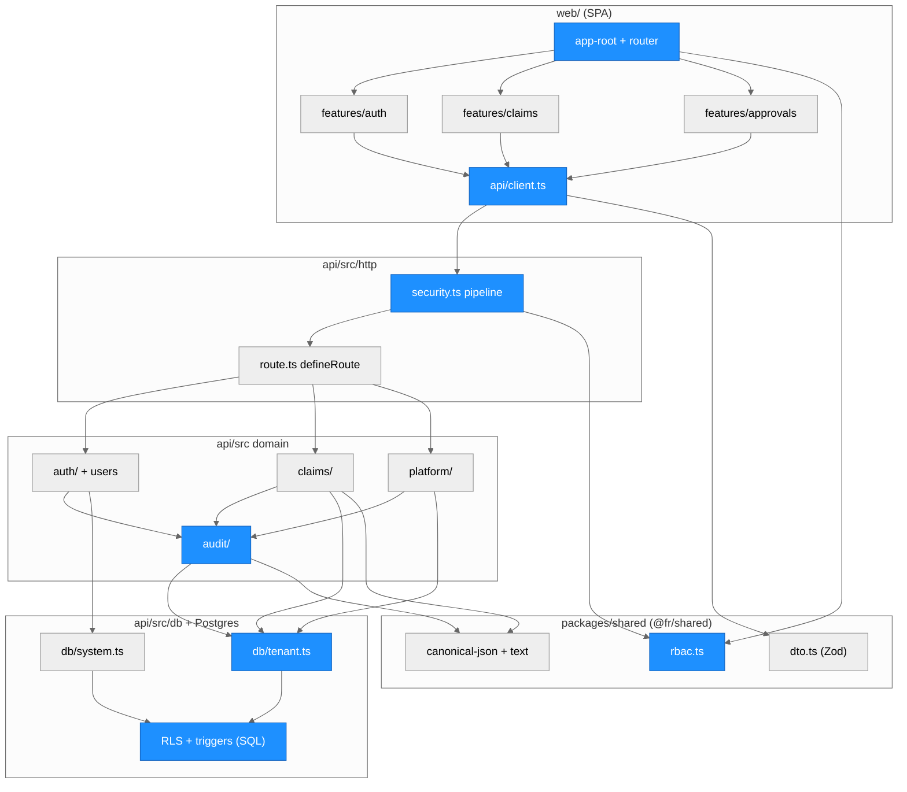

> Alt i dette diagrammet er nytt i denne kjøringen. Blått markerer de sikkerhetskritiske modulene.

### Modulreferanse

| Modul / fil | Lag | Formål | Viktige eksporter | Endret |
| --- | --- | --- | --- | --- |
| `packages/shared/src/rbac.ts` | Delt | **Eneste sannhetskilde** for roller og den frosne tillatelsesmatrisen | `ROLES`, `PERMISSION_MATRIX`, `can`, `canAssignRole`, `canManageUserWithRole`, `MFA_REQUIRED_ROLES` | ny |
| `packages/shared/src/dto.ts` | Delt | Strenge forespørselsskjemaer og respons-DTO-er (også `CLAIM_SORT_FIELDS`) | Zod-skjemaer | ny |
| `packages/shared/src/canonical-json.ts`, `text.ts`, `money.ts` | Delt | Kanonisk JSON for hashing; `displayText` og kontroll av usikre tegn; formatering av heltallscent | `canonicalJson`, `GENESIS_HASH`, `displayText`, `formatUsdCents` | ny |
| `api/src/app.ts`, `server.ts`, `config.ts` | API | App-fabrikk; feilsikker konfigurasjon (produksjonsvern, kontroll av hemmeligheter) | `buildApp`, `loadConfig`, `secretEntropyProblem` | ny |
| `api/src/http/security.ts` | API | Én `onRequest`-pipeline: ratebegrensning → Origin → CSRF → autentisering → tillatelse; sikkerhetshoder | `registerSecurityPipeline` | ny |
| `api/src/http/route.ts` | API | `defineRoute`; oppstarten feiler hvis en rute mangler tilgangsdeklarasjon; Zod-validering i `preHandler` | `defineRoute` | ny |
| `api/src/security/*` | API | argon2id, HS256-JWT (nøkkel/typ/aud per formål), TOTP, CSRF, HKDF/AES-GCM, utestengingsmatematikk | | ny |
| `api/src/auth/*` | API | Innlogging, MFA, refresh-rotasjon + gjenbruksdeteksjon, glemt passord/tilbakestilling, invitasjoner, brukere (R3-R23), dev-utboks (R38) | `authenticateAccessToken`, `rotateRefreshToken`, ruteregistrering | ny |
| `api/src/claims/*` | API | Liste/sortering/søk (`escapeLike`), pakkevisning, innholdshash, tilstandsmaskin for gjennomgang, godkjenninger (R26-R34) | `canTransition`, `packetContentHash` | ny |
| `api/src/platform/*` | API | Helse, tenant-statistikk, SUPER_ADMIN-lesing på tvers av tenants (revisjonslogget først) | `crossTenantRead` | ny |
| `api/src/audit/*` | API | Hashkjede, tilføying under advisory lock, verifikator, liste-/verifiseringsruter | `appendAudit`, `ChainVerifier` | ny |
| `api/src/db/tenant.ts`, `system.ts` | Data | Lag 2: tenant-utvidelse som feiler lukket; systemmodus-transaksjoner (begrenset av lint) | `withTenantTx`, `withSystemTx` | ny |
| `api/prisma/migrations/20261008000000_init/migration.sql`, `api/db/init/00-roles.sql` | Data | Skjema, RLS + FORCE, minste-privilegium-tildelinger, append-only- og tilstandsmaskin-triggere, DB-roller | | ny |
| `web/src/api/client.ts` | Web | Tilgangstoken i minnet, CSRF-hode, refresh én om gangen (Web Locks på tvers av faner) | `ApiClient` | ny |
| `web/src/features/{auth,shell,claims,approvals}` | Web | Sider for innlogging/MFA/tilbakestilling/invitasjon, skall + kommandopalett, kravtabell + detaljpanel, godkjenningskø | sider | ny |
| `infra/*.tf` | Infra | AWS-skjelett (kun fmt/validate, aldri anvendt) | | ny |
| `compose.web.yml`, `.github/workflows/web-ci.yml` | Drift | Egen lokal stack og egen CI; Python-tjenestens `docker-compose.yml` og `ci.yml` er urørt | | ny |

## Forespørselspipeline (dataflyt)

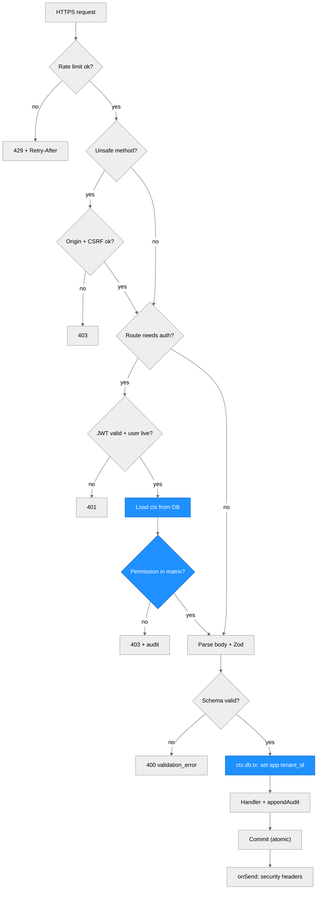

Autentisering og autorisasjon kjøres i `onRequest`, før body parses. En uautentisert eller forbudt
forespørsel får derfor 401/403 selv om body er ugyldig. En forretningsendring og revisjonshendelsen
dens committes i samme transaksjon: feiler tilføyingen til revisjonssporet, returnerer forespørselen 500
og ingenting endres.

## Autentiseringsflyter

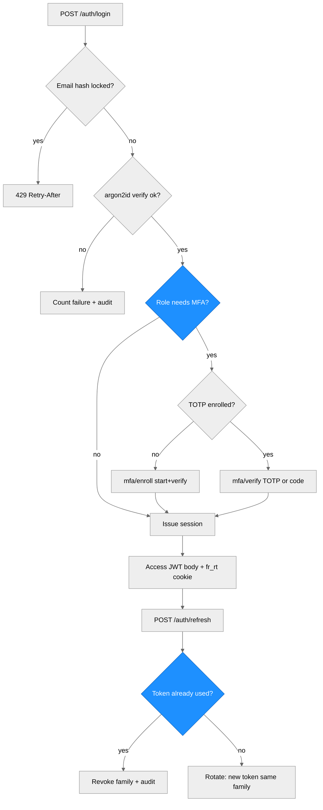

| Flyt | Ruter (under `/api/v1`) | Viktige regler |
| --- | --- | --- |
| Innlogging | `POST /auth/login` | argon2id med en dummy-verifisering for ukjente eller deaktiverte brukere; utestenging per e-posthash `min(30·2^(f-5), 900)` s etter 5 feil; ratebegrensning for auth 20/60 s per IP |
| MFA | `/auth/mfa/verify`, `/auth/mfa/enroll/start`, `/auth/mfa/enroll/verify` | påkrevd for OWNER, ADMIN, PLATFORM_DEV, SUPER_ADMIN; RFC 6238 ±1 steg; godtatt steg må øke strengt (ingen gjenbruk); gjenopprettingskoder kan brukes én gang |
| Sesjon | `/auth/refresh`, `/auth/logout`, `GET /me` | tilgangs-JWT (10 min) holdes i JS-minnet; informasjonskapselen `fr_rt` er `HttpOnly; Secure; SameSite=Strict; Path=/api/v1/auth`; DB lagrer en HMAC av tokenet; gjenbruk tilbakekaller hele familien; en familie lever maks 30 dager |
| CSRF | `GET /auth/csrf` | informasjonskapselen `fr_csrf` == `X-CSRF-Token` == `nonce.HMAC(secret, nonce)`, pluss en Origin-kontroll |
| Gjenoppretting | `/auth/forgot`, `/auth/reset`, `/auth/change-password` | samme svar for ukjente e-poster; tilbakestilling tilbakekaller alle sesjoner; glemt passord er begrenset til 5/15 min |
| Invitasjoner | `/users/invites`, `/auth/invites/inspect`, `/auth/invites/accept` | rolletildeling er rangbasert (`canAssignRole`); OWNER kan aldri tildeles |

## RBAC

`packages/shared/src/rbac.ts` er eneste sannhetskilde. API-et kontrollerer `can(role, permission)` på
hver forespørsel. Nettappen importerer de samme frosne dataene bare for å skjule kontroller.

| Tillatelse | OWNER | ADMIN | MANAGER | REVIEWER | ANALYST | VIEWER | PLATFORM_DEV | SUPER_ADMIN |
| --- | --- | --- | --- | --- | --- | --- | --- | --- |
| `claims:read` | x | x | x | x | x | x | | |
| `claims:assign` | x | x | x | | | | | |
| `packets:edit`, `packets:approve` | x | x | x | x | | | | |
| `demands:send` | x | x | x | | | | | |
| `import:run` (steg 3: batcher, opplasting, dokumenter, nedlasting, opprett krav) | x | x | x | x | x | | | |
| `import:review` (steg 3: gjennomgangskø og beslutninger) | x | x | x | x | | | | |
| `export:claims` (steg 3) | x | x | x | x | x | | | |
| `export:packets`, `export:outcomes` (steg 3) | x | x | x | x | | | | |
| `users:read`, `users:manage`, `audit:read`, `settings:manage`, `integrations:manage` | x | x | | | | | | |
| `admins:manage`, `billing:manage`, `tenant:delete` | x | | | | | | | |
| `apikeys:manage` (steg 4: opprette, liste og tilbakekalle tenantenes API-nøkler) | x | x | | | | | | |
| `claims:analyze` (steg 5: analysere ett krav, masseanalyse; ingen API-nøkkel-scope) | x | x | x | x | x | | | |
| `charge_labels:manage` (steg 6: sette og slette teamets gebyretiketter; ingen API-nøkkel-scope) | x | x | x | x | | | | |
| `platform:health` (steg 4: også pipelinehelse og telemetri) | | | | | | | x | x |
| `platform:flags`, `platform:logs` | | | | | | | x | |
| `platform:eval` (steg 4: evalueringskjøringer) | | | | | | | x | |
| `platform:audit` (steg 4: plattformens revisjonskjede) | | | | | | | | x |
| `platform:tenants:list`, `platform:cross_tenant_read` | | | | | | | | x |

Plattformroller har ingen tenant og ingen tillatelse til tenant-data. En SUPER_ADMIN-lesing på tvers av
tenants er skrivebeskyttet, krever en begrunnelse på minst 10 tegn og logges først i revisjonssporet til
måltenanten. Det finnes ingen Team-modell, så alle tenant-roller ser alle krav i sin tenant (antakelse
A4).

## Tenant-isolasjon (tre lag, feiler lukket)

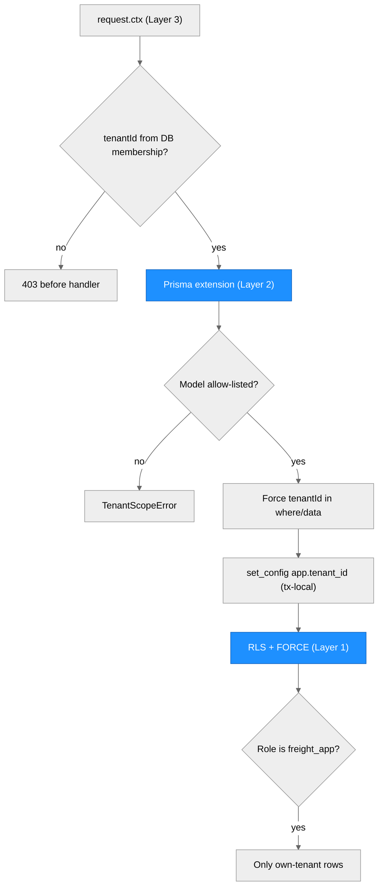

- **Lag 1, PostgreSQL RLS.** Hver tenant-avgrenset tabell (`claims`, `evidence_packets`,
  pakkens undertabeller, `approvals`, `memberships`, `invites`, `audit_events`) har `ENABLE` og
  `FORCE ROW LEVEL SECURITY` med `USING/WITH CHECK (tenant_id = fr_current_tenant())`. Uten
  `app.tenant_id` satt ser spørringer null rader. Bare `memberships` og `invites` tillater i tillegg
  `fr_system_mode()` (oppstart av autentisering), og `platform`-revisjonskjeden er bare synlig i
  systemmodus.
- **Roller.** API-et kjører som `freight_app` (`NOSUPERUSER NOBYPASSRLS NOINHERIT`, ikke eier; bare
  DML-tildelinger; `evidence_packets` får bare `UPDATE (status)`; tabeller som bare kan utvides får bare
  `SELECT, INSERT`). `freight_owner` eier skjemaet og kjører migrasjoner, seed og testoppsett
  (BYPASSRLS).
- **Lag 2, Prisma-utvidelse som feiler lukket** (`api/src/db/tenant.ts`). Modellene er hvitelistet;
  `tenantId` legges inn i hver where-betingelse og hver create, og en motstridende verdi kaster en feil.
  Rå SQL er blokkert på tenant-klienten.
- **Lag 3, forespørselskontekst.** Bruker, rolle, tenant-status og om refresh-familien lever lastes på
  nytt fra DB ved hver forespørsel, aldri fra token-claims. Plattformbrukere får `db = null`.

## Revisjonsspor med hashkjede

- Én kjede per tenant (`chain_key = t:<tenantId>`) pluss en `platform`-kjede.
  `hash_n = SHA-256(hash_{n-1} + "\n" + canonicalJson(event_n))`; genesis er 64 nuller; `seq` er
  sammenhengende under `pg_advisory_xact_lock(hashtextextended(chain_key, 0))`.
- Triggere blokkerer UPDATE, DELETE og TRUNCATE på `audit_events` (og på `approvals`,
  `login_attempts` og pakkens undertabeller), også for eieren. Bare `db:seed -- --reset` i dev/test
  omgår dem via `session_replication_role`.
- `GET /api/v1/audit/verify` (`audit:read`) regner ut kjeden på nytt og rapporterer `brokenAtSeq`.
  Metadata går gjennom en hviteliste; mislykkede innlogginger registreres med `actor = null`.

## Tilstandsmaskin for godkjenning

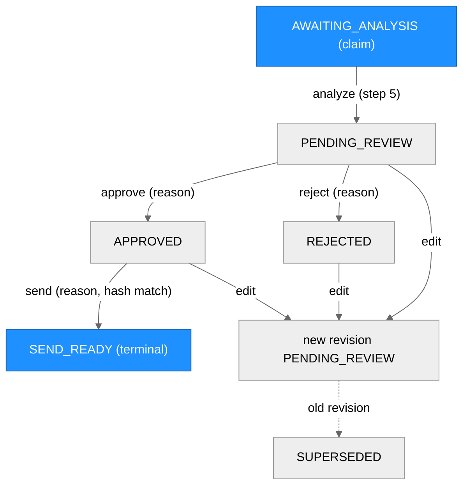

`AWAITING_ANALYSIS` er bare en kravstatus (importerte krav uten pakke ennå). Siden kjøringen
`REQ-20261010-step5-analysis` lager analysehandlingen pakkerevisjon 1 i `PENDING_REVIEW` og flytter kravet dit;
ingenting går tilbake til `AWAITING_ANALYSIS`. Se [kravanalyse (steg 5)](#nettplattform-kravanalyse-steg-5).

Hver handling krever en begrunnelse og skriver en `approvals`-rad (som bare kan utvides) pluss en
revisjonshendelse i én transaksjon, med kravraden låst `FOR UPDATE`. Godkjenning lagrer pakkens kanoniske
innholdshash. Sending regner den ut på nytt og krever at den er lik både godkjenningens hash og den lagrede
hashen. «Send» merker bare kravet som klart til sending: ingen e-post, ingen betaling. DB-triggeren
`fr_packet_update_guard` håndhever de samme overgangene og gjør alle kolonner unntatt `status`
uforanderlige. Redigering lager en ny revisjon; godkjenningsraden registrerer grunnrevisjonen (avvik 18).
Siden kjøringen `REQ-20261009-four-eyes` avvises også godkjenning og avvisning (403 `four_eyes_required`)
for alle som har laget en revisjon av kravets pakke; se
[firøyeprinsippet](#nettplattform-firøyeprinsippet-arbeidsdeling).

| Funksjon | Definert i | Kalles av | Formål |
| --- | --- | --- | --- |
| `canTransition`, `targetStatus` | `api/src/claims/state-machine.ts` | kravtjenesten | overgangstabell (speiler SQL-triggeren) |
| `packetContentHash` | `api/src/claims/content-hash.ts` | godkjenn, rediger, send, integritet i visningen | kanonisk hash med ordenstall i stedet for UUID-er |
| `lockClaimForUpdate` | `api/src/db/tenant.ts` | kravtjenesten | serialiserer samtidige beslutninger |
| `appendAudit` | `api/src/audit/audit.ts` | hver endrende handler, lesing på tvers av tenants | tilføying til kjeden i kallerens transaksjon |
| `crossTenantRead` | `api/src/platform/cross-tenant.ts` | plattformruter | revisjonslogg først, så lesing, feiler lukket |

## AWS-kartlegging (nettstack)

`infra/` erstatter `deploy/terraform/` **kun for nettstacken**. Den følger prinsippene i
[deploy/aws.md](deploy/aws.md) ([norsk](deploy/aws.no.md)): hemmeligheter kommer fra Secrets Manager via
task-definisjonen og er aldri i state, migrasjoner kjøres som en engangs ECS-oppgave før utrullingen, WAF
står foran, og ingenting anvendes automatisk.

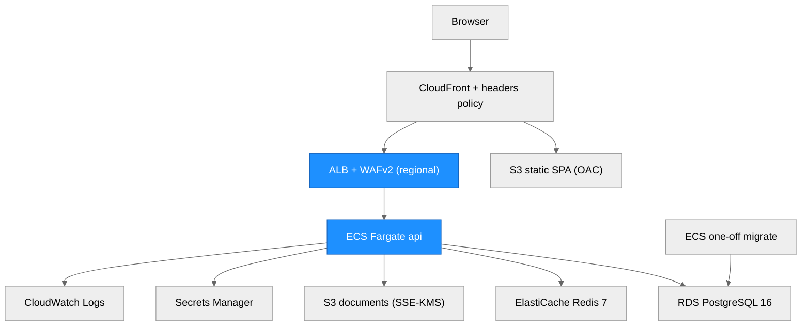

| Komponent | Lokalt (`compose.web.yml`) | AWS (`infra/`) |
| --- | --- | --- |
| SPA | nginx-unprivileged, hoder fra `web/security-headers.json` | S3 + CloudFront (OAC), respons-hode-policy generert fra den samme JSON-filen |
| API | `api`-container (uid 10001, skrivebeskyttet rotfilsystem, capabilities fjernet) | ECS Fargate, samme herding, private subnett, VPC-endepunkter (ingen NAT) |
| Kant | kun loopback | ALB nåbar bare fra CloudFronts origin-områder, TLS 1.2/1.3-policy, WAFv2 (administrerte regler, IP-ratebegrensning, Content-Length > 64 KiB; steg 3: opplastingsruten har en egen regel > 10 MiB) |
| DB | `postgres:16.15-alpine` + `00-roles.sql` | RDS PostgreSQL 16, KMS, `rds.force_ssl=1`, administrert masterpassord; roller legges inn av en operatør |
| Lager for ratebegrensning | `redis:7-alpine` | ElastiCache Redis 7, TLS + kryptering i hvile, AUTH-token satt utenom Terraform |
| Dokumenter | MinIO (`chainguard/minio`) med innebygd KMS (`fr-dev-key`) og versjonering | S3 SSE-KMS (bucket-policyen avviser opplasting uten CMK-en), versjonering, livssyklusregler; task-rollen begrenset til prefikset `t/*`, `s3:DeleteObject` bare på `t/*/imports/*` |
| Hemmeligheter | offentlige `local-dev-*`-verdier (avvist i produksjon) | 7 Secrets Manager-beholdere; verdiene settes utenom Terraform |

## Arkitekturmønstre

- **Sikkerhetspipeline som én hook**: en eksakt, testbar rekkefølge (rate → Origin → CSRF → autentisering → autorisasjon → validering).
- **Feil lukket overalt**: ukjente ruter hindrer oppstart; uten tenant gir null rader; en feil i revisjonssporet ruller tilbake forretningsendringen; produksjonskonfigurasjonen avviser dev-verdier.
- **Delt kontraktspakke**: roller, matrise og DTO-er er definert én gang i `@fr/shared` og brukes av både API og web.
- **Dybdeforsvar i databasen**: RLS, tildelinger og triggere håndhever invariantene selv om applikasjonskoden er feil.
- **Innholdsadresserte godkjenninger**: beslutninger bindes til en kanonisk hash, ikke til en rad som kan endres.

## Merknader

- Avvik fra briefen: Node 22 i stedet for 20 (Node 20 er EOL); en Prisma-klientutvidelse i stedet for den fjernede `$use`-mellomvaren; eslint 9; framer-motion utelatt. Hele listen (22 punkter) står i kjøringens `implementation.md`.
- Ikke verifisert: Docker-imagene og compose-stacken, Playwright-ende-til-ende-tester, enhver AWS-utrulling. Se «Known gaps» i trusselmodellen.

---

# Nettplattform: import og eksport (steg 3)

> Skrevet av scriber for kjøringen `REQ-20261008-step3-import-export` 2026-10-09 (grenen
> `feat/import-export`). **Før produkt, kun syntetiske data, aldri utrullet.** Trusselradene for dette
> steget er T18-T31 i [technical/web-platform-security.md](technical/web-platform-security.md) (engelsk).
> E-postvideresending er kun et design: [docs/design/email-ingest.md](docs/design/email-ingest.md)
> (engelsk). Mermaid-diagrammene er de samme som i den engelske originalen
> ([ARCHITECTURE.md](ARCHITECTURE.md#web-platform-import-and-export-step-3)).

## Oversikt (steg 3)

Steg 3 legger til **import** og **eksport** av dokumenter. Import dekker opplasting, typegjenkjenning,
kryptert lagring, parsing i sandkasse, deterministisk uttrekk med kildehenvisninger, menneskelig
gjennomgang og opprettelse av krav. Eksport strømmer krav, bevispakker og godkjenningsutfall som CSV
eller XLSX, med nøytralisering av formler. Steg 3 legger ikke til OCR, AI- eller LLM-kall, utgående
e-post eller mottak av videresendt e-post. Parsing og uttrekk er en TypeScript-port av Python-modulene
`ingest/` og `extraction/`. Paritetstester sjekker den mot Python-koden. Python er bare et testorakel og
kjører aldri i produksjon.

Hovedbeslutninger:

- Pipelinen er **synkron** inne i opplastingsforespørselen og begrenset av tidsgrenser. Statusmodellen
  åpner allerede for en kø senere.
- API-et **videreformidler** originalene. Det finnes ingen signerte URL-er.
- PDF-er leses bare fra tekstlaget. Bilder lagres og flagges for manuell registrering.
- Krav som opprettes fra import, starter i den nye statusen `AWAITING_ANALYSIS`, uten beløp og uten
  bevispakke. Steg 5 legger til analysen ([kravanalyse (steg 5)](#nettplattform-kravanalyse-steg-5)).

## Modulstruktur (steg 3)

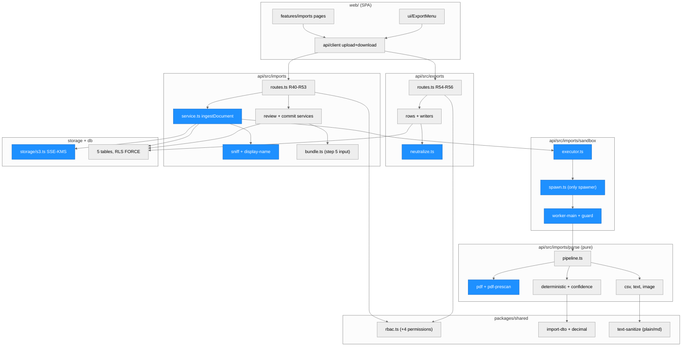

> Alt i dette diagrammet er nytt eller endret i steg 3. Blått markerer modulene som håndterer fiendtlige
> bytes eller fiendtlig celleinnhold. Modulreferansen (filer, eksporter, endringer) står i den engelske
> originalen.

## Importpipeline (dataflyt)

Én opplasting er én forespørsel `POST /api/v1/imports/:batchId/documents?filename=` med filens rå bytes.
Pipelinen kjører synkront, og svaret inneholder dokumentets endelige tilstand.

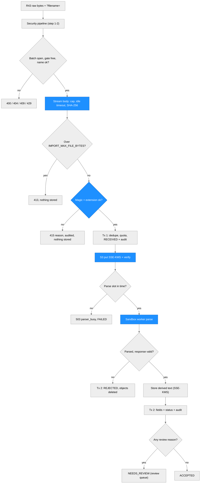

1. **Opplasting.** Klienten sender rå bytes (`Content-Type: application/octet-stream`, ingen multipart).
   Filnavnet er en spørreparameter og renses til et visningsnavn. Klientens medietype brukes aldri.
   Ratebegrensning, Origin, CSRF, autentisering og tillatelse kjøres før innholdet leses.
2. **Typegjenkjenning.** API-et godtar `%PDF-` på posisjon 0, PNG-signaturen eller `FF D8 FF`. Alt annet
   behandles som tekst. Tekst kan ikke inneholde NUL, C0-kontrolltegn eller DEL utenom HT, LF, CR og FF,
   og kan ikke starte som HTML, SVG, XML eller PHP. Kjente signaturer som ikke er tillatt (zip, gzip, PE,
   ELF, GIF, RIFF, OLE, PostScript, rar, 7z) avvises. Den siste filendelsen må være en av
   `.pdf .png .jpg .jpeg .csv .txt` og stemme med den gjenkjente typen.
3. **Lagring.** Transaksjon 1 setter inn raden `RECEIVED` og revisjonshendelsen før all treg I/O.
   Originalen lagres under `t/<tenantId>/imports/<batchId>/<docId>/original` med SSE-KMS og
   SHA-256-kontrollsum. I produksjon verifiserer en `HEAD`-forespørsel krypteringen. Nøkler inneholder
   aldri klientens filnavn.
4. **Isolert parsearbeider.** `ChildProcessExecutor` tar en plass fra en semafor per instans. Den
   starter `node` med `--permission`, som bare gir lesetilgang til arbeiderens filer. Arbeideren får
   ingen skrive-, barneprosess-, worker-, addon- eller WASI-tillatelse. Den får også
   `--max-old-space-size`, et **tomt miljø** og en tom arbeidsmappe. En vaktmodul (beste innsats, i
   samme prosess) sletter `fetch`, `WebSocket`, `EventSource` og `XMLHttpRequest`, blokkerer nettverks-,
   prosess- og VM-modulene og låser `connect` på socket-klassene som kan nås via stdio-strømmene. Den er
   ingen sikkerhetsgrense: den reelle nettverkskontrollen er et nettverk uten utgående trafikk (i AWS
   oppgavenettverket uten NAT), og en egen parseroppgave uten utgående trafikk er et krav før lansering.
   Forelderprosessen håndhever veggklokke, utdatagrense og (på Linux) en RSS-grense. Den behandler
   arbeideren som upålitelig: hele svaret valideres på nytt, og et ugyldig svar blir `parse_failed`.
5. **PDF-forhåndsskanning.** `pdf-prescan.ts` går gjennom PDF-strukturen med faste grenser før pdf.js
   ser filen. Den avviser som `malformed_pdf`: mer enn 3 kjedede filtre, et indirekte `/Filter`,
   dekompresjonsbomber (32 MiB per strøm, 64 MiB totalt), `/Prev`-løkker, mer enn 64 xref-seksjoner,
   sidetrær større enn sideantallet pluss 16, og null sider. Den teller også tekst i innholdsstrømmene,
   også tekst utenfor siden, slik at grensen `PARSE_MAX_TEXT_CHARS` holder (`text_too_large`). Deretter
   leser pdf.js bare tekstlaget, uten merknader, vedlegg, JavaScript eller XFA.
6. **Uttrekk med kildehenvisning.** Den deterministiske leverandøren (`deterministic`, versjon 1) leser
   `Nøkkel: verdi`-linjer og gir bare tillatte felt. Hvert felt har en kildepeker (side, linje,
   UTF-16-start og -slutt, CSV-rad, renset utdrag) og en regelbasert konfidens. Et felt flagges når
   konfidensen er under `REVIEW_CONFIDENCE_THRESHOLD` (0,90), når verdien ikke kan tolkes, eller når
   duplikater er i konflikt. PDF-felt starter på 0,85, så alle PDF-felt flagges som standard.
7. **Gjennomgang.** Et dokument med en gjennomgangsgrunn får `NEEDS_REVIEW` og havner i
   gjennomgangskøen (`GET /reviews`). En gjennomgåer bekrefter, korrigerer eller avviser hvert flagget
   felt. For bilder kan gjennomgåeren også sette dokumenttypen og legge inn felt manuelt. Deretter godtar
   eller avviser gjennomgåeren dokumentet. Hver handling krever en begrunnelse og gir en rad i tabellen
   `import_review_decisions`, som bare kan utvides, pluss en revisjonshendelse. Godtatte dokumenter kan
   ikke endres.
8. **Opprett krav.** `POST /imports/:batchId/commit` grupperer batchens godtatte dokumenter etter
   normalisert lastnummer (NFKC, sammenslått mellomrom, store bokstaver). Den oppretter et
   `AWAITING_ANALYSIS`-krav eller kobler til et eksisterende. Har kravet allerede en bevispakke, kobles
   dokumentene bare til (`new_evidence_not_in_packet`), og pakken og feltene endres aldri. Operasjonen er
   atomisk og idempotent.

### Funksjonskall (opplasting)

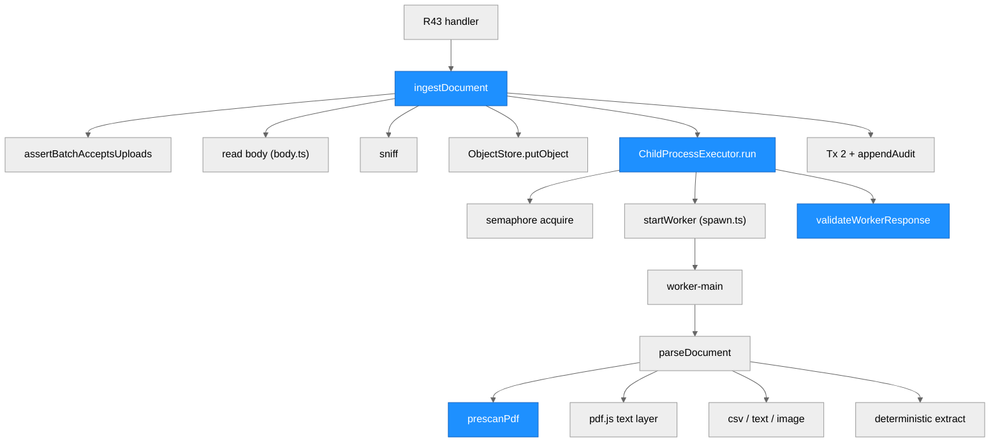

## Dokumenttilstander

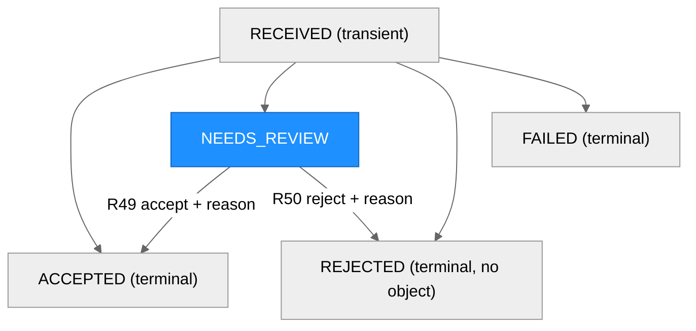

Et felt går én gang fra `PROPOSED` til `CONFIRMED`, `CORRECTED` eller `REJECTED`. En databasetrigger
håndhever overgangene og holder uttrukket verdi, råverdi, konfidens og pekere uforanderlige.

Siden kjøringen `REQ-20261009-four-eyes` avvises R49 (godta) med 403 `four_eyes_required` for den som
lastet opp dokumentet, og for alle som har registrert en felt-`CORRECT` eller -`ADD` på det; se
[firøyeprinsippet](#nettplattform-firøyeprinsippet-arbeidsdeling). Et dokument som går rett fra
`RECEIVED` til `ACCEPTED` (ingen grunner til gjennomgang), har ingen menneskelig godkjenner (restrisiko
FE-S1).

## Datamodell og lagring

Fem nye tenant-tabeller: `import_batches`, `import_documents`, `extracted_fields`,
`import_review_decisions` (kun tillegg) og `claim_documents` (kun innsetting). Alle har `ENABLE` og
`FORCE ROW LEVEL SECURITY`, kolonnevise tildelinger for `freight_app`, og står i `TENANT_MODELS`. En
CHECK krever at `storage_key` starter med `t/<egen tenant_id>/`. Objektlagringen er privat. Hvert kall i
`ObjectStore` kontrollerer tenant-prefikset på nytt, og API-et returnerer aldri en lagrings-URL.
Nedlasting av originalen strømmes gjennom API-et med et syntetisk filnavn, og SHA-256 av de strømmede
bytene kontrolleres.

## Eksportstrømming

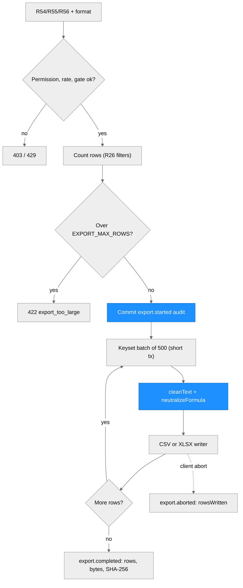

- **Formater.** CSV er UTF-8 med BOM og CRLF, og hver tekstcelle står i anførselstegn. XLSX er ett ark,
  skrevet som en strømmet ZIP med `fflate`, med typede tekster og tall og en fet, fastfrosset
  overskriftsrad. Det finnes ingen formler, lenker, makroer, tegninger eller eksterne relasjoner.
- **Formelnøytralisering.** Tekstceller mister kontrolltegn, bidi- og nullbreddetegn (tab, CR, LF, LS og
  PS blir ett mellomrom) og kuttes ved 10 000 tegn. Er første tegn etter eventuelt mellomrom `=`, `+`,
  `-`, `@` eller en fullbreddeform (U+FF1D, U+FF0B, U+FF0D, U+FF20), får cellen en ledende `'`. Tall
  skrives som tall og nøytraliseres aldri.
- **Begrenset minne.** Hver bolk på 500 rader bruker sin egen korte transaksjon, og skriverne respekterer
  mottrykk (backpressure).

## Python-paritet: registrerte avvik (D1-D8)

TypeScript-parseren skal gi samme resultat som Python-referansen (`ingest_bytes`, `classify`,
`DeterministicStubProvider.extract`) for den støttede delmengden. `api/test/parity/extract.parity.test.ts`
kjører Python-koden via `tools/parity/extract_dump.py` og sammenligner dokumenttype, sha256, tekst og
felt. Avvikene nedenfor er de **eneste** tillatte forskjellene. Alle andre forskjeller er feil.

| ID | Avvik (TS mot Python) | Begrunnelse |
| --- | --- | --- |
| D1 | PDF-signaturen `%PDF-` må stå på posisjon 0. Python tåler opptil 1024 søppelbytes foran. | Søppel foran er et klassisk polyglott-triks. Posisjon 0 gjør typen entydig. |
| D2 | PDF-tekst kommer fra pdf.js, ikke pdfplumber. Paritet gjelder bare enkle PDF-er med tekstlag (én tekstlinje per linje, standard Helvetica eller Times, én spalte). | pdfplumber finnes bare i Python, og TS-porten skal ikke kalle Python under kjøring. To motorer ordner og spatierer tekst ulikt på komplekse oppsett. |
| D3 | Filendelsen og den gjenkjente typen må stemme overens. Tillatte endelser: `.pdf .png .jpg .jpeg .csv .txt` (uten hensyn til store og små bokstaver, bare siste endelse). Python ser bare på endelsen. | Hindrer at en PDF eller et skript forkledd som `.csv` (og omvendt) havner i feil parser. |
| D4 | Ugyldig UTF-8 dekodes med U+FFFD som i Python, men gir advarselen og gjennomgangsgrunnen `DECODE_REPLACEMENTS`. NUL, C0-kontrollbytes utenom HT, LF, CR og FF, **eller DEL (0x7F)** avviser filen som `binary_content`. Python ville fortsatt. | Binært innhold i en «tekstfil» tyder på en forkledd eller ødelagt fil. DEL-regelen kom i rettingsrunde 1 (lederavgjørelse SQ2). Python har ingen binærsperre, så DEL har ingen motpart i Python. |
| D5 | Tekst over `PARSE_MAX_TEXT_CHARS` (standard 2 000 000) avvises som `text_too_large`. Pythons grense er 5 000 000. For PDF-er teller også tekst utenfor siden (forhåndsskanning, rettingsrunde 1). | Strammere grense for minne og tid i parseren. |
| D6 | Tekstverdier renses for usikre tegn (kontrolltegn, linjeskilletegn, bidi-kontrolltegn) og kuttes ved 200 tegn, med feltgrunnen `SANITIZED_VALUE` når noe ble endret. | Verdiene vises i brukergrensesnittet og eksporteres, så de må være trygg tekst på én linje. |
| D7 | Ikke-ASCII-sifre og eksotisk Unicode-bokstavfolding godtas ikke der Pythons regulære uttrykk ville godtatt dem. Dato- og tidssifre er bare ASCII `0-9`, og `USD`-endelsen godtar bare ASCII-bokstaver. | Hindrer at sifre og bokstaver som ser like ut, endrer beløp eller datoer. |
| D8 | PNG og JPEG godtas og strukturvalideres, men gir **ingen felt** (ingen OCR). Status er `NEEDS_REVIEW` med grunnen `IMAGE_NO_TEXT_LAYER`. En gjennomgåer kan sette typen (R46) og legge inn felt (R47). | Python leser ikke bilder, og OCR er utenfor omfanget av steg 3. |

Beslektede merknader (ikke nye avvik): `parseMoney` beholder CPython-paritet, så `"1,2,3"` blir `123` og
`"$-5"` blir `-5` (avgjørelse SQ1; et senere steg kan gjøre dette strengere som et nytt registrert avvik;
steg 5 gjorde det ikke, men avviser et negativt resultat ved lagring, RD3, 422).
Forhåndsskanningen avviser fiendtlige PDF-er utenfor D2-delmengden. Opptil 16 nullbytes etter `IEND` i
PNG tåles, som for JPEG. `strptime`-paritet følger CPython 3.12 for et ledende mellomrom foran `%H` eller
`%d`. Feltrekkefølgen følger N7-nøkkelrekkefølgen og deretter `groupIndex` (SQ4).

## Grensesnitt for steg 5 (port av regler og bevis)

**Status: levert** i kjøringen `REQ-20261010-step5-analysis` (se
[kravanalyse (steg 5)](#nettplattform-kravanalyse-steg-5)). Punkt 1-6 brukes som beskrevet nedenfor; punkt 7
(en LLM-leverandør) og strengere tolking av beløp gjenstår.

1. **Inndata.** `loadBundleForClaim(tx, claimId)` gir `{bundle, sources}`. `bundle` er TS-versjonen av
   `ExtractedBundle`, bygget fra de effektive feltverdiene i kravets dokumenter. Steg 5 la til
   `loadAnalysisInput(tx, claimId)` (samme utvalg og rekkefølge av dokumenter, pluss feltproveniens og
   `sizeBytes`); `loadBundleForClaim` delegerer nå til den med uendret signatur. Inngangen til motoren er
   `buildEvidence(docs, bundle, perspective, settings, now)` i `@fr/shared/analysis`, motparten til
   Pythons `run_pipeline` etter `extract_bundle`.
2. **Kildehenvisning.** `pointerToLocator(displayName, pointer)` gir sitatlokatorer som `invoice.txt:L5`
   eller `file.pdf:p2:L14`. `sources[]` har `documentId`, `displayName`, `sha256` og `docType`.
3. **Penger.** `packages/shared/src/decimal.ts` er grunnlaget for tolking av beløp. Steg 5 la til
   `packages/shared/src/analysis/py-decimal.ts`, en `Decimal` som er nøyaktig lik CPython (presisjon 28,
   ROUND_HALF_EVEN, quantize, formatering som `str` og `.2f`), for regnestykkene i reglene.
4. **Tekst.** `plain` og `md` (`packages/shared/src/text-sanitize.ts`) er allerede portert med paritet.
5. **Kravets livsløp.** Steg 5 la til overgangen `AWAITING_ANALYSIS -> PENDING_REVIEW`, med
   pakkerevisjon 1 og revisjonshendelsen `claim.analyzed` i samme transaksjon. `claim_documents` viser
   kildedokumentene. Revisjon 1 registrerer `created_by_id` som brukeren som startet analysen, så den
   brukeren kan ikke godkjenne den (FE-N2 lukket; migreringen `20261012000000_analysis` avviser en revisjon
   1 uten forfatter for et krav som venter på analyse).
6. **Paritetsmønster.** `tools/parity/` og `api/test/parity/` er mønsteret for regel-dumpen. CI setter
   allerede opp Python. Steg 5 la til `tools/parity/rules_dump.py` og `api/test/parity/rules.parity.test.ts`
   (registrerte avvik RD1-RD6).
7. **Leverandører.** `ExtractionProvider` er der en LLM-leverandør kan kobles inn senere, bak rensing og
   med obligatorisk kildehenvisning. Den kan aldri senke et flagg som de deterministiske kontrollene har
   satt.

## Slik kjører du kontrollene for steg 3

```bash
npm run db:migrate:deploy && npm run db:seed -- --reset
npm run ensure-bucket        # creates the dev/test bucket (MinIO), enables versioning; refuses production
npm run build                # builds the parser worker; run it before the integration and acceptance tests
npm run test:integration     # needs Postgres, S3 (MinIO) and Python for the parity suite (PYTHON=<interpreter>)
npm run test:acceptance      # black-box suites; same services
```

README-avsnittet «Import og eksport (steg 3)» beskriver lokalt oppsett uten Docker: portabel PostgreSQL,
MinIO med KMS og Python for paritet.

## Merknader (steg 3)

- Kjøringens `implementation.md` lister avvikene fra spesifikasjonen (14 punkter pluss rettingsrunde 1).
  De to viktigste: arbeideren startes ikke med `--no-experimental-fetch` (vakten sletter
  nettverksglobalene i stedet), og WAF-regelen for Content-Length har et eget unntak for
  opplastingsruten.
- Samtidighetsgrensene (opplasting, eksport, parseplasser) gjelder per API-instans, ikke distribuert.
- Ikke verifisert: container-images, compose-stacken, Playwright-ende-til-ende-tester, enhver
  AWS-utrulling.

---

# Nettplattform: utviklerdashbord, Recovery intelligence og API-nøkler (steg 4)

> Skrevet av scriber for kjøringen `REQ-20261009-step4-intelligence` 2026-10-09 (grenen
> `feat/intelligence`). **Før produkt, kun syntetiske data, aldri utrullet.** Trusselradene for dette
> steget er T32-T45 i [technical/web-platform-security.md](technical/web-platform-security.md) (engelsk).
> Alle hemmeligheter står i [docs/secrets.no.md](docs/secrets.no.md). Beskrivelse for brukere:
> [README.no.md, steg 4](README.no.md#utviklerdashbord-recovery-intelligence-og-api-nøkler-steg-4).
> Mermaid-diagrammene er de samme som i den engelske originalen
> ([ARCHITECTURE.md](ARCHITECTURE.md#web-platform-dev-dashboard-recovery-intelligence-and-api-keys-step-4)).

## Oversikt (steg 4)

Steg 4 legger fire ting oppå steg 1-3:

1. **Utviklerdashbord** (`/dev`, rutene R60-R68) for `PLATFORM_DEV` og `SUPER_ADMIN`: pipelinehelse
   aggregert over alle tenanter, telemetri for forespørsler og en filtrert loggvisning fra API-instansen
   som svarer, funksjonsflagg, skrivebeskyttede evalueringskjøringer og plattformens revisjonskjede.
   Plattformsvar inneholder bare aggregater og telemetri.
2. **Recovery intelligence** (rutene R70-R73) for tenantbrukere: en prioritert arbeidsliste
   (`priority-v1`), lignende tidligere krav (`similar-v1`) og et sammendrag av proveniens per krav. Alle
   tre er deterministiske funksjoner av lagrede kolonner i innringerens egen tenant.
3. **API-nøkler for tenanter** (rutene R80-R82 pluss en vei for maskinautentisering): HMAC-hashet, vist
   én gang, tre omfang over nøyaktig ni ruter som har valgt å godta nøkler.
4. **Evalueringsverktøy** (`api/src/eval/`, et kommandolinjeprogram): pass^k over det syntetiske settet
   `api/eval/sets/extraction-v1`, kjørt gjennom den ekte sandkasseparsingen; den eneste som skriver
   evalueringsdata.

Bindende regel for alt sammen (**regelen om ærlig merking**): ingenting vises som ikke er beregnet fra data
systemet har ved forespørselen eller registrert av et måleverktøy, hvert tall oppgir grunnlaget sitt, og
ingen påstand om treffsikkerhet, hastighetsgevinst, læring eller «AI» forekommer. De faste tekstene ligger
i `packages/shared/src/honest-copy.ts`; brukergrensesnittet viser dem ordrett. En arkitekturtest stopper
byggingen hvis strengene «neural mesh», «Hebbian», «solved-problems cache», «AI-powered», «faster than»
eller et mønster «Nx faster» forekommer i `api/src`, `packages/shared/src` eller `web/src`.

## Begreper i briefen mot det som er bygget

Produktbriefen bruker ord som denne koden **ikke** implementerer. Ingenting av det følgende finnes i
repoet, og ingen tall fra briefen er målt:

| Begrep i briefen | Status | Hva som er bygget i stedet (ærlig motsvar) |
| --- | --- | --- |
| «Hebbian router» (rangerer krav/ruter etter forventet innkrevbar verdi) | **Ikke implementert.** En Hebbian eller annen lært rangering trenger registrerte innkrevingsutfall (betalt, delvis betalt, avslått), og slike finnes ikke. Ruter (lanes) er ikke modellert. | `priority-v1`: en fast formel `recoverable + floor(pending_review * W / 100)` med W = 25 % som uttalt policy, eksplisitte regler ved likhet og en «hvorfor»-liste per rad. Ikke kalt «forventet verdi» (det finnes ingen sannsynligheter). |
| «Neural mesh» (panel / målinger) | **Ikke implementert.** Produktet har ingen nevral komponent. (`src/freight_recovery/forecast/neural.py` er valgfritt, uvalidert veikartstillas for Python-tjenesten og er ikke koblet til noe.) | Tabellen «Intelligence components» på Telemetry-fanen: de to komponentene `priority-v1` og `similar-v1` med målte kall, feil, varighetsgrenser og antall kandidater fra ekte forespørsler, merket Method «Fixed rules» og Learned model «None». |
| «Solved-problems cache» med «~250x» | **Ikke implementert.** Det finnes ingen cache av noe slag, og tallet ~250x er aldri målt. «Vinnende bevismønster» ville kreve utfall som ikke finnes. | `similar-v1`: forklarbar heltallslikhet (samme transportør 35, felles regler opptil 40, lignende beløp opptil 15, samme perspektiv 10; anker påkrevd; minimum 30) over tenantens egne avgjorte krav, som viser hvordan teamet behandlet hvert av dem. Den viser den målte `computeMs` for den ene forespørselen og ingenting som ligner et forhold for hastighetsgevinst. |
| «AI-uttrekk med proveniens» | Finnes siden steg 3 som **deterministisk, regelbasert** uttrekk med kildepekere (ingen LLM). | Steg 4 legger til proveniens-sammendraget per krav (antall felt per gjennomgangsstatus, laveste regelbaserte konfidens). |
| «pass^k-målinger» | **Bygget, bare på syntetiske testdata.** | Evalueringsverktøyet og den skrivebeskyttede Evaluation-fanen. Med denne deterministiske pipelinen er pass^k lik pass^1, og brukergrensesnittet sier det. Presenteres aldri som treffsikkerhet på kundedokumenter. |

Hva en lært rangering ville trenge (utsatt, kun design): registrerte utfall per krav; en offline
sammenligning mot `priority-v1` på en holdt-ut periode med en forhåndsregistrert måleverdi (for eksempel
innkrevde dollar ved fast gjennomgangskapasitet) og et intervall; og lansering bare bak et nytt flagg hvis
den slår den faste formelen med et intervall som ikke inneholder null. Sømmen er det rene paret
`scoreClaim`/`compareWorklist` pluss feltet `formula.version`.

## Modulstruktur (steg 4)

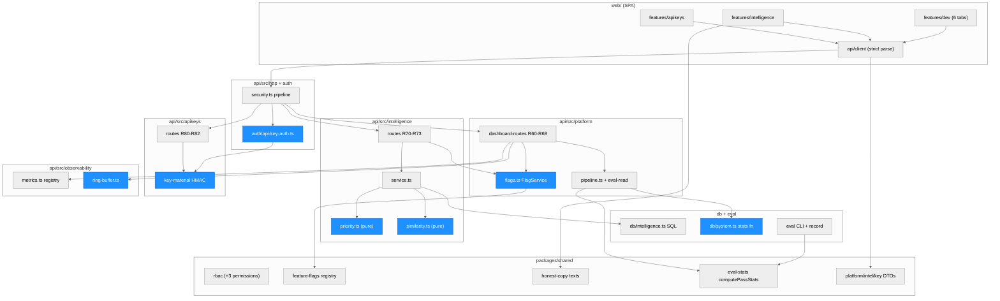

> Alt i dette diagrammet er nytt eller endret i steg 4. Blått markerer de sikkerhetsrelevante modulene
> (nøkkelautentisering, hashing av nøkler, flaggbufferen, avledning av logger, aggregatfunksjonen på tvers
> av tenanter) og de to poengkjernene.

### Modulreferanse (steg 4)

| Modul / fil | Lag | Formål | Viktige eksporter | Endret |
| --- | --- | --- | --- | --- |
| `packages/shared/src/rbac.ts` | Shared | Legger til `platform:eval` (PLATFORM_DEV), `platform:audit` (SUPER_ADMIN), `apikeys:manage` (OWNER, ADMIN) | `PERMISSION_MATRIX`, `can` | endret |
| `packages/shared/src/feature-flags.ts` | Shared | Flaggregisteret: nøyaktig `intelligence.provenance`, `intelligence.similar_claims`, `intelligence.worklist` (arkitekturtest) | `FEATURE_FLAGS`, `isKnownFlag` | ny |
| `packages/shared/src/honest-copy.ts` | Shared | De faste, ærlige tekstene (merknader for arbeidsliste, lignende krav, proveniens, ingen treffsikkerhet, evaluering, telemetri, logger, pipeline) | `WORKLIST_NOTE`, `worklistNote`, `EVAL_NOTE`, ... | ny |
| `packages/shared/src/eval-stats.ts` | Shared | pass^k-statistikk: andel per kjøring, pass^k, forventningsrett pass^j-kurve, ustabile saker, Wilson 95 %-intervall (z = 1,959964) | `computePassStats`, `binomial`, `wilsonInterval` | ny |
| `packages/shared/src/{platform,intelligence,api-key}-dto.ts` | Shared | Strenge Zod-skjemaer for hver forespørsel og hvert svar i steg 4; både nettklienten og API-et parser med dem | skjemaer, `API_KEY_SCOPES`, `SCOPE_PERMISSION` | ny |
| `api/src/http/security.ts`, `http/route.ts`, `http/context.ts` | API | URL-vakt (`fr_live_` i en URL = 400), nøkkelgrenen i forhåndsbehandleren, `apiKeyScope` på rutetilgang, `RequestCtx.role = 'API_KEY'` med `viaApiKey` | `registerSecurityPipeline`, `defineRoute` | endret |
| `api/src/auth/api-key-auth.ts` | API | Maskinautentisering: feilport per IP, format, oppslag, HMAC-sammenligning med konstant tid, tilstandskontroller, rute- og omfangskontroll, ny kontroll av skaperen, grense per nøkkel, kontekst | `ApiKeyAuthenticator`, `FailureGate` | ny |
| `api/src/apikeys/{key-material,service,routes}.ts` | API | Nøkkelgenerering (`randomBytes`), HMAC-SHA-256 med pepperen, kvote under en tenantlås, R80-R82 | `generateKey`, `verifySecret`, `createApiKey`, `revokeApiKey` | ny |
| `api/src/audit/attribution.ts` | API | Legger til `viaApiKey` og aktørrollen `API_KEY` sentralt i `appendAudit` for nøkkelautentiserte forespørsler (DV-7) | `registerApiKeyRequest`, `apiKeyFor` | ny |
| `api/src/platform/dashboard-routes.ts` | API | R60-R68: plattformlesinger med revisjonsspor, strenge utgående skjemaer (`strictBody`), rategruppen `platform` | `registerPlatformDashboardRoutes` | ny |
| `api/src/platform/flags.ts` | API | `FlagService`: buffer med TTL per instans, feiler lukket, radlås + optimistisk versjon + revisjonsspor i én systemtransaksjon | `FlagService`, `validFlagReason` | ny |
| `api/src/platform/pipeline.ts`, `eval-read.ts` | API | Setter sammen `PipelineHealth` fra SQL-funksjonen (nullutfylling, andeler); leser evalueringskjøringer | `assemblePipelineHealth`, `listEvalRuns`, `getEvalRun` | ny |
| `api/src/intelligence/priority.ts` | Kjerne | `priority-v1`: poeng, rekkefølge med 4 nøkler, «hvorfor»-tekster, neste handling (ren, heltall i cent) | `scoreClaim`, `compareWorklist`, `buildWhy`, `nextAction` | ny |
| `api/src/intelligence/similarity.ts` | Kjerne | `similar-v1`: normalisering av transportør, poeng, regel for inkludering, rangering (ren) | `scoreSimilarity`, `rankSimilar`, `normalizeCarrier` | ny |
| `api/src/intelligence/{service,routes}.ts` | API | R70-R73: flaggkontroll først (av = 404), lesing i tenanttransaksjonen, komponenttelemetri, revisjonshendelsen `intelligence.viewed` | `buildWorklist`, `findSimilar`, `provenanceFor` | ny |
| `api/src/db/intelligence.ts` | Data | Parametrisert rå SQL for arbeidsliste, likhetstrekk og proveniens, kjørt i innringerens tenanttransaksjon (rå SQL holdes i `db/`, DV-1) | `worklistPage`, `similarityFeatures`, `provenanceRows` | ny |
| `api/src/db/system.ts` | Data | Legger til `platformPipelineStats` (kaller `fr_platform_pipeline_stats`) og `lockFeatureFlag` | | endret |
| `api/src/observability/metrics.ts` | API | `MetricsRegistry`: 11 faste varighetsbøtter, høyst 200 rutenøkler, bøttegrenser etter nærmeste rang, komponentstatistikk; ingen I/O | `MetricsRegistry`, `DURATION_BOUNDS` | ny |
| `api/src/observability/ring-buffer.ts`, `api/src/logging.ts` | API | Loggeren tappes inn i en begrenset ring av avledede poster med 8 felt; `route` i `serializeRes`; maskering av `fr_live_` | `LogRingBuffer`, `deriveRecord`, `safeEvent` | ny / endret |
| `api/src/eval/{manifest,runner,canonical,record,cli,git-sha}.ts` | Verktøy | Manifestvakter, k kjøringer gjennom den ekte sandkassen, kanoniske digester, statistikk, `--record` (eneste DB-skriver, systemtransaksjon) | `loadSet`, `runEval`, `EVAL_STAGES`, `recordRun` | ny |
| `api/eval/sets/extraction-v1/` | Data | 30 syntetiske saker (9 Python-orakel, 9 avvist, 12 håndskrevne) og en README | | ny |
| `api/prisma/migrations/20261010000000_intelligence/` | Data | `feature_flags`, `eval_runs`, `eval_case_results`, `api_keys`, `fr_platform_pipeline_stats`, RLS FORCE, tildelinger, triggere | | ny |
| `web/src/features/dev/*`, `features/intelligence/*`, `features/apikeys/ApiKeysPage.tsx`, `api/client.ts`, `AppShell.tsx` | Web | Utviklerdashbord (6 latlastede faner), Intelligence-siden, fanene Similar/Provenance i kravpanelet, siden for API-nøkler, rollebevisst navigasjon | sider | ny / endret |
| `.github/workflows/web-ci.yml`, `compose.web.yml`, `.env.example`, `infra/{ecs,iam,locals,variables}.tf` | Drift | Evalueringsterskel i CI og offentlig CI-pepper, gjennomsending av innstillinger, Secrets Manager-beholder og -referanse `api-key-pepper` | | endret |

## Forespørselsflyt: API-nøkkel mot informasjonskapsel/JWT

Begge typer forespørsler deler forhåndsbehandleren i `api/src/http/security.ts`. Grenen velges bare ut fra
`Authorization`-headeren: `Bearer fr_live_...` er en nøkkelforespørsel, enhver annen bearer-verdi er et
tilgangstoken for en bruker, nøyaktig som før. En nøkkelforespørsel ser aldri på en informasjonskapsel,
trenger aldri CSRF-token og får aldri en informasjonskapsel.

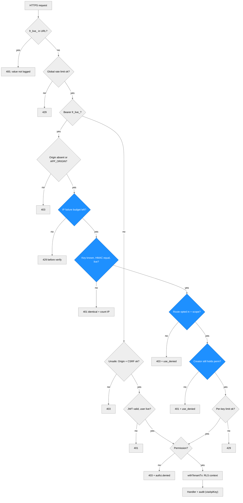

Detaljer i nøkkelveien (`ApiKeyAuthenticator.authenticate`):

- **Oppslag og sammenligning.** Nøkkelen parses med `^fr_live_[0-9a-f]{16}_[A-Za-z0-9_-]{43}$`. Raden
  finnes via `key_id` i en systemtransaksjon (RLS-policyen på `api_keys` tillater systemmodus). Den
  presenterte hemmeligheten hashes med `HMAC-SHA-256(API_KEY_PEPPER, secret)` og sammenlignes med
  `timingSafeEqual`; en ukjent nøkkel-id sammenlignes mot en fast dummy-digest, så arbeidet er det samme.
  Ukjent, feil format, feil hemmelighet, tilbakekalt og utløpt gir alle den identiske 401.
- **Tilstand ved hver forespørsel.** Tilbakekalling, utløp, suspensjon av tenanten og skaperens status
  leses fra databasen ved hver forespørsel; ingenting om nøkkeltilstand bufres, så en tilbakekalling
  virker fra neste forespørsel på alle instanser.
- **Ruter velger selv.** Bare ruter deklarert med `access.apiKeyScope` godtar nøkler. En arkitekturtest
  går gjennom alle ruter og krever at mengden er nøyaktig R26, R27, R53 (`claims.read`), R54
  (`exports.claims`) og R40-R44 (`imports.write`). Alle andre ruter svarer 403 etter en vellykket
  nøkkelautentisering, slik at avslaget kan revideres (`apikey.use_denied` med årsak `route`).
- **Vern mot forvirret stedfortreder.** Nøkkelens tillatelser er `SCOPE_PERMISSION[scope]` for omfangene
  dens, og skaperens **nåværende** rolle må fortsatt ha hver av dem; ellers 401 (årsak `creator`).
  Tenanten kommer bare fra nøkkelraden; tenant-id-er i headere, spørrestreng eller body ignoreres.
- **Misbruksgrenser.** Mislykkede autentiseringer telles per klientadresse i det delte lageret for
  ratebegrensning. Når `RATE_LIMIT_API_KEY_FAIL_MAX` (30) feil er nådd innen 10 minutter, avvises adressen
  med 429 før all verifisering til vinduet er over (grenserettingen D-4: det 31. forsøket avvises, ved
  hjelp av tallet `remaining` fra begrenseren). Bufferen for «avvis tidlig» er per instans; tellingene er
  delte. Vellykkede forespørsler går deretter gjennom grensen per nøkkel (`RATE_LIMIT_API_KEY_MAX`, 300 per
  60 s).
- **Tilskriving.** Konteksten er `{tenantId: key.tenant_id, actor: creator, role: 'API_KEY',
  viaApiKey: keyId}`, og forespørselen fortsetter gjennom den samme `withTenantTx`-veien som en
  brukerforespørsel. `appendAudit` legger til `viaApiKey` fra et register over forespørsler (DV-7).
  `last_used_at` oppdateres høyst én gang per 60 sekunder, etter beste evne.

### Funksjonskall (steg 4)

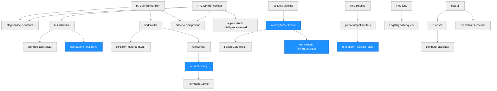

| Funksjon | Definert i | Kalles av | Formål |
| --- | --- | --- | --- |
| `scoreClaim`, `compareWorklist`, `buildWhy`, `nextAction` | `api/src/intelligence/priority.ts` | `buildWorklist` | aritmetikk, rekkefølge og forklaring for `priority-v1`; SQL-ens `ORDER BY` må stemme med `compareWorklist` (integrasjonstest på 48 tilfeldige krav) |
| `scoreSimilarity`, `rankSimilar`, `normalizeCarrier` | `api/src/intelligence/similarity.ts` | `findSimilar` | poeng, inkludering (anker + minimum 30) og rekkefølge for `similar-v1`; ingen bufring av noe slag |
| `worklistPage`, `similarityFeatures`, `provenanceRows` | `api/src/db/intelligence.ts` | intelligence-tjenesten | parametrisert SQL i innringerens tenanttransaksjon, pluss eksplisitte predikater `tenant_id = fr_current_tenant()` |
| `FlagService.isEnabled` / `change` | `api/src/platform/flags.ts` | intelligence-rutene, R63/R64 | lesing med TTL-buffer, feiler lukket; låst, versjonert endring med revisjonsspor |
| `ApiKeyAuthenticator.authenticate` | `api/src/auth/api-key-auth.ts` | sikkerhetspipelinen | maskinautentisering (se ovenfor) |
| `MetricsRegistry.observeRequest` / `observeComponent` / `snapshot` | `api/src/observability/metrics.ts` | `onResponse`-kroken, R71/R72, R61 | telemetri i prosessen |
| `LogRingBuffer.ingest` / `query` | `api/src/observability/ring-buffer.ts` | loggertappen, R62 | avledede loggposter |
| `platformPipelineStats` | `api/src/db/system.ts` | R60 | kaller `SECURITY DEFINER`-funksjonen i en systemtransaksjon |
| `runEval`, `computePassStats`, `recordRun` | `api/src/eval/runner.ts`, `packages/shared/src/eval-stats.ts`, `api/src/eval/record.ts` | eval-CLI-en | k kjøringer per sak, statistikk, valgfri registrering |

## Tillegg i datamodellen (steg 4)

| Objekt | Formål | Viktige regler |
| --- | --- | --- |
| `feature_flags(key, enabled, version, updated_by_id, updated_at, last_reason)` | Globale flagg; migreringen setter inn de 3 radene fra registeret | Ikke tenant-avgrenset (inneholder ingen tenantdata). RLS FORCE; SELECT for alle, UPDATE bare i systemmodus; `freight_app` har bare `SELECT` og `UPDATE` på kolonnenivå; en trigger krever uendret `key` og `version = gammel + 1`; DELETE og TRUNCATE feiler for alle roller |
| `eval_runs`, `eval_case_results` | Registrerte evalueringskjøringer og resultater per sak (uten dokumentinnhold, verdier eller filnavn) | RLS FORCE med en policy bare for systemmodus (en rå tilkobling ser null rader og kan ikke sette inn); bare `SELECT, INSERT`; UPDATE, DELETE og TRUNCATE feiler i alle moduser; CHECK-er binder tallene sammen (`runs_passed <= runs_total`, `pass_hat_k_count <= pass_at_least_one_count <= case_count`, kurvelengde = k, `passed_all = (runs_passed = k)`) |
| `api_keys(id, tenant_id, key_id, name, secret_hash, scopes, created_by_id, created_at, expires_at, last_used_at, revoked_at, revoked_by_id, revoke_reason)` | Tenantenes API-nøkler | Tenant-avgrenset, i `TENANT_MODELS`; policy `tenant_id = fr_current_tenant() OR fr_system_mode()` (systemmodus for oppslag via `key_id`); CHECK-er på `key_id` (16 hex), `secret_hash` (64 hex), 1-3 omfang blant de tre, navnelengde, lengde på begrunnelse for tilbakekalling og alt-eller-ingenting for tilbakekallingskolonnene; bare `last_used_at` og tilbakekallingskolonnene kan oppdateres, tilbakekalling settes én gang og fjernes aldri; DELETE/TRUNCATE feiler |
| `fr_platform_pipeline_stats(window_seconds, stale_seconds)` | Aggregat på tvers av tenanter for R60 | `SECURITY DEFINER`, låst `search_path`, feiler utenfor systemmodus, områdesjekker inndata, `EXECUTE` bare for `freight_app`; returnerer rader `(metric, label, n, p50_ms, p95_ms)` og velger aldri tenant-id, bruker-id, navn, filnavn, lagringsnøkkel, hash eller kravnummer |
| indeks `claims (tenant_id, status, updated_at DESC, id)` | Spørringer for arbeidsliste og likhet | planer registrert i kjøringens `implementation.md` (ingen tider påstått) |

## Flaggbuffer

`FlagService.isEnabled(key)` har en buffer per instans nøklet på flagg, med TTL `FLAGS_CACHE_TTL_MS`
(standard 5000 ms, produksjonstak 30000 ms, 0 slår den av). En lesefeil gir **false** (feiler lukket) og
bufres ikke lenger enn 1 sekund. En endring (`PUT /platform/flags/:key`) kjører i én systemtransaksjon:
kontroll mot registeret (ukjent nøkkel = 404 før all databasetilgang), `SELECT ... FOR UPDATE`,
versjonssammenligning (409 `stale_revision`), samme verdi (409 `conflict`, ingenting skrives), oppdatering
med `version + 1`, revisjonshendelsen `platform.flag_changed`; den lokale bufferen tømmes etter commit.
Andre instanser ser endringen innen sin TTL. Flagg styrer bare de tre intelligence-funksjonene; de kan ikke
nå kode for autentisering, CSRF, RLS eller revisjonsspor (arkitekturtest).

## Observerbarhet: telemetriregister og loggring

- **Telemetri.** En Fastify-krok `onResponse` (registrert før rutene, så helseruter telles) registrerer
  rute**mønsteret** (`routeOptions.url`, eller `(unmatched)`), metoden (ukjente metoder blir `OTHER`),
  statusen og `reply.elapsedTime`. Den leser aldri URL, spørrestreng, headere eller body. Minnet er
  begrenset: høyst 200 rutenøkler (overløp til `(other)`) ganger 11 bøtter. Persentiler rapporteres som
  øvre grense for bøtta som inneholder nærmeste rang. Tellerne for parserens utfører og de to
  komponentstatistikkene legges til når øyeblikksbildet tas. Ingenting rører databasen.
- **Loggring.** `createLogger` tapper hver formatert (allerede maskert) linje inn i
  `LogRingBuffer(LOG_BUFFER_SIZE)`. `ingest` parser linjen i try/catch og beholder bare en avledet post med
  8 felt (tid, nivå, forespørsels-id hvis UUID, metode hvis standard, rute hvis den starter med `/`, ikke
  har `?` og er høyst 200 tegn, status 100-599, endelig varighet, hendelse hvis den består
  meldingsregelen); alt annet kastes, og bufferen kaster aldri feil inn i loggeren. Loggeren erstatter i
  tillegg enhver `fr_live_...`-streng på alle nivåer med `[REDACTED]`. Telemetri og logger er **per
  instans og flyktige**, og brukergrensesnittet sier det.

## Evalueringsverktøy (dataflyt)

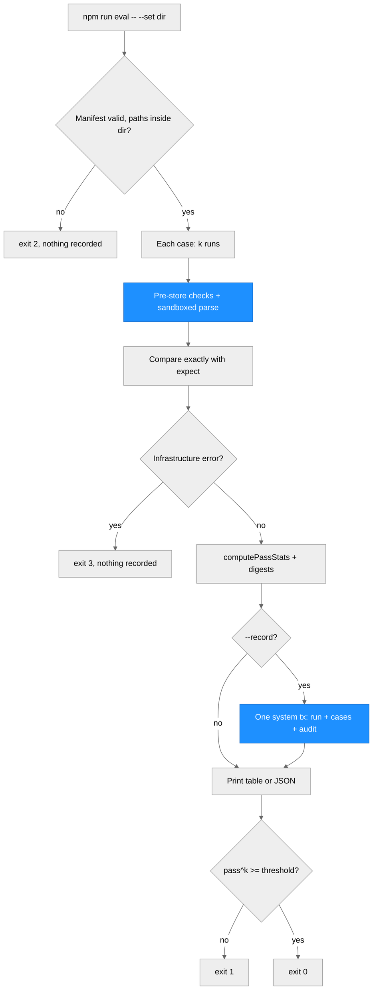

Stegregisteret `EVAL_STAGES` inneholder foreløpig bare `extraction`. Et `rules`-steg var planlagt for steg 5,
men ble utsatt; reglene sjekkes i stedet mot Python av paritetstestene.
Sett-hashen `evalSetSha256` dekker manifestet og hver saksfil i rekkefølge; testdataene holdes byte-like av
`.gitattributes` (`api/eval/sets/** -text`).

## Grensesnitt for steg 5

Status etter kjøringen `REQ-20261010-step5-analysis`: punkt 1 er levert; punkt 2 og 3 ble utsatt og
står åpne.

1. **Levert.** Intelligence-funksjonene leser bare lagrede kolonner (`claims` beløp, status, transportør,
   perspektiv, `updated_at`; siste revisjon av `evidence_packets`; `packet_findings.rule_id` og
   `needs_human_review`; `packet_sources.doc_type`; `approvals.created_at`). Steg 5 lager nå pakkerevisjon
   1 (`AWAITING_ANALYSIS -> PENDING_REVIEW`), så analyserte importerte krav kommer med i arbeidsliste,
   likhet og proveniens uten endringer i steg 4. `rule_id` er en av de åtte stabile, ikke-tomme
   `RULE_IDS` (`rules-v1`), eller fra steg 6 det lærte `LRN-ACCESSORIAL-REVIEW`, som bare går til
   gjennomgang.
2. **Åpent.** Et `rules`-steg i `EVAL_STAGES` (og en migrering som utvider `stage`-CHECK-en), som
   gjenbruker `computePassStats`, registreringen og dashbordet, med Python-funksjonen `run_pipeline` som
   orakel.
3. **Åpent.** Telemetri `observeComponent('rules-v1', ...)`. Ingen flagg ble lagt til (analyse ved
   opprettelse av krav er ikke bygget).

## Merknader (steg 4)

- Avvik registrert av byggeren (DV-1..DV-11), de viktigste: rå SQL ligger i `db/` (DV-1); rutetabellen
  har 199 nøkler pluss `(other)` (DV-2); lesinger med revisjonsspor skriver hendelsen i sin egen
  transaksjon etter at dataene er beregnet, og en mislykket skriving gir fortsatt 500 uten data (DV-3);
  `API_KEY_PEPPER` har en offentlig standardverdi utenfor produksjon (DV-4); en nøkkel på en rute uten
  nøkkelstøtte får 403, også for `/healthz`, og `Origin` på en nøkkelforespørsel kontrolleres for alle
  metoder (DV-5); bufferen for «avvis tidlig» per IP er per instans (DV-6); plattformbrukere havner på
  `/dev` (DV-11).
- Utsatt (kun design, ikke bygget): IP-tillatelseslister per nøkkel, hjelpere for nøkkelrotasjon
  (opprett-så-tilbakekall er den manuelle veien), HMAC-signering av forespørsler, bruksdashbord per nøkkel,
  flere omfang, firøyeprinsipp for flaggendringer, telemetri og logger for hele klyngen, enhver lært
  rangering.
- Ikke verifisert: container-images, compose-stacken, Playwright-ende-til-ende-tester, enhver
  AWS-utrulling.

---

# Nettplattform: firøyeprinsippet (arbeidsdeling)

> Skrevet av scriber for kjøringen `REQ-20261009-four-eyes` 2026-10-10 (grenen `feat/four-eyes`,
> byggecommit `8eb7062`). **Før produkt, kun syntetiske data, aldri utrullet.** Trusselrad T46,
> standardvalgene og de aksepterte restrisikoene står i
> [technical/web-platform-security.md, del 8](technical/web-platform-security.md#8-four-eyes-separation-of-duties)
> (engelsk). Beskrivelse for brukere: [README.no.md, firøyeprinsippet](README.no.md#firøyeprinsippet-arbeidsdeling).
> Mermaid-diagrammene er de samme som i den engelske originalen
> ([ARCHITECTURE.md](ARCHITECTURE.md#web-platform-four-eyes-separation-of-duties)).

## Oversikt (firøyeprinsippet)

To beslutninger krever nå en annen person:

1. **Krav.** En bruker som har laget **en hvilken som helst** pakkerevisjon av et krav (gjeldende eller
   erstattet), kan ikke godkjenne eller avvise kravets gjeldende revisjon. En revisjon uten registrert
   oppretter (seedet revisjon 1) utelukker ingen. Siden steg 5 registrerer revisjon 1 fra analyse den som
   analyserte. «Klar til sending» er uendret.
2. **Importerte dokumenter.** Den som lastet opp, og alle som har registrert en felt-`CORRECT` eller
   -`ADD`, kan ikke godta dokumentet. Avvisning er uendret. Opplastinger med API-nøkkel regnes som
   opplastinger gjort av den som opprettet nøkkelen.

Kontrollen i tjenesten er den primære kontrollen. Databasetriggere er en ekstra sikring, et avslag er én
fast 403 for alle kallere og logges i revisjonssporet, og brukergrensesnittet skjuler knappen for den
utelukkede personen (bare kosmetisk). Ingen tabell, kolonne, tenant-tabell, RBAC-oppføring eller rute ble
lagt til. Den eneste skjemaendringen er triggermigreringen `20261011000000_four_eyes`.

## Modulstruktur (firøyeprinsippet)

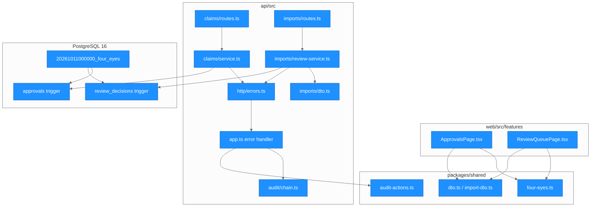

| Modul/funksjon | Formål | Viktige avhengigheter | Endret i denne kjøringen |
| --- | --- | --- | --- |
| `packages/shared/src/four-eyes.ts` | `FOUR_EYES_ERROR_CODE`, `FOUR_EYES_CLAIM_TEXT`, `FOUR_EYES_DOCUMENT_TEXT` (nøyaktig UI-tekst) | ingen | ny |
| `packages/shared/src/audit-actions.ts` | legger til `authz.four_eyes_denied` (siste oppføring) | ingen | endret |
| `packages/shared/src/dto.ts`, `import-dto.ts` | påkrevd `selfAuthored: boolean` bare på `ApprovalItem` og `ImportDocumentDetail` | zod | endret |
| `api/src/http/errors.ts` | meldingen for `four_eyes_required`; `FourEyesRefusal` (403, bærer revisjonskonteksten); `errors.fourEyes(audit)` | `HttpError` | endret |
| `api/src/app.ts` | asynkron feilhåndterer: skriver `authz.four_eyes_denied` i en egen tenant-transaksjon, 500 hvis det feiler; `isFourEyesDbError` gjør et triggeravslag om til 403 | `appendAudit`, `requireTenant` | endret |
| `api/src/audit/chain.ts` | `basis` tillatt i `METADATA_KEYS` | ingen | endret |
| `api/src/claims/service.ts` | `FOUR_EYES_GUARDED_TRANSITIONS`; forfatterkontroll i `transition()`; `listApprovalQueue(tx, query, viewerId)` beregner `selfAuthored` | `lockAndLoadLatest` | endret |
| `api/src/claims/routes.ts` | sender `requireTenant(req).user.id` som innlogget bruker | kravtjenesten | endret |
| `api/src/imports/review-service.ts` | `assertNotDocumentEditor` i `acceptDocument`; alle kall til detaljvisningen sender brukeren | `lockReviewable`, `documentDetail` | endret |
| `api/src/imports/dto.ts` | `EDITOR_DECISIONS = {CORRECT, ADD}`; `isDocumentEditor(uploadedById, decisions, viewerId)` | ingen | endret |
| `api/src/imports/service.ts`, `routes.ts`, `deps.ts` | `documentDetail(..., viewerId)`; `uploadedById` lastes internt (ingen DTO viser den); inntak avviser en `user`-aktør med id som ikke er en UUID; tilskrivingsregelen er dokumentert | lagring, DB | endret |
| `api/prisma/migrations/20261011000000_four_eyes/` | `fr_approval_four_eyes_guard`, `fr_review_four_eyes_guard` og deres `BEFORE INSERT`-triggere | `evidence_packets`, `import_documents`, `import_review_decisions` | ny |
| `web/src/features/approvals/ApprovalsPage.tsx` | skjuler Approve/Reject når `selfAuthored`; viser kravteksten ved 403 `four_eyes_required` og henter på nytt | delte konstanter | endret |
| `web/src/features/imports/ReviewQueuePage.tsx` | skjuler Accept document når `selfAuthored`; viser dokumentteksten ved 403 og henter på nytt | delte konstanter | endret |

## Funksjonskall (firøyeprinsippet)

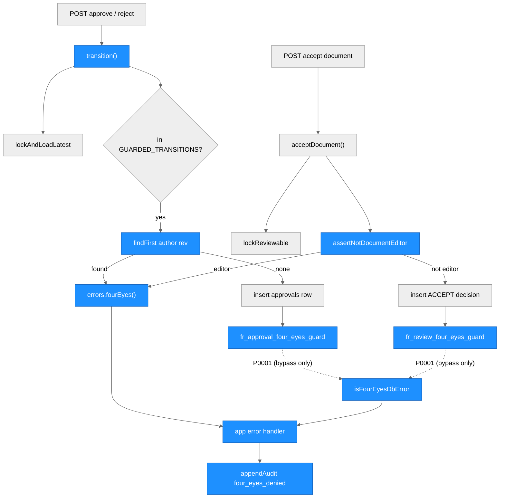

| Funksjon | Definert i | Kalles av | Formål |
| --- | --- | --- | --- |
| `transition` | `api/src/claims/service.ts` | kravrutene (approve, reject, send) | tilstandsmaskin, så forfatterkontrollen for approve/reject, så kontrollen av bekreftelse |
| `listApprovalQueue` | `api/src/claims/service.ts` | `GET /api/v1/approvals` | én `distinct`-spørring over sidens krav-id-er setter `selfAuthored` |
| `acceptDocument`, `assertNotDocumentEditor` | `api/src/imports/review-service.ts` | `POST .../accept` | opplasterkontroll (`basis: uploader`), så CORRECT/ADD-kontroll (`basis: field_editor`), før kontrollen av uløste felt |
| `documentDetail`, `isDocumentEditor` | `api/src/imports/service.ts`, `api/src/imports/dto.ts` | detalj, opplasting, sett type, godta, avvis, inntak | `selfAuthored` fra beslutningene som allerede er lastet (ingen ekstra spørring) |
| `FourEyesRefusal`, `errors.fourEyes` | `api/src/http/errors.ts` | begge tjenestene | 403 `four_eyes_required` med `{tenantId, targetType, targetId, metadata}` |
| `isFourEyesDbError` | `api/src/app.ts` | `toHttpError` | gjenkjenner SQLSTATE `P0001` og den nøyaktige meldingen `four_eyes_required` på feilen eller i `cause`/`meta`-kjeden (dybde 5, tåler sykluser) |
| `fr_approval_four_eyes_guard` | migreringen `20261011000000_four_eyes` | `BEFORE INSERT ON approvals` | avviser `APPROVE`/`REJECT` fra enhver `created_by_id` på kravets pakker (samme tenant) |
| `fr_review_four_eyes_guard` | migreringen `20261011000000_four_eyes` | `BEFORE INSERT ON import_review_decisions` | avviser `ACCEPT` fra opplasteren eller en CORRECT/ADD-aktør på dokumentet (samme tenant) |

## Dataflyt (avslag etter firøyeprinsippet)

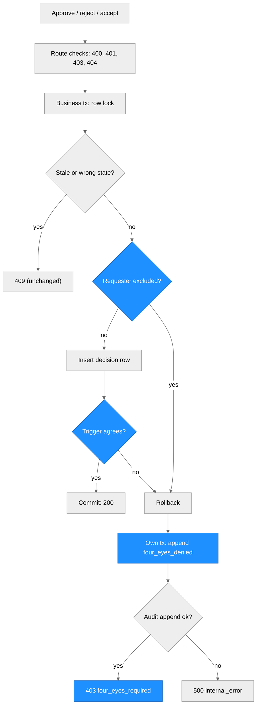

Grenen «Trigger agrees?» er en reserve: den nås bare hvis applikasjonskoden hoppet over kontrollen i
tjenesten. Da svarer API-et også 403 og logger `four_eyes_db_guard`, men skriver ingen revisjonshendelse
(FE-N1). Alle redigeringer og beslutninger på ett krav tar kravradens lås, og alle feltredigeringer og
beslutninger på ett dokument tar dokumentradens lås. Derfor kan ikke settet av forfattere eller
redaktører som leses i transaksjonen, endre seg før commit.

| Trinn | Hvor | Merknader |
| --- | --- | --- |
| Rekkefølge, approve/reject | `transition()` | 400 -> 401 -> 403 `forbidden` -> 404 -> 409 `stale_revision` -> 409 `invalid_state` -> **403 `four_eyes_required`** -> 422 |
| Rekkefølge, accept | `acceptDocument()` | 400 -> 401 -> 403 `forbidden` -> 404 -> 409 `invalid_state` -> **403 `four_eyes_required`** -> 409 `unresolved_fields` |
| Feilsvar | `sendError` | `{ code, message: "A different person must make this decision.", requestId }`, likt for UI og API; ingen `authz.denied`-hendelse |
| Revisjonsspor | feilhåndtereren, tenantkjeden | krav: `claimId`, `packetId`, `packetRevision`, `action`, `basis: revision_author`; dokument: `documentId`, `batchId`, `action: ACCEPT`, `basis` |
| UI | `selfAuthored` | skjuler knappen og viser den faste teksten; bare kosmetisk, serveren bestemmer |

## Standardvalg (firøyeprinsippet)

D1 en revisjonsforfatter kan heller ikke avvise; D2 «klar til sending» er ikke begrenset; D3 bare
opplasteren og CORRECT/ADD-aktører er dokumentredaktører; D4 avvisning av dokumenter er ikke begrenset.
Stedene å endre er `FOUR_EYES_GUARDED_TRANSITIONS` (krav) og `EDITOR_DECISIONS` (dokumenter), hver med en
ny migrering for den tilhørende triggeren. Detaljer står i trusselmodellen, del 8.4.

## Grensesnitt for steg 5 (firøyeprinsippet)

- **Levert (FE-N2 lukket).** Steg 5 lager pakkerevisjon 1 for importerte krav og setter
  `evidence_packets.created_by_id` til brukeren som startet analysen (enkeltvis og i masseanalyse). Den
  brukeren er da revisjonsforfatter og kan ikke godkjenne eller avvise kravet. Triggeren
  `evidence_packets_analysis_guard` avviser en revisjon 1 uten forfatter for et krav i `AWAITING_ANALYSIS`.
  Avgjørelse (standardvalg D2 i steg 5): de som lastet opp eller redigerte felt i kravets dokumenter, er
  **ikke** forfattere av kravet. Firøyeprinsippet for dokumenter tvang allerede en annen person til å
  godta disse inndataene (unntatt automatisk godtatte dokumenter, FE-S1).
- Enhver ny kodevei som setter inn en `approvals`-rad (`APPROVE`/`REJECT`) eller en `ACCEPT`-beslutning,
  må kjøre kontrollen i tjenesten under samme radlås. Ellers avviser triggerne innsettingen.

## Merknader (firøyeprinsippet)

- Verifisert lokalt på Node 22.23.3 (CI-versjonen), **ikke i GitHub CI**: enhetstester shared 136, api
  356, web 67; integrasjon 95 bestått (2 hoppet over fra før); akseptanse shared 36, api 690 bestått (9
  hoppet over, 2 todo), web 150 bestått (1 hoppet over). Veien som feiler lukket i revisjonssporet, og
  oversettelsen fra trigger til 403 dekkes bare av byggerens integrasjons- og enhetstester (de kan ikke
  nås utenfra).
- Aksepterte restrisikoer FE-S1..S4, FE-N1 og FE-N2 står i trusselmodellen, del 8.5.

---

# Nettplattform: kravanalyse (steg 5)

> Skrevet av scriber for kjøringen `REQ-20261010-step5-analysis` 2026-10-10 (grenen `feat/analysis`,
> byggecommits `d27c4a2`..`5c047fb`). **Før produkt, kun syntetiske data, aldri utrullet.** Trusselradene
> T47-T52, standardvalgene og de aksepterte restrisikoene står i
> [technical/web-platform-security.md, del 9](technical/web-platform-security.md#9-step-5-claim-analysis)
> (engelsk). Beskrivelse for brukere: [README.no.md, kravanalyse](README.no.md#kravanalyse-steg-5).
> Mermaid-diagrammene er de samme som i den engelske originalen
> ([ARCHITECTURE.md](ARCHITECTURE.md#web-platform-claim-analysis-step-5)).

## Oversikt (steg 5)

Før steg 5 ble et krav opprettet ved import stående i `AWAITING_ANALYSIS` uten beløp og uten pakke, fordi
regelmotoren bare fantes i Python-referansetjenesten. Steg 5 lukker sløyfen:
import -> gjennomgang -> opprett krav -> **analyser** -> pakkerevisjon 1 -> gjennomgang etter
firøyeprinsippet.

- **Motor (`@fr/shared/analysis`).** En TypeScript-port av Pythons `rules/` (`detention.py`,
  `invoice_checks.py`, `engine.py`) og `evidence/` (`letter.py`, Markdown-delen av `packet.py`). Modulen er
  ren: ingen innebygde Node-moduler og ingen flyttall for penger eller timer. Den bruker en desimaltype som
  er nøyaktig lik CPython (`py-decimal.ts`: presisjon 28, ROUND_HALF_EVEN, formatering som CPythons `str` og
  `.2f`), CPythons `repr` for strenger og lister, og naive `YYYY-MM-DDTHH:MM:SS`-tidspunkter med
  heltallsregning på dager. Regelversjon `rules-v1`, åtte regel-ID-er (`INV-DUPLICATE`,
  `INV-LINEHAUL-RATE`, `INV-FUEL-SURCHARGE`, `INV-ACCESSORIAL-UNAUTH`, `INV-TOTAL-MISMATCH`,
  `DET-UNBILLED`, `DET-UNDERBILLED`, `DET-OVERBILLED`). Innstillingene er konstanter
  (`DEFAULT_ANALYSIS_SETTINGS`: ventetid i trinn på 15 minutter, toleranse 0,01, tvistefrist 90 dager).
- **Hva et funn er.** Et funn er resultatet av en fast, deterministisk regel brukt på feltverdiene i
  kravets godtatte dokumenter (hentet ut av parseren fra steg 3 og, der de var flagget, gjennomgått av en
  person). Det er et **utkast til menneskelig gjennomgang, ikke et verifisert resultat**. Konfidensen på et
  funn er en fast konstant per regel, kopiert fra Python-referansen (0,6, 0,85, 0,9 eller 0,95), ikke en
  målt sannsynlighet, og produktet påstår ingenting om nøyaktighet. Evalueringsterskelen fra steg 4 kjøres
  på syntetiske testdata og er ikke et mål på nøyaktighet.
- **Ruter.** `POST /api/v1/claims/:id/analyze` (201) og `POST /api/v1/claims/analyze-awaiting` (200,
  masseanalyse). Begge krever den nye tillatelsen `claims:analyze` (OWNER, ADMIN, MANAGER, REVIEWER,
  ANALYST), har ingen API-nøkkel-scope og deler ratebegrensningsgruppen `analysis` per bruker
  (`RATE_LIMIT_ANALYSIS_MAX`, standard 30 per 10 minutter).
- **Livsløp.** Én analyse kjører i én tenant-transaksjon under radlåsen på kravet. Den lager pakkerevisjon
  1 (`PENDING_REVIEW`, opprettet av den som ba om analysen) med kilder, funn (med sitater og en styrende
  klausul), en tidslinje og innholdshashen. Den setter kravet til `PENDING_REVIEW` med `recoverableCents`,
  `pendingReviewCents` og `amountClaimedCents`, øker `version` og legger til `claim.analyzed`. Ingen
  `approvals`-rad skrives. Deretter gjelder den eksisterende gjennomgangsflyten uendret.
- **Databasevakter.** Migreringen `20261012000000_analysis` legger til to triggere og ingen endring i
  tabeller, kolonner, enumer eller tilganger.
- **Nett.** En seksjon **Analyze claim** i kravpanelet (fanene Summary og Evidence) og en dialog **Analyze
  awaiting claims** på kravsiden, begge vist bare med `claims:analyze` (tekstene i appen er på engelsk).

Utsatt (ikke bygget): analyse ved opprettelse av krav (ikke noe flagg; masseanalysen er automatiseringen,
med en eksplisitt menneskelig utløser), et `rules`-steg i evalueringsverktøyet, telemetrikomponenten
`rules-v1`, et endepunkt for nedlasting av Markdown, strengere tolking av beløp, brevmaler per transportør.

## Modulstruktur (steg 5)

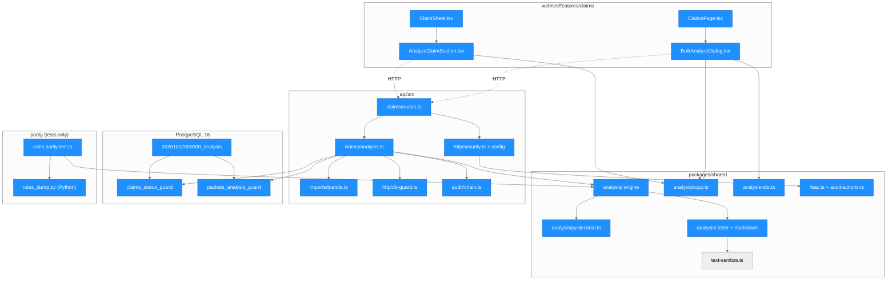

| Modul/funksjon | Formål | Viktige avhengigheter | Endret i denne kjøringen |
| --- | --- | --- | --- |
| `packages/shared/src/analysis/py-decimal.ts` | CPythons `Decimal`-semantikk: tolking, addisjon, subtraksjon, multiplikasjon, vanlig divisjon og heltallsdivisjon, sammenligning, quantize, `str`, `.2f`, Pythons `max`/`sum` | ingen (BigInt) | ny |
| `packages/shared/src/analysis/py-text.ts`, `local-datetime.ts` | CPythons `repr(str)` og repr av lister, `_norm_text`; naive tidspunkter, epokesekunder via days-from-civil, `%Y-%m-%d %H:%M` | ingen | ny |
| `packages/shared/src/analysis/invoice-checks.ts`, `detention.ts`, `engine.ts` | Port av `rules/*.py`: `classifyLine`, fjerning av duplikater, fakturakontroller, `computeDetention`, `applyRules`; `applyRulesTraced` gir også spor per funn for sitatene | `py-decimal`, `py-text`, `local-datetime` | ny |
| `packages/shared/src/analysis/letter.ts`, `markdown.ts`, `evidence.ts` | Port av `evidence/letter.py` og Markdown-delen av `packet.py`: `buildDemandLetter`, `renderPacketMarkdown`, `buildEvidence` (`buildEvidenceTraced`), `packetLoadNumber` | `text-sanitize.ts` (`plain`, `md`) | ny |
| `packages/shared/src/analysis/types.ts`, `copy.ts`, `index.ts` | `AnalysisInputError`, `DEFAULT_ANALYSIS_SETTINGS`, `RULES_VERSION`, `RULE_IDS`, `DRAFT_BANNER`, `PACKET_DISCLAIMER`; UI-tekstene `ANALYSIS_NOTE`, `ANALYZE_AUTHOR_NOTE`, `ANALYSIS_TEXT`; underbanen `@fr/shared/analysis` | ingen | ny |
| `packages/shared/src/analysis-dto.ts` | `AnalyzeBody` (streng `{}`), `BulkAnalyzeBody` (`limit` 1..25), svarskjemaer, `ANALYZE_BATCH_MAX = 25`, `ANALYZE_BATCH_DEFAULT = 10` | zod | ny |
| `packages/shared/src/rbac.ts`, `audit-actions.ts` | `claims:analyze` lagt til (5 roller); `claim.analyzed`, `claim.bulk_analyzed` lagt til | ingen | endret |
| `api/src/imports/bundle.ts` | `assembleBundleWithProvenance` (registrerer hvilket dokument og felt som fylte hver plass i bunten); `loadAnalysisInput` (kilder med `sizeBytes`, felt med side, linje og utdrag; felt sortert etter `ordinal, id`); `loadBundleForClaim` delegerer, uendret signatur | Prisma tenant-tx | endret |
| `api/src/claims/analysis.ts` | `buildAnalysisPacket` (ren: rader, sitater, klausuler, tidslinje, hash, lagringskontroll), `analyzeClaim` (ett krav, én tx), `analyzeAwaiting` (masseanalyse), `storableCents`, `INT4_MAX` | `@fr/shared/analysis`, `bundle.ts`, `lockClaimForUpdate`, `appendAudit`, `packetContentHash` | ny |
| `api/src/claims/routes.ts` | `POST /claims/:id/analyze` (201), `POST /claims/analyze-awaiting` (200); tillatelse `claims:analyze`, ingen `apiKeyScope`, `rateGroup: 'analysis'` | `analysis.ts` | endret |
| `api/src/http/security.ts`, `context.ts`, `config.ts`, `app.ts` | Ratebegrensningsgruppen `analysis` (per bruker, vindu på 10 minutter); `RATE_LIMIT_ANALYSIS_MAX` (standard 30, 1..100000); `app.analysisLimiter` (null når ratebegrensning er av) sendes til masseanalysen | lager for ratebegrensning (Redis) | endret |
| `api/src/http/db-guard.ts` | Eksakt gjenkjenning av triggerfeil (SQLSTATE `P0001` + eksakt melding, gjennom `cause`/`meta`/`driverAdapterError`, dybde 5), delt av firøyeprinsippet og analysen; `isAnalysisDbError` | ingen | ny (flyttet fra `app.ts`) |
| `api/src/http/errors.ts`, `audit/chain.ts` | 422 `analysis_input_invalid`; metadatanøkler for steg 5 på tillatelseslisten | ingen | endret |
| `api/prisma/migrations/20261012000000_analysis/` | `fr_claim_status_guard` + triggeren `claims_status_guard`; `fr_analysis_packet_guard` + triggeren `evidence_packets_analysis_guard` | `claims`, `evidence_packets` | ny |
| `web/src/features/claims/AnalyzeClaimSection.tsx`, `ClaimSheet.tsx` | Analyseknapp med begge merknadene i fanene Summary og Evidence; faste feiltekster per statuskode; ved suksess lastes krav, pakke, kravliste og godkjenninger på nytt, og Evidence-fanen vises | `useCan('claims:analyze')`, delte tekster | ny / endret |
| `web/src/features/claims/BulkAnalyzeDialog.tsx`, `ClaimsPage.tsx` | Knapp i verktøylinjen og modal dialog; POST `{ limit: 10 }`; sammendrag i et `role="status"`-område; kravnumre som feilet, via `SafeText` | `Dialog`, delte tekster | ny / endret |
| `tools/parity/rules_dump.py`, `api/test/parity/rules.parity.test.ts` | Python-orakel (bare i tester, aldri i drift) og sammenligningen TS mot Python i `test:integration` | Python-referansetjenesten | ny |

## Funksjonskall (steg 5)

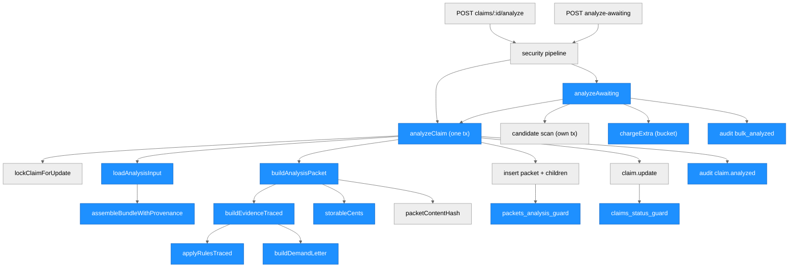

| Funksjon | Definert i | Kalles av | Formål |
| --- | --- | --- | --- |
| `analyzeClaim(tx, claimId, actor, { bulk })` | `api/src/claims/analysis.ts` | enkeltruten (inne i `db.tx`), `analyzeAwaiting` (én `db.tx` per kandidat) | UUID-kontroll og radlås (404), ny kontroll av status og «ingen pakke» under låsen (409), last inndata (409 uten godtatt dokument), bygg (422), sett inn, oppdater, revisjonsspor |
| `analyzeAwaiting(db, actor, limit, chargeExtra)` | `api/src/claims/analysis.ts` | masseruten | kandidater én gang, én tx per kandidat, resultatlister, stopp ved tomt budsjett, sammendragshendelse |
| `loadAnalysisInput(tx, claimId)` | `api/src/imports/bundle.ts` | `analyzeClaim` | koblede `ACCEPTED`-dokumenter (eldste kobling først, likhet avgjøres av koblings-ID) til `{ bundle, provenance, sources }` |
| `buildAnalysisPacket({ input, claim, now, actorId })` | `api/src/claims/analysis.ts` | `analyzeClaim` | ren: kjøring av motoren, lagringskontroll, rader for kilder, funn, sitater, klausuler og tidslinje, `HashPacket` og innholdshash |
| `buildEvidenceTraced` / `buildEvidence` | `packages/shared/src/analysis/evidence.ts` | `buildAnalysisPacket`, paritetstesten | resultat, brev (UTC-dato for `now`), Markdown (lagres ikke), lastnummer |
| `applyRules` / `applyRulesTraced` | `packages/shared/src/analysis/engine.ts` | `buildEvidence*`, paritetstesten | fakturafunn, funn om ventetid, fordeling etter perspektiv, summer |
| `isAnalysisDbError` | `api/src/http/db-guard.ts` | `toHttpError` i `app.ts`, `analyzeAwaiting` | gjør `claim_transition_invalid` / `analysis_packet_invalid` om til 409 `invalid_state` (enkeltvis) eller `skipped` (masseanalyse) |
| `fr_claim_status_guard`, `fr_analysis_packet_guard` | migreringen `20261012000000_analysis` | `BEFORE UPDATE OF status ON claims`, `BEFORE INSERT ON evidence_packets` | databasens sikring av livsløpet (nedenfor) |

## Dataflyt (analyse av ett krav)

```mermaid
%%{init: {'theme': 'neutral'}}%%
graph TD
    A["POST claims/:id/analyze"] --> B["Pipeline: 403, 401, 429, 403, 400"]
    B --> C["Tenant tx: lock claim row"]
    C --> D{"Claim visible?"}
    D -- no --> E["404 not_found"]
    D -- yes --> F{"AWAITING, no packet, accepted doc?"}
    F -- no --> G["409 invalid_state"]
    F -- yes --> H["Load bundle + provenance"]
    H --> I["Rules, letter, rows, hash"]
    I --> J{"Input valid and storable?"}
    J -- no --> K["422 analysis_input_invalid"]
    J -- yes --> L["Insert rev 1 + children"]
    L --> M["Claim to PENDING_REVIEW"]
    M --> N{"Triggers agree?"}
    N -- no --> O["Rollback: 409 invalid_state"]
    N -- yes --> P["Append claim.analyzed: 201"]

    style F fill:#1e90ff,stroke:#1565c0,color:#fff
    style J fill:#1e90ff,stroke:#1565c0,color:#fff
    style N fill:#1e90ff,stroke:#1565c0,color:#fff
    style P fill:#1e90ff,stroke:#1565c0,color:#fff
```

Ingenting skrives før 422-kontrollen, så en avvist analyse (404, 409, 422) endrer ingenting og skriver ingen
`claim.analyzed`. Grenen «Triggers agree?» er en sikring som kontrollene i tjenesten gjør uoppnåelig gjennom
API-et; nås den likevel, svarer API-et 409 `invalid_state` (aldri 500, aldri databaseteksten) og logger
`analysis_db_guard` på feilnivå.

| Steg | Hvor | Merknader |
| --- | --- | --- |
| Rekkefølge, ett krav | sikkerhetspipelinen, `analyzeClaim` | origin/CSRF 403 -> 401 -> 429 (`analysis`-bøtten) -> 403 `forbidden` -> 400 -> 404 -> 409 `invalid_state` -> 422 `analysis_input_invalid` |
| Rekkefølge, masseanalyse | sikkerhetspipelinen | origin/CSRF 403 -> 401 -> 429 -> 403 -> 400 -> 200 (resultat per krav i svaret) |
| 422 | `buildAnalysisPacket` | motoren avviser inndata (feilformet desimaltall eller tidspunkt, trinn 0), eller et resultat kan ikke lagres: et lagret funnbeløp eller en sum er negativ eller over 2 147 483 647 cent, eller de to summene til sammen er over grensen (RD3) |
| Samtidighet | `lockClaimForUpdate` + ny kontroll | N parallelle analyser av ett krav: nøyaktig én 201, resten 409; én pakke, én hendelse, `version` +1 én gang. Unik `(claim_id, revision)` og indeksen for én levende revisjon er en ekstra sikring |
| Svar | `AnalyzeResponse` | `claim` (id, status, tre centbeløp), `packet` (id, revisjon 1, status, `contentHash`), `analysis` (`rulesVersion`, `findingsCount`, `pendingFindingsCount`, `ignoredFindingsCount`) |

## Kravets livsløp og databasevakter (steg 5)

```mermaid
%%{init: {'theme': 'neutral'}}%%
graph TD
    CM["import commit"] --> AW["AWAITING_ANALYSIS"]
    AW -- "analyze: rev 1 with author" --> PR["PENDING_REVIEW"]
    PR --> FL["existing review flow"]
    FL -. "back to AWAITING: refused" .-> AW

    style AW fill:#1e90ff,stroke:#1565c0,color:#fff
    style PR fill:#1e90ff,stroke:#1565c0,color:#fff
```

| Trigger (funksjon) | Utløses av | Avviser | Feil |
| --- | --- | --- | --- |
| `claims_status_guard` (`fr_claim_status_guard`) | `BEFORE UPDATE OF status ON claims` | en statusendring **til** `AWAITING_ANALYSIS`; en endring **fra** `AWAITING_ANALYSIS` til noe annet enn `PENDING_REVIEW`, eller til `PENDING_REVIEW` når det ikke finnes en `evidence_packets`-rad for samme krav og tenant med `revision = 1` og `created_by_id` som ikke er null | `P0001` `claim_transition_invalid` |
| `evidence_packets_analysis_guard` (`fr_analysis_packet_guard`) | `BEFORE INSERT ON evidence_packets` | en pakke for et krav i `AWAITING_ANALYSIS` med mindre `revision = 1`, `created_by_id` ikke er null og `status = 'PENDING_REVIEW'` | `P0001` `analysis_packet_invalid` |

Begge funksjonene er `SECURITY DEFINER` (eier = migreringsrollen), har `search_path = public, pg_temp`,
sammenligner `tenant_id` eksplisitt (så en manglende `app.tenant_id` ikke kan skjule rader), og har
`EXECUTE` trukket tilbake fra `PUBLIC`. Eksisterende rader valideres ikke på nytt. Oppdateringer som ikke
endrer `status`, andre statusendringer, innsetting av krav og innsetting av pakker for andre krav påvirkes
ikke; særlig er beløps- og `version`-kolonnene til et krav i `AWAITING_ANALYSIS` **ikke** beskyttet av
databasen (restrisiko SA-6 i trusselmodellen). De fire tidligere migreringene er uendret byte for byte.

## Masseanalyse og ratebudsjettet `analysis`

`POST /api/v1/claims/analyze-awaiting` med `{ "limit": n }` (1..25, standard 10; dialogen i nettappen
sender alltid 10):

1. **Kandidater**, hentet én gang i en kort tenant-transaksjon: tenantens krav i `AWAITING_ANALYSIS` med
   minst ett koblet `ACCEPTED`-dokument, eldste `createdAt` først (likhet avgjøres av id), høyst
   `min(4 x limit, 100)`.
2. **Hver kandidat i sin egen transaksjon**, nøyaktig som enkeltruten. En kandidat som ikke lenger kan
   analyseres (404/409, eller en avvisning fra en databasevakt), havner i `skipped` (`invalid_state`); en
   som får 422, havner i `failed` (`analysis_input_invalid`). Enhver annen feil avslutter forespørselen
   med 500; analyser som allerede er lagret, blir stående.
3. **Budsjett (rettingsrunde 1, S5-1).** Forespørselens eget `analysis`-token dekker den første
   kandidaten. Før hver ny kandidat tas ett token til fra brukerens `analysis`-bøtte
   (`app.analysisLimiter`). Det trekkes per **forsøkt** kandidat, så kandidater som hoppes over eller
   feiler, koster også ett. Med `RATE_LIMIT_ENABLED=false` (bare utvikling og test; produksjon avviser det)
   trekkes ingenting ekstra.
4. **Stoppvilkår:** `analyzed` når `limit`, kandidatene er brukt opp, eller bøtten er tom. Et stopp på
   grunn av budsjettet gir fortsatt 200 med samme form; krav som ikke ble forsøkt, blir i
   `AWAITING_ANALYSIS` og telles i `remaining`. `examined` = forsøkte kandidater = analyzed + skipped +
   failed.
5. **Sammendrag.** Én `claim.bulk_analyzed`-hendelse (mål `tenant`) i egen transaksjon, med `limit`,
   `examined`, `analyzed`, `skipped`, `failed` og `remaining` (tenantens krav som fortsatt venter på
   analyse etter kjøringen).

Virkning: en bruker kan utføre høyst `RATE_LIMIT_ANALYSIS_MAX` analyser per vindu på 10 minutter, enten
enkeltruten eller masseruten brukes. Før rettingsrunde 1 kostet én masseforespørsel ett token for opptil 25
analyser (25 ganger forsterkning, sikkerhetsfunn S5-1, Low). Samtidige masseforespørsler analyserer aldri
et krav to ganger; den som taper kappløpet, rapporterer kravet som `skipped`.

Kjente begrensninger (trusselmodellen del 9.5): kandidater som hoppes over eller feiler, bruker av
budsjettet (SA-1); en feil i ratebegrenseren midt i kjøringen (for eksempel at Redis ikke svarer) avslutter
forespørselen med 500 og uten `claim.bulk_analyzed` (SA-2); dialogen sier ikke at budsjettet stoppet
kjøringen, men sammendraget («n still awaiting analysis») er fortsatt riktig (SA-3); et krav som feiler med
422, forblir en kandidat og forsøkes først i hver kjøring fordi det er gammelt (SA-8).

## Innholdet i pakken (revisjon 1)

| Del | Innhold |
| --- | --- |
| Pakke | `revision 1`, `PENDING_REVIEW`, kravets perspektiv, `loadNumber` (første ikke-tomme fra faktura, ratebekreftelse (rate confirmation), fraktbrev (bill of lading)), `generatedAt` = analysetidspunktet, `PACKET_DISCLAIMER`, utkastet til kravbrev (datert med UTC-datoen for `generatedAt`), USD, `verifier NOT_RUN`, `createdBy` = den som ba om analysen, innholdshash |
| Kilder | én per koblet `ACCEPTED`-dokument i koblingsrekkefølge: visningsnavn, type, SHA-256, størrelsen på den lagrede originalen |
| Funn | funn for eget perspektiv i motorens rekkefølge (regel-ID, tittel, retning, beløp i cent, forklaring, utregningssteg, konfidens, `needsHumanReview`); funn i motsatt retning telles (`ignoredFindingsCount`), men lagres ikke |
| Sitater | per regel, feltene som ga grunnlaget, som `{sourceId, locator, excerpt}` med lokator `<navn>:L<linje>`, `<navn>:p<side>:L<linje>` eller `<navn>:manual`; utdrag gjennom `plain(..., 200)`; duplikater fjernet |
| Styrende klausul | feltet i ratebekreftelsen (rate confirmation) som regelen sammenligner med (linehaul-rate, drivstofftillegg, godkjente tilleggstjenester, fri ventetid), eller null |
| Tidslinje | avtalt tid, ankomst, avgang (fraktbrev) og fakturadato, lagret med naive lokale tider lest som UTC; anlegg og fakturanummer gjennom `plain(..., 100)` |

Sitater, styrende klausuler og tidslinjen er tillegg som bare finnes i TS, uten motpart i Python. De inngår
i innholdshashen, så hashbindingen ved godkjenning og sending dekker dem.

## Revisjonsspor (steg 5)

| Handling | Når | Mål | Metadata (eksakt nøkkelsett) |
| --- | --- | --- | --- |
| `claim.analyzed` | hver vellykket analyse, i samme transaksjon som skrivingen | `claim` | `claimId`, `claimNumber`, `packetId`, `revision`, `contentHash`, `perspective`, `fromStatus`, `toStatus`, `documentIds`, `findingsCount`, `pendingFindingsCount`, `ignoredFindingsCount`, `recoverableCents`, `pendingReviewCents`, `rulesVersion`, `bulk` |
| `claim.bulk_analyzed` | én gang per masseforespørsel som når handleren og fullføres, etter transaksjonene per krav | `tenant` | `limit`, `examined`, `analyzed`, `skipped`, `failed`, `remaining` (alle heltall) |

Ingen navn, filnavn, uttrukne verdier, brevtekst eller begrunnelser havner i metadata. Avviste analyser (409,
422) skriver ingen hendelse; avvisning på grunn av manglende tillatelse beholder den eksisterende
`authz.denied`-oppførselen. Rensingen av metadata kutter lister ved 50 elementer, så `documentIds` ville
være ufullstendig for et krav med mer enn 50 koblede godtatte dokumenter; radene i `packet_sources` er
fortsatt fullstendige (SA-4).

## Python-paritet: registrerte avvik (RD1-RD6)

`api/test/parity/rules.parity.test.ts` (del av `npm run test:integration`; samme regel for å finne Python
som paritetstestene fra steg 3: CI uten Python feiler, en lokal kjøring uten Python hoppes over med en
melding) sender de samme sakene til TS-motoren og til `tools/parity/rules_dump.py`, som kaller
Python-referansen med eksplisitte `Settings`. Den sammenligner med eksakt strenglikhet: `classifyLine`,
JSON fra `computeDetention`, JSON fra `applyRules`, brevet, Markdown og lastnummeret, og kontrollerer at
begge sider avviser de samme inndataene. Paritetsdomene: desimaltall
`-?(0|[1-9][0-9]{0,14})(\.[0-9]{1,6})?`; tidspunkter `YYYY-MM-DDTHH:MM:SS`, år 1000-9999; strenger av
tildelte kodepunkter uten kontrolltegn, bidi-kontrolltegn eller U+2028/U+2029, høyst 200 kodepunkter;
trinn 1..240; frist 1..3650 dager.

| ID | Avvik (TS mot Python) | Begrunnelse |
| --- | --- | --- |
| RD1 | Tidspunkter er bare naive `YYYY-MM-DDTHH:MM:SS`; forskyvninger avvises (`AnalysisInputError`). Pythons veier med tidssoner har ingen TS-inndata. | Uttrekket fra steg 3 lagrer naive lokale tider; det finnes ingen tidssone å bruke. |
| RD2 | `%Y` fyller ut år under 1000 til 4 sifre (CPython på Linux gjør ikke det). | Korpuset bruker år 1000 og senere. |
| RD3 | API-et avviser negative resultater og resultater over INT4 (422) der Python ville gitt dem ut. Den rene motoren er fortsatt lik Python. | Beløp lagres som int4-cent; et negativt kravbeløp gir ingen mening. |
| RD4 | Store/små bokstaver og utskrivbarhet følger ICU-tabellene i Node 22, ikke Pythons Unicode-database. | Korpuset utelater kodepunkter som ikke er tildelt. |
| RD5 | Ende til ende lister TS-pakken kravets godtatte koblede dokumenter; Python lister hver innleste fil. | Bare godtatte dokumenter gir grunnlag for et krav. |
| RD6 | Brevdatoen er UTC-datoen for `generatedAt`; Python bruker den lokale datoen for `datetime.now()`. | Uavhengig av serverens tidssone; paritetskjøringer sender samme `now`. |

Byggerens korpus (frø `20261010`): 2 132 saker (4 ende-til-ende-saker fra testdataene, 623 inndata fra
Pythons testfiler, 1 200 genererte bunter, 300 genererte ventetidssaker, 5 klassifiseringsbunker med 200
beskrivelser hver). Resultat i byggerens kjøring: null forskjeller på Node 22 og Node 24, hver regel-ID
brukt, og ingen registrerte avvik trengtes innenfor korpuset. Testerens uavhengige orakel
(`api/test-acceptance/helpers/rules_oracle.py`) besto P01-P05 i akseptansekjøring 1; antall saker per
korpus er ennå ikke registrert.

## Standardvalg (steg 5)

| ID | Standard | Stedet å endre |
| --- | --- | --- |
| D1 | `claims:analyze` = OWNER, ADMIN, MANAGER, REVIEWER, ANALYST; ingen API-nøkkel-scope | raden i `rbac.ts` |
| D2 | Forfatter av revisjon 1 = den som ba om analysen (enkeltvis og i masseanalyse); de som lastet opp eller redigerte felt i dokumentene, er ikke forfattere av kravet | `analysis.ts` + firøyepredikatet |
| D3 | Analyse ved opprettelse av krav er ikke bygget; masseanalysen er automatiseringen | fremtidig flagg + migreringsrad |
| D4 | Bare funn for eget perspektiv lagres | `buildAnalysisPacket` |
| D5 | Null funn gir likevel revisjon 1 med nullbeløp og brevet «No amount is requested» | `analyzeClaim` |
| D6 | Negative resultater eller resultater over INT4 -> 422, kravet uendret | `buildAnalysisPacket` |
| D7 | Innstillingene er konstanter (15 min, 0,01, 90 dager) | `DEFAULT_ANALYSIS_SETTINGS` |
| D8 | Brevdato = UTC-datoen for `generatedAt`; naive tider i tidslinjen lagres som UTC | `buildEvidence`, tidslinjen |
| D9 | Masseanalyse: `limit` 1..25 (standard 10), skannetak `min(4 x limit, 100)`, eldste først | `analyzeAwaiting` |
| D10 | Ratebegrensningsgruppen `analysis`, `RATE_LIMIT_ANALYSIS_MAX` 30 per 10 minutter, trukket per kandidat i masseanalyse | konfigurasjon, `analyzeAwaiting` |

## Grensesnitt for senere steg (etter steg 5)

- Hold `rule_id` innenfor `RULE_IDS` og øk `RULES_VERSION` når en regel endres; intelligence fra steg 4 og
  paritetstestene er avhengige av begge. Steg 6 holder fast ved dette for reglene og legger til den lærte ID-en
  `LRN-ACCESSORIAL-REVIEW` utenfor `RULE_IDS`, versjonert med `CHARGE_CLASSIFIER_VERSION` og `SEED_VERSION`
  (se [gebyrintelligens (steg 6)](#nettplattform-gebyrintelligens-steg-6)).
- Åpent: `rules`-steget i evalueringen, telemetri `rules-v1`, analyse ved opprettelse av krav, et
  endepunkt for nedlasting av Markdown, strengere tolking av beløp.
- En fremtidig HTML-, Markdown- eller PDF-visning av lagrede funn må rense `explanation` og `calculation`:
  de inneholder den rå beskrivelsen av fakturalinjen (SA-5). Bare brevet bruker `plain()`.
- En ny kodevei som skriver kravbeløp, må holde seg til analysetransaksjonen eller utvide statusvakten
  (SA-6).

## Merknader (steg 5)

- Hva som ble kjørt (lokalt, Windows, **ikke GitHub CI**): byggeren kjørte lint, typecheck og
  enhetstester (shared 165, api 370, web 78), paritetstestene for reglene (2 132 saker, null forskjeller på
  Node 22 og 24) og integrasjonstestene på Node 22.23.3 (16 filer, 107 bestått, 3 lokale plassholdere
  hoppet over), alt ved `b12ce2a`. Den uavhengige akseptansekjøringen 1 (Node 22.23.3, `CI=true`, ved
  `b12ce2a`) ga shared 81/81 og api 754 bestått, 4 feilet, 10 hoppet over; alle de 4 feilene ble
  klassifisert som testdesign og rettet i testfilene, men den bekreftende kjøringen ble stoppet av lite
  ledig minne. Akseptansetestene for nettappen (AN-W01..W11) er ikke kjørt ennå. Rettingsrunde 1
  (`5c047fb`) ble bare kontrollert med lint, typecheck og utvalgte enhetstester; det finnes ingen
  integrasjons- eller akseptansekjøring ved `5c047fb`.
- Gjennomgangens vurdering da dette ble skrevet: FAIL (validering ufullstendig), ingen kodefeil funnet.
  Avvikene 1-8 i kjøringens `implementation.md` ble godtatt.
- `.env.example` har `RATE_LIMIT_ANALYSIS_MAX=30` uten kommentartegn, i motsetning til innstillingene fra
  steg 4; verdien er lik standardverdien.
- Ikke verifisert: GitHub CI, container-images, compose-stacken, Playwright, enhver AWS-utrulling.

---

# Nettplattform: gebyrintelligens (steg 6)

> Skrevet av scriber for kjøringen `REQ-20261011-charge-intelligence` 2026-10-11 (grenen
> `feat/charge-intelligence` fra `feat/analysis` ved `51ea826`, byggecommits `959aa36`..`43d7d4c`, pluss
> `a1b1c2a` som bare gjør en konstant tilgjengelig fra pakkeroten). **Før produkt, aldri utrullet.**
> Plattformen har fortsatt bare syntetiske data; det eneste unntaket er frøsettet med offentlige
> gebyrnavn fra tariffer som er beskrevet nedenfor (en eierbeslutning, åpent spørsmål OQ1). Trusselradene
> T53-T57 og restrisikoene SC-1..SC-11 står i
> [technical/web-platform-security.md, del 10](technical/web-platform-security.md#10-step-6-charge-intelligence)
> (engelsk). Beskrivelse for brukere: [README.no.md, gebyrforslag](README.no.md#gebyrforslag-og-teametiketter-steg-6).
> Mermaid-diagrammene er de samme som i den engelske originalen
> ([ARCHITECTURE.md](ARCHITECTURE.md#web-platform-charge-intelligence-step-6)).

## Hvorfor (steg 6)

Reglene fra steg 5 bestemmer kategorien til en gebyrlinje på fakturaen med nøkkelordtabellene fra
Python-referansen (`classifyLine`: detention, linehaul, fuel, accessorial eller `other`).
`INV-ACCESSORIAL-UNAUTH` kontrollerer bare linjer som `classifyLine` kaller `accessorial`, så en linje den
kaller `other`, blir aldri sammenlignet med tilleggstjenestene som er godkjent i fraktavtalen (rate
confirmation).

Planleggeren målte dette på 175 fakturerbare gebyrnavn hentet ordrett fra seks offentlige regeltariffer
fra transportører (bare navn). Nøkkelordreglene gjenkjente **19 av de 159 navnene på tilleggstjenester**
(34 av 175 navn totalt). De fleste reelle formuleringer av tilleggstjenester ville altså passere kontrollen
av ikke-godkjente tilleggstjenester uten å bli sett. En prototype uten avhengigheter, med nærmeste nabo på
tegn-n-gram og evaluert med én transportør holdt utenfor om gangen på de samme navnene, gjenkjente langt
flere (tall i [evalueringsterskelen](#evalueringsterskel-regresjonskontroll-på-frøsettet)). En
embeddingmodell (MiniLM via ONNX) ble også prøvd i kjøringens prototype. Den ble ikke tatt i bruk, fordi den
ville gitt kjernepakken en stor native avhengighet. Grunnlaget (filen med merkede navn, tekstuttrekkene fra
de seks tariffene og prototypen) ligger i kjøringsmappen og er ikke committet.

Steg 6 legger til, uten å endre noe regelresultat fra steg 5:

1. en deterministisk klassifiserer for gebyrlinjer, `charge-knn-v1`, i `@fr/shared` (ren TypeScript, ingen
   ny avhengighet): nærmeste merkede eksempel etter n-gram-likhet, med en terskel for å avstå;
2. frøsettet `tariff-seed-v1` med kildehenvisninger (175 navn fra 6 offentlige tariffer);
3. et **etikettminne for teamet**: gjennomgåere bekrefter eller retter kategorien til en linje; etiketten
   lagres i en ny tenant-tabell og brukes av alle senere forslag og analyser for den tenanten. Dette er et
   minne som slås opp når en linje klassifiseres. Ingenting trenes, og det finnes ingen modellvekter;
4. et **lært lag** i analysen som bare legger til punkter for gjennomgang: funnet
   `LRN-ACCESSORIAL-REVIEW`, og `DET-UNBILLED` / `DET-UNDERBILLED` satt til gjennomgang når en linje ligner
   ventetid (detention) under et annet navn;
5. en **evalueringsterskel** i CI med én transportør holdt utenfor om gangen (en regresjonskontroll på
   frøsettet, ikke et mål på nøyaktighet på fakturaer);
6. en ren **kalkulator for ventetid etter tariff** (`computeTariffDetention`), som ennå ikke er koblet til
   noen rute;
7. en fane **Charges** i kravpanelet.

Punkt 3, 4 og 7 ligger bak plattformens nødbryter `intelligence.charge_suggestions` (standard på). Når den
er av, er analysen nøyaktig som i steg 5, og de fire gebyrrutene svarer 404.

**Hva det ikke er.** Ingen LLM-kall, ingen nettverkskall, ingen trening og ingen lagret modell. Et forslag
er en likhet med et merket eksempel. Det er ikke verifisert. Det kan bare legge til punkter for menneskelig
gjennomgang og bekrefter aldri et beløp. Evalueringstallene kommer fra 175 offentlige tariffnavn, ikke fra
kundefakturaer, og er ikke et mål på nøyaktighet.

## Frøsett v1 og dataenes opphav

`packages/shared/src/charge-intel/seed-v1.ts` inneholder `SEED_V1`: en fryst liste med 175
`{ text, label, source }`-oppføringer, lik i rekkefølge og tekst med kjøringens
`data/seed-charge-names-6carriers.json`. Etiketter: accessorial 159, detention 12, fuel 3, linehaul 1. Det
lengste navnet har 82 tegn. Navnene gir 157 ulike normaliserte tekster, og 14 normaliserte tekster finnes
hos 2 til 4 transportører. `SEED_SOURCES` gir kildehenvisningen for hver kilde; alle URL-er ble hentet
2026-10-11.

| Kildenøkkel | Tariff | Gyldig fra | Navn | URL |
| --- | --- | --- | --- | --- |
| `magnum_2026` | Magnum LTL 125 Rules and Special Services Tariff | 2026-04-01 | 27 | `https://magnumlog.com/wp-content/uploads/2026/04/2026-Rules-Tariff-125-04.01.26.pdf` |
| `gardewine_2025` | Gardewine GWN Tariff 100 General Rules, Domestic Canada LTL | 2025-12-01 | 27 | `https://gardewine.com/wp-content/uploads/2026/06/GWN_RULES_TARIFF_100_DEC_2025_FINAL-V2.pdf` |
| `dohrn_2025` | Dohrn Transfer Company accessorial recap, Rules Tariff DHRN 100 series | 2025-01-20 | 30 | `https://dohrn.com/wp-content/uploads/2025/01/Dohrn-Rules-Tariff-Effective-01.20.2025.pdf` |
| `states_2023` | States Logistics Services LTL Accessorials and Miscellaneous Charges | 2023-11-30 | 19 | `https://stateslogistics.com/wp-content/uploads/2024/07/LTLAccessorialMiscServices.pdf` |
| `xpo_2025` | XPO Logistics Freight Tariff CNWY 199-AJ.4, accessorial services | 2025-11-03 | 43 | `https://www.xpo.com/cdn/download_files/s1/p2831/CNWY_199-AJ.4_Eff_11.3.2025.pdf` |
| `estes_2025` | Estes Express Lines Accessorial Charges (Rules Tariff EXLA 105) | 2025-11-17 | 29 | `https://www.estes-express.com/downloads/EXLAaccessorialCharges.pdf` |

Bare gebyrnavn lagres: ingen tarifftekst, ingen satser og ingen kunde-, forsendelses- eller fakturadata.
Tarifftekstene er ikke committet.

**Eierbeslutning og åpent spørsmål OQ1.** Hardregel 4 i CLAUDE.md sier «Synthetic data only». 2026-10-10/11
bestemte eieren, Marius Carlsson, i forespørselen til denne kjøringen at reelle offentlige data kan brukes
der det trengs («real shipment data is okay. go look for real data. only use synthetic data ... when you
have to.»). Frøsettet bruker beslutningen snevert: generiske tjenestenavn som transportører publiserer i
tariffene sine, med kildehenvisning, og ingen kunde-, forsendelses- eller fakturaposter i repoet. Regel 4 i
CLAUDE.md og skillen project-conventions ble **ikke** endret av agentene. En datert unntaksmerknad der er
åpent spørsmål OQ1 til eieren. To punkter henger sammen med dette og er også åpne: de seks URL-ene ble funnet
med nettsøk, og eieren må bekrefte at de svarer til filene som ble lastet ned (OQ2), og vilkårene for
gjenbruk av tariffene er ikke kontrollert (sikkerhetsgjennomgangen S8).

## Modulstruktur (steg 6)

```mermaid
%%{init: {'theme': 'neutral'}}%%
graph TD
    subgraph Web["web/src/features"]
        CSH["claims/ClaimSheet.tsx"]
        CLP["ChargeLinesPanel.tsx"]
        UF["use-features.ts"]
    end
    subgraph Shared["packages/shared/src"]
        CON["charge-intel/constants"]
        SEED["charge-intel/seed-v1"]
        FEAT["charge-intel/features"]
        CLS["charge-intel/classifier"]
        LRN["charge-intel/learned"]
        EVA["charge-intel/evaluate"]
        DTO["charge-intel-dto + copy"]
        TD["analysis/tariff-detention"]
        S5["analysis/ (step 5, unchanged)"]
        RBC["rbac + audit-actions + flags"]
    end
    subgraph API["api/src"]
        CRT["charge-routes.ts"]
        CHS["intelligence/charges.ts"]
        LCK["db/charge-label-locks.ts"]
        CA["claims/analysis.ts"]
        CR["claims/routes.ts"]
        ECLI["eval/charges.ts (CLI)"]
    end
    subgraph DB["PostgreSQL 16"]
        MIG["20261013000000_charge_intel"]
        TBL["charge_labels (RLS FORCE)"]
        FLG["feature_flags row"]
    end

    CSH --> CLP
    CLP --> UF
    CLP --> DTO
    CLP -. "HTTP" .-> CRT
    CRT --> CHS
    CHS --> LCK
    CHS --> CLS
    CHS --> TBL
    CR --> CA
    CA --> CHS
    CA --> LRN
    LRN --> CLS
    LRN --> S5
    CLS --> FEAT
    CLS --> SEED
    CLS --> CON
    EVA --> CLS
    EVA --> S5
    ECLI --> EVA
    TD --> S5
    CRT --> RBC
    MIG --> TBL
    MIG --> FLG

    style CSH fill:#1e90ff,stroke:#1565c0,color:#fff
    style CLP fill:#1e90ff,stroke:#1565c0,color:#fff
    style UF fill:#1e90ff,stroke:#1565c0,color:#fff
    style CON fill:#1e90ff,stroke:#1565c0,color:#fff
    style SEED fill:#1e90ff,stroke:#1565c0,color:#fff
    style FEAT fill:#1e90ff,stroke:#1565c0,color:#fff
    style CLS fill:#1e90ff,stroke:#1565c0,color:#fff
    style LRN fill:#1e90ff,stroke:#1565c0,color:#fff
    style EVA fill:#1e90ff,stroke:#1565c0,color:#fff
    style DTO fill:#1e90ff,stroke:#1565c0,color:#fff
    style TD fill:#1e90ff,stroke:#1565c0,color:#fff
    style RBC fill:#1e90ff,stroke:#1565c0,color:#fff
    style CRT fill:#1e90ff,stroke:#1565c0,color:#fff
    style CHS fill:#1e90ff,stroke:#1565c0,color:#fff
    style LCK fill:#1e90ff,stroke:#1565c0,color:#fff
    style CA fill:#1e90ff,stroke:#1565c0,color:#fff
    style CR fill:#1e90ff,stroke:#1565c0,color:#fff
    style ECLI fill:#1e90ff,stroke:#1565c0,color:#fff
    style MIG fill:#1e90ff,stroke:#1565c0,color:#fff
    style TBL fill:#1e90ff,stroke:#1565c0,color:#fff
    style FLG fill:#1e90ff,stroke:#1565c0,color:#fff
```

| Modul/funksjon | Formål | Viktige avhengigheter | Endret i denne kjøringen |
| --- | --- | --- | --- |
| `packages/shared/src/charge-intel/constants.ts` | `CHARGE_CLASSIFIER_VERSION` `charge-knn-v1`, `SEED_VERSION` `tariff-seed-v1`, terskel 3/10, `CHARGE_CATEGORIES`, `CHARGE_LABELS_MAX` 2000, `CHARGE_QUERY_TEXT_MAX` 200, `LEARNED_RULE_IDS` (og fra `a1b1c2a` `LEARNED_LABEL_IDS_MAX` 50) | ingen | ny |
| `charge-intel/seed-v1.ts` | `SEED_V1` (175 frosne oppføringer), `SEED_SOURCES` (kildehenvisning), opphavsmerknad | constants | ny |
| `charge-intel/features.ts` | `featureText` (tak på 200 tegn), `chargeFeatures`, `featureNorm2`, `featureDot` | `normText` fra `analysis/py-text` | ny |
| `charge-intel/classifier.ts` | `buildChargeClassifier` (invertert indeks, memo), `buildChargeClassifierByScan` og `rankNearest` (referansegjennomgang), `accepts`, `beats`, `formatSimilarity`, `seedExamples` | features, seed, DTO-typer | ny (indeksen kom i rettingsrunde 1) |
| `charge-intel/learned.ts` | `buildEvidenceLearned`, `applyLearning`: det lærte laget oppå resultatet fra steg 5; returnerer `learnedFindingsCount`, `reviewFlagsCount`, `labelIds` | `applyRulesTraced`, `classifyLine`, `dedupe`, brev og Markdown fra steg 5 | ny |
| `charge-intel/evaluate.ts` | `evaluateLeaveOneCarrierOut` -> `ChargeEvalReport` | klassifisereren, `classifyLine` fra steg 5 | ny |
| `charge-intel-dto.ts`, `charge-intel/copy.ts` | Zod-skjemaer for rutene og evalueringsrapporten; tekstene `CHARGE_NOTE`, `CHARGE_EVAL_NOTE`, `CHARGE_TEXT`, `CATEGORY_LABELS` | zod | ny |
| `analysis/tariff-detention.ts` | `computeTariffDetention` (ren; ikke koblet til) | `py-decimal`, `local-datetime` fra steg 5 | ny |
| `rbac.ts`, `audit-actions.ts`, `feature-flags.ts`, `analysis-dto.ts`, `index.ts`, `package.json` | `charge_labels:manage`; `charge_label.set`, `charge_label.deleted`; flagget `intelligence.charge_suggestions`; tre nye felt i `analysis`-svaret; eksporter fra roten; underbanen `./charge-intel` | ingen | endret |
| `api/src/intelligence/charges.ts` | `loadClassifier`, `chargeLines`, `setLabel`, `deleteLabel`, `listLabels` | Prisma-tenant-transaksjon, `loadAnalysisInput`, `appendAudit` | ny |
| `api/src/intelligence/charge-routes.ts` | de fire rutene (rategruppe `intelligence`, ingen API-nøkkel-scope, flagget sjekkes etter kontrollene i pipelinen) | `charges.ts`, `auditViewed` | ny |
| `api/src/db/charge-label-locks.ts` | `lockChargeLabels`: rådgivende transaksjonslås `charge-labels:<tenantId>` | `advisoryXactLock` | ny (rettingsrunde 1) |
| `api/src/claims/analysis.ts`, `claims/routes.ts` | klassifisererargument, lært lag, styrende klausul for LRN, felt i svar og revisjonsspor; flagget leses én gang per forespørsel; masseanalysen bygger klassifisereren én gang per forespørsel | `@fr/shared/charge-intel`, `charges.ts` | endret |
| `api/src/db/tenant.ts`, `http/errors.ts`, `audit/chain.ts`, `app.ts`, `scripts/seed.ts` | `ChargeLabel` i `TENANT_MODELS`; 409 `label_limit_reached`; tillatte metadatanøkler; registrering av rutene; `--reset` sletter `charge_labels` | ingen | endret |
| `api/src/eval/charges.ts` | CLI `npm run eval:charges` (ingen database, ikke noe nettverk, ingenting registreres) | `evaluateLeaveOneCarrierOut` | ny |
| `api/prisma/migrations/20261013000000_charge_intelligence/` | tabell, CHECK-er, RLS FORCE, policy, tilganger, flaggrad | `tenants`, `users`, `feature_flags` | ny |
| `web/src/features/intelligence/ChargeLinesPanel.tsx`, `use-features.ts`, `claims/ClaimSheet.tsx`, `api/client.ts` | fanen Charges, flagget `charges`, hjelperen `put()` | `useCan('charge_labels:manage')`, delte tekster | ny / endret |
| `.github/workflows/web-ci.yml` | ett steg: gebyrevalueringen med faste grenser | `npm run eval:charges` | endret |

Pakkeroten `@fr/shared` eksporterer bare konstantene, tekstene, DTO-skjemaene og `computeTariffDetention`.
Frøsettet, klassifisereren, evalueringen og det lærte laget ligger under underbanen `@fr/shared/charge-intel`,
så nettappens pakke tar ikke med frøsettet. Motorfilene fra steg 5 under `packages/shared/src/analysis/`
ble ikke endret (bare `index.ts` fikk den nye eksporten).

## Klassifisereren `charge-knn-v1` (eksakte regler)

| Trinn | Regel |
| --- | --- |
| Normaliser | `normText(s)`: små bokstaver, hver sekvens av tegn utenfor `[a-z0-9]` blir ett mellomrom, trimmet (funksjonen fra steg 5) |
| Tak på spørringen | `featureText(s)` = de første 200 tegnene av `normText(s)`, med avsluttende mellomrom fjernet. Etiketter (høyst 200) og frønavn (høyst 82) kuttes aldri; en lang fakturabeskrivelse kuttes |
| Kjennetegn | for k = 3, 4, 5 teller hver delstreng med lengde k av `" " + n + " "` 1 per forekomst; hvert ord `w` gir nøkkelen `"w:" + w` med vekt 2 per forekomst; en tom tekst har ingen kjennetegn |
| Likhet | `dot(q, e) / sqrt(N(q) * N(e))`, der `N` er summen av kvadrerte tellinger. Vises med tre desimaler (én IEEE-divisjon, bare for visning) |
| Eksempler | tenantens etiketter sortert etter normalisert tekst (deretter id), fulgt av frøsettet i filrekkefølge uten frøoppføringene der den normaliserte teksten er lik en tenant-etikett sin |
| Nærmeste | blant eksempler som deler et kjennetegn (`dot > 0`), slår `e` ut `e'` hvis og bare hvis `dot(q,e)^2 * N(e') > dot(q,e')^2 * N(e)`. Ved likhet vinner det tidligste eksemplet: en teametikett før frøsettet, og innenfor frøsettet filrekkefølgen |
| Godta | `100 * dot^2 >= 9 * N(q) * N(e)`, altså likhet >= 0,30 eksakt |
| Resultat | `empty` (ingen kjennetegn), `no_match` (ingen felles kjennetegn), kategorien til det nærmeste eksemplet, eller `below_threshold` (avstår; det nærmeste eksemplet vises likevel) |

Hver beslutning bruker eksakte heltall: vanlige doubles så lenge begge produktene er høyst 2^53, BigInt over
det. Ingen avrunding i flyttall kan endre en rangering eller terskeltesten, og resultatet er det samme på
Node 22 og Node 24. k = 1, så hvert forslag viser til nøyaktig ett merket eksempel (frøoppføringer med sin
`sourceLabel`, teametiketter som «Your team's label»).

**Hvorfor 0,30.** Terskelen ble valgt ut fra fordelingen av likheter når én transportør holdes utenfor om
gangen på frøsettet: ved 0,30 er 160 av de 161 forslagene riktige, og de 14 svakeste treffene avstår. De
likhetene i frøsettet som ligger nærmest terskelen, er 0,3031, 0,3061 og 0,3094. Dette er et valg på
frøsettet, ikke en egenskap ved fakturaer. Det er et standardvalg eieren kan endre (OQ3); stedet å endre er
`constants.ts`, sammen med nye evalueringsgrenser.

**Kostnad (rettingsrunde 1, sikkerhetsfunn S1).** Det første bygget gikk gjennom alle eksempler for hver
linje, uten tak på spørringen. Med 2 000 etiketter på 200 tegn tok klassifiseringen av 250 linjer omtrent 7
til 9 s synkron CPU (målt i sikkerhetsgjennomgangen, Node 24). Rettingen har fire deler: taket på 200 tegn;
en invertert indeks fra kjennetegn til (eksempelposisjon, antall), der kandidatene vurderes i
eksempelrekkefølge med den samme eksakte sammenligningen; forslag huskes per kjennetegnstekst (høyst 1 000
per klassifiserer); og én klassifiserer per forespørsel (masseanalysen bygger den én gang per
masseforespørsel). Målt på Node 22 med 2 000 etiketter og 250 ulike linjer på 4 000 tegn: omtrent
**0,47 s** med indeksen mot omtrent **5,5 s** med full gjennomgang. Grensen i enhetstesten ved takene er
20 s. Den fulle gjennomgangen er beholdt som `rankNearest` / `buildChargeClassifierByScan`. En randomisert
enhetstest (3 000 spørringer over tilfeldige etiketter, duplikater i frøsettet og likheter) viser at
indeksen og gjennomgangen gir identiske resultater. Testerens uavhengige orakel er enig med produktet på
2 000 genererte spørringer.

## Etikettminnet for teamet

Tabellen `charge_labels` (migreringen `20261013000000_charge_intelligence`):

| Kolonne | Merknader |
| --- | --- |
| `id` uuid PK, `tenant_id` uuid FK `tenants` | unik `(tenant_id, normalized_text)` og `(id, tenant_id)` |
| `normalized_text` text | CHECK `^[a-z0-9]+( [a-z0-9]+)*$`, 1..200 tegn; kan ikke oppdateres |
| `description` text | den trimmede inndataen, CHECK 1..200 tegn |
| `category` text | CHECK én av `detention`, `linehaul`, `fuel`, `accessorial`, `other` |
| `created_by_id`, `created_at`, `updated_by_id`, `updated_at`, `version` | FK-er til `users`; CHECK `version >= 1` |

- **Isolasjon.** `ENABLE` + `FORCE ROW LEVEL SECURITY`, policyen `charge_labels_tenant_isolation`
  `FOR ALL` med `USING` og `WITH CHECK` `tenant_id = fr_current_tenant()`. `REVOKE ALL ... FROM PUBLIC`.
  `freight_app` har SELECT, INSERT og DELETE, og UPDATE bare på `description`, `category`, `updated_by_id`,
  `updated_at` og `version`. `ChargeLabel` står i `TENANT_MODELS` og `TenantTx`, og hver spørring kjører i
  tenant-transaksjonen. Testene på tvers av tenanter er skrevet, men ikke kjørt ennå (se merknadene).
- **Betydning.** Én etikett per normalisert tekst per tenant. PUT med en ny tekst setter den inn
  (`version 1`, utfall `created`). PUT med en annen kategori erstatter kategori og beskrivelse
  (`version + 1`, `changed`). PUT med samme kategori skriver ingenting (`unchanged`). Den siste etiketten
  gjelder. DELETE fjerner den, og senere forslag bruker den ikke lenger. Pakker som allerede er laget,
  endres aldri.
- **Tak.** Høyst 2 000 etiketter per tenant (`CHARGE_LABELS_MAX`). En innsetting over taket får 409
  `label_limit_reached`; oppdateringer er alltid tillatt. Rettingsrunde 1 (S2): PUT og DELETE tar først en
  rådgivende transaksjonslås på `charge-labels:<tenantId>`, så samtidige PUT-er kan ikke gå over taket.
  Taket håndheves av tjenesten, ikke av en databasetrigger.
- **Virkning.** Etiketter endrer forslag, LRN-funn og gjennomgangsflagg i senere analyser og i visningen av
  gebyrlinjer. De endrer aldri et regelresultat fra steg 5: nøkkelordresultatet vinner, og en etikett på en
  linje som `classifyLine` allerede klassifiserer, har ingen virkning i analysen.
- **Revisjonsspor.** `charge_label.set` (`labelId`, `category`, `outcome`, `normalizedTextSha256`, pluss
  `previousCategory` ved endring) og `charge_label.deleted` (`labelId`, `category`,
  `normalizedTextSha256`). `normalizedTextSha256` er hex-SHA-256 av den normaliserte teksten (rettingsrunde
  1, S4): den knytter rader i revisjonssporet til en formulering uten å lagre teksten. Utfallet
  `unchanged`, avvisninger og etikettlisten skriver ingen hendelse. `GET .../charge-lines` skriver
  `intelligence.viewed` (`kind: charge_lines`). `npm run db:seed -- --reset` sletter etikettene til de
  seedede tenantene.

| Rute | Tillatelse | Svar ved suksess |
| --- | --- | --- |
| `GET /api/v1/claims/:id/charge-lines` | `claims:read` | 200: hver fakturalinje i kravets godtatte dokumenter (duplikater med), med regelkategori, forslag og teametikett |
| `GET /api/v1/charge-labels?page&pageSize` | `claims:read` | 200: etiketter etter normalisert tekst, `pageSize` 1..100 (standard 25) |
| `PUT /api/v1/charge-labels` | `charge_labels:manage` | 200: `{ label, outcome }` |
| `DELETE /api/v1/charge-labels/:id` | `charge_labels:manage` | 204 |

Alle fire rutene bruker ratebøtten `intelligence` per bruker og har ingen API-nøkkel-scope (API-nøkler får
403). Rekkefølge: origin/CSRF 403 -> 401 -> 429 -> 403 -> 400 -> 404 (flagg av, ukjent id, id som ikke er
UUID, eller id fra en annen tenant; byte for byte like) -> 409.

## Funksjonskall (steg 6)

```mermaid
%%{init: {'theme': 'neutral'}}%%
graph TD
    R1["POST claims/:id/analyze"] --> FL["flag read (once)"]
    R2["POST analyze-awaiting"] --> FL
    R2 --> LC2["loadClassifier (once)"]
    FL --> AC["analyzeClaim (one tx)"]
    LC2 --> AC
    AC --> LI["loadAnalysisInput"]
    AC --> LC1["loadClassifier (single)"]
    AC --> BP["buildAnalysisPacket"]
    BP --> BEL["buildEvidenceLearned"]
    BEL --> AR["applyRulesTraced (step 5)"]
    BEL --> AL["applyLearning"]
    AL --> CL["classifier.classify"]
    BEL --> DL["letter + Markdown"]
    AC --> AUD["audit claim.analyzed"]
    R3["GET charge-lines"] --> CLN["chargeLines"]
    CLN --> LC3["loadClassifier"]
    R4["PUT charge-labels"] --> SL["setLabel"]
    SL --> LK["lockChargeLabels"]
    SL --> AUD2["audit charge_label.set"]

    style FL fill:#1e90ff,stroke:#1565c0,color:#fff
    style LC1 fill:#1e90ff,stroke:#1565c0,color:#fff
    style LC2 fill:#1e90ff,stroke:#1565c0,color:#fff
    style LC3 fill:#1e90ff,stroke:#1565c0,color:#fff
    style AC fill:#1e90ff,stroke:#1565c0,color:#fff
    style BP fill:#1e90ff,stroke:#1565c0,color:#fff
    style BEL fill:#1e90ff,stroke:#1565c0,color:#fff
    style AL fill:#1e90ff,stroke:#1565c0,color:#fff
    style CL fill:#1e90ff,stroke:#1565c0,color:#fff
    style AUD fill:#1e90ff,stroke:#1565c0,color:#fff
    style R3 fill:#1e90ff,stroke:#1565c0,color:#fff
    style CLN fill:#1e90ff,stroke:#1565c0,color:#fff
    style R4 fill:#1e90ff,stroke:#1565c0,color:#fff
    style SL fill:#1e90ff,stroke:#1565c0,color:#fff
    style LK fill:#1e90ff,stroke:#1565c0,color:#fff
    style AUD2 fill:#1e90ff,stroke:#1565c0,color:#fff
```

| Funksjon | Definert i | Kalles av | Formål |
| --- | --- | --- | --- |
| `loadClassifier(tx)` | `api/src/intelligence/charges.ts` | `analyzeClaim` (enkeltvis), `analyzeAwaiting` (én gang per masseforespørsel), `chargeLines` | leser tenantens etiketter og bygger klassifisereren; returnerer `labelCount` |
| `buildEvidenceLearned(docs, bundle, perspective, settings, now, classifier \| null)` | `charge-intel/learned.ts` | `buildAnalysisPacket` | `buildEvidence` fra steg 5 pluss det lærte laget; med `null` er `evidence` nøyaktig lik `buildEvidence(...)` |
| `applyLearning(...)` | `charge-intel/learned.ts` | `buildEvidenceLearned` | LRN-funn, gjennomgangsflagg på DET, summer, `labelIds` |
| `buildChargeClassifier(labels)` | `charge-intel/classifier.ts` | `loadClassifier`, tester | eksempelliste, invertert indeks, `classify(description)` |
| `evaluateLeaveOneCarrierOut()` | `charge-intel/evaluate.ts` | `api/src/eval/charges.ts`, tester | rapporten på frøsettet for CI-terskelen |
| `setLabel`, `deleteLabel`, `listLabels`, `chargeLines` | `api/src/intelligence/charges.ts` | `charge-routes.ts` | etikettminnet og visningen av gebyrlinjer |
| `computeTariffDetention(start, departure, terms)` | `analysis/tariff-detention.ts` | bare tester | ventetid etter tariff (ikke koblet til) |

## Det lærte laget i analysen

Rutene leser flagget én gang per forespørsel, før transaksjonen. Når flagget er på, laster enkeltanalysen
klassifisereren inne i sin transaksjon. Masseanalysen bygger den én gang per masseforespørsel, fra
etikettene slik de er lagret når forespørselen starter, og bruker den for hver kandidat.

```mermaid
%%{init: {'theme': 'neutral'}}%%
graph TD
    A["Step 5 rules (unchanged)"] --> B{"Flag on?"}
    B -- no --> Z["Step 5 packet, exactly"]
    B -- yes --> C["Each unique line, amount > 0"]
    C --> D{"classifyLine = other?"}
    D -- no --> N["Keyword result wins"]
    D -- yes --> E{"Nearest category?"}
    E -- accessorial --> F{"Rate con, unauthorized, not contract amount?"}
    F -- yes --> G["LRN-ACCESSORIAL-REVIEW (review)"]
    F -- no --> N
    E -- detention --> H["DET-UNBILLED/UNDERBILLED to review"]
    E -- "other or abstain" --> N
    G --> T["Totals, letter, hash"]
    H --> T
    N --> T

    style B fill:#1e90ff,stroke:#1565c0,color:#fff
    style D fill:#1e90ff,stroke:#1565c0,color:#fff
    style E fill:#1e90ff,stroke:#1565c0,color:#fff
    style F fill:#1e90ff,stroke:#1565c0,color:#fff
    style G fill:#1e90ff,stroke:#1565c0,color:#fff
    style H fill:#1e90ff,stroke:#1565c0,color:#fff
```

1. **Bare `other`-linjer.** Reglene fra steg 5 kjører uendret. Bare unike fakturalinjer (dedupliseringen
   fra steg 5) som `classifyLine` kaller `other`, og som har et beløp over null, blir klassifisert.
2. **`LRN-ACCESSORIAL-REVIEW`** når forslaget er `accessorial`, bunten har en fraktavtale, linjen ikke er
   godkjent der (samme inneholder-test som `INV-ACCESSORIAL-UNAUTH`), og beløpet er ulikt både avtalt
   `linehaul_rate` og `fuel_surcharge`. Den siste betingelsen er **vakten mot avtalte beløp**: frøsettet har
   ingen generisk formulering for linehaul, så «Freight charges» ligger nærmest «HEAVY LIFT CHARGES»
   (0,445), og vakten hindrer at hovedfraktlinjen flagges som en tilleggstjeneste. Funnet har retningen
   `overcharge`, en fast `confidence 0.5` (ikke en sannsynlighet) og `needs_human_review = true`. Tittel
   «Possible unauthorized accessorial (suggestion)». Forklaringen og utregningen nevner det nærmeste
   eksemplet, opphavet («public tariff example, <tariff>» eller «your team's label»), likheten, regelen om
   0,30, listen over godkjente tilleggstjenester og gebyret, og slutter med «Suggestion only - verify before
   disputing.» Funnet siterer beløpsfeltet på linjen, og den styrende klausulen er «Authorized
   accessorials».
3. **Ligner ventetid** når forslaget er `detention`. Dette lager aldri penger. I stedet får hvert
   `DET-UNBILLED`- og `DET-UNDERBILLED`-funn `needs_human_review = true`, ett ekstra utregningstrinn per
   lignende linje («Possible detention billed under another name: ... Confirm before claiming.») og
   linjesitatet til den lignende linjen. Regel-ID, tittel, forklaring, beløp, retning og konfidens er
   uendret. Begrunnelsen: når ventetid kanskje allerede er fakturert under et annet navn, må en person sjekke
   før den kreves som ufakturert.
4. **Summer.** `recoverableCents` er summen av funn for eget perspektiv uten gjennomgang, og
   `pendingReviewCents` summen av dem med gjennomgang. LRN-funn og flaggede DET-funn venter derfor på
   gjennomgang, og utkastet til brev (bare bekreftede funn) tar dem aldri med. For transportørens perspektiv
   går et LRN-funn i motsatt retning: det telles i `ignoredFindingsCount` og lagres ikke.
5. **Paritet uendret.** Når flagget er av, eller når det ikke oppstår noe LRN-funn og ingen lignende linje
   som flagger et lagret funn, er den lagrede pakken (funn, summer, brev, innholdshash, kilder, tidslinje)
   nøyaktig det steg 5 lagrer for samme inndata og tidspunkt. Paritetsgarantien mot Python fra steg 5 for
   `classifyLine`, `computeDetention`, `applyRules`, brevet, Markdown og `buildEvidence` er uendret.
6. **Sporbarhet (rettingsrunde 1, S3).** `learnedLabelIds`: de ulike id-ene til teametiketter (høyst 50, i
   linjerekkefølge) som var nærmeste eksempel for et LRN-funn eller en linje som ligner ventetid. De
   registreres i `claim.analyzed`, så en etikett som flyttet penger til gjennomgang, kan fortsatt spores
   etter at den er slettet.

`AnalyzeResponse.analysis` får `classifierVersion` (`charge-knn-v1`, eller null når flagget er av),
`learnedFindingsCount` og `reviewFlagsCount`. `claim.analyzed` får `classifierVersion`, `seedVersion`,
`tenantLabelCount`, `learnedFindingsCount`, `reviewFlagsCount` og `learnedLabelIds`. Formen på svaret fra
masseanalysen er uendret.

**Nødbryter.** Plattformflagget `intelligence.charge_suggestions` (oppføring i registeret pluss en
migreringsrad, på, standard på, synlig for tenanter). Av: analysen er nøyaktig som i steg 5
(`classifierVersion null`), de fire rutene svarer 404 etter kontrollene 401/429/403/400, og nettappen
skjuler fanen. En feil ved lesing av flagget regnes som av og huskes i høyst 1 s (akseptert avvik S6: av er
den sikre retningen).

## Evalueringsterskel (regresjonskontroll på frøsettet)

`evaluateLeaveOneCarrierOut()` klassifiserer hvert av de 175 frønavnene med bare navnene fra de fem andre
transportørene som eksempler, med reglene over og uten teametiketter. Resultater (deterministiske, like ved
hver kjøring):

| Mål | Resultat |
| --- | --- |
| Nærmeste eksempel har riktig kategori (topp-1) | 173 av 175; accessorial 158 av 159 |
| Ved terskelen 0,30 | 161 foreslått: 160 riktige, 1 feil; 14 avstått. Accessorial gjenkjent: 145 av 159 |
| Variant med ulike navn (utelater også like navn fra andre transportører) | topp-1 173; 157 foreslått: 156 riktige, 1 feil; 18 avstått; accessorial gjenkjent 141 |
| Nøkkelordreglene (`classifyLine`) | 34 av 175; accessorial 19 av 159 |
| Navn på tilleggstjenester som pipelinen ville kontrollere (`classifyLine` accessorial, eller `other` pluss et foreslått accessorial) | 145 av 159 |
| Feil oppført i rapporten | 2 |

```bash
npm run build
npm run eval:charges                 # human summary; the second line is CHARGE_EVAL_NOTE
npm run eval:charges -- --json       # one JSON line (ChargeEvalReport)
npm run eval:charges -- --min-top1 173 --min-accessorial-top1 158 --min-accessorial-recognised 145 --max-wrong-suggested 1
```

Avslutningskode 0 betyr at alle oppgitte grenser er nådd, 1 at en grense ikke er nådd (navngitt på stderr),
og 2 er en bruksfeil. Ingen database, ikke noe nettverk, ingenting registreres. CI (`web-ci.yml`) kjører den
siste linjen etter evalueringen av uttrekk, i steget «Charge classifier evaluation (seed-set regression
check, not an accuracy measure)». Grensene er lik dagens tall, så enhver endring i klassifisereren,
terskelen eller frøsettet som senker dem, får CI til å feile.

**Hva tallene betyr.** `CHARGE_EVAL_NOTE`: «Leave-one-carrier-out check on 175 public tariff charge names
from 6 carriers. It is a regression check on this seed set, not an accuracy measure on invoices.» Tallene
er optimistiske selv for tariffnavn: 14 normaliserte navn går igjen hos flere transportører (varianten med
ulike navn viser virkningen). Frøsettet er LTL-tariffordforråd med 1 navn for linehaul og 3 for fuel.
Formuleringer på fakturaer er ikke målt, fordi det ikke finnes reelle fakturaer i repoet.

## Kalkulator for ventetid etter tariff (ren; ikke koblet til ennå)

`computeDetention` fra steg 5 (Python-modellen: timer ganger en timesats, rundet ned til trinnet, med et
maksimum) er uendret. Reelle tariffer fakturerer ventetid annerledes: per trinn, «or fraction thereof»
(avrunding opp), med minste- og høyestebeløp. `computeTariffDetention(clockStart, departure, terms)` i
`@fr/shared/analysis` regner ut dette med eksakte desimaltall og heltall av sekunder:

```
over = (departure - clockStart) - 60 * freeMinutes                    (seconds)
n    = floor(over / (60 * incrementMinutes))   rounding 'down'
       ceil (over / (60 * incrementMinutes))   rounding 'up'
over <= 0 or n = 0  ->  amount 0.00 (the minimum is never applied to a zero amount)
base   = Q(n * ratePerIncrement)
amount = min(max(base, minimumCharge), maximumCharge)     each bound only when given; Q = half-even cents
```

Inndata: `freeMinutes` 0..1440, `incrementMinutes` 1..240, `rounding` `down` | `up`, beløp som
`^[0-9]+(\.[0-9]{1,6})?$`, minstebeløp ikke over høyestebeløp, naive `YYYY-MM-DDTHH:MM:SS`-tidspunkter;
alt annet kaster `AnalysisInputError`. Resultatet har `increments`, `billableMinutes`, `amount`,
`minimumApplied`, `maximumApplied` og lesbare `steps`. En avgang før klokken starter regnes som innenfor
fritiden (beløp 0; byggerens avvik 9, spesifikasjonen sier ikke noe om det).

| Tariff (oversettelse av vilkår) | Klokke | Resultat |
| --- | --- | --- |
| XPO CNWY 199-AJ.4 Item 211, med trekkvogn: fritid 60 min (>= 10 000 lb), trinn på 15 min rundet opp («or fraction thereof»), $72,25 per trinn, minstebeløp $95,50 | 08:00 -> 09:20 | 20 min over, 2 trinn, **$144,50** |
| samme | 08:00 -> 09:05 | 1 trinn = $72,25, hevet til minstebeløpet **$95,50** |
| samme | 08:00 -> 09:00 | innenfor fritiden, **$0,00** |
| samme med fritid 30 min (1 000-4 999 lb) | 08:00 -> 11:47:30 | 197,5 min over, 14 trinn, **$1 011,50** |
| States Logistics LTL (2023): første 30 min gratis, $26,25 per 15 min, minstebeløp $105, høyestebeløp $630; avrunding ikke oppgitt, derfor `down` | 08:00 -> 08:50 | 1 trinn = $26,25, hevet til minstebeløpet **$105,00** |
| samme | 08:00 -> 12:10 | 220 min over, 14 trinn, **$367,50** (avrunding opp ville gitt 15 og $393,75) |
| samme | 08:00 -> 16:00 | 450 min over, 30 trinn = $787,50, begrenset til **$630,00** |
| Estes Item 501 (stopp >= 20 000 lb): $40,00 per 15 min; arket oppgir verken fritid eller avrunding, så dette er en illustrasjon med en avtalt fritid på 60 min og `down` | 08:00 -> 10:10 | 70 min over, 4 trinn, **$160,00** (`up`: $200,00) |

Med avrunding `down` og uten minste- eller høyestebeløp er funksjonen lik motoren fra steg 5 med
`rate_per_hour = ratePerIncrement * 60 / incrementMinutes` (for States: $105,00 per time, 220 min over,
210 fakturerbare minutter, $367,50). Testeren kontrollerte denne likheten på 320 genererte saker.

**Brukes ikke av analysen ennå.** Ingen rute, ikke noe uttrekksfelt og ingen analysevei kaller den i steg 6.
Å hente fritid, trinn, avrunding, minste- og høyestebeløp ut av fraktavtaler krever nye feltnøkler, en
migrering av listen over tillatte nøkler og et registrert avvik i uttrekksparitet. Det er utsatt, så
analysen regner fortsatt ut ventetid med modellen fra steg 5. Også utsatt: ventetid uten trekkvogn
(dagsatser i trinn, for eksempel XPO Item 212 med $217 per dag, Estes Item 515 med $110 for de første 24 t,
$150 for de neste 24 t og $225 per dag fra dag 3, States med $125 per 24 t etter 72 t), valg av fritid
etter forsendelsens vekt, og fratrekk for måltidspauser.

## Nett: fanen Charges

`ClaimSheet.tsx` viser fanen **Charges** etter de eksisterende fanene når `GET /features` melder at flagget
er på (feiler lukket). `ChargeLinesPanel.tsx` laster `GET /claims/:id/charge-lines`; 404 skjuler fanen. Den
viser `CHARGE_NOTE` («Suggestions compare each charge name with labelled examples: public carrier tariff
charge names and your team's labels. They are not verified. A suggestion only adds items for human review;
it never confirms an amount.»), og per linje beskrivelse og beløp, en brikke `Rules: <kategori>`, en brikke
`Suggested: <kategori> (<likhet>)` eller `No suggestion`, `Nearest example: '<tekst>' (<kilde>)` og
`Team label: <kategori>` når en slik finnes. Brukere med `charge_labels:manage` får i tillegg **Confirm
<kategori>** (når forslaget ikke er avstått og er ulikt teametiketten) og en nedtrekksliste **Category**
med **Save label**. Hver handling sender én PUT; ved suksess vises «Label saved. It applies to future
analyses.», og linjene lastes på nytt. Feil viser faste tekster (403, 409, 429, annet), aldri tekst fra
serveren. Rettingsrunde 1 (S7): kontrollene er deaktivert for en beskrivelse serveren ville avvist
(`isLabelable` bruker serverens regel i `SetChargeLabelBody`: over 200 tegn, kontroll- eller bidi-tegn, eller
tom normalisert tekst). Alle ikke-klarerte strenger vises som React-tekst (`SafeText`). Lærte funn vises i
den eksisterende fanen Evidence som alle andre funn, merket som at de trenger menneskelig gjennomgang
(tekstene i appen er på engelsk).

## Python-paritet: registrerte avvik (RD7-RD10)

RD1-RD6 fra steg 5 er uendret.

| ID | Avvik (TS mot Python) | Begrunnelse |
| --- | --- | --- |
| RD7 | Når flagget er på, kan lagrede pakker inneholde `LRN-ACCESSORIAL-REVIEW`-funn, som Python aldri lager. Beløpene deres ligger i `pendingReviewCents`. | Linjer nøkkelordreglene ikke kan plassere, ville ellers aldri bli kontrollert mot godkjente tilleggstjenester. Bare til gjennomgang. |
| RD8 | Når flagget er på, kan et lagret `DET-UNBILLED` eller `DET-UNDERBILLED` ha `needs_human_review = true`, ekstra utregningstrinn og ekstra sitater. Det flytter beløpet fra innkrevbart til ventende og ut av brevet. | En linje som ligner ventetid under et annet navn, betyr at «ufakturert» kan være feil; en person avgjør. |
| RD9 | `ignoredFindingsCount` (svar og revisjonsspor) kan ta med LRN-funn i motsatt retning. | Samme deling etter perspektiv som i steg 5. |
| RD10 | `computeTariffDetention` har ingen motpart i Python. | Ny tariffmodell. Funksjonene fra steg 5 beholder paritetsgarantien. |

## Standardvalg (steg 6)

| ID | Standard | Stedet å endre |
| --- | --- | --- |
| D1 | Terskel 0,30 eksakt (3/10) | `constants.ts`, pluss nye evalueringsgrenser |
| D2 | Ett nærmeste eksempel; teametiketter før frøsettet; ved likhet vinner det tidligste eksemplet | `classifier.ts` |
| D3 | Det lærte laget ser bare linjer som nøkkelordreglene kaller `other`; nøkkelordresultatet vinner | `learned.ts` |
| D4 | LRN krever fraktavtale, beløp > 0, ikke godkjent, beløp ulikt avtalt linehaul og fuel; konfidens 0,5; alltid gjennomgang | `learned.ts` |
| D5 | Linjer som ligner ventetid, setter bare DET-UNBILLED/UNDERBILLED til gjennomgang; de lager aldri penger | `learned.ts` |
| D6 | `charge_labels:manage` = OWNER, ADMIN, MANAGER, REVIEWER (ikke ANALYST: etiketter endrer fremtidige analyser for hele tenanten); lesing krever `claims:read`; ingen API-nøkkel-scope | `rbac.ts` |
| D7 | 2 000 etiketter per tenant (kontroll i tjenesten, skrivinger serialisert per tenant) | `CHARGE_LABELS_MAX` |
| D8 | Flagget `intelligence.charge_suggestions` er på som standard; av = nøyaktig steg 5 | flaggregisteret og migreringsraden |
| D9 | Avrunding `down` når tariffen ikke sier «or fraction thereof» | den som kaller `computeTariffDetention` |
| D10 | Frøsettet er en TS-konstant under underbanen `@fr/shared/charge-intel`; tarifftekstene er ikke committet | `seed-v1.ts` |

D1, D6 og D7 venter på eierens bekreftelse (OQ3).

## Utsatt (steg 6)

Uttrekk av ventetidsvilkår fra fraktavtaler og bruk av dem i analysen; ventetid uten trekkvogn (dagsatser i
trinn); fritid etter forsendelsens vekt; fratrekk for måltidspauser; embeddinger; lærte virkninger på
reglene for linehaul og fuel; en telemetrikomponent for klassifisereren; import og eksport av etiketter; et
tidsbudsjett per forespørsel for klassifisering (foreslått av sikkerhetsgjennomgangen; ikke bygget, se SC-2).

## Grensesnitt for senere steg (etter steg 6)

- **Tariffvilkår kommer neste.** `computeTariffDetention` og `TariffDetentionTerms` er klare for et steg som
  henter fritid, trinn, avrunding, minste- og høyestebeløp ut av fraktavtalen. Det steget trenger nye
  feltnøkler for uttrekk, en migrering av listen over tillatte nøkler og et registrert avvik i
  uttrekksparitet. Når vilkårene mangler, må analysen beholde `computeDetention` fra steg 5, så pariteten
  holder.
- `packet_findings.rule_id` kan nå også være `LRN-ACCESSORIAL-REVIEW` (`LEARNED_RULE_IDS`). Reglene fra steg
  5 beholder `RULE_IDS` og `RULES_VERSION` `rules-v1`; lært oppførsel versjoneres med
  `CHARGE_CLASSIFIER_VERSION` og `SEED_VERSION`, som begge registreres i `claim.analyzed`. `similar-v1` fra
  steg 4 behandler regel-ID-er som vanlige strenger, så et LRN-funn teller med i overlappen av regel-ID-er.
- En ny versjon av frøsettet må oppdatere `SEED_VERSION`, kildehenvisningene og CI-grensene samtidig, og
  følge regelen om opphav (bare navn, med kildehenvisning, etter eierens beslutning om OQ1).
- Teksten i LRN-funn inneholder den rå beskrivelsen av fakturalinjen, som funnene fra steg 5 (SA-5): en
  fremtidig HTML-, Markdown- eller PDF-visning av funn må rense den.

## Merknader (steg 6)

- Hva som ble kjørt (lokalt, Windows, Node 22.23.3, **ikke GitHub CI**; modus for lite minne, så tunge
  testsett ble ikke kjørt):
  - Byggeren ved `3a8125d`: lint og typecheck rene (shared, api, web); enhetstester shared 190 (16 filer),
    api 392 (28 filer), web alle 11 filer; `prisma generate`; `prisma migrate diff` (uten database);
    `eval:charges` med CI-grensene ga avslutningskode 0, og en grense som med vilje skulle feile
    (`--min-top1 174`), ga 1.
  - Byggeren ved `43d7d4c` (rettingsrunde 1): lint og typecheck rene; enhetstester shared 195 (17 filer),
    api 393 (28 filer), og nettappens filer for gebyrer, analyse og steg 4 (33 tester); `eval:charges` ga 0
    med uendrede tall.
  - Testeren, nivå L (rene akseptansetester i shared) ved `3a8125d` med fersk `dist`: 6 filer, 73 av 73
    bestått; hele akseptansesettet for shared 148 av 148; eslint og tsc på testfilene rene. Den første
    kjøringen (før M2 og S2 var bygget) hadde 31 feil: 30 ikke implementert ennå og 1 kontraktsavvik
    (`formatSimilarity` returnerte et tall), rettet i `57a3ca4`.
  - Testeren etter rettingsrunde 1: nivå L med de nye sakene (tak på spørringen, kostnadsgrense, `labelIds`)
    ga 77 av 78 ved `43d7d4c`; CI-S25 målte 808 ms mot grensen på 20 s. Den ene feilen (D1: pakkeroten
    eksporterte ikke `LEARNED_LABEL_IDS_MAX`) ble rettet i `a1b1c2a` (rettingsrunde 2; byggerens
    enhetstester for shared 196). Ved `a1b1c2a` besto hele akseptansesettet for shared 153 av 153.
  - Sikkerhetsgjennomgang av `51ea826..3a8125d`: ingen Critical eller High. S1 (Medium, CPU i
    klassifisereren) og S2, S3, S4, S7 (Low/Info) ble rettet i `43d7d4c`; S5 og S6 ble akseptert; S8
    registrerer dataenes opphav.
- **Ikke kjørt ennå:** akseptansetester på nivå H (API, database, på tvers av tenanter, RBAC,
  revisjonsspor, flagg, CLI, nett) og integrasjonstestene (`api/test/integration/charge-labels.int.test.ts`
  og de oppdaterte låsingene i fire eksisterende filer) er skrevet, men venter på eierens klarsignal (OQ4).
  Det samme gjelder paritetstestene, kontrollen av migreringsavvik mot en skyggedatabase,
  `verify-ci-locally` og GitHub CI. Tenant-isolasjonen for `charge_labels` er derfor bare kontrollert med
  kodegjennomgang og enhetstester, ikke med en kjøring mot databasen. Sakene på nivå H som kom etter
  rettingsrunde 1 (`learnedLabelIds`, hashen, kappløpet om taket, byggingen i masseanalysen), er skrevet og
  venter på den samme kjøringen.
- Rekkefølge for den tunge kjøringen på Node 22: `npm run build`, så `/verify-ci-locally --node 22 --only
  acceptance` (`CI=true`), så `npm run test:acceptance -w web`.
- Steg 6 bygger på steg 5, der den bekreftende kjøringen (R3) fortsatt er åpen på `feat/analysis`.
- Gjennomgangens vurdering: venter (gjennomgåeren kjører etter denne dokumentasjonen).
- Ikke verifisert: GitHub CI, container-images, compose-stacken, Playwright, enhver AWS-utrulling.

---

# Nettplattform: drivstoffkontroll, offentlige prisdata og kostnadsutsikt (steg 7)

> Skrevet av scriber for kjøringen `REQ-20261011-fuel-outlook` 2026-10-11 (grenen `feat/fuel-outlook` fra
> `feat/charge-intelligence` ved `5f7eb7e`, byggecommits `a164f56`..`cbb340f`, rettingsrunde 1 `1a95245`).
> **Før produkt, aldri utrullet.** Tenantdata er fortsatt syntetiske. Den eneste nye typen reelle data er to
> offentlige prisserier fra amerikanske myndigheter (diesel og en produsentprisindeks for trailerlast), lagt
> inn med kildehenvisning etter en eierbeslutning (åpent spørsmål OQ1, se nedenfor). Trusselradene T58-T65
> og restrisikoene FO-1..FO-12 står i
> [technical/web-platform-security.md, del 11](technical/web-platform-security.md#11-step-7-fuel-check-public-price-data-and-cost-outlook)
> (engelsk). Beskrivelse for brukere: [README.no.md, drivstoffkontroll og kostnadsutsikt](README.no.md#drivstoffkontroll-og-kostnadsutsikt-steg-7).
> Mermaid-diagrammene er de samme som i den engelske originalen
> ([ARCHITECTURE.md](ARCHITECTURE.md#web-platform-fuel-check-public-price-data-and-cost-outlook-step-7)).

## Hvorfor (steg 7)

To kostnader på en fraktfaktura endrer seg over tid og beregnes av noen andre: drivstofftillegget (FSC) og
den underliggende prisen for trailerlast. Steg 7 legger til tre ting, uten å endre noe regelresultat fra
steg 5 eller steg 6:

1. **Kontroll av drivstofftillegg.** En tenant lagrer drivstofftabellene (FSC-tabellene) til sine
   transportører. En gjennomgåer registrerer sendingsdato, miles og tabell for et krav. Analysen slår opp den
   offentlige ukentlige amerikanske dieselprisen som gjelder for sendingsdatoen, regner tillegget på nytt med
   eksakte desimaler og sammenligner med de fakturerte drivstofflinjene. En differanse over toleransen blir
   ett funn `FSC-INDEX-MISMATCH` som **bare går til gjennomgang**, og som viser prisuken, tabellraden og hvert
   steg i regnestykket. Hvis det fakturerte beløpet er lik tabellresultatet for en naboukes pris, sier funnet
   det («feil uke-sonden»). Fakturering med feil publiseringsuke er feiltypen eieren undersøkte på den
   offentlige dieselhistorikken; de tallene står i forretningscaset i kjøringen og er ikke produktpåstander.
2. **Globalt lager for offentlige priser.** Ukentlig diesel og den månedlige produsentprisindeksen for
   trailerlast (PPI) ligger i to tabeller som bare kan utvides, og som ikke tilhører noen tenant. Bare et
   kommandolinjeverktøy for import med eierforbindelsen skriver dem, fra en strengt tolket CSV, og hver import
   lagrer kilde-URL, hentedato og sha256. Ingen forespørselsvei henter noe utenfra.
3. **Kostnadsutsikt.** Diesel om 1, 4, 8 og 13 uker og PPI for trailerlast om 1 måned, hver med et
   80 %-intervall. En modellprognose vises bare for en horisont der en walk-forward-backtest på den lagrede
   historikken viser at den slår «ingen endring»; ellers faller horisonten automatisk tilbake til «ingen
   endring». Et CI-steg gjentar backtesten på den medfølgende historikken.

**Ærlighet.** Utsikten er backtestet på offentlige data 2011-2026 (diesel) og 2009-2026 (PPI); den er ingen
garanti. Dekningen som vises ved hvert intervall, er dekningen i backtesten, ikke et løfte. Ingen tall for
treffsikkerhet, besparelser eller innkreving finnes i produktet. FSC-funnet er til gjennomgang: tabellen,
milene og sendingsdatoen legges inn av mennesker og må kontrolleres før noe bestrides.

## Offentlige prisdata og opphav

`api/data/public-prices/` inneholder nøyaktig fire filer: `GASDESW.csv`, `PCU4841214841212.csv`,
`manifest.json` og `README.md`. De to CSV-filene er byte for byte like filene eieren lastet ned fra FRED
2026-10-11, og er merket `-text` i `.gitattributes`, slik at ingen konvertering av linjeskift endrer sha256.

| Serienøkkel | FRED-id | Innhold | Rader | Første .. siste | sha256 (prefiks) | Fast kilde-URL |
| --- | --- | --- | --- | --- | --- | --- |
| `diesel_us` | `GASDESW` | Gjennomsnittlig dieselpris i USA, USD per gallon, ukentlig (mandagsdatoer) | 1 699 | 1994-03-21 .. 2026-10-05 | `aca8fefdbb54` | `https://fred.stlouisfed.org/graph/fredgraph.csv?id=GASDESW` |
| `ppi_tl` | `PCU4841214841212` | Produsentprisindeks, stykkgods med lastebil, langdistanse trailerlast, juni 1992 = 100, månedlig | 411 | 1992-06-01 .. 2026-08-01 | `83894390a4fd` | `https://fred.stlouisfed.org/graph/fredgraph.csv?id=PCU4841214841212` |

- **Kilder.** U.S. Energy Information Administration (diesel) og U.S. Bureau of Labor Statistics (PPI),
  begge hentet fra FRED, Federal Reserve Bank of St. Louis. Kildehenvisningene står i `PRICE_SERIES`
  (`packages/shared/src/outlook/constants.ts`) og vises på siden Outlook og i hvert FSC-funn.
- **Lisens.** Begge seriesidene på FRED har merknaden **«Public Domain: Citation Requested»** (kontrollert på
  nytt av scriber 2026-10-11 på `https://fred.stlouisfed.org/series/GASDESW` og
  `https://fred.stlouisfed.org/series/PCU4841214841212`). EIA og BLS opplyser at publiserte data er i det
  fri (public domain), og ber om å bli oppgitt som kilde.
- **Detalj om kildehenvisningen.** FREDs egen foreslåtte kildehenvisning for PPI bruker hele serietittelen
  «Producer Price Index by Industry: General Freight Trucking, Long-Distance Truckload: General Freight
  Trucking, Long-Distance, Truckload [PCU4841214841212]». Produktets kildehenvisning (Part C F2, låst av
  tester) bruker den kortere tittelen uten gjentakelsen. README for dataene gir nå også FREDs nøyaktige
  foreslåtte kildehenvisninger.
- **Ikke med.** PPI for dyphavsfrakt og USDAs ukentlige rater for kjølebil per rute ble bare brukt i eierens
  backtester og blir liggende i kjøringskatalogen.
- **Eierbeslutning og OQ1.** Harde regel 4 i CLAUDE.md sier «kun syntetiske data». Eieren tillot reelle
  offentlige data i forespørselen for denne kjøringen. Seriene i repoet inneholder ingen kunde-,
  transportør- eller sendingsdata. Et datert unntak i CLAUDE.md for offentlige prisserier fra myndigheter er
  åpent spørsmål OQ1 for eieren; agentene endret ikke CLAUDE.md.
- **Revisjoner.** De siste PPI-månedene er foreløpige, og BLS reviderer dem. En senere import blir det
  aktive øyeblikksbildet; tidligere importer beholdes. Siden rettingsrunde 1 avvises en ny import som endrer
  verdier som allerede er dekket, med mindre operatøren gir `--accept-revisions` (se importen).

## Modulstruktur (steg 7)

```mermaid
%%{init: {'theme': 'neutral'}}%%
graph TD
    subgraph Web["web/src/features"]
        CSH["claims/ClaimSheet.tsx"]
        FP["fuel/FuelPanel.tsx"]
        FTP["fuel/FuelTablesPage.tsx"]
        OP["outlook/OutlookPage.tsx"]
        SH["shell/AppShell + routes"]
    end
    subgraph Shared["packages/shared/src"]
        FW["fuel/week"]
        FT["fuel/table"]
        FC["fuel/check"]
        FE["fuel/evidence"]
        OC["outlook/csv + sha256"]
        OA["outlook/ar + backtest"]
        OO["outlook/outlook"]
        DTO["fuel-dto, outlook-dto, copy"]
        LRN["charge-intel/learned (step 6)"]
    end
    subgraph API["api/src"]
        FR["intelligence/fuel-routes"]
        FS["intelligence/fuel.ts"]
        OR["intelligence/outlook-routes"]
        PS["platform/price-store"]
        PF["platform/price-files"]
        CLI["platform/prices-cli"]
        DBP["db/prices.ts"]
        CA["claims/analysis + routes"]
        EV["eval/outlook.ts (CLI)"]
    end
    subgraph DB["PostgreSQL 16"]
        MIG["20261014000000_fuel_outlook"]
        TT["fsc_tables, claim_fuel_inputs"]
        GT["price_imports, observations"]
    end

    SH --> FTP
    SH --> OP
    CSH --> FP
    FP --> DTO
    OP --> DTO
    FP -. "HTTP" .-> FR
    FTP -. "HTTP" .-> FR
    OP -. "HTTP" .-> OR
    FR --> FS
    FS --> FC
    FS --> TT
    CA --> FS
    CA --> PS
    CA --> FE
    FE --> FC
    FE --> LRN
    FC --> FW
    FC --> FT
    OR --> PS
    OR --> FT
    PS --> DBP
    PS --> OO
    OO --> OA
    DBP --> GT
    CLI --> PF
    CLI --> OC
    CLI --> DBP
    EV --> PF
    EV --> OC
    EV --> OA
    MIG --> TT
    MIG --> GT

    style CSH fill:#1e90ff,stroke:#1565c0,color:#fff
    style FP fill:#1e90ff,stroke:#1565c0,color:#fff
    style FTP fill:#1e90ff,stroke:#1565c0,color:#fff
    style OP fill:#1e90ff,stroke:#1565c0,color:#fff
    style SH fill:#1e90ff,stroke:#1565c0,color:#fff
    style FW fill:#1e90ff,stroke:#1565c0,color:#fff
    style FT fill:#1e90ff,stroke:#1565c0,color:#fff
    style FC fill:#1e90ff,stroke:#1565c0,color:#fff
    style FE fill:#1e90ff,stroke:#1565c0,color:#fff
    style OC fill:#1e90ff,stroke:#1565c0,color:#fff
    style OA fill:#1e90ff,stroke:#1565c0,color:#fff
    style OO fill:#1e90ff,stroke:#1565c0,color:#fff
    style DTO fill:#1e90ff,stroke:#1565c0,color:#fff
    style FR fill:#1e90ff,stroke:#1565c0,color:#fff
    style FS fill:#1e90ff,stroke:#1565c0,color:#fff
    style OR fill:#1e90ff,stroke:#1565c0,color:#fff
    style PS fill:#1e90ff,stroke:#1565c0,color:#fff
    style PF fill:#1e90ff,stroke:#1565c0,color:#fff
    style CLI fill:#1e90ff,stroke:#1565c0,color:#fff
    style DBP fill:#1e90ff,stroke:#1565c0,color:#fff
    style CA fill:#1e90ff,stroke:#1565c0,color:#fff
    style EV fill:#1e90ff,stroke:#1565c0,color:#fff
    style MIG fill:#1e90ff,stroke:#1565c0,color:#fff
    style TT fill:#1e90ff,stroke:#1565c0,color:#fff
    style GT fill:#1e90ff,stroke:#1565c0,color:#fff
```

| Modul/funksjon | Formål | Viktige avhengigheter | Endret i denne kjøringen |
| --- | --- | --- | --- |
| `packages/shared/src/fuel/constants.ts`, `fuel/copy.ts` | `FUEL_CHECK_VERSION` `fsc-v1`, `FUEL_RULE_IDS` `['FSC-INDEX-MISMATCH']`, `FSC_CONFIDENCE` 0.7, `FSC_TABLES_MAX` 50, `FSC_ROWS_MAX` 200, `FUEL_CHECK_STATUSES`, typer, enheter, trinnvarianter; UI-tekstene `FUEL_NOTE`, `FUEL_STATUS_TEXT`, `FUEL_TEXT`, `FUEL_TABLES_TEXT` | ingen | ny |
| `fuel/week.ts` | `applicablePosting`, `addDays`, `weekdayIndex`, `weekRuleText`, `civilFromDays` (heltallsaritmetikk på kalenderdatoer, ingen `Date`-tolking) | `daysFromCivil` fra steg 5 `local-datetime` | ny |
| `fuel/table.ts` | `evaluateFscTable` (heltall skalert med 10^4 i BigInt, mpg avrundet halv opp), `expectedAmount` | steg 5 `py-decimal`, DTO-skjemaer | ny |
| `fuel/check.ts` | `checkFuel` (returnerer `FuelCheckResult`), `computeFuelCheck` (legger til funnet og sporet av drivstofflinjer) | week, table, steg 5 `classifyLine`/`dedupe`, valgfri klassifiserer fra steg 6 | ny |
| `fuel/evidence.ts` | `buildEvidenceFuel`: bevisene fra steg 6 pluss FSC-funnet; med input null er resultatet nøyaktig `buildEvidenceLearned` | `applyRulesTraced`, `applyLearning`, renderere for brev og Markdown | ny |
| `outlook/constants.ts`, `outlook/copy.ts` | `PRICE_SERIES` (fryst register med faste URL-er, kildehenvisninger, grenser), `OUTLOOK_SERIES`, `GATE_MIN_ORIGINS` 100, `GATE_MIN_DM` 1.96, `RANGE_QUANTILES` [0.1, 0.9]; `OUTLOOK_NOTE`, `outlookBacktestText`, `rangeText`, `METHOD_LABELS`, `REASON_LABELS`, `OUTLOOK_TEXT`, `OUTLOOK_EVAL_NOTE` | ingen | ny |
| `outlook/sha256.ts`, `outlook/csv.ts` | SHA-256 i ren JS (ingen innebygde Node-moduler i shared); `parsePriceCsv`, `PriceCsvError` | steg 5 `py-decimal`, `local-datetime` | ny |
| `outlook/ar.ts`, `outlook/backtest.ts`, `outlook/outlook.ts` | `ar2Forecast`, `backtestSeries` (walk-forward, DM, terskel, intervaller), `computeOutlook` (status, horisonter, `backtestYears`) | konstanter | ny |
| `fuel-dto.ts`, `outlook-dto.ts`, `index.ts`, `package.json`, `audit-actions.ts`, `feature-flags.ts`, `analysis-dto.ts` | Zod-skjemaer for rutene; eksporter fra roten (ingen motorer); underveiene `./fuel` og `./outlook`; seks revisjonshandlinger; to flagg; `fuelCheckStatus`, `fuelFindingsCount` i `AnalyzeResponse` | zod | ny / endret |
| `api/src/intelligence/fuel.ts`, `fuel-routes.ts` | drivstofftabeller (liste, opprette, endre, arkivere), drivstoffdata (sette, fjerne), visningen av drivstoffkontrollen; `fscParamsSha256` (rettingsrunde 1) | tenanttransaksjon, `db/fuel-locks.ts`, `checkFuel`, `appendAudit` | ny |
| `api/src/intelligence/outlook-routes.ts` | `GET /api/v1/outlook` (med valgfri `fscTableId`, S2) | `app.prices`, `evaluateFscTable` | ny |
| `api/src/platform/price-store.ts` | `PriceStore`: aktiv import per serie hurtigbufret i `PRICE_CACHE_TTL_MS`; observasjoner og beregnet utsikt lagret per import-id (høyst 2 per serie); `dbPriceReader`, `dieselSeriesOrNull` | `db/prices.ts`, `computeOutlook` | ny |
| `api/src/platform/price-files.ts` | streng leser for manifestet, beskyttet fillesing (vanlig fil inne i datakatalogen, sha256 kontrollert), `defaultPriceDataDir()` | `node:fs`, `node:crypto` | ny |
| `api/src/platform/prices-cli.ts` | `npm run prices:import` (`--file`, `--bundled`, `--list`, `--fetch`, `--accept-revisions`); den eneste modulen som kaller `fetch(` | `price-files`, `parsePriceCsv`, `db/prices.ts` | ny |
| `api/src/db/prices.ts` | `readActiveImport`, `readObservations`, `insertImport` (advisory lock, importreglene, `countRevisedValues`, plattformhendelsen `price_data.imported`) | `withSystemTx`, `appendAudit` | ny |
| `api/src/db/fuel-locks.ts` | advisory lock per tenant når tabeller opprettes (taket på 50) | `advisoryXactLock` | ny |
| `api/src/claims/analysis.ts`, `claims/routes.ts` | drivstofflaget i enkelt- og masseanalyse; flagg og dieselserie lest én gang per forespørsel; drivstoffeltene i sammendraget og i `claim.analyzed` | `buildEvidenceFuel`, `fuel.ts`, `app.prices` | endret |
| `api/src/eval/outlook.ts` | `npm run eval:outlook` (ingen database, intet nettverk, ingen miljøvariabler, ingen skriving) | `price-files`, `parsePriceCsv`, `backtestSeries` | ny |
| `api/src/db/tenant.ts`, `http/errors.ts`, `audit/chain.ts`, `config.ts`, `app.ts`, `scripts/seed.ts` | `FscTable`, `ClaimFuelInput` i `TENANT_MODELS`; tre nye feilkoder og `serviceUnavailable`; tillatte metadatanøkler; `PRICE_CACHE_TTL_MS`; dekorasjonen `prices`; seed importerer de medfølgende dataene | ingen | endret |
| `api/prisma/migrations/20261014000000_fuel_outlook/` | fire tabeller, CHECK-er, RLS FORCE, tilganger, triggere som bare tillater utvidelse, to flaggrader | `tenants`, `users`, `claims`, `feature_flags` | ny |
| `api/data/public-prices/` | medfølgende historikk, manifest, README | ingen | ny |
| `web/src/features/fuel/*`, `outlook/OutlookPage.tsx`, `claims/ClaimSheet.tsx`, `shell/AppShell.tsx`, `app-root.tsx`, `intelligence/use-features.ts`, `api/client.ts` | fanen Fuel, siden Fuel tables, siden Outlook, menylenker, late ruter, flaggene `fuel` og `outlook`, hjelperen `delete()` | tekster og DTO-er fra shared | ny / endret |
| `.github/workflows/web-ci.yml`, `api/Dockerfile`, `.gitattributes`, `.env.example`, `package.json` (rot og api) | CI-steget for utsikten; `COPY api/data`; `-text`; `PRICE_CACHE_TTL_MS`; skriptene `eval:outlook` og `prices:import` | ingen | endret |

Pakkeroten `@fr/shared` eksporterer bare konstanter, tekster og DTO-er. Motorene (`table`, `check`,
`evidence`, `csv`, `ar`, `backtest`, `outlook`) ligger under underveiene `@fr/shared/fuel` og
`@fr/shared/outlook`. Ingen fil under `packages/shared/src/analysis/` eller `packages/shared/src/charge-intel/`
ble endret (`git diff --stat 5f7eb7e` er tom for begge).

## Funksjonskall (steg 7)

```mermaid
%%{init: {'theme': 'neutral'}}%%
graph TD
    R1["POST claims/:id/analyze"] --> FL["flags read (once)"]
    R2["POST analyze-awaiting"] --> FL
    FL --> GS["prices.getSeries diesel"]
    GS --> AC["analyzeClaim (one tx)"]
    AC --> LI["loadAnalysisInput"]
    AC --> IN["read claim fuel inputs"]
    IN --> BP["buildAnalysisPacket"]
    BP --> BEF["buildEvidenceFuel"]
    BEF --> LRN["step 6 learned result"]
    BEF --> CF["computeFuelCheck"]
    CF --> AP["applicablePosting"]
    CF --> EVT["evaluateFscTable"]
    AC --> AUD["audit claim.analyzed"]
    R3["GET /outlook"] --> GO["prices.getOutlook"]
    GO --> CO["computeOutlook (memo)"]
    CO --> BT["backtestSeries"]
    BT --> AR["ar2Forecast"]
    R4["prices:import CLI"] --> PC["parsePriceCsv"]
    PC --> II["insertImport (owner tx)"]

    style FL fill:#1e90ff,stroke:#1565c0,color:#fff
    style GS fill:#1e90ff,stroke:#1565c0,color:#fff
    style AC fill:#1e90ff,stroke:#1565c0,color:#fff
    style IN fill:#1e90ff,stroke:#1565c0,color:#fff
    style BP fill:#1e90ff,stroke:#1565c0,color:#fff
    style BEF fill:#1e90ff,stroke:#1565c0,color:#fff
    style CF fill:#1e90ff,stroke:#1565c0,color:#fff
    style AP fill:#1e90ff,stroke:#1565c0,color:#fff
    style EVT fill:#1e90ff,stroke:#1565c0,color:#fff
    style AUD fill:#1e90ff,stroke:#1565c0,color:#fff
    style R3 fill:#1e90ff,stroke:#1565c0,color:#fff
    style GO fill:#1e90ff,stroke:#1565c0,color:#fff
    style CO fill:#1e90ff,stroke:#1565c0,color:#fff
    style BT fill:#1e90ff,stroke:#1565c0,color:#fff
    style AR fill:#1e90ff,stroke:#1565c0,color:#fff
    style R4 fill:#1e90ff,stroke:#1565c0,color:#fff
    style PC fill:#1e90ff,stroke:#1565c0,color:#fff
    style II fill:#1e90ff,stroke:#1565c0,color:#fff
```

| Funksjon | Definert i | Kalles av | Formål |
| --- | --- | --- | --- |
| `applicablePosting(observations, shipDate, offsetDays)` | `fuel/week.ts` | `computeFuelCheck` | den ukentlige publiseringen som gjelder for en sendingsdato, eller null |
| `evaluateFscTable(table, price)` | `fuel/table.ts` | `computeFuelCheck`, ruten for utsikten (S2) | eksakt tabellsats `{ rate, steps, row, reachesFirstStep }` |
| `checkFuel(bundle, input, classify, settings?)` | `fuel/check.ts` | visningen av drivstoffkontrollen | bare `FuelCheckResult` |
| `computeFuelCheck(...)` | `fuel/check.ts` | `buildEvidenceFuel` | resultatet pluss funnet og sporet av drivstofflinjer |
| `buildEvidenceFuel(docs, bundle, persp, settings, now, classifier, input)` | `fuel/evidence.ts` | `buildAnalysisPacket` | bevisene fra steg 6 pluss FSC-funnet og `fuel` |
| `parsePriceCsv(bytes, seriesKey)` | `outlook/csv.ts` | import, evalueringsverktøy | streng tolking med sha256 |
| `backtestSeries(dates, values, key)`, `computeOutlook(...)` | `outlook/backtest.ts`, `outlook/outlook.ts` | evalueringsverktøy, `PriceStore.getOutlook` | walk-forward, terskel, intervaller, punkt og intervall i dag |
| `insertImport(ownerBase, args)` | `api/src/db/prices.ts` | importverktøyet, seed | én transaksjon med eierforbindelsen: lås, sammenlign, sett inn, revisjonsspor |
| `PriceStore.getSeries(key)`, `getOutlook(key)` | `platform/price-store.ts` | analyserutene, ruten for drivstoffkontrollen, ruten for utsikten | hurtigbufret lesing av den aktive importen |

## Dataflyt (drivstoffkontroll)

```mermaid
%%{init: {'theme': 'neutral'}}%%
graph TD
    A["Step 6 result (unchanged)"] --> B{"Flag on and inputs set?"}
    B -- no --> Z["Step 6 packet, exactly"]
    B -- yes --> C{"Table archived or contract FSC?"}
    C -- yes --> Z
    C -- no --> D{"Fuel line and posting found?"}
    D -- no --> Z
    D -- yes --> E["Rate from table at posted price"]
    E --> F{"Miles or linehaul present?"}
    F -- no --> Z
    F -- yes --> G{"Difference above tolerance?"}
    G -- no --> Z
    G -- yes --> H["Probe weeks -1, -2, -3, +1"]
    H --> I["FSC-INDEX-MISMATCH (review)"]

    style B fill:#1e90ff,stroke:#1565c0,color:#fff
    style C fill:#1e90ff,stroke:#1565c0,color:#fff
    style D fill:#1e90ff,stroke:#1565c0,color:#fff
    style E fill:#1e90ff,stroke:#1565c0,color:#fff
    style F fill:#1e90ff,stroke:#1565c0,color:#fff
    style G fill:#1e90ff,stroke:#1565c0,color:#fff
    style H fill:#1e90ff,stroke:#1565c0,color:#fff
    style I fill:#1e90ff,stroke:#1565c0,color:#fff
```

«Step 6 packet, exactly» betyr at lagrede funn, summer, brev og innholdshash er det steg 6 lagrer for samme
input og tidspunkt; svaret og revisjonshendelsen rapporterer likevel drivstoffstatusen (for eksempel
`no_fuel_line`).

## Ukeregelen

EIA publiserer den nasjonale gjennomsnittsprisen for diesel ukentlig, datert mandag. GSAs regel for
drivstofftillegg (slik planleggeren registrerte den fra GSA Freight Management Programs side om
drivstofftillegg 2026-10-11) bruker mandagens pris for sendinger som hentes fra den påfølgende onsdagen til og
med tirsdagen etter, og hentedatoen avgjør.

`applicablePosting(observations, shipDate, o)`: gjeldende observasjon er den siste `w` med
`w.date + o <= shipDate`, og bare hvis `shipDate <= w.date + o + 6`; ellers finnes det ingen pris. Vinduet er
`effectiveFrom = w.date + o` til `effectiveTo = effectiveFrom + 6`. Hver tabell har sin egen
`effectiveOffsetDays` `o` (0..6, **standard 2 = onsdag til tirsdag**, GSA-regelen; 0 = mandag til søndag).
Regelteksten i et funn er `Monday posting applies <dag o> to <dag o+6>`.

Med de medfølgende dataene og standardverdien: sendingsdato 2026-10-07 (onsdag) bruker publiseringen
2026-10-05 ($6.199); 2026-10-05 og 2026-10-06 bruker 2026-09-28 ($6.382); 2026-10-14 har ingen publisering
ennå (status `price_unavailable`).

## Drivstofftabeller (eksakt beregning)

P = publisert pris (3 desimaler), B = basispris, S = trinnstørrelse, R = sats per trinn, M = miles per gallon.

| Type | Parametere | Enhet | Sats |
| --- | --- | --- | --- |
| `step`, `above_base` | `basePrice`, `stepSize`, `ratePerStep` | per_mile eller percent | P > B: k = ceil((P - B) / S), sats = R x k; ellers 0 |
| `step`, `from_base` | samme | per_mile eller percent | P >= B: k = floor((P - B) / S) + 1, sats = R x k; ellers 0 |
| `mpg` | `basePrice`, `mpg`, `decimals` 2/3/4 | bare per_mile | P > B: (P - B) / M avrundet halv opp til `decimals`; ellers 0 |
| `rows` | 1..200 `{ atLeast, rate }`, `atLeast` strengt stigende | per_mile eller percent | satsen i den siste raden med `atLeast <= P`; ellers 0 |

- All aritmetikk er eksakt: desimaler gjøres om til heltall skalert med 10^4 og deles i BigInt; satser
  formateres som Python `str(Decimal)`. Ingen flyttall og ingen løkke over trinn, så ekstreme parametere
  koster ingen CPU.
- Forventet tillegg: per mile `Q(miles x sats)`; prosent `Q(sats x L / 100)`, der L er
  fraktavtalens `linehaul_rate` når den finnes (grunnlag «rate confirmation»), ellers summen av de unike
  fakturalinjene som `classifyLine` kaller `linehaul` (grunnlag «invoice linehaul lines»). Q er avrunding
  til hele cent med halv-til-partall.
- Formater: `basePrice`, `stepSize`, `atLeast` med opptil 2 heltallssifre og 4 desimaler, > 0. Satser per
  mile `0..9.9999`; prosentsatser opptil 100 med 3 desimaler; `mpg` 1..20. Miles har én desimal,
  0.1..10000.0.
- Regneeksempel (enhetstestet): tabell med basis $1.20, trinn $0.06, $0.01 per mile per trinn, `above_base`;
  sendingsdato 2026-10-07; prisen $6.199 gir ceil(4.999 / 0.06) = 84 trinn, $0.84 per mile, **$420.00** for
  500.0 miles. En faktura på $435.00 gir et funn om overfakturering på $15.00, og sonden viser til
  publiseringen 2026-09-28 ($6.382, 87 trinn), én uke før gjeldende publisering. En tabell i Bison-stil med
  `from_base` (basis $1.12, trinn $0.05) gir 102 trinn ved $6.199.

## Drivstoffkontrollen i analysen

**Status, første treff:** `no_inputs` -> `table_archived` -> `contract_amount` (fraktavtalen oppgir et fast
`fuel_surcharge`: steg 5 `INV-FUEL-SURCHARGE` kontrollerer allerede det beløpet, så FSC-kontrollen hoppes over
for å unngå dobbelttelling) -> `no_fuel_line` -> `price_unavailable` -> `miles_missing` -> `no_linehaul` ->
`finding` (|fakturert - forventet| over `settings.amountTolerance`) -> `within_tolerance`. Med flagget av er
statusen `off`.

**Fakturerte drivstofflinjer** er de unike fakturalinjene (duplikatfjerningen fra steg 5) som
`classifyLine` kaller `fuel`. Når flagget for gebyrforslag er på, legges unike `other`-linjer til der
forslaget fra steg 6 er `fuel` uten å avstå, merket «(suggested fuel line)».

**Funnet** `FSC-INDEX-MISMATCH`, tittel «Fuel surcharge differs from the fuel table (review)»: confidence 0.7
(en fast verdi, ikke en sannsynlighet), `needs_human_review = true`, retning `overcharge` eller
`underbilled`, beløp `Q(|fakturert - forventet|)`, ingen styrende klausul, kildehenvisninger = de fakturerte
drivstofflinjene. Beregningen viser i rekkefølge: sendingsdatoen og publiseringsvinduet med regelteksten;
publisert pris med kildehenvisning og de første 12 heks-sifrene i importens sha256; tabellinjen (versjon,
trinn eller rad, sats); forventet beløp; de fakturerte linjene; differansen; og, bare når en naboukes
publisering forklarer fakturaen, «The billed amount equals the table result for the price posted <dato>
($<pris>), <n> week(s) earlier|later than the applicable posting.» Forklaringen slutter med «Verify the
table, the miles and the ship date before disputing.»

**Feil uke-sonden.** Bare for `finding`: observasjonene 1, 2 og 3 uker før, deretter 1 uke etter, beregnes med
samme tabell, miles og L; den første der forventet beløp er nøyaktig lik det fakturerte, oppgis.

**Plassering og summer.** Et FSC-funn i eget perspektiv legges etter egne funn fra steg 6; et funn i motsatt
retning går til `ignored_findings` og lagres ikke. Det telles bare i `pendingReviewCents`:
`recoverableCents` er uendret, og utkastet til kravbrev viser det aldri. Godkjenning med funn til gjennomgang
krever fortsatt `acknowledgePendingFindings`, og firøyeprinsippet er uendret.

**Paritet.** Med input null, eller enhver annen status enn `finding`, er bevisene nøyaktig
`buildEvidenceLearned(...)`; med flagget av er lagret pakke, summer, brev og innholdshash som i steg 6.

**Lagret i pakkesammendraget og i `claim.analyzed`:** `fuelCheckStatus`, `fscTableId`, `fscTableVersion`,
`priceImportId`, `priceDate`, `fuelFindingsCount` (0 eller 1) og, siden rettingsrunde 1 (L2), `paramsSha256`:
sha256 av kanonisk JSON for tabellparameterne som ble brukt (null uten drivstoffdata eller med flagget av).
Tabeller endres på stedet (versjon + 1); hashen i revisjonshendelsene og i pakken gjør de nøyaktige
parameterne sporbare.

**Drivstoffdata** er ett sett per krav (`claim_fuel_inputs`): sendingsdato, miles (null tillatt for
prosenttabeller) og tabell. De kan opprettes, endres eller fjernes bare mens kravet er `AWAITING_ANALYSIS`
(ellers 409 `invalid_state`; kravraden låses). PUT rapporterer `created`, `changed` eller `unchanged`.
Visningen av drivstoffkontrollen (`GET /claims/:id/fuel-check`) beregner en forhåndsvisning i alle statuser og
endrer aldri en lagret pakke.

## Prislager og import

Tabeller (migreringen `20261014000000_fuel_outlook`):

| Tabell | Omfang | Hovedpunkter |
| --- | --- | --- |
| `fsc_tables` | tenant | navn unikt per tenant; CHECK-er på verdiene for type, enhet og trinnvariant, `mpg` krever `per_mile`, `price_series = 'diesel_us'`, forskyvning 0..6, navn 1..80, `params` et JSON-objekt på høyst 16 KB, `version >= 1`; RLS ENABLE + FORCE med tenantpolicyen; `freight_app`: SELECT, INSERT, UPDATE begrenset til kolonner, **ingen DELETE** (tabeller arkiveres) |
| `claim_fuel_inputs` | tenant | unik `(tenant_id, claim_id)`; sammensatte fremmednøkler `(claim_id, tenant_id)` og `(fsc_table_id, tenant_id)`; `miles numeric(6,1)` 0.1..10000.0 eller null; sendingsdato 1994-01-01..2100-12-31; RLS ENABLE + FORCE; SELECT, INSERT, DELETE, UPDATE begrenset til kolonner |
| `price_imports` | global | `series_key`, `source_kind` (`file`, `bundled`, `fetch`), `source_url` (CHECK: seriens faste FRED-URL), `retrieved_at`, `sha256` (64 heks), `row_count` 1..5000, `first_date <= last_date`, `imported_at` |
| `price_observations` | global | primærnøkkel `(import_id, period_date)`, `value numeric(10,3) > 0` |

De to globale tabellene har RLS ENABLE + FORCE med en SELECT-policy for alle som har tilgangen, og en
INSERT-policy som krever systemmodus. `freight_app` har **bare SELECT**, så API-et i drift kan ikke skrive
prisdata. Radtriggere avviser UPDATE og DELETE, og en setningstrigger avviser TRUNCATE for alle roller
(`fr_append_only()`). Ingen av modellene er i `TENANT_MODELS`, så tenantklienten når dem ikke; lesing skjer
gjennom `withSystemTx` i `db/prices.ts`.

**Aktiv import.** Per serie er den nyeste `imported_at` (likt: høyeste id) aktiv. Data leses bare fra den
aktive importen; eldre importer blir liggende som historikk.

**Import** (`npm run prices:import`; bare eierforbindelsen `MIGRATE_DATABASE_URL`, som aldri skrives ut):

| Kall | Kildetype |
| --- | --- |
| `-- --series <key> --file <path> --source-url <fast url> --retrieved-at <YYYY-MM-DD>` | `file` |
| `-- --bundled` (kjøres også av `npm run db:seed`) | `bundled` (URL og dato fra manifestet, sha256 kontrollert) |
| `-- --series <key> --fetch` | `fetch` (hentedato = i dag, UTC) |
| `-- --list` | skriver nøkkel, import-id, sha256, rader, første og siste dato, kildetype, hentedato |

`--accept-revisions` kan legges til alle importformene. Regler:

- `--source-url` må være den faste URL-en; `--retrieved-at` må være en ekte dato som ikke er etter i dag
  (UTC).
- `--file` avviser symbolske lenker og filer som ikke er vanlige filer, og leser høyst 1 MiB; bytene hashes og
  tolkes én gang. All input valideres før databasen åpnes.
- `--fetch` laster bare ned den faste https-URL-en: `redirect: 'error'`, tidsavbrudd 20 s som også dekker
  innholdet, et tak på 1 MiB under strømming, status 200 påkrevd. `prices-cli.ts` er den eneste modulen under
  `api/src` som kaller `fetch(` (arkitekturtest), og ingen rute, lagermodul eller analysemodul importerer den.
- Én transaksjon med eierforbindelsen per serie, under en advisory lock på serienøkkelen. Utfall, i
  rekkefølge: `unchanged` (samme sha256 som den aktive importen; ingen skriving, ingen revisjonshendelse);
  `would_remove_history` (den nye filen dekker ikke datointervallet til den aktive importen);
  **`revisions_refused`** (rettingsrunde 1, L1: verdier for datoer som den aktive importen allerede dekker, er
  endret; antallet skrives ut; kjør på nytt med `--accept-revisions` for å importere dem); ellers `imported`,
  med importraden, alle observasjoner og plattformhendelsen `price_data.imported` (`seriesKey`, `importId`,
  `sha256`, `rowCount`, `firstDate`, `lastDate`, `sourceKind`, `sourceUrl`, `retrievedAt`, `revisedValues`) i
  samme transaksjon.
- Avslutningskoder: 0 importert, uendret eller liste; 2 bruk, validering, tolking, `would_remove_history`
  eller `revisions_refused` (ingenting skrevet); 3 feil i database eller nettverk (ingenting skrevet;
  driverfeil gjentas aldri). Seed sender ikke `--accept-revisions`, så en revidert medfølgende fil avvises og
  logges, uten å stoppe seed.

**CSV-format** (`parsePriceCsv`): høyst 1 048 576 byte; en UTF-8-BOM avvises; bare LF, CR og skrivbar ASCII;
CR bare rett før LF; overskriften nøyaktig `observation_date,<fredId>`; 1..5000 rader `YYYY-MM-DD,<verdi>`
med verdi `^[0-9]{1,4}(\.[0-9]{1,3})?$`; ekte datoer, strengt stigende; ukeserier: mandager med nøyaktig 7
dagers avstand; månedsserier: den 1. i påfølgende måneder; verdier innenfor seriens grenser (diesel 0.5..20,
PPI 10..2000). Feil har en kode og et linjenummer som starter på 1. Alle regulære uttrykk er forankret og uten
nøstede kvantorer.

**Opphav som vises til brukere.** Siden Outlook skriver `Data: <kildehenvisning>. Retrieved <dato>; last
observation <dato>; file sha256 <12 heks>.`, og hvert FSC-funn viser serien og de første 12 heks-sifrene i
importens sha256. Kildetypen er synlig i `--list` og i revisjonshendelsen, ikke i brukergrensesnittet.

## Kostnadsutsikt

`OUTLOOK_SERIES`: `diesel_us` (sesong m = 52, evaluering over de siste 15 årene, oppvarming 104) med
horisontene 1 uke `ar2`, 4 uker `combo`, 8 og 13 uker `naive`; `ppi_tl` (m = 12, evaluering over andre
halvdel av historikken, oppvarming 36) med horisonten 1 måned `ar2`.

**Metoder.**

- `naive` («No change»): siste verdi.
- `ar2` («Trend model»): en AR(2) med konstantledd på logaritmiske endringer `z_i = ln y_i - ln y_{i-1}`,
  tilpasset med minste kvadraters metode på de siste 8 sesongene (`W = 8m` nivåer) før hvert startpunkt
  (Gauss-eliminasjon med delvis pivotering), iterert h steg og gjort om til et nivå
  `y_t x exp(summen av stegene)`. En pivot på null eller en koeffisient som ikke er endelig, gir den naive
  verdien.
- `combo` («Average of trend model and no change»): `(naive + ar2) / 2` i nivåer.

**Walk-forward-backtest.** Startpunkter `t = s0 .. n-1-h`, med `s0 = max(floor(n/2), n - 15 x 52)` for diesel
og `floor(n/2)` for PPI; hver prognose bruker bare data fram til sitt startpunkt. `maeRatio` (merket «MASE vs
no change») er summen av absolutte kandidatfeil delt på summen av absolutte naive feil over de samme
startpunktene. Diebold-Mariano-statistikken bruker `d = |e_naive| - |e_candidate|` med en Bartlett-vektet
varians over `h - 1` etterslep.

**Terskel (per horisont).** Kandidatmodellen brukes (grunn `model_beats_naive`) bare hvis den ikke er naiv,
det finnes **minst 100 startpunkter**, **`maeRatio < 1`** og **DM >= 1.96**. En modell som ikke består, faller
automatisk tilbake til «ingen endring» (grunn `fallback_gate`, vist som «The model no longer beats "no
change"; showing "no change"»). Naive horisonter viser grunnen `naive_by_design`. Terskelen kjøres på den
aktive importen, så den vurderes på nytt hver gang en ny import blir aktiv; ingenting beregnes fra data hentet
under en forespørsel.

**Intervaller (80 %).** For hvert startpunkt j: den logaritmiske feilen `l_j = ln y_{t_j+h} - ln f_j`,
volatiliteten `vol_j` (populasjonsstandardavviket til de siste m logaritmiske endringene, gulv 1e-9) og den
skalerte feilen `r_j = l_j / vol_j`. Ved startpunkt i er intervallet `[q0.1, q0.9]` av de skalerte feilene
der utfallet allerede var kjent (`r_0..r_{i-h}`), ganger `vol_i` (kvantiler av type 7). **Dekning** er andelen
startpunkter fra og med oppvarmingen der utfallet havnet innenfor. Dagens intervall bruker alle N skalerte
feil og dagens volatilitet: `low = f x exp(q0.1 x vol)`, `high = f x exp(q0.9 x vol)`. Intervallet blir derfor
bredere når prisene svinger. I eierens kontroll av intervaller dekket vanlige feilkvantiler 62-76 % av
utfallene og volatilitetsskalerte intervaller 74-81 %, og derfor ble denne metoden valgt. Hvert intervall på
siden har sin målte dekning: «80% range. In the backtest, <c>% of outcomes fell inside ranges built this way.»

**Låst backtest på den medfølgende historikken** (deterministisk; gjenskapt av planleggeren i Python, av
byggeren og av testerens uavhengige orakel):

| Serie, horisont | Metode brukt (grunn) | Startpunkter | maeRatio | DM | Intervalldekning |
| --- | --- | --- | --- | --- | --- |
| Diesel, 1 uke | `ar2` (slår ingen endring) | 779 (fra 2011-10-31) | 0.850 | 5.64 | 526 / 675 = 77,9 % |
| Diesel, 4 uker | `combo` (slår ingen endring) | 776 | 0.960 | 2.75 | 530 / 672 = 78,9 % |
| Diesel, 8 uker | `naive` (bevisst) | 772 | 1 | 0 | 520 / 668 = 77,8 % |
| Diesel, 13 uker | `naive` (bevisst) | 767 | 1 | 0 | 510 / 663 = 76,9 % |
| PPI trailerlast, 1 måned | `ar2` (slår ingen endring) | 205 (fra 2009) | 0.872 | 2.33 | 125 / 169 = 74,0 % |

Uavrundet: diesel 1 uke 0.850402 / 5.6375, 4 uker 0.960302 / 2.7485, PPI 0.872139 / 2.3327.

**Eksempel i dag** (siste dieselpublisering 2026-10-05 på $6.199; siste PPI-verdi 2026-08-01):

| Horisont | Måldato | Punkt | 80 %-intervall |
| --- | --- | --- | --- |
| Diesel 1 uke | 2026-10-12 | 6.124 | 5.903 - 6.392 |
| Diesel 4 uker | 2026-11-02 | 6.136 | 5.301 - 7.175 |
| Diesel 8 uker | 2026-11-30 | 6.199 | 4.777 - 8.189 |
| Diesel 13 uker | 2027-01-04 | 6.199 | 4.384 - 9.395 |
| PPI trailerlast 1 måned | 2026-09-01 | 218.0 | 210.9 - 225.9 |

Tallene endres med hver nye import. De er en backtest på offentlige data, ingen garanti.

**Horisonter som ikke vises, og hvorfor** (eierens backtester i kjøringskatalogen, gjenskapt av
planleggeren):

| Horisont | Grunnlag | Beslutning |
| --- | --- | --- |
| Diesel 8-13 uker med modell | Ingen modell slår «ingen endring» signifikant: best ved 8 uker er combo med maeRatio 0.982 og DM 1.65; ved 13 uker er alle modeller dårligere enn naiv | vises som «ingen endring» med intervall |
| PPI trailerlast 3 måneder | Svakt: AR(2) maeRatio 0.888 med DM 1.53 (under 1.96). Planleggeren målte også bare 64,7 % dekning for et intervall med ingen endring der, for langt fra 80 % til å kalle det et 80 %-intervall | vises ikke |
| PPI dyphavsfrakt | Ved 1 måned er alle modeller dårligere enn naiv; ved 6 måneder når ingen modell DM 1.96. Det eneste signalet (combo ved 3 måneder, maeRatio 0.959, DM 2.27) ble ikke fulgt opp; eierens vurdering var «i praksis en tilfeldig gang» | ikke bygget, ikke med |
| Kjølebilrater per rute (USDA, 10 551 ruter, 78 824 prognoser ved 1 uke) | «Ingen endring» slår samlet AR, videreføring av drivstoff, sesongmodeller og kombinasjon (MAE-forhold 1.002 til 9.36 ved 1 og 4 uker) | ikke bygget. Forretningscaset merker at dette stemmer med Rana og Caplice, «Forecasting Long Haul Truckload Spot Market Rates», MIT Center for Transportation & Logistics, 2020, https://dspace.mit.edu/handle/1721.1/124451 |

**Kostnad og hurtigbuffer.** Begge medfølgende serier beregnes på omtrent 25-30 ms på Node 22 (målinger fra
byggeren og testeren). `PriceStore` hurtigbufrer id-en til den aktive importen per serie i
`PRICE_CACHE_TTL_MS` (standard 60 s; 0 slår av) og lagrer observasjoner og utsikt per import-id (høyst 2 per
serie). Den første forespørselen etter en ny import beregner synkront i hendelsesløkken (sikkerhetsfunn I4,
akseptert).

**FSC per horisont (S2).** `GET /outlook?fscTableId=<id>` beregner en av tenantens ikke-arkiverte
dieseltabeller ved avrundet punkt, nedre og øvre grense for hver dieselhorisont og ved siste pris
(`fscTable.current`). Tabellen leses i en tenanttransaksjon; selve den offentlige utsikten er felles og
inneholder ingen tenantdata.

## Evalueringsterskel (`eval:outlook`)

```bash
npm run build
npm run eval:outlook                    # human summary; line 2 is OUTLOOK_EVAL_NOTE
npm run eval:outlook -- --json          # one JSON line (OutlookEvalReport, unrounded)
npm run eval:outlook -- --min-coverage 0.70 --max-coverage 0.90 --require-model diesel_us:1,diesel_us:4,ppi_tl:1
```

Verktøyet leser `api/data/public-prices/manifest.json` (eller `--data-dir`), kontrollerer hver sha256, tolker
filene og kjører backtesten for hver konfigurerte horisont. Ingen database, intet nettverk, ingen
miljøvariabler, ingen skriving. Avslutningskode 0: alle grenser oppfylt; 1: en grense ikke oppfylt
(`bound not met: <flagg> (<detalj>)` på stderr); 2: feil i bruk, manifest, sha256 eller tolking. CI kjører den
siste linjen i steget «Cost outlook backtest gate (walk-forward on bundled public data; not a guarantee)»,
etter gebyrevalueringen. Terskelen feiler hvis en dekning havner utenfor 70-90 %, eller hvis en påkrevd
horisont faller tilbake til «ingen endring». `OUTLOOK_EVAL_NOTE`: «Walk-forward backtest on bundled public
price history (U.S. EIA and BLS data via FRED). It is a regression check of the forecast and range rules, not
a guarantee about future prices.»

## Nett

- **Kravarket, fanen `Fuel`** (`FuelPanel.tsx`, flagget `intelligence.fuel_check`): `FUEL_NOTE`,
  drivstoffdataene (sendingsdato, miles, drivstofftabell) og statusteksten; for et beregnet resultat også
  publiseringsdato, pris, forventet, fakturert, differanse og beregningslinjene. Kan redigeres med
  `claims:analyze` mens kravet er `AWAITING_ANALYSIS`; ellers vises «Fuel inputs can only change before the
  claim is analysed.» Feil er faste tekster i `role="alert"` (403, 409, 422 `miles_required`, 422
  `fuel_table_unavailable`, 429, annet); en 404 skjuler fanen.
- **Siden Fuel tables** (`/settings/fuel-tables`, menyen «Fuel tables»): viser alle tabeller, også arkiverte.
  Med `settings:manage`: legge til, endre (sender `expectedVersion`) og arkivere. Feltene avhenger av typen;
  en radtabell redigeres som ett par `atLeast,rate` per linje og valideres i nettleseren med skjemaet fra
  shared. Faste 409-tekster for taket, en utdatert versjon og et navn som er tatt.
- **Siden Outlook** (`/outlook`, menyen «Outlook», flagget `intelligence.cost_outlook`): `OUTLOOK_NOTE` én
  gang; per serie navn, enhet, siste verdi og dato, «Backtested on public data <fra>-<til>; not a
  guarantee.», én rad per horisont (måldato, metodenavn, grunn, punkt, intervall, `rangeText(coverage)`,
  maeRatio og DM) og opphavslinjen. Med drivstoffflagget på legger en liste «Fuel table» til
  drivstofftillegget per dieselhorisont.
- Alle upålitelige tekster (tabellnavn, linjebeskrivelser) vises som React-tekst (`SafeText`); tall er
  DTO-strengene slik de kommer.

## Ruter, roller, revisjonsspor, feil og konfigurasjon

| Rute | Tillatelse | Flagg | Suksess |
| --- | --- | --- | --- |
| `GET /api/v1/fuel-tables?includeArchived=true\|false` | `claims:read` | fuel_check | 200 `FscTableList` (navn, så id) |
| `POST /api/v1/fuel-tables` | `settings:manage` | fuel_check | 201 `FscTable` |
| `PUT /api/v1/fuel-tables/:id` | `settings:manage` | fuel_check | 200 (`expectedVersion` påkrevd) |
| `DELETE /api/v1/fuel-tables/:id` | `settings:manage` | fuel_check | 204 (arkiverer; idempotent) |
| `GET /api/v1/claims/:id/fuel-check` | `claims:read` | fuel_check | 200 `FuelCheckView` |
| `PUT /api/v1/claims/:id/fuel-inputs` | `claims:analyze` | fuel_check | 200 `{ inputs, outcome }` |
| `DELETE /api/v1/claims/:id/fuel-inputs` | `claims:analyze` | fuel_check | 204 (idempotent) |
| `GET /api/v1/outlook?fscTableId=<uuid>` | `claims:read` | cost_outlook | 200 `OutlookResponse` |

- **Roller.** Ingen ny tillatelse. `settings:manage` = OWNER, ADMIN; `claims:analyze` = OWNER, ADMIN,
  MANAGER, REVIEWER, ANALYST; `claims:read` = alle tenantroller. Plattformroller får 403. Ingen omfang for
  API-nøkler gir tilgang til disse rutene, så en forespørsel med API-nøkkel får 403 (rettingsrunde 1, I1: en
  integrasjonstest kontrollerer dette for alle 8 rutene; skrevet, ikke kjørt).
- **Ratebegrensning.** Alle åtte bruker bøtta `intelligence` per bruker; analysen beholder bøtta `analysis`.
- **Feil.** Nye: 409 `fuel_table_limit_reached` (50 tabeller per tenant, arkiverte medregnet), 422
  `fuel_table_unavailable`, 422 `miles_required`. Gjenbrukt: 409 `conflict` (navnet er tatt),
  `stale_revision`, `invalid_state`; 404 `not_found`; 503 `service_unavailable` (utsikten når prislageret
  ikke kan leses). En ugyldig samling dokumenter i visningen av drivstoffkontrollen gir 422
  `analysis_input_invalid`, aldri 500. Rekkefølge: origin/CSRF 403 -> 401 -> 429 -> 403 -> 400 -> 404 (flagg
  av, ukjent id, id som ikke er UUID, eller id fra en annen tenant; byte for byte like) -> 409 -> 422.
- **Revisjonsspor.** Tenantkjeden: `fsc_table.created`, `fsc_table.updated` (med sortert `changedFields`),
  `fsc_table.archived` (alle med `paramsSha256` siden rettingsrunde 1), `claim.fuel_inputs_set`,
  `claim.fuel_inputs_cleared`, `intelligence.viewed` (`kind: fuel_check`) og drivstoffnøklene i
  `claim.analyzed`. Plattformkjeden: `price_data.imported` (ingen aktør). Ingen tabellnavn og ingen
  fakturatekst i metadata. Skriving som ikke endrer noe, avvisninger og lesing av utsikten gir ingen
  hendelse.
- **Flagg.** `intelligence.fuel_check` («Fuel tables and fuel-surcharge check») og
  `intelligence.cost_outlook` («Cost outlook from public price data»), oppføringer i registeret pluss
  migreringsrader, på, synlige for tenanter. Av: rutene svarer 404 etter 401/429/403/400, nettappen skjuler
  fanen, sidene og menylenkene, og med `fuel_check` av er analysen nøyaktig steg 6 (`fuelCheckStatus 'off'`).
  En lesefeil for et flagg teller som av. En `fscTableId` på utsikten mens `fuel_check` er av, gir 404.
- **Konfigurasjon.** `PRICE_CACHE_TTL_MS` (standard 60000, 0..3600000). Importen bruker bare
  `MIGRATE_DATABASE_URL`. API-imaget inneholder nå `api/data` (4 offentlige filer), slik at `--bundled`
  virker der.

## Python-paritet: registrerte avvik (RD11-RD13)

RD1-RD10 er uendret.

| ID | Avvik (TS mot Python) | Begrunnelse |
| --- | --- | --- |
| RD11 | Med drivstoffflagget på og drivstoffdata registrert kan lagrede pakker inneholde funnet `FSC-INDEX-MISMATCH`, som Python aldri lager. Beløpene står bare i `pendingReviewCents`. | Drivstofftabeller og offentlige priser har ingen motpart i Python. Bare til gjennomgang. |
| RD12 | `AnalyzeResponse.analysis` og `claim.analyzed` har drivstoffeltene (`fuelCheckStatus` er `off` når flagget er av). | Sporbarhet for drivstoffkontrollen. |
| RD13 | Utsikten og prislageret har ingen motpart i Python. | Ny funksjon. Regelresultatene fra steg 5 beholder paritetsgarantien. |

## Standardvalg (steg 7)

| ID | Standard | Hvor det kan endres |
| --- | --- | --- |
| D1 | Sendingsdato og miles legges inn per krav (ingen uttrekking), bare mens `AWAITING_ANALYSIS` | `fuel.ts`; uttrekking utsatt |
| D2 | Ukeregel per tabell, `effectiveOffsetDays` standard 2 (onsdag-tirsdag, GSA) | standard i DTO |
| D3 | Tabelltyper trinn (over/fra basis), mpg (halv opp), rader; prosentgrunnlag = avtalt linehaul, ellers fakturaens linehaul-linjer | `table.ts`, `check.ts` |
| D4 | Et fast avtalt drivstofftillegg (`fuel_surcharge` satt) hopper over kontrollen (`contract_amount`) | `check.ts` |
| D5 | Ett funn `FSC-INDEX-MISMATCH` bare til gjennomgang, confidence 0.7, toleranse = analysens toleranse | `fuel/constants.ts` |
| D6 | Rekkefølge for feil uke-sonden -1, -2, -3, +1 uker | `check.ts` |
| D7 | Horisonter diesel 1/4/8/13 uker, PPI trailerlast 1 måned; kandidater ar2/combo/naive/naive og ar2 | `OUTLOOK_SERIES` |
| D8 | Terskel: >= 100 startpunkter, maeRatio < 1, DM >= 1.96; ellers «ingen endring» | `outlook/constants.ts` |
| D9 | Intervall: volatilitetsskalert empirisk q0.1/q0.9, oppvarming 104/36, volatilitetsgulv 1e-9 | `outlook/constants.ts` |
| D10 | Bare eierforbindelsen skriver priser; bare utvidelse; importer er fulle øyeblikksbilder; krymping avvises; revisjoner krever `--accept-revisions` | migrering, `db/prices.ts` |
| D11 | Tabeller `settings:manage`; drivstoffdata `claims:analyze`; lesing `claims:read`; ingen API-nøkler | ruter |
| D12 | Begge flagg på som standard; en lesefeil teller som av | register og migrering |
| D13 | Medfølgende historikk i `api/data/public-prices/` (`-text`), kopiert inn i API-imaget | `.gitattributes`, `Dockerfile` |

D1, D2, D5, D8, D11 og D12 venter på eierens bekreftelse (OQ2).

## Utsatt (steg 7)

Regionale dieselpriser (PADD; EIA tilbyr historikken bare som XLS; OQ5); prognoser for PPI dyphavsfrakt og
rater per rute; planlagte eller automatiske importer; en plattformrute for opplasting av priser; uttrekking av
miles eller sendingsdato fra dokumenter; ny kontroll av pakker som allerede er analysert; drivstofftillegg i
andre valutaer enn USD; kanadiske priser (NRCan); andre intervallmetoder; varsler; en versjonshistorikktabell
for drivstofftabeller (hashen `paramsSha256` holder parameterne sporbare inntil videre); visning av
importens kildetype i brukergrensesnittet.

## Grensesnitt for senere steg (etter steg 7)

- `packet_findings.rule_id` kan nå også være `FSC-INDEX-MISMATCH` (`FUEL_RULE_IDS`), versjonert med
  `FUEL_CHECK_VERSION` `fsc-v1`. Utsikten er versjonert med `OUTLOOK_VERSION` `outlook-v1`.
- En ny prisserie trenger en oppføring i `PRICE_SERIES` med fast URL, en ny CHECK for parene i
  `price_imports` (ny migrering), medfølgende data og en manifestoppføring hvis terskelen skal dekke den, og,
  for bruk i FSC, at serien lastes etter tabellens `priceSeries` (i dag laster rutene bare `diesel_us`).
- En endring av horisont, kandidat eller terskelkonstant endrer de låste backtesttallene og CI-grensene
  samtidig; kjør `eval:outlook` på nytt og dokumenter den nye tabellen.
- Uttrekking av miles og sendingsdato fra dokumenter vil kreve nye feltnøkler for uttrekking, en migrering av
  listen over tillatte nøkler og et registrert paritetsavvik for uttrekking, som de utsatte tariffvilkårene i
  steg 6.

## Merknader (steg 7)

- Hva som ble kjørt (lokalt, Windows, Node 22.23.3, **ikke GitHub CI**; modus for lite minne, så tunge
  testsett ble ikke kjørt):
  - Byggeren ved `cbb340f`: lint og typecheck rene i hele repoet (akseptansefilene medregnet); utvalgte
    enhetstester besto (shared fuel og outlook; api `outlook-eval-cli`, `fuel-outlook-units` og de berørte
    låsingene; nett fuel, outlook, charges, analysis og ui, 35 tester); `prisma generate`; `prisma migrate
    diff` fra skjemaet ved `5f7eb7e` (ingen database). `eval:outlook` `main()` med CI-grensene gir
    avslutningskode 0; en manipulert kopi, et ugyldig manifest, en sti som rømmer og en manglende katalog gir
    2; for stramme grenser gir 1. Alle låste tall gjenskapes.
  - Testeren, nivå L ved `cbb340f` (etter rettingen av D1 i `d87db5e`), `dist` for shared bygget på nytt: hele
    akseptanseprosjektet for shared **263/263** (17 filer), api `outlook-eval-cli` og `fuel-static`
    **13/13**; eslint på de tre akseptansekatalogene avslutningskode 0; tsc 0 feil for shared, api og web.
    Første kjøring hadde 22 feil, alle fra én produktfeil D1 (`checkFuel` returnerte en innpakning i stedet
    for `FuelCheckResult`), rettet uten å endre noen test. Uavhengige orakler (BigInt-rasjonaler for FSC, en
    separat implementasjon av AR(2), DM og intervaller for utsikten) gjenskaper alle låste tall.
  - Sikkerhetsgjennomgang av `5f7eb7e..cbb340f` (statisk): ingen Critical, High eller Medium. L1, L2 og I1
    ble rettet i `1a95245`; I2, I3 og I4 ble akseptert.
  - Byggeren ved `1a95245` (rettingsrunde 1): lint og typecheck rene; 52 enhetstester i api besto
    (`fuel-outlook-units`, `analysis-units`, `outlook-eval-cli` inkludert kjøringen med CI-grensene,
    `audit-chain`, `seed`). Testerens kjøring på nivå L er eldre enn denne commiten.
- **Ikke kjørt ennå (nivå H, venter på eierens klarsignal, OQ4):** `npm run build` og den bygde
  `eval:outlook`; `api/test/integration/fuel-outlook.int.test.ts` (RLS FORCE, tilganger, avvisning på tvers
  av tenanter, bare utvidelse også for eieren, CHECK for fast URL, import fra ende til ende, 403 for
  API-nøkler, avvisningen fra L1) og de tilføyde låsingene i tre andre integrasjonsfiler; akseptansefilene
  på nivå H (API, database, import, nett); paritetstestene; kontrollen av migreringsavvik mot en
  skyggedatabase; `verify-ci-locally`. Isolasjonen på databasenivå for de to nye tenanttabellene og
  utvidelsesregelen for pristabellene er derfor kontrollert med kodegjennomgang og enhetstester alene. Da
  dette ble skrevet, hadde testerens arbeidskatalog ikke-committede oppdateringer på nivå H for tilleggene i
  kontrakten fra rettingsrunden (`paramsSha256`, `revisions_refused`).
- Steg 5 og 6 venter fortsatt på sine egne tunge valideringskjøringer.
- Gjennomgangens vurdering: venter (gjennomgåeren kjører etter denne dokumentasjonen).
- Ikke verifisert: GitHub CI, container-images, compose-stacken, Playwright, enhver AWS-utrulling.
