> **Uoffisiell oversettelse (bokmål).** Bekvemmelighetsoversettelse, ikke juridisk/finansiell fagoversettelse. Ved avvik gjelder den engelske originalen ([ARCHITECTURE.md](ARCHITECTURE.md)). Juridisk og skattemessig innhold er utkast og må gjennomgås av advokat/rådgiver før bruk.

# Arkitektur (MVP, før produkt)

```
files (PDF/CSV/TXT)
   |  ingest/        bytes -> RawDocument (text, doc_type, sha256)
   v
 extraction/        RawDocument -> Invoice | RateConfirmation | BillOfLading   (utskiftbar leverandør)
   |  extract_bundle -> ExtractedBundle (+ warnings)
   v
 rules/             ExtractedBundle -> Findings -> RecoveryResult (per perspektiv)
   v
 evidence/          dokumenter + funn + beregninger + UTKAST til brev -> EvidencePacket (+ markdown)
   v
 api/ (FastAPI) og cli.py     tynne adaptere over pipeline.run_pipeline
```

Forespørselsløpet i API-et (produksjonsfundament):

```
request -> BodySizeLimitMiddleware -> AuthenticatedRoute (API-nøkkel -> tenant, FØR body parses)
        -> lagre Analysis(running) + rådokumenter via StorageProvider      [db/, storage/; tenant-avgrenset]
        -> sandbox-arbeiderprosess: ingest -> extract -> rules -> evidence  [sandbox/; tids- og minnebegrenset]
        -> marker Analysis succeeded|failed (+ resultat-JSON)               [tenant-avgrenset repository]
```

## Moduler (`src/freight_recovery/`)
| Modul | Ansvar |
|---|---|
| `models.py` | pydantic v2-domenetyper; penger er `Decimal`; `Finding`, `RecoveryResult`, `EvidencePacket` |
| `config.py` | miljødrevet `Settings` (`FR_*`), hemmeligheter utelatt fra `repr`, `validate_for_production()`-vern |
| `keys.py`, `auth.py` | API-nøkkelformat/HMAC-hashing; `AuthenticatedRoute` finner tenant fra nøkkelen før body leses (401 ingen nøkkel / 403 ugyldig) |
| `admin.py` | operatør-CLI: tenanter og API-nøkler (`python -m freight_recovery.admin`) |
| `db/` | SQLAlchemy 2-tabeller (`tables.py`), tenant-bundet `AnalysisRepository` og ubegrenset `TenantAdminRepository` (`repository.py`), engine-/sesjonsfabrikker, Alembic-migrasjoner (`migrations/`, `migrate.py`) |
| `storage/` | `StorageProvider`-grensesnitt: `LocalFilesystemStorage` (standard), `S3Storage`-stub bak to flagg; tenant-prefiksede nøkler bygget kun av validerte id-er |
| `sandbox/` | `run_isolated` / `SandboxRunner`: én arbeiderunderprosess per jobb med grenser for veggklokketid, minne, CPU og utdata, og et rent miljø; `targets.analyze` er analysejobben |
| `ingest/` | dekoder PDF (pdfplumber, lat import) / CSV (flatet ut til `Key: Value`) / TXT; klassifiserer dokumenttype; sha256 |
| `extraction/` | `ExtractionProvider`-Protocol; `DeterministicStubProvider` (standard, offline); `LLMExtractionProvider`-plassholder; `extract_bundle` |
| `rules/` | `detention.py` (etterprøvbar beregning), `invoice_checks.py` (rate/drivstoff/tilleggsgebyr/duplikat/sum), `engine.py` (totaler per perspektiv) |
| `evidence/` | `letter.py` deterministisk utkast til brev; `packet.py` setter sammen pakke og markdown |
| `pipeline.py` | `run_pipeline(files, perspective)` - det eneste orkestreringsinngangspunktet |
| `api/main.py` | `create_app()`-fabrikk + `app`; autentiserte ruter, tenant-avgrenset persistens, portstyrte docs; `cli.py` for lokal bruk (ingen auth/DB) |

## Viktige beslutninger
- **Leverandørgrensesnitt, deterministisk standard.** Pipelinen avhenger kun av `ExtractionProvider`. Stubben gjør tester reproduserbare og offline; en leverandør med hostet modell kan legges til uten å røre regler eller bevis. Modellutdata må valideres av pydantic og aldri stoles på for aritmetikk: **all pengematematikk ligger i `rules/`, i Decimal.**
- **Regler gir forklarbare funn.** Hvert funn bærer regel-id, beløp, konfidens og en steg-for-steg-beregning; usikre setter `needs_human_review`. Duplikater fjernes før ratesammenligning for å unngå dobbelttelling.
- **To perspektiver, én motor.** Funn er retningsbestemte (`overcharge` mot `underbilled`); det valgte perspektivet summerer sin retning og rapporterer resten som ignorert.
- **Menneske i løkken.** Utdata er en utkastpakke; ingenting sendes. Hver pakke har en ansvarsfraskrivelse.
- **Tenant-isolasjon ved konstruksjon.** Tenanten kommer kun fra API-nøkkelen. `AnalysisRepository` er bundet til én tenant ved opprettelse og hver spørring filtrerer på den; en annen tenants id gir 404; lagringsnøkler bærer tenant-prefikset og sjekkes på nytt ved lesing. PostgreSQL radnivåsikkerhet (row-level security) er neste lag i dybdeforsvaret.
- **Persistens bak et repository.** SQLAlchemy 2 + Alembic; SQLite lokalt/i tester, PostgreSQL (RDS) i produksjon. En `analyses`-rad er både jobbposten (queued/running/succeeded/failed) og resultatet, slik at en asynkron arbeider kan overta den uten skjemaendring. Penger lagres som heltallsører/cent pluss eksakt pakke-JSON.
- **Avgrenset parsing.** Fiendtlig input parses i en separat, ressursbegrenset arbeiderprosess, aldri i API-prosessen. Dette er prosessisolasjon, ikke en OS-sandbox; seccomp/skrivebeskyttet rotfilsystem/ingen utgående trafikk (egress) er en kontroll på utrullingslaget (`deploy/aws.md`).
- **Ingen kø ennå.** Analyser kjører synkront innenfor forespørselen (avgrenset av arbeiderpoolen og 503-mottrykk); en asynkron jobbkø er et neste steg for store dokumenter.
- **Bevisintegritet.** sha256 av originalbytes registreres per dokument.

## Prognoser (veikart)
`forecast/` er en valgfri, fremtidig funksjon (ikke i kjerneflyten): et `Forecaster`-grensesnitt, en stdlib sesongnaiv/glidende-gjennomsnitt-baseline (standard, testet) og en lat importert `neuralforecast`-backend bak `[forecast]`-tillegget, av som standard og ikke validert (trenger reelle data med flere tidsserier; ofte bare likt med baselines). Ingen påstander om treffsikkerhet.

## Kjente mangler
OCR for skannede PDF-er; laster med flere dokumenter/stopp; tidssonebevisste tidsstempler; kontrakts-/tariffspesifikke regler; transportørspesifikke gebyrkoder; tvistefrister og statussporing; integrasjoner (TMS/EDI/transportørportaler); betalinger/kreditt-avstemming; ratebegrensning, malware-skanning, oppbevaringspolicy, en asynkron jobbkø; og den eksterne sikkerhetsrevisjonen / samsvarsgodkjenningen. Prosjektets forskningsplan (eval-sett først, uavhengig verifikator, målt pass^k) ligger i `technical/` og er ennå ikke implementert her.

---

# Nettplattform (TypeScript, steg 1-2)

> Skrevet av scriber for kjøringen `REQ-20261008-webapp-foundation` 2026-10-08. **Før produkt, kun
> syntetiske data, aldri utrullet.** Python-tjenesten ovenfor og pilotdashbordet `webapp/` er uendret og
> kjører fortsatt for seg selv. Trusselmodell og kjente mangler (engelsk):
> [technical/web-platform-security.md](technical/web-platform-security.md). Mermaid-diagrammene er de
> samme som i den engelske originalen ([ARCHITECTURE.md](ARCHITECTURE.md#web-platform-typescript-steps-1-2)),
> slik at de holdes i takt med den.

## Oversikt

Et npm-workspaces-monorepo ved siden av Python-tjenesten. `web/` er en React 19 + Vite SPA (React
Router, TanStack Query, Zustand, Tailwind). `api/` er Node 22 + Fastify 5 + Prisma 7 på PostgreSQL 16, med
Zod-validering og Pino-logger. `packages/shared/` (`@fr/shared`) inneholder rollene, tillatelsesmatrisen,
kanonisk JSON, tekstsikkerhet og DTO-skjemaene; begge sider importerer den. `infra/` er et
Terraform-skjelett for AWS. Byggesteg 1 og 2 er implementert: autentisering (argon2id, tilgangs-JWT pluss
en roterende refresh-informasjonskapsel, TOTP-MFA, utestenging), RBAC for 8 roller, tenant-isolasjon i
tre lag, applikasjonsherding, et hashkjedet revisjonsspor som bare kan utvides, kravlisten, visningen av
bevispakken og godkjenningsporten med menneske i løkken. Steg 3 (import og eksport) er beskrevet i
et eget avsnitt nedenfor: [Nettplattform: import og eksport (steg 3)](#nettplattform-import-og-eksport-steg-3).
Steg 4 (utviklerdashbord, Recovery intelligence, API-nøkler for tenanter og evalueringsverktøyet) har
også et eget avsnitt:
[Nettplattform: utviklerdashbord, Recovery intelligence og API-nøkler (steg 4)](#nettplattform-utviklerdashbord-recovery-intelligence-og-api-nøkler-steg-4).
Steg 5 (TS-porten av Python-reglene og kravbrevet, og analysehandlingen som gjør et importert krav om til
pakkerevisjon 1) er beskrevet i
[Nettplattform: kravanalyse (steg 5)](#nettplattform-kravanalyse-steg-5). Det finnes ingen lært modell og ingen LLM-kall. Krav og pakker seedes fra Python-CLI-ens
utdata på `tests/fixtures/` (syntetisk).

## Modulstruktur

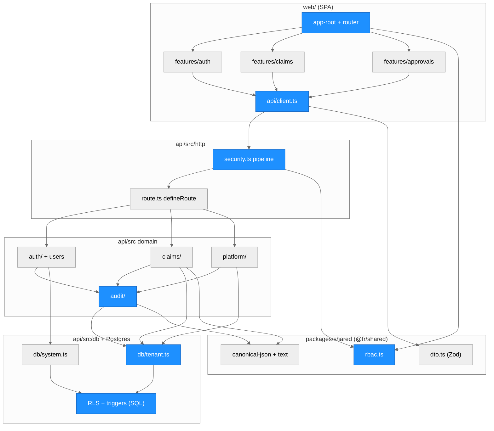

> Alt i dette diagrammet er nytt i denne kjøringen. Blått markerer de sikkerhetskritiske modulene.

### Modulreferanse

| Modul / fil | Lag | Formål | Viktige eksporter | Endret |
| --- | --- | --- | --- | --- |
| `packages/shared/src/rbac.ts` | Delt | **Eneste sannhetskilde** for roller og den frosne tillatelsesmatrisen | `ROLES`, `PERMISSION_MATRIX`, `can`, `canAssignRole`, `canManageUserWithRole`, `MFA_REQUIRED_ROLES` | ny |
| `packages/shared/src/dto.ts` | Delt | Strenge forespørselsskjemaer og respons-DTO-er (også `CLAIM_SORT_FIELDS`) | Zod-skjemaer | ny |
| `packages/shared/src/canonical-json.ts`, `text.ts`, `money.ts` | Delt | Kanonisk JSON for hashing; `displayText` og kontroll av usikre tegn; formatering av heltallscent | `canonicalJson`, `GENESIS_HASH`, `displayText`, `formatUsdCents` | ny |
| `api/src/app.ts`, `server.ts`, `config.ts` | API | App-fabrikk; feilsikker konfigurasjon (produksjonsvern, kontroll av hemmeligheter) | `buildApp`, `loadConfig`, `secretEntropyProblem` | ny |
| `api/src/http/security.ts` | API | Én `onRequest`-pipeline: ratebegrensning → Origin → CSRF → autentisering → tillatelse; sikkerhetshoder | `registerSecurityPipeline` | ny |
| `api/src/http/route.ts` | API | `defineRoute`; oppstarten feiler hvis en rute mangler tilgangsdeklarasjon; Zod-validering i `preHandler` | `defineRoute` | ny |
| `api/src/security/*` | API | argon2id, HS256-JWT (nøkkel/typ/aud per formål), TOTP, CSRF, HKDF/AES-GCM, utestengingsmatematikk | | ny |
| `api/src/auth/*` | API | Innlogging, MFA, refresh-rotasjon + gjenbruksdeteksjon, glemt passord/tilbakestilling, invitasjoner, brukere (R3-R23), dev-utboks (R38) | `authenticateAccessToken`, `rotateRefreshToken`, ruteregistrering | ny |
| `api/src/claims/*` | API | Liste/sortering/søk (`escapeLike`), pakkevisning, innholdshash, tilstandsmaskin for gjennomgang, godkjenninger (R26-R34) | `canTransition`, `packetContentHash` | ny |
| `api/src/platform/*` | API | Helse, tenant-statistikk, SUPER_ADMIN-lesing på tvers av tenants (revisjonslogget først) | `crossTenantRead` | ny |
| `api/src/audit/*` | API | Hashkjede, tilføying under advisory lock, verifikator, liste-/verifiseringsruter | `appendAudit`, `ChainVerifier` | ny |
| `api/src/db/tenant.ts`, `system.ts` | Data | Lag 2: tenant-utvidelse som feiler lukket; systemmodus-transaksjoner (begrenset av lint) | `withTenantTx`, `withSystemTx` | ny |
| `api/prisma/migrations/20261008000000_init/migration.sql`, `api/db/init/00-roles.sql` | Data | Skjema, RLS + FORCE, minste-privilegium-tildelinger, append-only- og tilstandsmaskin-triggere, DB-roller | | ny |
| `web/src/api/client.ts` | Web | Tilgangstoken i minnet, CSRF-hode, refresh én om gangen (Web Locks på tvers av faner) | `ApiClient` | ny |
| `web/src/features/{auth,shell,claims,approvals}` | Web | Sider for innlogging/MFA/tilbakestilling/invitasjon, skall + kommandopalett, kravtabell + detaljpanel, godkjenningskø | sider | ny |
| `infra/*.tf` | Infra | AWS-skjelett (kun fmt/validate, aldri anvendt) | | ny |
| `compose.web.yml`, `.github/workflows/web-ci.yml` | Drift | Egen lokal stack og egen CI; Python-tjenestens `docker-compose.yml` og `ci.yml` er urørt | | ny |

## Forespørselspipeline (dataflyt)

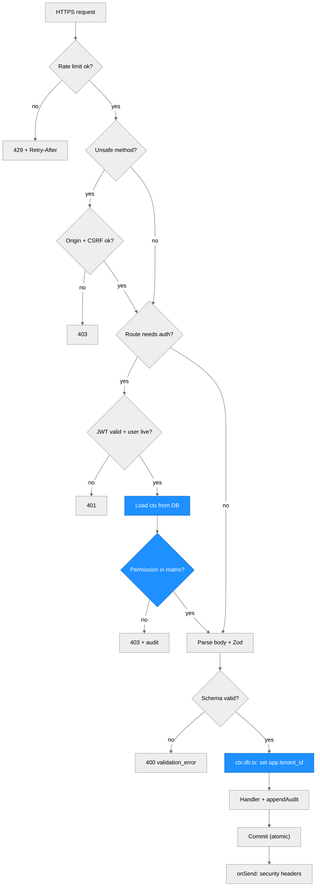

Autentisering og autorisasjon kjøres i `onRequest`, før body parses. En uautentisert eller forbudt
forespørsel får derfor 401/403 selv om body er ugyldig. En forretningsendring og revisjonshendelsen
dens committes i samme transaksjon: feiler tilføyingen til revisjonssporet, returnerer forespørselen 500
og ingenting endres.

## Autentiseringsflyter

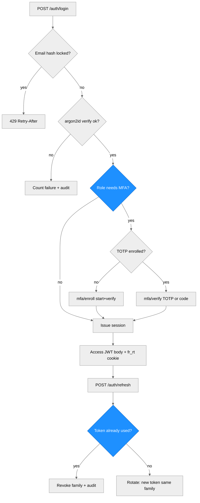

| Flyt | Ruter (under `/api/v1`) | Viktige regler |
| --- | --- | --- |
| Innlogging | `POST /auth/login` | argon2id med en dummy-verifisering for ukjente eller deaktiverte brukere; utestenging per e-posthash `min(30·2^(f-5), 900)` s etter 5 feil; ratebegrensning for auth 20/60 s per IP |
| MFA | `/auth/mfa/verify`, `/auth/mfa/enroll/start`, `/auth/mfa/enroll/verify` | påkrevd for OWNER, ADMIN, PLATFORM_DEV, SUPER_ADMIN; RFC 6238 ±1 steg; godtatt steg må øke strengt (ingen gjenbruk); gjenopprettingskoder kan brukes én gang |
| Sesjon | `/auth/refresh`, `/auth/logout`, `GET /me` | tilgangs-JWT (10 min) holdes i JS-minnet; informasjonskapselen `fr_rt` er `HttpOnly; Secure; SameSite=Strict; Path=/api/v1/auth`; DB lagrer en HMAC av tokenet; gjenbruk tilbakekaller hele familien; en familie lever maks 30 dager |
| CSRF | `GET /auth/csrf` | informasjonskapselen `fr_csrf` == `X-CSRF-Token` == `nonce.HMAC(secret, nonce)`, pluss en Origin-kontroll |
| Gjenoppretting | `/auth/forgot`, `/auth/reset`, `/auth/change-password` | samme svar for ukjente e-poster; tilbakestilling tilbakekaller alle sesjoner; glemt passord er begrenset til 5/15 min |
| Invitasjoner | `/users/invites`, `/auth/invites/inspect`, `/auth/invites/accept` | rolletildeling er rangbasert (`canAssignRole`); OWNER kan aldri tildeles |

## RBAC

`packages/shared/src/rbac.ts` er eneste sannhetskilde. API-et kontrollerer `can(role, permission)` på
hver forespørsel. Nettappen importerer de samme frosne dataene bare for å skjule kontroller.

| Tillatelse | OWNER | ADMIN | MANAGER | REVIEWER | ANALYST | VIEWER | PLATFORM_DEV | SUPER_ADMIN |
| --- | --- | --- | --- | --- | --- | --- | --- | --- |
| `claims:read` | x | x | x | x | x | x | | |
| `claims:assign` | x | x | x | | | | | |
| `packets:edit`, `packets:approve` | x | x | x | x | | | | |
| `demands:send` | x | x | x | | | | | |
| `import:run` (steg 3: batcher, opplasting, dokumenter, nedlasting, opprett krav) | x | x | x | x | x | | | |
| `import:review` (steg 3: gjennomgangskø og beslutninger) | x | x | x | x | | | | |
| `export:claims` (steg 3) | x | x | x | x | x | | | |
| `export:packets`, `export:outcomes` (steg 3) | x | x | x | x | | | | |
| `users:read`, `users:manage`, `audit:read`, `settings:manage`, `integrations:manage` | x | x | | | | | | |
| `admins:manage`, `billing:manage`, `tenant:delete` | x | | | | | | | |
| `apikeys:manage` (steg 4: opprette, liste og tilbakekalle tenantenes API-nøkler) | x | x | | | | | | |
| `claims:analyze` (steg 5: analysere ett krav, masseanalyse; ingen API-nøkkel-scope) | x | x | x | x | x | | | |
| `platform:health` (steg 4: også pipelinehelse og telemetri) | | | | | | | x | x |
| `platform:flags`, `platform:logs` | | | | | | | x | |
| `platform:eval` (steg 4: evalueringskjøringer) | | | | | | | x | |
| `platform:audit` (steg 4: plattformens revisjonskjede) | | | | | | | | x |
| `platform:tenants:list`, `platform:cross_tenant_read` | | | | | | | | x |

Plattformroller har ingen tenant og ingen tillatelse til tenant-data. En SUPER_ADMIN-lesing på tvers av
tenants er skrivebeskyttet, krever en begrunnelse på minst 10 tegn og logges først i revisjonssporet til
måltenanten. Det finnes ingen Team-modell, så alle tenant-roller ser alle krav i sin tenant (antakelse
A4).

## Tenant-isolasjon (tre lag, feiler lukket)

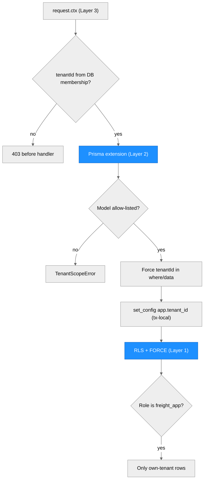

- **Lag 1, PostgreSQL RLS.** Hver tenant-avgrenset tabell (`claims`, `evidence_packets`,
  pakkens undertabeller, `approvals`, `memberships`, `invites`, `audit_events`) har `ENABLE` og
  `FORCE ROW LEVEL SECURITY` med `USING/WITH CHECK (tenant_id = fr_current_tenant())`. Uten
  `app.tenant_id` satt ser spørringer null rader. Bare `memberships` og `invites` tillater i tillegg
  `fr_system_mode()` (oppstart av autentisering), og `platform`-revisjonskjeden er bare synlig i
  systemmodus.
- **Roller.** API-et kjører som `freight_app` (`NOSUPERUSER NOBYPASSRLS NOINHERIT`, ikke eier; bare
  DML-tildelinger; `evidence_packets` får bare `UPDATE (status)`; tabeller som bare kan utvides får bare
  `SELECT, INSERT`). `freight_owner` eier skjemaet og kjører migrasjoner, seed og testoppsett
  (BYPASSRLS).
- **Lag 2, Prisma-utvidelse som feiler lukket** (`api/src/db/tenant.ts`). Modellene er hvitelistet;
  `tenantId` legges inn i hver where-betingelse og hver create, og en motstridende verdi kaster en feil.
  Rå SQL er blokkert på tenant-klienten.
- **Lag 3, forespørselskontekst.** Bruker, rolle, tenant-status og om refresh-familien lever lastes på
  nytt fra DB ved hver forespørsel, aldri fra token-claims. Plattformbrukere får `db = null`.

## Revisjonsspor med hashkjede

- Én kjede per tenant (`chain_key = t:<tenantId>`) pluss en `platform`-kjede.
  `hash_n = SHA-256(hash_{n-1} + "\n" + canonicalJson(event_n))`; genesis er 64 nuller; `seq` er
  sammenhengende under `pg_advisory_xact_lock(hashtextextended(chain_key, 0))`.
- Triggere blokkerer UPDATE, DELETE og TRUNCATE på `audit_events` (og på `approvals`,
  `login_attempts` og pakkens undertabeller), også for eieren. Bare `db:seed -- --reset` i dev/test
  omgår dem via `session_replication_role`.
- `GET /api/v1/audit/verify` (`audit:read`) regner ut kjeden på nytt og rapporterer `brokenAtSeq`.
  Metadata går gjennom en hviteliste; mislykkede innlogginger registreres med `actor = null`.

## Tilstandsmaskin for godkjenning

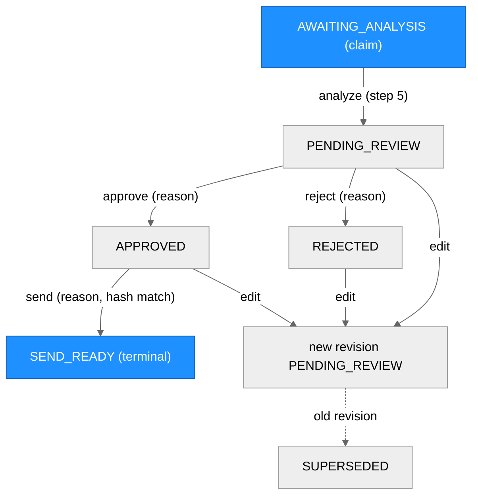

`AWAITING_ANALYSIS` er bare en kravstatus (importerte krav uten pakke ennå). Siden kjøringen
`REQ-20261010-step5-analysis` lager analysehandlingen pakkerevisjon 1 i `PENDING_REVIEW` og flytter kravet dit;
ingenting går tilbake til `AWAITING_ANALYSIS`. Se [kravanalyse (steg 5)](#nettplattform-kravanalyse-steg-5).

Hver handling krever en begrunnelse og skriver en `approvals`-rad (som bare kan utvides) pluss en
revisjonshendelse i én transaksjon, med kravraden låst `FOR UPDATE`. Godkjenning lagrer pakkens kanoniske
innholdshash. Sending regner den ut på nytt og krever at den er lik både godkjenningens hash og den lagrede
hashen. «Send» merker bare kravet som klart til sending: ingen e-post, ingen betaling. DB-triggeren
`fr_packet_update_guard` håndhever de samme overgangene og gjør alle kolonner unntatt `status`
uforanderlige. Redigering lager en ny revisjon; godkjenningsraden registrerer grunnrevisjonen (avvik 18).
Siden kjøringen `REQ-20261009-four-eyes` avvises også godkjenning og avvisning (403 `four_eyes_required`)
for alle som har laget en revisjon av kravets pakke; se
[firøyeprinsippet](#nettplattform-firøyeprinsippet-arbeidsdeling).

| Funksjon | Definert i | Kalles av | Formål |
| --- | --- | --- | --- |
| `canTransition`, `targetStatus` | `api/src/claims/state-machine.ts` | kravtjenesten | overgangstabell (speiler SQL-triggeren) |
| `packetContentHash` | `api/src/claims/content-hash.ts` | godkjenn, rediger, send, integritet i visningen | kanonisk hash med ordenstall i stedet for UUID-er |
| `lockClaimForUpdate` | `api/src/db/tenant.ts` | kravtjenesten | serialiserer samtidige beslutninger |
| `appendAudit` | `api/src/audit/audit.ts` | hver endrende handler, lesing på tvers av tenants | tilføying til kjeden i kallerens transaksjon |
| `crossTenantRead` | `api/src/platform/cross-tenant.ts` | plattformruter | revisjonslogg først, så lesing, feiler lukket |

## AWS-kartlegging (nettstack)

`infra/` erstatter `deploy/terraform/` **kun for nettstacken**. Den følger prinsippene i
[deploy/aws.md](deploy/aws.md) ([norsk](deploy/aws.no.md)): hemmeligheter kommer fra Secrets Manager via
task-definisjonen og er aldri i state, migrasjoner kjøres som en engangs ECS-oppgave før utrullingen, WAF
står foran, og ingenting anvendes automatisk.

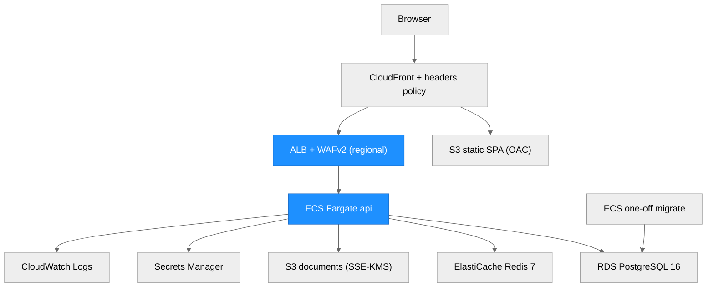

| Komponent | Lokalt (`compose.web.yml`) | AWS (`infra/`) |
| --- | --- | --- |
| SPA | nginx-unprivileged, hoder fra `web/security-headers.json` | S3 + CloudFront (OAC), respons-hode-policy generert fra den samme JSON-filen |
| API | `api`-container (uid 10001, skrivebeskyttet rotfilsystem, capabilities fjernet) | ECS Fargate, samme herding, private subnett, VPC-endepunkter (ingen NAT) |
| Kant | kun loopback | ALB nåbar bare fra CloudFronts origin-områder, TLS 1.2/1.3-policy, WAFv2 (administrerte regler, IP-ratebegrensning, Content-Length > 64 KiB; steg 3: opplastingsruten har en egen regel > 10 MiB) |
| DB | `postgres:16.15-alpine` + `00-roles.sql` | RDS PostgreSQL 16, KMS, `rds.force_ssl=1`, administrert masterpassord; roller legges inn av en operatør |
| Lager for ratebegrensning | `redis:7-alpine` | ElastiCache Redis 7, TLS + kryptering i hvile, AUTH-token satt utenom Terraform |
| Dokumenter | MinIO (`chainguard/minio`) med innebygd KMS (`fr-dev-key`) og versjonering | S3 SSE-KMS (bucket-policyen avviser opplasting uten CMK-en), versjonering, livssyklusregler; task-rollen begrenset til prefikset `t/*`, `s3:DeleteObject` bare på `t/*/imports/*` |
| Hemmeligheter | offentlige `local-dev-*`-verdier (avvist i produksjon) | 7 Secrets Manager-beholdere; verdiene settes utenom Terraform |

## Arkitekturmønstre

- **Sikkerhetspipeline som én hook**: en eksakt, testbar rekkefølge (rate → Origin → CSRF → autentisering → autorisasjon → validering).
- **Feil lukket overalt**: ukjente ruter hindrer oppstart; uten tenant gir null rader; en feil i revisjonssporet ruller tilbake forretningsendringen; produksjonskonfigurasjonen avviser dev-verdier.
- **Delt kontraktspakke**: roller, matrise og DTO-er er definert én gang i `@fr/shared` og brukes av både API og web.
- **Dybdeforsvar i databasen**: RLS, tildelinger og triggere håndhever invariantene selv om applikasjonskoden er feil.
- **Innholdsadresserte godkjenninger**: beslutninger bindes til en kanonisk hash, ikke til en rad som kan endres.

## Merknader

- Avvik fra briefen: Node 22 i stedet for 20 (Node 20 er EOL); en Prisma-klientutvidelse i stedet for den fjernede `$use`-mellomvaren; eslint 9; framer-motion utelatt. Hele listen (22 punkter) står i kjøringens `implementation.md`.
- Ikke verifisert: Docker-imagene og compose-stacken, Playwright-ende-til-ende-tester, enhver AWS-utrulling. Se «Known gaps» i trusselmodellen.

---

# Nettplattform: import og eksport (steg 3)

> Skrevet av scriber for kjøringen `REQ-20261008-step3-import-export` 2026-10-09 (grenen
> `feat/import-export`). **Før produkt, kun syntetiske data, aldri utrullet.** Trusselradene for dette
> steget er T18-T31 i [technical/web-platform-security.md](technical/web-platform-security.md) (engelsk).
> E-postvideresending er kun et design: [docs/design/email-ingest.md](docs/design/email-ingest.md)
> (engelsk). Mermaid-diagrammene er de samme som i den engelske originalen
> ([ARCHITECTURE.md](ARCHITECTURE.md#web-platform-import-and-export-step-3)).

## Oversikt (steg 3)

Steg 3 legger til **import** og **eksport** av dokumenter. Import dekker opplasting, typegjenkjenning,
kryptert lagring, parsing i sandkasse, deterministisk uttrekk med kildehenvisninger, menneskelig
gjennomgang og opprettelse av krav. Eksport strømmer krav, bevispakker og godkjenningsutfall som CSV
eller XLSX, med nøytralisering av formler. Steg 3 legger ikke til OCR, AI- eller LLM-kall, utgående
e-post eller mottak av videresendt e-post. Parsing og uttrekk er en TypeScript-port av Python-modulene
`ingest/` og `extraction/`. Paritetstester sjekker den mot Python-koden. Python er bare et testorakel og
kjører aldri i produksjon.

Hovedbeslutninger:

- Pipelinen er **synkron** inne i opplastingsforespørselen og begrenset av tidsgrenser. Statusmodellen
  åpner allerede for en kø senere.
- API-et **videreformidler** originalene. Det finnes ingen signerte URL-er.
- PDF-er leses bare fra tekstlaget. Bilder lagres og flagges for manuell registrering.
- Krav som opprettes fra import, starter i den nye statusen `AWAITING_ANALYSIS`, uten beløp og uten
  bevispakke. Steg 5 legger til analysen ([kravanalyse (steg 5)](#nettplattform-kravanalyse-steg-5)).

## Modulstruktur (steg 3)

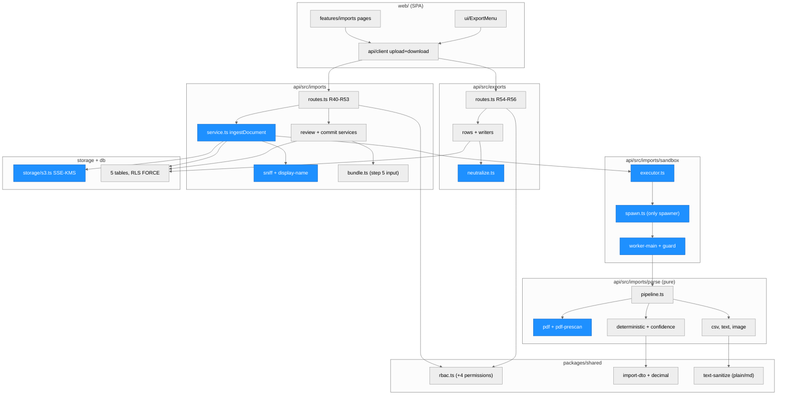

> Alt i dette diagrammet er nytt eller endret i steg 3. Blått markerer modulene som håndterer fiendtlige
> bytes eller fiendtlig celleinnhold. Modulreferansen (filer, eksporter, endringer) står i den engelske
> originalen.

## Importpipeline (dataflyt)

Én opplasting er én forespørsel `POST /api/v1/imports/:batchId/documents?filename=` med filens rå bytes.
Pipelinen kjører synkront, og svaret inneholder dokumentets endelige tilstand.

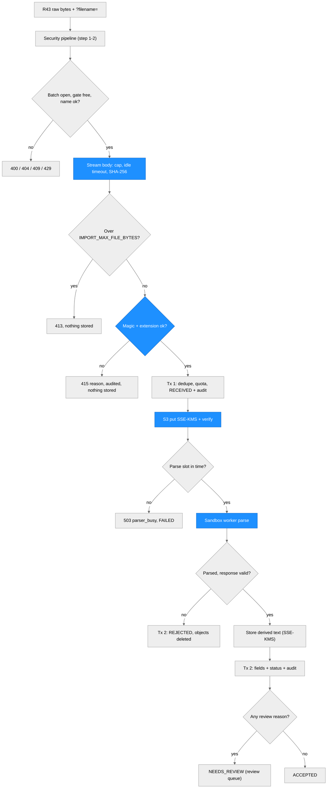

1. **Opplasting.** Klienten sender rå bytes (`Content-Type: application/octet-stream`, ingen multipart).
   Filnavnet er en spørreparameter og renses til et visningsnavn. Klientens medietype brukes aldri.
   Ratebegrensning, Origin, CSRF, autentisering og tillatelse kjøres før innholdet leses.
2. **Typegjenkjenning.** API-et godtar `%PDF-` på posisjon 0, PNG-signaturen eller `FF D8 FF`. Alt annet
   behandles som tekst. Tekst kan ikke inneholde NUL, C0-kontrolltegn eller DEL utenom HT, LF, CR og FF,
   og kan ikke starte som HTML, SVG, XML eller PHP. Kjente signaturer som ikke er tillatt (zip, gzip, PE,
   ELF, GIF, RIFF, OLE, PostScript, rar, 7z) avvises. Den siste filendelsen må være en av
   `.pdf .png .jpg .jpeg .csv .txt` og stemme med den gjenkjente typen.
3. **Lagring.** Transaksjon 1 setter inn raden `RECEIVED` og revisjonshendelsen før all treg I/O.
   Originalen lagres under `t/<tenantId>/imports/<batchId>/<docId>/original` med SSE-KMS og
   SHA-256-kontrollsum. I produksjon verifiserer en `HEAD`-forespørsel krypteringen. Nøkler inneholder
   aldri klientens filnavn.
4. **Isolert parsearbeider.** `ChildProcessExecutor` tar en plass fra en semafor per instans. Den
   starter `node` med `--permission`, som bare gir lesetilgang til arbeiderens filer. Arbeideren får
   ingen skrive-, barneprosess-, worker-, addon- eller WASI-tillatelse. Den får også
   `--max-old-space-size`, et **tomt miljø** og en tom arbeidsmappe. En vaktmodul (beste innsats, i
   samme prosess) sletter `fetch`, `WebSocket`, `EventSource` og `XMLHttpRequest`, blokkerer nettverks-,
   prosess- og VM-modulene og låser `connect` på socket-klassene som kan nås via stdio-strømmene. Den er
   ingen sikkerhetsgrense: den reelle nettverkskontrollen er et nettverk uten utgående trafikk (i AWS
   oppgavenettverket uten NAT), og en egen parseroppgave uten utgående trafikk er et krav før lansering.
   Forelderprosessen håndhever veggklokke, utdatagrense og (på Linux) en RSS-grense. Den behandler
   arbeideren som upålitelig: hele svaret valideres på nytt, og et ugyldig svar blir `parse_failed`.
5. **PDF-forhåndsskanning.** `pdf-prescan.ts` går gjennom PDF-strukturen med faste grenser før pdf.js
   ser filen. Den avviser som `malformed_pdf`: mer enn 3 kjedede filtre, et indirekte `/Filter`,
   dekompresjonsbomber (32 MiB per strøm, 64 MiB totalt), `/Prev`-løkker, mer enn 64 xref-seksjoner,
   sidetrær større enn sideantallet pluss 16, og null sider. Den teller også tekst i innholdsstrømmene,
   også tekst utenfor siden, slik at grensen `PARSE_MAX_TEXT_CHARS` holder (`text_too_large`). Deretter
   leser pdf.js bare tekstlaget, uten merknader, vedlegg, JavaScript eller XFA.
6. **Uttrekk med kildehenvisning.** Den deterministiske leverandøren (`deterministic`, versjon 1) leser
   `Nøkkel: verdi`-linjer og gir bare tillatte felt. Hvert felt har en kildepeker (side, linje,
   UTF-16-start og -slutt, CSV-rad, renset utdrag) og en regelbasert konfidens. Et felt flagges når
   konfidensen er under `REVIEW_CONFIDENCE_THRESHOLD` (0,90), når verdien ikke kan tolkes, eller når
   duplikater er i konflikt. PDF-felt starter på 0,85, så alle PDF-felt flagges som standard.
7. **Gjennomgang.** Et dokument med en gjennomgangsgrunn får `NEEDS_REVIEW` og havner i
   gjennomgangskøen (`GET /reviews`). En gjennomgåer bekrefter, korrigerer eller avviser hvert flagget
   felt. For bilder kan gjennomgåeren også sette dokumenttypen og legge inn felt manuelt. Deretter godtar
   eller avviser gjennomgåeren dokumentet. Hver handling krever en begrunnelse og gir en rad i tabellen
   `import_review_decisions`, som bare kan utvides, pluss en revisjonshendelse. Godtatte dokumenter kan
   ikke endres.
8. **Opprett krav.** `POST /imports/:batchId/commit` grupperer batchens godtatte dokumenter etter
   normalisert lastnummer (NFKC, sammenslått mellomrom, store bokstaver). Den oppretter et
   `AWAITING_ANALYSIS`-krav eller kobler til et eksisterende. Har kravet allerede en bevispakke, kobles
   dokumentene bare til (`new_evidence_not_in_packet`), og pakken og feltene endres aldri. Operasjonen er
   atomisk og idempotent.

### Funksjonskall (opplasting)

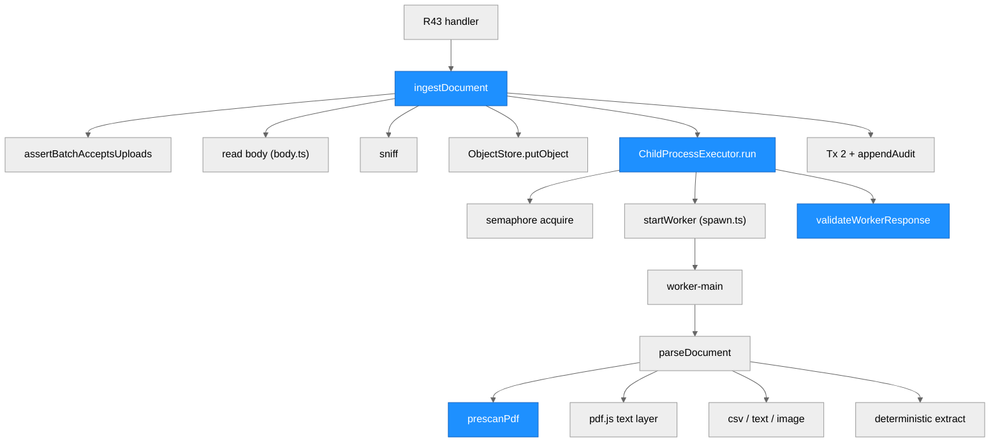

## Dokumenttilstander

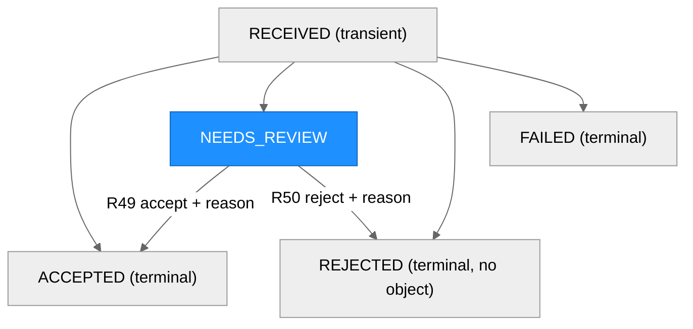

Et felt går én gang fra `PROPOSED` til `CONFIRMED`, `CORRECTED` eller `REJECTED`. En databasetrigger
håndhever overgangene og holder uttrukket verdi, råverdi, konfidens og pekere uforanderlige.

Siden kjøringen `REQ-20261009-four-eyes` avvises R49 (godta) med 403 `four_eyes_required` for den som
lastet opp dokumentet, og for alle som har registrert en felt-`CORRECT` eller -`ADD` på det; se
[firøyeprinsippet](#nettplattform-firøyeprinsippet-arbeidsdeling). Et dokument som går rett fra
`RECEIVED` til `ACCEPTED` (ingen grunner til gjennomgang), har ingen menneskelig godkjenner (restrisiko
FE-S1).

## Datamodell og lagring

Fem nye tenant-tabeller: `import_batches`, `import_documents`, `extracted_fields`,
`import_review_decisions` (kun tillegg) og `claim_documents` (kun innsetting). Alle har `ENABLE` og
`FORCE ROW LEVEL SECURITY`, kolonnevise tildelinger for `freight_app`, og står i `TENANT_MODELS`. En
CHECK krever at `storage_key` starter med `t/<egen tenant_id>/`. Objektlagringen er privat. Hvert kall i
`ObjectStore` kontrollerer tenant-prefikset på nytt, og API-et returnerer aldri en lagrings-URL.
Nedlasting av originalen strømmes gjennom API-et med et syntetisk filnavn, og SHA-256 av de strømmede
bytene kontrolleres.

## Eksportstrømming

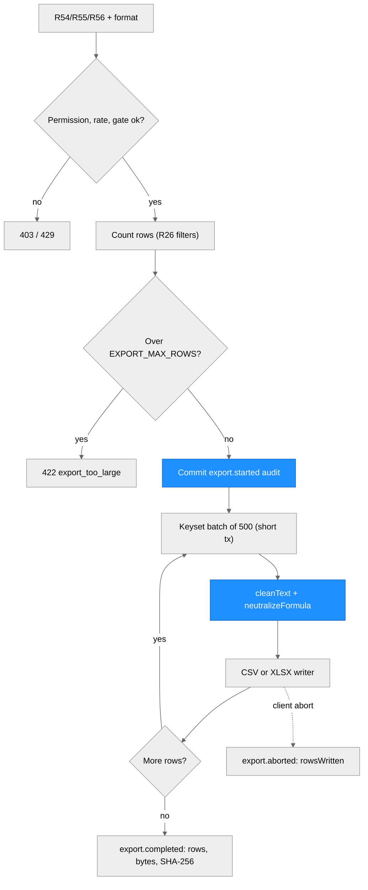

- **Formater.** CSV er UTF-8 med BOM og CRLF, og hver tekstcelle står i anførselstegn. XLSX er ett ark,
  skrevet som en strømmet ZIP med `fflate`, med typede tekster og tall og en fet, fastfrosset
  overskriftsrad. Det finnes ingen formler, lenker, makroer, tegninger eller eksterne relasjoner.
- **Formelnøytralisering.** Tekstceller mister kontrolltegn, bidi- og nullbreddetegn (tab, CR, LF, LS og
  PS blir ett mellomrom) og kuttes ved 10 000 tegn. Er første tegn etter eventuelt mellomrom `=`, `+`,
  `-`, `@` eller en fullbreddeform (U+FF1D, U+FF0B, U+FF0D, U+FF20), får cellen en ledende `'`. Tall
  skrives som tall og nøytraliseres aldri.
- **Begrenset minne.** Hver bolk på 500 rader bruker sin egen korte transaksjon, og skriverne respekterer
  mottrykk (backpressure).

## Python-paritet: registrerte avvik (D1-D8)

TypeScript-parseren skal gi samme resultat som Python-referansen (`ingest_bytes`, `classify`,
`DeterministicStubProvider.extract`) for den støttede delmengden. `api/test/parity/extract.parity.test.ts`
kjører Python-koden via `tools/parity/extract_dump.py` og sammenligner dokumenttype, sha256, tekst og
felt. Avvikene nedenfor er de **eneste** tillatte forskjellene. Alle andre forskjeller er feil.

| ID | Avvik (TS mot Python) | Begrunnelse |
| --- | --- | --- |
| D1 | PDF-signaturen `%PDF-` må stå på posisjon 0. Python tåler opptil 1024 søppelbytes foran. | Søppel foran er et klassisk polyglott-triks. Posisjon 0 gjør typen entydig. |
| D2 | PDF-tekst kommer fra pdf.js, ikke pdfplumber. Paritet gjelder bare enkle PDF-er med tekstlag (én tekstlinje per linje, standard Helvetica eller Times, én spalte). | pdfplumber finnes bare i Python, og TS-porten skal ikke kalle Python under kjøring. To motorer ordner og spatierer tekst ulikt på komplekse oppsett. |
| D3 | Filendelsen og den gjenkjente typen må stemme overens. Tillatte endelser: `.pdf .png .jpg .jpeg .csv .txt` (uten hensyn til store og små bokstaver, bare siste endelse). Python ser bare på endelsen. | Hindrer at en PDF eller et skript forkledd som `.csv` (og omvendt) havner i feil parser. |
| D4 | Ugyldig UTF-8 dekodes med U+FFFD som i Python, men gir advarselen og gjennomgangsgrunnen `DECODE_REPLACEMENTS`. NUL, C0-kontrollbytes utenom HT, LF, CR og FF, **eller DEL (0x7F)** avviser filen som `binary_content`. Python ville fortsatt. | Binært innhold i en «tekstfil» tyder på en forkledd eller ødelagt fil. DEL-regelen kom i rettingsrunde 1 (lederavgjørelse SQ2). Python har ingen binærsperre, så DEL har ingen motpart i Python. |
| D5 | Tekst over `PARSE_MAX_TEXT_CHARS` (standard 2 000 000) avvises som `text_too_large`. Pythons grense er 5 000 000. For PDF-er teller også tekst utenfor siden (forhåndsskanning, rettingsrunde 1). | Strammere grense for minne og tid i parseren. |
| D6 | Tekstverdier renses for usikre tegn (kontrolltegn, linjeskilletegn, bidi-kontrolltegn) og kuttes ved 200 tegn, med feltgrunnen `SANITIZED_VALUE` når noe ble endret. | Verdiene vises i brukergrensesnittet og eksporteres, så de må være trygg tekst på én linje. |
| D7 | Ikke-ASCII-sifre og eksotisk Unicode-bokstavfolding godtas ikke der Pythons regulære uttrykk ville godtatt dem. Dato- og tidssifre er bare ASCII `0-9`, og `USD`-endelsen godtar bare ASCII-bokstaver. | Hindrer at sifre og bokstaver som ser like ut, endrer beløp eller datoer. |
| D8 | PNG og JPEG godtas og strukturvalideres, men gir **ingen felt** (ingen OCR). Status er `NEEDS_REVIEW` med grunnen `IMAGE_NO_TEXT_LAYER`. En gjennomgåer kan sette typen (R46) og legge inn felt (R47). | Python leser ikke bilder, og OCR er utenfor omfanget av steg 3. |

Beslektede merknader (ikke nye avvik): `parseMoney` beholder CPython-paritet, så `"1,2,3"` blir `123` og
`"$-5"` blir `-5` (avgjørelse SQ1; et senere steg kan gjøre dette strengere som et nytt registrert avvik;
steg 5 gjorde det ikke, men avviser et negativt resultat ved lagring, RD3, 422).
Forhåndsskanningen avviser fiendtlige PDF-er utenfor D2-delmengden. Opptil 16 nullbytes etter `IEND` i
PNG tåles, som for JPEG. `strptime`-paritet følger CPython 3.12 for et ledende mellomrom foran `%H` eller
`%d`. Feltrekkefølgen følger N7-nøkkelrekkefølgen og deretter `groupIndex` (SQ4).

## Grensesnitt for steg 5 (port av regler og bevis)

**Status: levert** i kjøringen `REQ-20261010-step5-analysis` (se
[kravanalyse (steg 5)](#nettplattform-kravanalyse-steg-5)). Punkt 1-6 brukes som beskrevet nedenfor; punkt 7
(en LLM-leverandør) og strengere tolking av beløp gjenstår.

1. **Inndata.** `loadBundleForClaim(tx, claimId)` gir `{bundle, sources}`. `bundle` er TS-versjonen av
   `ExtractedBundle`, bygget fra de effektive feltverdiene i kravets dokumenter. Steg 5 la til
   `loadAnalysisInput(tx, claimId)` (samme utvalg og rekkefølge av dokumenter, pluss feltproveniens og
   `sizeBytes`); `loadBundleForClaim` delegerer nå til den med uendret signatur. Inngangen til motoren er
   `buildEvidence(docs, bundle, perspective, settings, now)` i `@fr/shared/analysis`, motparten til
   Pythons `run_pipeline` etter `extract_bundle`.
2. **Kildehenvisning.** `pointerToLocator(displayName, pointer)` gir sitatlokatorer som `invoice.txt:L5`
   eller `file.pdf:p2:L14`. `sources[]` har `documentId`, `displayName`, `sha256` og `docType`.
3. **Penger.** `packages/shared/src/decimal.ts` er grunnlaget for tolking av beløp. Steg 5 la til
   `packages/shared/src/analysis/py-decimal.ts`, en `Decimal` som er nøyaktig lik CPython (presisjon 28,
   ROUND_HALF_EVEN, quantize, formatering som `str` og `.2f`), for regnestykkene i reglene.
4. **Tekst.** `plain` og `md` (`packages/shared/src/text-sanitize.ts`) er allerede portert med paritet.
5. **Kravets livsløp.** Steg 5 la til overgangen `AWAITING_ANALYSIS -> PENDING_REVIEW`, med
   pakkerevisjon 1 og revisjonshendelsen `claim.analyzed` i samme transaksjon. `claim_documents` viser
   kildedokumentene. Revisjon 1 registrerer `created_by_id` som brukeren som startet analysen, så den
   brukeren kan ikke godkjenne den (FE-N2 lukket; migreringen `20261012000000_analysis` avviser en revisjon
   1 uten forfatter for et krav som venter på analyse).
6. **Paritetsmønster.** `tools/parity/` og `api/test/parity/` er mønsteret for regel-dumpen. CI setter
   allerede opp Python. Steg 5 la til `tools/parity/rules_dump.py` og `api/test/parity/rules.parity.test.ts`
   (registrerte avvik RD1-RD6).
7. **Leverandører.** `ExtractionProvider` er der en LLM-leverandør kan kobles inn senere, bak rensing og
   med obligatorisk kildehenvisning. Den kan aldri senke et flagg som de deterministiske kontrollene har
   satt.

## Slik kjører du kontrollene for steg 3

```bash
npm run db:migrate:deploy && npm run db:seed -- --reset
npm run ensure-bucket        # creates the dev/test bucket (MinIO), enables versioning; refuses production
npm run build                # builds the parser worker; run it before the integration and acceptance tests
npm run test:integration     # needs Postgres, S3 (MinIO) and Python for the parity suite (PYTHON=<interpreter>)
npm run test:acceptance      # black-box suites; same services
```

README-avsnittet «Import og eksport (steg 3)» beskriver lokalt oppsett uten Docker: portabel PostgreSQL,
MinIO med KMS og Python for paritet.

## Merknader (steg 3)

- Kjøringens `implementation.md` lister avvikene fra spesifikasjonen (14 punkter pluss rettingsrunde 1).
  De to viktigste: arbeideren startes ikke med `--no-experimental-fetch` (vakten sletter
  nettverksglobalene i stedet), og WAF-regelen for Content-Length har et eget unntak for
  opplastingsruten.
- Samtidighetsgrensene (opplasting, eksport, parseplasser) gjelder per API-instans, ikke distribuert.
- Ikke verifisert: container-images, compose-stacken, Playwright-ende-til-ende-tester, enhver
  AWS-utrulling.

---

# Nettplattform: utviklerdashbord, Recovery intelligence og API-nøkler (steg 4)

> Skrevet av scriber for kjøringen `REQ-20261009-step4-intelligence` 2026-10-09 (grenen
> `feat/intelligence`). **Før produkt, kun syntetiske data, aldri utrullet.** Trusselradene for dette
> steget er T32-T45 i [technical/web-platform-security.md](technical/web-platform-security.md) (engelsk).
> Alle hemmeligheter står i [docs/secrets.no.md](docs/secrets.no.md). Beskrivelse for brukere:
> [README.no.md, steg 4](README.no.md#utviklerdashbord-recovery-intelligence-og-api-nøkler-steg-4).
> Mermaid-diagrammene er de samme som i den engelske originalen
> ([ARCHITECTURE.md](ARCHITECTURE.md#web-platform-dev-dashboard-recovery-intelligence-and-api-keys-step-4)).

## Oversikt (steg 4)

Steg 4 legger fire ting oppå steg 1-3:

1. **Utviklerdashbord** (`/dev`, rutene R60-R68) for `PLATFORM_DEV` og `SUPER_ADMIN`: pipelinehelse
   aggregert over alle tenanter, telemetri for forespørsler og en filtrert loggvisning fra API-instansen
   som svarer, funksjonsflagg, skrivebeskyttede evalueringskjøringer og plattformens revisjonskjede.
   Plattformsvar inneholder bare aggregater og telemetri.
2. **Recovery intelligence** (rutene R70-R73) for tenantbrukere: en prioritert arbeidsliste
   (`priority-v1`), lignende tidligere krav (`similar-v1`) og et sammendrag av proveniens per krav. Alle
   tre er deterministiske funksjoner av lagrede kolonner i innringerens egen tenant.
3. **API-nøkler for tenanter** (rutene R80-R82 pluss en vei for maskinautentisering): HMAC-hashet, vist
   én gang, tre omfang over nøyaktig ni ruter som har valgt å godta nøkler.
4. **Evalueringsverktøy** (`api/src/eval/`, et kommandolinjeprogram): pass^k over det syntetiske settet
   `api/eval/sets/extraction-v1`, kjørt gjennom den ekte sandkasseparsingen; den eneste som skriver
   evalueringsdata.

Bindende regel for alt sammen (**regelen om ærlig merking**): ingenting vises som ikke er beregnet fra data
systemet har ved forespørselen eller registrert av et måleverktøy, hvert tall oppgir grunnlaget sitt, og
ingen påstand om treffsikkerhet, hastighetsgevinst, læring eller «AI» forekommer. De faste tekstene ligger
i `packages/shared/src/honest-copy.ts`; brukergrensesnittet viser dem ordrett. En arkitekturtest stopper
byggingen hvis strengene «neural mesh», «Hebbian», «solved-problems cache», «AI-powered», «faster than»
eller et mønster «Nx faster» forekommer i `api/src`, `packages/shared/src` eller `web/src`.

## Begreper i briefen mot det som er bygget

Produktbriefen bruker ord som denne koden **ikke** implementerer. Ingenting av det følgende finnes i
repoet, og ingen tall fra briefen er målt:

| Begrep i briefen | Status | Hva som er bygget i stedet (ærlig motsvar) |
| --- | --- | --- |
| «Hebbian router» (rangerer krav/ruter etter forventet innkrevbar verdi) | **Ikke implementert.** En Hebbian eller annen lært rangering trenger registrerte innkrevingsutfall (betalt, delvis betalt, avslått), og slike finnes ikke. Ruter (lanes) er ikke modellert. | `priority-v1`: en fast formel `recoverable + floor(pending_review * W / 100)` med W = 25 % som uttalt policy, eksplisitte regler ved likhet og en «hvorfor»-liste per rad. Ikke kalt «forventet verdi» (det finnes ingen sannsynligheter). |
| «Neural mesh» (panel / målinger) | **Ikke implementert.** Produktet har ingen nevral komponent. (`src/freight_recovery/forecast/neural.py` er valgfritt, uvalidert veikartstillas for Python-tjenesten og er ikke koblet til noe.) | Tabellen «Intelligence components» på Telemetry-fanen: de to komponentene `priority-v1` og `similar-v1` med målte kall, feil, varighetsgrenser og antall kandidater fra ekte forespørsler, merket Method «Fixed rules» og Learned model «None». |
| «Solved-problems cache» med «~250x» | **Ikke implementert.** Det finnes ingen cache av noe slag, og tallet ~250x er aldri målt. «Vinnende bevismønster» ville kreve utfall som ikke finnes. | `similar-v1`: forklarbar heltallslikhet (samme transportør 35, felles regler opptil 40, lignende beløp opptil 15, samme perspektiv 10; anker påkrevd; minimum 30) over tenantens egne avgjorte krav, som viser hvordan teamet behandlet hvert av dem. Den viser den målte `computeMs` for den ene forespørselen og ingenting som ligner et forhold for hastighetsgevinst. |
| «AI-uttrekk med proveniens» | Finnes siden steg 3 som **deterministisk, regelbasert** uttrekk med kildepekere (ingen LLM). | Steg 4 legger til proveniens-sammendraget per krav (antall felt per gjennomgangsstatus, laveste regelbaserte konfidens). |
| «pass^k-målinger» | **Bygget, bare på syntetiske testdata.** | Evalueringsverktøyet og den skrivebeskyttede Evaluation-fanen. Med denne deterministiske pipelinen er pass^k lik pass^1, og brukergrensesnittet sier det. Presenteres aldri som treffsikkerhet på kundedokumenter. |

Hva en lært rangering ville trenge (utsatt, kun design): registrerte utfall per krav; en offline
sammenligning mot `priority-v1` på en holdt-ut periode med en forhåndsregistrert måleverdi (for eksempel
innkrevde dollar ved fast gjennomgangskapasitet) og et intervall; og lansering bare bak et nytt flagg hvis
den slår den faste formelen med et intervall som ikke inneholder null. Sømmen er det rene paret
`scoreClaim`/`compareWorklist` pluss feltet `formula.version`.

## Modulstruktur (steg 4)

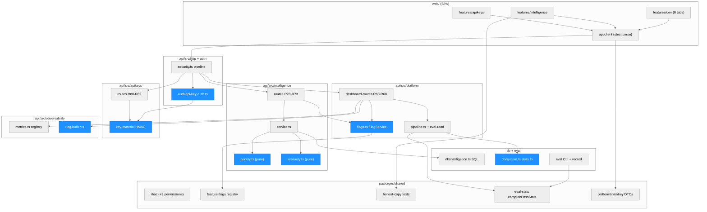

> Alt i dette diagrammet er nytt eller endret i steg 4. Blått markerer de sikkerhetsrelevante modulene
> (nøkkelautentisering, hashing av nøkler, flaggbufferen, avledning av logger, aggregatfunksjonen på tvers
> av tenanter) og de to poengkjernene.

### Modulreferanse (steg 4)

| Modul / fil | Lag | Formål | Viktige eksporter | Endret |
| --- | --- | --- | --- | --- |
| `packages/shared/src/rbac.ts` | Shared | Legger til `platform:eval` (PLATFORM_DEV), `platform:audit` (SUPER_ADMIN), `apikeys:manage` (OWNER, ADMIN) | `PERMISSION_MATRIX`, `can` | endret |
| `packages/shared/src/feature-flags.ts` | Shared | Flaggregisteret: nøyaktig `intelligence.provenance`, `intelligence.similar_claims`, `intelligence.worklist` (arkitekturtest) | `FEATURE_FLAGS`, `isKnownFlag` | ny |
| `packages/shared/src/honest-copy.ts` | Shared | De faste, ærlige tekstene (merknader for arbeidsliste, lignende krav, proveniens, ingen treffsikkerhet, evaluering, telemetri, logger, pipeline) | `WORKLIST_NOTE`, `worklistNote`, `EVAL_NOTE`, ... | ny |
| `packages/shared/src/eval-stats.ts` | Shared | pass^k-statistikk: andel per kjøring, pass^k, forventningsrett pass^j-kurve, ustabile saker, Wilson 95 %-intervall (z = 1,959964) | `computePassStats`, `binomial`, `wilsonInterval` | ny |
| `packages/shared/src/{platform,intelligence,api-key}-dto.ts` | Shared | Strenge Zod-skjemaer for hver forespørsel og hvert svar i steg 4; både nettklienten og API-et parser med dem | skjemaer, `API_KEY_SCOPES`, `SCOPE_PERMISSION` | ny |
| `api/src/http/security.ts`, `http/route.ts`, `http/context.ts` | API | URL-vakt (`fr_live_` i en URL = 400), nøkkelgrenen i forhåndsbehandleren, `apiKeyScope` på rutetilgang, `RequestCtx.role = 'API_KEY'` med `viaApiKey` | `registerSecurityPipeline`, `defineRoute` | endret |
| `api/src/auth/api-key-auth.ts` | API | Maskinautentisering: feilport per IP, format, oppslag, HMAC-sammenligning med konstant tid, tilstandskontroller, rute- og omfangskontroll, ny kontroll av skaperen, grense per nøkkel, kontekst | `ApiKeyAuthenticator`, `FailureGate` | ny |
| `api/src/apikeys/{key-material,service,routes}.ts` | API | Nøkkelgenerering (`randomBytes`), HMAC-SHA-256 med pepperen, kvote under en tenantlås, R80-R82 | `generateKey`, `verifySecret`, `createApiKey`, `revokeApiKey` | ny |
| `api/src/audit/attribution.ts` | API | Legger til `viaApiKey` og aktørrollen `API_KEY` sentralt i `appendAudit` for nøkkelautentiserte forespørsler (DV-7) | `registerApiKeyRequest`, `apiKeyFor` | ny |
| `api/src/platform/dashboard-routes.ts` | API | R60-R68: plattformlesinger med revisjonsspor, strenge utgående skjemaer (`strictBody`), rategruppen `platform` | `registerPlatformDashboardRoutes` | ny |
| `api/src/platform/flags.ts` | API | `FlagService`: buffer med TTL per instans, feiler lukket, radlås + optimistisk versjon + revisjonsspor i én systemtransaksjon | `FlagService`, `validFlagReason` | ny |
| `api/src/platform/pipeline.ts`, `eval-read.ts` | API | Setter sammen `PipelineHealth` fra SQL-funksjonen (nullutfylling, andeler); leser evalueringskjøringer | `assemblePipelineHealth`, `listEvalRuns`, `getEvalRun` | ny |
| `api/src/intelligence/priority.ts` | Kjerne | `priority-v1`: poeng, rekkefølge med 4 nøkler, «hvorfor»-tekster, neste handling (ren, heltall i cent) | `scoreClaim`, `compareWorklist`, `buildWhy`, `nextAction` | ny |
| `api/src/intelligence/similarity.ts` | Kjerne | `similar-v1`: normalisering av transportør, poeng, regel for inkludering, rangering (ren) | `scoreSimilarity`, `rankSimilar`, `normalizeCarrier` | ny |
| `api/src/intelligence/{service,routes}.ts` | API | R70-R73: flaggkontroll først (av = 404), lesing i tenanttransaksjonen, komponenttelemetri, revisjonshendelsen `intelligence.viewed` | `buildWorklist`, `findSimilar`, `provenanceFor` | ny |
| `api/src/db/intelligence.ts` | Data | Parametrisert rå SQL for arbeidsliste, likhetstrekk og proveniens, kjørt i innringerens tenanttransaksjon (rå SQL holdes i `db/`, DV-1) | `worklistPage`, `similarityFeatures`, `provenanceRows` | ny |
| `api/src/db/system.ts` | Data | Legger til `platformPipelineStats` (kaller `fr_platform_pipeline_stats`) og `lockFeatureFlag` | | endret |
| `api/src/observability/metrics.ts` | API | `MetricsRegistry`: 11 faste varighetsbøtter, høyst 200 rutenøkler, bøttegrenser etter nærmeste rang, komponentstatistikk; ingen I/O | `MetricsRegistry`, `DURATION_BOUNDS` | ny |
| `api/src/observability/ring-buffer.ts`, `api/src/logging.ts` | API | Loggeren tappes inn i en begrenset ring av avledede poster med 8 felt; `route` i `serializeRes`; maskering av `fr_live_` | `LogRingBuffer`, `deriveRecord`, `safeEvent` | ny / endret |
| `api/src/eval/{manifest,runner,canonical,record,cli,git-sha}.ts` | Verktøy | Manifestvakter, k kjøringer gjennom den ekte sandkassen, kanoniske digester, statistikk, `--record` (eneste DB-skriver, systemtransaksjon) | `loadSet`, `runEval`, `EVAL_STAGES`, `recordRun` | ny |
| `api/eval/sets/extraction-v1/` | Data | 30 syntetiske saker (9 Python-orakel, 9 avvist, 12 håndskrevne) og en README | | ny |
| `api/prisma/migrations/20261010000000_intelligence/` | Data | `feature_flags`, `eval_runs`, `eval_case_results`, `api_keys`, `fr_platform_pipeline_stats`, RLS FORCE, tildelinger, triggere | | ny |
| `web/src/features/dev/*`, `features/intelligence/*`, `features/apikeys/ApiKeysPage.tsx`, `api/client.ts`, `AppShell.tsx` | Web | Utviklerdashbord (6 latlastede faner), Intelligence-siden, fanene Similar/Provenance i kravpanelet, siden for API-nøkler, rollebevisst navigasjon | sider | ny / endret |
| `.github/workflows/web-ci.yml`, `compose.web.yml`, `.env.example`, `infra/{ecs,iam,locals,variables}.tf` | Drift | Evalueringsterskel i CI og offentlig CI-pepper, gjennomsending av innstillinger, Secrets Manager-beholder og -referanse `api-key-pepper` | | endret |

## Forespørselsflyt: API-nøkkel mot informasjonskapsel/JWT

Begge typer forespørsler deler forhåndsbehandleren i `api/src/http/security.ts`. Grenen velges bare ut fra
`Authorization`-headeren: `Bearer fr_live_...` er en nøkkelforespørsel, enhver annen bearer-verdi er et
tilgangstoken for en bruker, nøyaktig som før. En nøkkelforespørsel ser aldri på en informasjonskapsel,
trenger aldri CSRF-token og får aldri en informasjonskapsel.

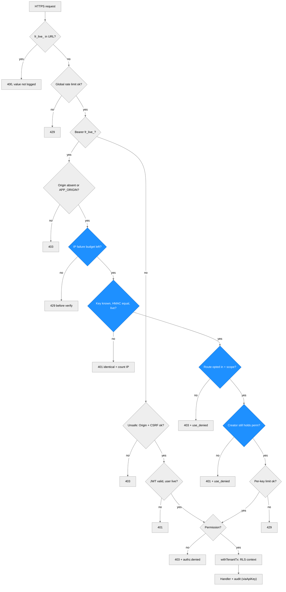

Detaljer i nøkkelveien (`ApiKeyAuthenticator.authenticate`):

- **Oppslag og sammenligning.** Nøkkelen parses med `^fr_live_[0-9a-f]{16}_[A-Za-z0-9_-]{43}$`. Raden
  finnes via `key_id` i en systemtransaksjon (RLS-policyen på `api_keys` tillater systemmodus). Den
  presenterte hemmeligheten hashes med `HMAC-SHA-256(API_KEY_PEPPER, secret)` og sammenlignes med
  `timingSafeEqual`; en ukjent nøkkel-id sammenlignes mot en fast dummy-digest, så arbeidet er det samme.
  Ukjent, feil format, feil hemmelighet, tilbakekalt og utløpt gir alle den identiske 401.
- **Tilstand ved hver forespørsel.** Tilbakekalling, utløp, suspensjon av tenanten og skaperens status
  leses fra databasen ved hver forespørsel; ingenting om nøkkeltilstand bufres, så en tilbakekalling
  virker fra neste forespørsel på alle instanser.
- **Ruter velger selv.** Bare ruter deklarert med `access.apiKeyScope` godtar nøkler. En arkitekturtest
  går gjennom alle ruter og krever at mengden er nøyaktig R26, R27, R53 (`claims.read`), R54
  (`exports.claims`) og R40-R44 (`imports.write`). Alle andre ruter svarer 403 etter en vellykket
  nøkkelautentisering, slik at avslaget kan revideres (`apikey.use_denied` med årsak `route`).
- **Vern mot forvirret stedfortreder.** Nøkkelens tillatelser er `SCOPE_PERMISSION[scope]` for omfangene
  dens, og skaperens **nåværende** rolle må fortsatt ha hver av dem; ellers 401 (årsak `creator`).
  Tenanten kommer bare fra nøkkelraden; tenant-id-er i headere, spørrestreng eller body ignoreres.
- **Misbruksgrenser.** Mislykkede autentiseringer telles per klientadresse i det delte lageret for
  ratebegrensning. Når `RATE_LIMIT_API_KEY_FAIL_MAX` (30) feil er nådd innen 10 minutter, avvises adressen
  med 429 før all verifisering til vinduet er over (grenserettingen D-4: det 31. forsøket avvises, ved
  hjelp av tallet `remaining` fra begrenseren). Bufferen for «avvis tidlig» er per instans; tellingene er
  delte. Vellykkede forespørsler går deretter gjennom grensen per nøkkel (`RATE_LIMIT_API_KEY_MAX`, 300 per
  60 s).
- **Tilskriving.** Konteksten er `{tenantId: key.tenant_id, actor: creator, role: 'API_KEY',
  viaApiKey: keyId}`, og forespørselen fortsetter gjennom den samme `withTenantTx`-veien som en
  brukerforespørsel. `appendAudit` legger til `viaApiKey` fra et register over forespørsler (DV-7).
  `last_used_at` oppdateres høyst én gang per 60 sekunder, etter beste evne.

### Funksjonskall (steg 4)

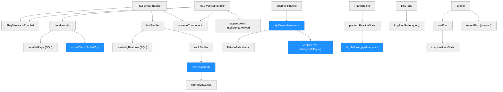

| Funksjon | Definert i | Kalles av | Formål |
| --- | --- | --- | --- |
| `scoreClaim`, `compareWorklist`, `buildWhy`, `nextAction` | `api/src/intelligence/priority.ts` | `buildWorklist` | aritmetikk, rekkefølge og forklaring for `priority-v1`; SQL-ens `ORDER BY` må stemme med `compareWorklist` (integrasjonstest på 48 tilfeldige krav) |
| `scoreSimilarity`, `rankSimilar`, `normalizeCarrier` | `api/src/intelligence/similarity.ts` | `findSimilar` | poeng, inkludering (anker + minimum 30) og rekkefølge for `similar-v1`; ingen bufring av noe slag |
| `worklistPage`, `similarityFeatures`, `provenanceRows` | `api/src/db/intelligence.ts` | intelligence-tjenesten | parametrisert SQL i innringerens tenanttransaksjon, pluss eksplisitte predikater `tenant_id = fr_current_tenant()` |
| `FlagService.isEnabled` / `change` | `api/src/platform/flags.ts` | intelligence-rutene, R63/R64 | lesing med TTL-buffer, feiler lukket; låst, versjonert endring med revisjonsspor |
| `ApiKeyAuthenticator.authenticate` | `api/src/auth/api-key-auth.ts` | sikkerhetspipelinen | maskinautentisering (se ovenfor) |
| `MetricsRegistry.observeRequest` / `observeComponent` / `snapshot` | `api/src/observability/metrics.ts` | `onResponse`-kroken, R71/R72, R61 | telemetri i prosessen |
| `LogRingBuffer.ingest` / `query` | `api/src/observability/ring-buffer.ts` | loggertappen, R62 | avledede loggposter |
| `platformPipelineStats` | `api/src/db/system.ts` | R60 | kaller `SECURITY DEFINER`-funksjonen i en systemtransaksjon |
| `runEval`, `computePassStats`, `recordRun` | `api/src/eval/runner.ts`, `packages/shared/src/eval-stats.ts`, `api/src/eval/record.ts` | eval-CLI-en | k kjøringer per sak, statistikk, valgfri registrering |

## Tillegg i datamodellen (steg 4)

| Objekt | Formål | Viktige regler |
| --- | --- | --- |
| `feature_flags(key, enabled, version, updated_by_id, updated_at, last_reason)` | Globale flagg; migreringen setter inn de 3 radene fra registeret | Ikke tenant-avgrenset (inneholder ingen tenantdata). RLS FORCE; SELECT for alle, UPDATE bare i systemmodus; `freight_app` har bare `SELECT` og `UPDATE` på kolonnenivå; en trigger krever uendret `key` og `version = gammel + 1`; DELETE og TRUNCATE feiler for alle roller |
| `eval_runs`, `eval_case_results` | Registrerte evalueringskjøringer og resultater per sak (uten dokumentinnhold, verdier eller filnavn) | RLS FORCE med en policy bare for systemmodus (en rå tilkobling ser null rader og kan ikke sette inn); bare `SELECT, INSERT`; UPDATE, DELETE og TRUNCATE feiler i alle moduser; CHECK-er binder tallene sammen (`runs_passed <= runs_total`, `pass_hat_k_count <= pass_at_least_one_count <= case_count`, kurvelengde = k, `passed_all = (runs_passed = k)`) |
| `api_keys(id, tenant_id, key_id, name, secret_hash, scopes, created_by_id, created_at, expires_at, last_used_at, revoked_at, revoked_by_id, revoke_reason)` | Tenantenes API-nøkler | Tenant-avgrenset, i `TENANT_MODELS`; policy `tenant_id = fr_current_tenant() OR fr_system_mode()` (systemmodus for oppslag via `key_id`); CHECK-er på `key_id` (16 hex), `secret_hash` (64 hex), 1-3 omfang blant de tre, navnelengde, lengde på begrunnelse for tilbakekalling og alt-eller-ingenting for tilbakekallingskolonnene; bare `last_used_at` og tilbakekallingskolonnene kan oppdateres, tilbakekalling settes én gang og fjernes aldri; DELETE/TRUNCATE feiler |
| `fr_platform_pipeline_stats(window_seconds, stale_seconds)` | Aggregat på tvers av tenanter for R60 | `SECURITY DEFINER`, låst `search_path`, feiler utenfor systemmodus, områdesjekker inndata, `EXECUTE` bare for `freight_app`; returnerer rader `(metric, label, n, p50_ms, p95_ms)` og velger aldri tenant-id, bruker-id, navn, filnavn, lagringsnøkkel, hash eller kravnummer |
| indeks `claims (tenant_id, status, updated_at DESC, id)` | Spørringer for arbeidsliste og likhet | planer registrert i kjøringens `implementation.md` (ingen tider påstått) |

## Flaggbuffer

`FlagService.isEnabled(key)` har en buffer per instans nøklet på flagg, med TTL `FLAGS_CACHE_TTL_MS`
(standard 5000 ms, produksjonstak 30000 ms, 0 slår den av). En lesefeil gir **false** (feiler lukket) og
bufres ikke lenger enn 1 sekund. En endring (`PUT /platform/flags/:key`) kjører i én systemtransaksjon:
kontroll mot registeret (ukjent nøkkel = 404 før all databasetilgang), `SELECT ... FOR UPDATE`,
versjonssammenligning (409 `stale_revision`), samme verdi (409 `conflict`, ingenting skrives), oppdatering
med `version + 1`, revisjonshendelsen `platform.flag_changed`; den lokale bufferen tømmes etter commit.
Andre instanser ser endringen innen sin TTL. Flagg styrer bare de tre intelligence-funksjonene; de kan ikke
nå kode for autentisering, CSRF, RLS eller revisjonsspor (arkitekturtest).

## Observerbarhet: telemetriregister og loggring

- **Telemetri.** En Fastify-krok `onResponse` (registrert før rutene, så helseruter telles) registrerer
  rute**mønsteret** (`routeOptions.url`, eller `(unmatched)`), metoden (ukjente metoder blir `OTHER`),
  statusen og `reply.elapsedTime`. Den leser aldri URL, spørrestreng, headere eller body. Minnet er
  begrenset: høyst 200 rutenøkler (overløp til `(other)`) ganger 11 bøtter. Persentiler rapporteres som
  øvre grense for bøtta som inneholder nærmeste rang. Tellerne for parserens utfører og de to
  komponentstatistikkene legges til når øyeblikksbildet tas. Ingenting rører databasen.
- **Loggring.** `createLogger` tapper hver formatert (allerede maskert) linje inn i
  `LogRingBuffer(LOG_BUFFER_SIZE)`. `ingest` parser linjen i try/catch og beholder bare en avledet post med
  8 felt (tid, nivå, forespørsels-id hvis UUID, metode hvis standard, rute hvis den starter med `/`, ikke
  har `?` og er høyst 200 tegn, status 100-599, endelig varighet, hendelse hvis den består
  meldingsregelen); alt annet kastes, og bufferen kaster aldri feil inn i loggeren. Loggeren erstatter i
  tillegg enhver `fr_live_...`-streng på alle nivåer med `[REDACTED]`. Telemetri og logger er **per
  instans og flyktige**, og brukergrensesnittet sier det.

## Evalueringsverktøy (dataflyt)

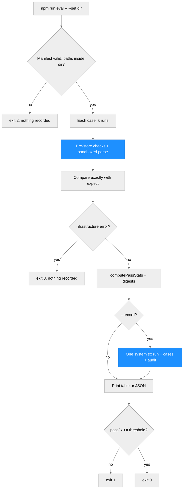

Stegregisteret `EVAL_STAGES` inneholder foreløpig bare `extraction`. Et `rules`-steg var planlagt for steg 5,
men ble utsatt; reglene sjekkes i stedet mot Python av paritetstestene.
Sett-hashen `evalSetSha256` dekker manifestet og hver saksfil i rekkefølge; testdataene holdes byte-like av
`.gitattributes` (`api/eval/sets/** -text`).

## Grensesnitt for steg 5

Status etter kjøringen `REQ-20261010-step5-analysis`: punkt 1 er levert; punkt 2 og 3 ble utsatt og
står åpne.

1. **Levert.** Intelligence-funksjonene leser bare lagrede kolonner (`claims` beløp, status, transportør,
   perspektiv, `updated_at`; siste revisjon av `evidence_packets`; `packet_findings.rule_id` og
   `needs_human_review`; `packet_sources.doc_type`; `approvals.created_at`). Steg 5 lager nå pakkerevisjon
   1 (`AWAITING_ANALYSIS -> PENDING_REVIEW`), så analyserte importerte krav kommer med i arbeidsliste,
   likhet og proveniens uten endringer i steg 4. `rule_id` er en av de åtte stabile, ikke-tomme
   `RULE_IDS` (`rules-v1`).
2. **Åpent.** Et `rules`-steg i `EVAL_STAGES` (og en migrering som utvider `stage`-CHECK-en), som
   gjenbruker `computePassStats`, registreringen og dashbordet, med Python-funksjonen `run_pipeline` som
   orakel.
3. **Åpent.** Telemetri `observeComponent('rules-v1', ...)`. Ingen flagg ble lagt til (analyse ved
   opprettelse av krav er ikke bygget).

## Merknader (steg 4)

- Avvik registrert av byggeren (DV-1..DV-11), de viktigste: rå SQL ligger i `db/` (DV-1); rutetabellen
  har 199 nøkler pluss `(other)` (DV-2); lesinger med revisjonsspor skriver hendelsen i sin egen
  transaksjon etter at dataene er beregnet, og en mislykket skriving gir fortsatt 500 uten data (DV-3);
  `API_KEY_PEPPER` har en offentlig standardverdi utenfor produksjon (DV-4); en nøkkel på en rute uten
  nøkkelstøtte får 403, også for `/healthz`, og `Origin` på en nøkkelforespørsel kontrolleres for alle
  metoder (DV-5); bufferen for «avvis tidlig» per IP er per instans (DV-6); plattformbrukere havner på
  `/dev` (DV-11).
- Utsatt (kun design, ikke bygget): IP-tillatelseslister per nøkkel, hjelpere for nøkkelrotasjon
  (opprett-så-tilbakekall er den manuelle veien), HMAC-signering av forespørsler, bruksdashbord per nøkkel,
  flere omfang, firøyeprinsipp for flaggendringer, telemetri og logger for hele klyngen, enhver lært
  rangering.
- Ikke verifisert: container-images, compose-stacken, Playwright-ende-til-ende-tester, enhver
  AWS-utrulling.

---

# Nettplattform: firøyeprinsippet (arbeidsdeling)

> Skrevet av scriber for kjøringen `REQ-20261009-four-eyes` 2026-10-10 (grenen `feat/four-eyes`,
> byggecommit `8eb7062`). **Før produkt, kun syntetiske data, aldri utrullet.** Trusselrad T46,
> standardvalgene og de aksepterte restrisikoene står i
> [technical/web-platform-security.md, del 8](technical/web-platform-security.md#8-four-eyes-separation-of-duties)
> (engelsk). Beskrivelse for brukere: [README.no.md, firøyeprinsippet](README.no.md#firøyeprinsippet-arbeidsdeling).
> Mermaid-diagrammene er de samme som i den engelske originalen
> ([ARCHITECTURE.md](ARCHITECTURE.md#web-platform-four-eyes-separation-of-duties)).

## Oversikt (firøyeprinsippet)

To beslutninger krever nå en annen person:

1. **Krav.** En bruker som har laget **en hvilken som helst** pakkerevisjon av et krav (gjeldende eller
   erstattet), kan ikke godkjenne eller avvise kravets gjeldende revisjon. En revisjon uten registrert
   oppretter (seedet revisjon 1) utelukker ingen. Siden steg 5 registrerer revisjon 1 fra analyse den som
   analyserte. «Klar til sending» er uendret.
2. **Importerte dokumenter.** Den som lastet opp, og alle som har registrert en felt-`CORRECT` eller
   -`ADD`, kan ikke godta dokumentet. Avvisning er uendret. Opplastinger med API-nøkkel regnes som
   opplastinger gjort av den som opprettet nøkkelen.

Kontrollen i tjenesten er den primære kontrollen. Databasetriggere er en ekstra sikring, et avslag er én
fast 403 for alle kallere og logges i revisjonssporet, og brukergrensesnittet skjuler knappen for den
utelukkede personen (bare kosmetisk). Ingen tabell, kolonne, tenant-tabell, RBAC-oppføring eller rute ble
lagt til. Den eneste skjemaendringen er triggermigreringen `20261011000000_four_eyes`.

## Modulstruktur (firøyeprinsippet)

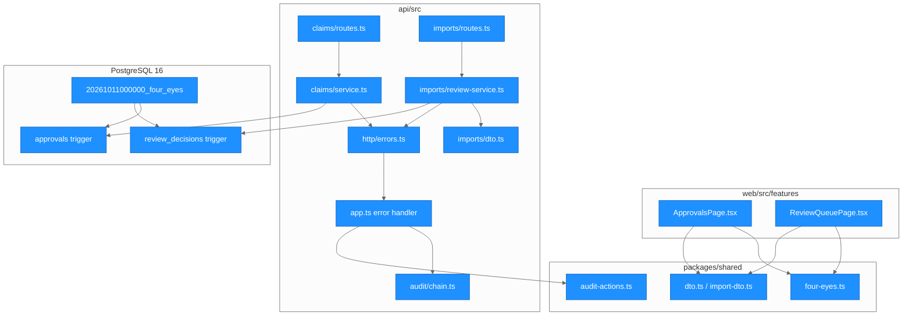

| Modul/funksjon | Formål | Viktige avhengigheter | Endret i denne kjøringen |
| --- | --- | --- | --- |
| `packages/shared/src/four-eyes.ts` | `FOUR_EYES_ERROR_CODE`, `FOUR_EYES_CLAIM_TEXT`, `FOUR_EYES_DOCUMENT_TEXT` (nøyaktig UI-tekst) | ingen | ny |
| `packages/shared/src/audit-actions.ts` | legger til `authz.four_eyes_denied` (siste oppføring) | ingen | endret |
| `packages/shared/src/dto.ts`, `import-dto.ts` | påkrevd `selfAuthored: boolean` bare på `ApprovalItem` og `ImportDocumentDetail` | zod | endret |
| `api/src/http/errors.ts` | meldingen for `four_eyes_required`; `FourEyesRefusal` (403, bærer revisjonskonteksten); `errors.fourEyes(audit)` | `HttpError` | endret |
| `api/src/app.ts` | asynkron feilhåndterer: skriver `authz.four_eyes_denied` i en egen tenant-transaksjon, 500 hvis det feiler; `isFourEyesDbError` gjør et triggeravslag om til 403 | `appendAudit`, `requireTenant` | endret |
| `api/src/audit/chain.ts` | `basis` tillatt i `METADATA_KEYS` | ingen | endret |
| `api/src/claims/service.ts` | `FOUR_EYES_GUARDED_TRANSITIONS`; forfatterkontroll i `transition()`; `listApprovalQueue(tx, query, viewerId)` beregner `selfAuthored` | `lockAndLoadLatest` | endret |
| `api/src/claims/routes.ts` | sender `requireTenant(req).user.id` som innlogget bruker | kravtjenesten | endret |
| `api/src/imports/review-service.ts` | `assertNotDocumentEditor` i `acceptDocument`; alle kall til detaljvisningen sender brukeren | `lockReviewable`, `documentDetail` | endret |
| `api/src/imports/dto.ts` | `EDITOR_DECISIONS = {CORRECT, ADD}`; `isDocumentEditor(uploadedById, decisions, viewerId)` | ingen | endret |
| `api/src/imports/service.ts`, `routes.ts`, `deps.ts` | `documentDetail(..., viewerId)`; `uploadedById` lastes internt (ingen DTO viser den); inntak avviser en `user`-aktør med id som ikke er en UUID; tilskrivingsregelen er dokumentert | lagring, DB | endret |
| `api/prisma/migrations/20261011000000_four_eyes/` | `fr_approval_four_eyes_guard`, `fr_review_four_eyes_guard` og deres `BEFORE INSERT`-triggere | `evidence_packets`, `import_documents`, `import_review_decisions` | ny |
| `web/src/features/approvals/ApprovalsPage.tsx` | skjuler Approve/Reject når `selfAuthored`; viser kravteksten ved 403 `four_eyes_required` og henter på nytt | delte konstanter | endret |
| `web/src/features/imports/ReviewQueuePage.tsx` | skjuler Accept document når `selfAuthored`; viser dokumentteksten ved 403 og henter på nytt | delte konstanter | endret |

## Funksjonskall (firøyeprinsippet)

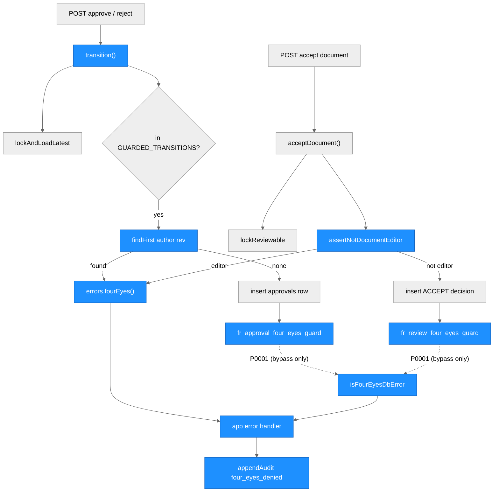

| Funksjon | Definert i | Kalles av | Formål |
| --- | --- | --- | --- |
| `transition` | `api/src/claims/service.ts` | kravrutene (approve, reject, send) | tilstandsmaskin, så forfatterkontrollen for approve/reject, så kontrollen av bekreftelse |
| `listApprovalQueue` | `api/src/claims/service.ts` | `GET /api/v1/approvals` | én `distinct`-spørring over sidens krav-id-er setter `selfAuthored` |
| `acceptDocument`, `assertNotDocumentEditor` | `api/src/imports/review-service.ts` | `POST .../accept` | opplasterkontroll (`basis: uploader`), så CORRECT/ADD-kontroll (`basis: field_editor`), før kontrollen av uløste felt |
| `documentDetail`, `isDocumentEditor` | `api/src/imports/service.ts`, `api/src/imports/dto.ts` | detalj, opplasting, sett type, godta, avvis, inntak | `selfAuthored` fra beslutningene som allerede er lastet (ingen ekstra spørring) |
| `FourEyesRefusal`, `errors.fourEyes` | `api/src/http/errors.ts` | begge tjenestene | 403 `four_eyes_required` med `{tenantId, targetType, targetId, metadata}` |
| `isFourEyesDbError` | `api/src/app.ts` | `toHttpError` | gjenkjenner SQLSTATE `P0001` og den nøyaktige meldingen `four_eyes_required` på feilen eller i `cause`/`meta`-kjeden (dybde 5, tåler sykluser) |
| `fr_approval_four_eyes_guard` | migreringen `20261011000000_four_eyes` | `BEFORE INSERT ON approvals` | avviser `APPROVE`/`REJECT` fra enhver `created_by_id` på kravets pakker (samme tenant) |
| `fr_review_four_eyes_guard` | migreringen `20261011000000_four_eyes` | `BEFORE INSERT ON import_review_decisions` | avviser `ACCEPT` fra opplasteren eller en CORRECT/ADD-aktør på dokumentet (samme tenant) |

## Dataflyt (avslag etter firøyeprinsippet)

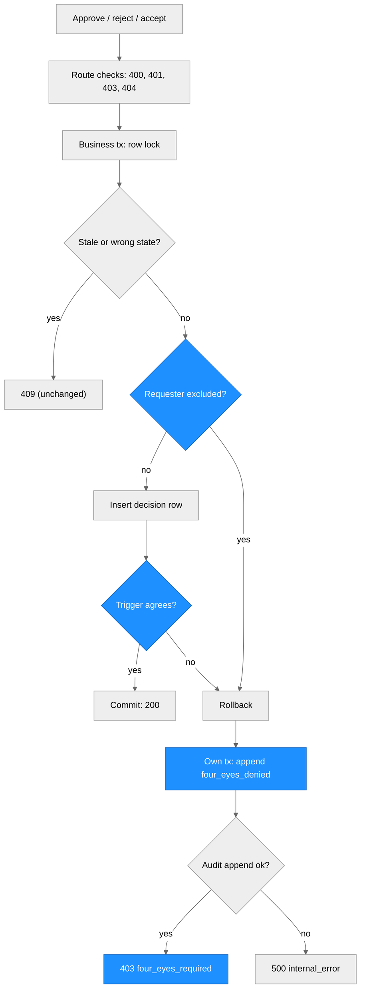

Grenen «Trigger agrees?» er en reserve: den nås bare hvis applikasjonskoden hoppet over kontrollen i
tjenesten. Da svarer API-et også 403 og logger `four_eyes_db_guard`, men skriver ingen revisjonshendelse
(FE-N1). Alle redigeringer og beslutninger på ett krav tar kravradens lås, og alle feltredigeringer og
beslutninger på ett dokument tar dokumentradens lås. Derfor kan ikke settet av forfattere eller
redaktører som leses i transaksjonen, endre seg før commit.

| Trinn | Hvor | Merknader |
| --- | --- | --- |
| Rekkefølge, approve/reject | `transition()` | 400 -> 401 -> 403 `forbidden` -> 404 -> 409 `stale_revision` -> 409 `invalid_state` -> **403 `four_eyes_required`** -> 422 |
| Rekkefølge, accept | `acceptDocument()` | 400 -> 401 -> 403 `forbidden` -> 404 -> 409 `invalid_state` -> **403 `four_eyes_required`** -> 409 `unresolved_fields` |
| Feilsvar | `sendError` | `{ code, message: "A different person must make this decision.", requestId }`, likt for UI og API; ingen `authz.denied`-hendelse |
| Revisjonsspor | feilhåndtereren, tenantkjeden | krav: `claimId`, `packetId`, `packetRevision`, `action`, `basis: revision_author`; dokument: `documentId`, `batchId`, `action: ACCEPT`, `basis` |
| UI | `selfAuthored` | skjuler knappen og viser den faste teksten; bare kosmetisk, serveren bestemmer |

## Standardvalg (firøyeprinsippet)

D1 en revisjonsforfatter kan heller ikke avvise; D2 «klar til sending» er ikke begrenset; D3 bare
opplasteren og CORRECT/ADD-aktører er dokumentredaktører; D4 avvisning av dokumenter er ikke begrenset.
Stedene å endre er `FOUR_EYES_GUARDED_TRANSITIONS` (krav) og `EDITOR_DECISIONS` (dokumenter), hver med en
ny migrering for den tilhørende triggeren. Detaljer står i trusselmodellen, del 8.4.

## Grensesnitt for steg 5 (firøyeprinsippet)

- **Levert (FE-N2 lukket).** Steg 5 lager pakkerevisjon 1 for importerte krav og setter
  `evidence_packets.created_by_id` til brukeren som startet analysen (enkeltvis og i masseanalyse). Den
  brukeren er da revisjonsforfatter og kan ikke godkjenne eller avvise kravet. Triggeren
  `evidence_packets_analysis_guard` avviser en revisjon 1 uten forfatter for et krav i `AWAITING_ANALYSIS`.
  Avgjørelse (standardvalg D2 i steg 5): de som lastet opp eller redigerte felt i kravets dokumenter, er
  **ikke** forfattere av kravet. Firøyeprinsippet for dokumenter tvang allerede en annen person til å
  godta disse inndataene (unntatt automatisk godtatte dokumenter, FE-S1).
- Enhver ny kodevei som setter inn en `approvals`-rad (`APPROVE`/`REJECT`) eller en `ACCEPT`-beslutning,
  må kjøre kontrollen i tjenesten under samme radlås. Ellers avviser triggerne innsettingen.

## Merknader (firøyeprinsippet)

- Verifisert lokalt på Node 22.23.3 (CI-versjonen), **ikke i GitHub CI**: enhetstester shared 136, api
  356, web 67; integrasjon 95 bestått (2 hoppet over fra før); akseptanse shared 36, api 690 bestått (9
  hoppet over, 2 todo), web 150 bestått (1 hoppet over). Veien som feiler lukket i revisjonssporet, og
  oversettelsen fra trigger til 403 dekkes bare av byggerens integrasjons- og enhetstester (de kan ikke
  nås utenfra).
- Aksepterte restrisikoer FE-S1..S4, FE-N1 og FE-N2 står i trusselmodellen, del 8.5.

---

# Nettplattform: kravanalyse (steg 5)

> Skrevet av scriber for kjøringen `REQ-20261010-step5-analysis` 2026-10-10 (grenen `feat/analysis`,
> byggecommits `d27c4a2`..`5c047fb`). **Før produkt, kun syntetiske data, aldri utrullet.** Trusselradene
> T47-T52, standardvalgene og de aksepterte restrisikoene står i
> [technical/web-platform-security.md, del 9](technical/web-platform-security.md#9-step-5-claim-analysis)
> (engelsk). Beskrivelse for brukere: [README.no.md, kravanalyse](README.no.md#kravanalyse-steg-5).
> Mermaid-diagrammene er de samme som i den engelske originalen
> ([ARCHITECTURE.md](ARCHITECTURE.md#web-platform-claim-analysis-step-5)).

## Oversikt (steg 5)

Før steg 5 ble et krav opprettet ved import stående i `AWAITING_ANALYSIS` uten beløp og uten pakke, fordi
regelmotoren bare fantes i Python-referansetjenesten. Steg 5 lukker sløyfen:
import -> gjennomgang -> opprett krav -> **analyser** -> pakkerevisjon 1 -> gjennomgang etter
firøyeprinsippet.

- **Motor (`@fr/shared/analysis`).** En TypeScript-port av Pythons `rules/` (`detention.py`,
  `invoice_checks.py`, `engine.py`) og `evidence/` (`letter.py`, Markdown-delen av `packet.py`). Modulen er
  ren: ingen innebygde Node-moduler og ingen flyttall for penger eller timer. Den bruker en desimaltype som
  er nøyaktig lik CPython (`py-decimal.ts`: presisjon 28, ROUND_HALF_EVEN, formatering som CPythons `str` og
  `.2f`), CPythons `repr` for strenger og lister, og naive `YYYY-MM-DDTHH:MM:SS`-tidspunkter med
  heltallsregning på dager. Regelversjon `rules-v1`, åtte regel-ID-er (`INV-DUPLICATE`,
  `INV-LINEHAUL-RATE`, `INV-FUEL-SURCHARGE`, `INV-ACCESSORIAL-UNAUTH`, `INV-TOTAL-MISMATCH`,
  `DET-UNBILLED`, `DET-UNDERBILLED`, `DET-OVERBILLED`). Innstillingene er konstanter
  (`DEFAULT_ANALYSIS_SETTINGS`: ventetid i trinn på 15 minutter, toleranse 0,01, tvistefrist 90 dager).
- **Hva et funn er.** Et funn er resultatet av en fast, deterministisk regel brukt på feltverdiene i
  kravets godtatte dokumenter (hentet ut av parseren fra steg 3 og, der de var flagget, gjennomgått av en
  person). Det er et **utkast til menneskelig gjennomgang, ikke et verifisert resultat**. Konfidensen på et
  funn er en fast konstant per regel, kopiert fra Python-referansen (0,6, 0,85, 0,9 eller 0,95), ikke en
  målt sannsynlighet, og produktet påstår ingenting om nøyaktighet. Evalueringsterskelen fra steg 4 kjøres
  på syntetiske testdata og er ikke et mål på nøyaktighet.
- **Ruter.** `POST /api/v1/claims/:id/analyze` (201) og `POST /api/v1/claims/analyze-awaiting` (200,
  masseanalyse). Begge krever den nye tillatelsen `claims:analyze` (OWNER, ADMIN, MANAGER, REVIEWER,
  ANALYST), har ingen API-nøkkel-scope og deler ratebegrensningsgruppen `analysis` per bruker
  (`RATE_LIMIT_ANALYSIS_MAX`, standard 30 per 10 minutter).
- **Livsløp.** Én analyse kjører i én tenant-transaksjon under radlåsen på kravet. Den lager pakkerevisjon
  1 (`PENDING_REVIEW`, opprettet av den som ba om analysen) med kilder, funn (med sitater og en styrende
  klausul), en tidslinje og innholdshashen. Den setter kravet til `PENDING_REVIEW` med `recoverableCents`,
  `pendingReviewCents` og `amountClaimedCents`, øker `version` og legger til `claim.analyzed`. Ingen
  `approvals`-rad skrives. Deretter gjelder den eksisterende gjennomgangsflyten uendret.
- **Databasevakter.** Migreringen `20261012000000_analysis` legger til to triggere og ingen endring i
  tabeller, kolonner, enumer eller tilganger.
- **Nett.** En seksjon **Analyze claim** i kravpanelet (fanene Summary og Evidence) og en dialog **Analyze
  awaiting claims** på kravsiden, begge vist bare med `claims:analyze` (tekstene i appen er på engelsk).

Utsatt (ikke bygget): analyse ved opprettelse av krav (ikke noe flagg; masseanalysen er automatiseringen,
med en eksplisitt menneskelig utløser), et `rules`-steg i evalueringsverktøyet, telemetrikomponenten
`rules-v1`, et endepunkt for nedlasting av Markdown, strengere tolking av beløp, brevmaler per transportør.

## Modulstruktur (steg 5)

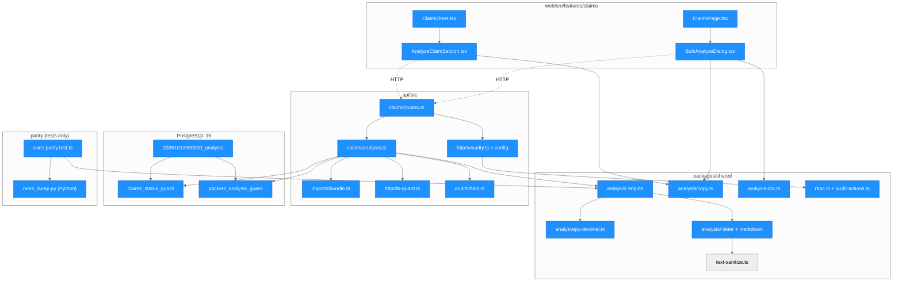

| Modul/funksjon | Formål | Viktige avhengigheter | Endret i denne kjøringen |
| --- | --- | --- | --- |
| `packages/shared/src/analysis/py-decimal.ts` | CPythons `Decimal`-semantikk: tolking, addisjon, subtraksjon, multiplikasjon, vanlig divisjon og heltallsdivisjon, sammenligning, quantize, `str`, `.2f`, Pythons `max`/`sum` | ingen (BigInt) | ny |
| `packages/shared/src/analysis/py-text.ts`, `local-datetime.ts` | CPythons `repr(str)` og repr av lister, `_norm_text`; naive tidspunkter, epokesekunder via days-from-civil, `%Y-%m-%d %H:%M` | ingen | ny |
| `packages/shared/src/analysis/invoice-checks.ts`, `detention.ts`, `engine.ts` | Port av `rules/*.py`: `classifyLine`, fjerning av duplikater, fakturakontroller, `computeDetention`, `applyRules`; `applyRulesTraced` gir også spor per funn for sitatene | `py-decimal`, `py-text`, `local-datetime` | ny |
| `packages/shared/src/analysis/letter.ts`, `markdown.ts`, `evidence.ts` | Port av `evidence/letter.py` og Markdown-delen av `packet.py`: `buildDemandLetter`, `renderPacketMarkdown`, `buildEvidence` (`buildEvidenceTraced`), `packetLoadNumber` | `text-sanitize.ts` (`plain`, `md`) | ny |
| `packages/shared/src/analysis/types.ts`, `copy.ts`, `index.ts` | `AnalysisInputError`, `DEFAULT_ANALYSIS_SETTINGS`, `RULES_VERSION`, `RULE_IDS`, `DRAFT_BANNER`, `PACKET_DISCLAIMER`; UI-tekstene `ANALYSIS_NOTE`, `ANALYZE_AUTHOR_NOTE`, `ANALYSIS_TEXT`; underbanen `@fr/shared/analysis` | ingen | ny |
| `packages/shared/src/analysis-dto.ts` | `AnalyzeBody` (streng `{}`), `BulkAnalyzeBody` (`limit` 1..25), svarskjemaer, `ANALYZE_BATCH_MAX = 25`, `ANALYZE_BATCH_DEFAULT = 10` | zod | ny |
| `packages/shared/src/rbac.ts`, `audit-actions.ts` | `claims:analyze` lagt til (5 roller); `claim.analyzed`, `claim.bulk_analyzed` lagt til | ingen | endret |
| `api/src/imports/bundle.ts` | `assembleBundleWithProvenance` (registrerer hvilket dokument og felt som fylte hver plass i bunten); `loadAnalysisInput` (kilder med `sizeBytes`, felt med side, linje og utdrag; felt sortert etter `ordinal, id`); `loadBundleForClaim` delegerer, uendret signatur | Prisma tenant-tx | endret |
| `api/src/claims/analysis.ts` | `buildAnalysisPacket` (ren: rader, sitater, klausuler, tidslinje, hash, lagringskontroll), `analyzeClaim` (ett krav, én tx), `analyzeAwaiting` (masseanalyse), `storableCents`, `INT4_MAX` | `@fr/shared/analysis`, `bundle.ts`, `lockClaimForUpdate`, `appendAudit`, `packetContentHash` | ny |
| `api/src/claims/routes.ts` | `POST /claims/:id/analyze` (201), `POST /claims/analyze-awaiting` (200); tillatelse `claims:analyze`, ingen `apiKeyScope`, `rateGroup: 'analysis'` | `analysis.ts` | endret |
| `api/src/http/security.ts`, `context.ts`, `config.ts`, `app.ts` | Ratebegrensningsgruppen `analysis` (per bruker, vindu på 10 minutter); `RATE_LIMIT_ANALYSIS_MAX` (standard 30, 1..100000); `app.analysisLimiter` (null når ratebegrensning er av) sendes til masseanalysen | lager for ratebegrensning (Redis) | endret |
| `api/src/http/db-guard.ts` | Eksakt gjenkjenning av triggerfeil (SQLSTATE `P0001` + eksakt melding, gjennom `cause`/`meta`/`driverAdapterError`, dybde 5), delt av firøyeprinsippet og analysen; `isAnalysisDbError` | ingen | ny (flyttet fra `app.ts`) |
| `api/src/http/errors.ts`, `audit/chain.ts` | 422 `analysis_input_invalid`; metadatanøkler for steg 5 på tillatelseslisten | ingen | endret |
| `api/prisma/migrations/20261012000000_analysis/` | `fr_claim_status_guard` + triggeren `claims_status_guard`; `fr_analysis_packet_guard` + triggeren `evidence_packets_analysis_guard` | `claims`, `evidence_packets` | ny |
| `web/src/features/claims/AnalyzeClaimSection.tsx`, `ClaimSheet.tsx` | Analyseknapp med begge merknadene i fanene Summary og Evidence; faste feiltekster per statuskode; ved suksess lastes krav, pakke, kravliste og godkjenninger på nytt, og Evidence-fanen vises | `useCan('claims:analyze')`, delte tekster | ny / endret |
| `web/src/features/claims/BulkAnalyzeDialog.tsx`, `ClaimsPage.tsx` | Knapp i verktøylinjen og modal dialog; POST `{ limit: 10 }`; sammendrag i et `role="status"`-område; kravnumre som feilet, via `SafeText` | `Dialog`, delte tekster | ny / endret |
| `tools/parity/rules_dump.py`, `api/test/parity/rules.parity.test.ts` | Python-orakel (bare i tester, aldri i drift) og sammenligningen TS mot Python i `test:integration` | Python-referansetjenesten | ny |

## Funksjonskall (steg 5)

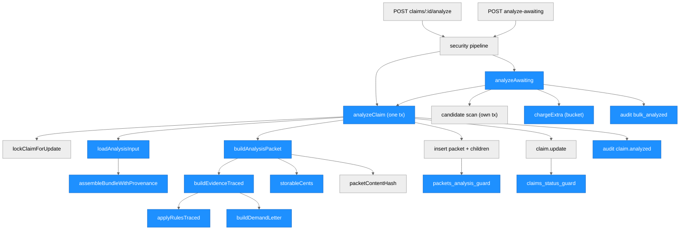

| Funksjon | Definert i | Kalles av | Formål |
| --- | --- | --- | --- |
| `analyzeClaim(tx, claimId, actor, { bulk })` | `api/src/claims/analysis.ts` | enkeltruten (inne i `db.tx`), `analyzeAwaiting` (én `db.tx` per kandidat) | UUID-kontroll og radlås (404), ny kontroll av status og «ingen pakke» under låsen (409), last inndata (409 uten godtatt dokument), bygg (422), sett inn, oppdater, revisjonsspor |
| `analyzeAwaiting(db, actor, limit, chargeExtra)` | `api/src/claims/analysis.ts` | masseruten | kandidater én gang, én tx per kandidat, resultatlister, stopp ved tomt budsjett, sammendragshendelse |
| `loadAnalysisInput(tx, claimId)` | `api/src/imports/bundle.ts` | `analyzeClaim` | koblede `ACCEPTED`-dokumenter (eldste kobling først, likhet avgjøres av koblings-ID) til `{ bundle, provenance, sources }` |
| `buildAnalysisPacket({ input, claim, now, actorId })` | `api/src/claims/analysis.ts` | `analyzeClaim` | ren: kjøring av motoren, lagringskontroll, rader for kilder, funn, sitater, klausuler og tidslinje, `HashPacket` og innholdshash |
| `buildEvidenceTraced` / `buildEvidence` | `packages/shared/src/analysis/evidence.ts` | `buildAnalysisPacket`, paritetstesten | resultat, brev (UTC-dato for `now`), Markdown (lagres ikke), lastnummer |
| `applyRules` / `applyRulesTraced` | `packages/shared/src/analysis/engine.ts` | `buildEvidence*`, paritetstesten | fakturafunn, funn om ventetid, fordeling etter perspektiv, summer |
| `isAnalysisDbError` | `api/src/http/db-guard.ts` | `toHttpError` i `app.ts`, `analyzeAwaiting` | gjør `claim_transition_invalid` / `analysis_packet_invalid` om til 409 `invalid_state` (enkeltvis) eller `skipped` (masseanalyse) |
| `fr_claim_status_guard`, `fr_analysis_packet_guard` | migreringen `20261012000000_analysis` | `BEFORE UPDATE OF status ON claims`, `BEFORE INSERT ON evidence_packets` | databasens sikring av livsløpet (nedenfor) |

## Dataflyt (analyse av ett krav)

```mermaid
%%{init: {'theme': 'neutral'}}%%
graph TD
    A["POST claims/:id/analyze"] --> B["Pipeline: 403, 401, 429, 403, 400"]
    B --> C["Tenant tx: lock claim row"]
    C --> D{"Claim visible?"}
    D -- no --> E["404 not_found"]
    D -- yes --> F{"AWAITING, no packet, accepted doc?"}
    F -- no --> G["409 invalid_state"]
    F -- yes --> H["Load bundle + provenance"]
    H --> I["Rules, letter, rows, hash"]
    I --> J{"Input valid and storable?"}
    J -- no --> K["422 analysis_input_invalid"]
    J -- yes --> L["Insert rev 1 + children"]
    L --> M["Claim to PENDING_REVIEW"]
    M --> N{"Triggers agree?"}
    N -- no --> O["Rollback: 409 invalid_state"]
    N -- yes --> P["Append claim.analyzed: 201"]

    style F fill:#1e90ff,stroke:#1565c0,color:#fff
    style J fill:#1e90ff,stroke:#1565c0,color:#fff
    style N fill:#1e90ff,stroke:#1565c0,color:#fff
    style P fill:#1e90ff,stroke:#1565c0,color:#fff
```

Ingenting skrives før 422-kontrollen, så en avvist analyse (404, 409, 422) endrer ingenting og skriver ingen
`claim.analyzed`. Grenen «Triggers agree?» er en sikring som kontrollene i tjenesten gjør uoppnåelig gjennom
API-et; nås den likevel, svarer API-et 409 `invalid_state` (aldri 500, aldri databaseteksten) og logger
`analysis_db_guard` på feilnivå.

| Steg | Hvor | Merknader |
| --- | --- | --- |
| Rekkefølge, ett krav | sikkerhetspipelinen, `analyzeClaim` | origin/CSRF 403 -> 401 -> 429 (`analysis`-bøtten) -> 403 `forbidden` -> 400 -> 404 -> 409 `invalid_state` -> 422 `analysis_input_invalid` |
| Rekkefølge, masseanalyse | sikkerhetspipelinen | origin/CSRF 403 -> 401 -> 429 -> 403 -> 400 -> 200 (resultat per krav i svaret) |
| 422 | `buildAnalysisPacket` | motoren avviser inndata (feilformet desimaltall eller tidspunkt, trinn 0), eller et resultat kan ikke lagres: et lagret funnbeløp eller en sum er negativ eller over 2 147 483 647 cent, eller de to summene til sammen er over grensen (RD3) |
| Samtidighet | `lockClaimForUpdate` + ny kontroll | N parallelle analyser av ett krav: nøyaktig én 201, resten 409; én pakke, én hendelse, `version` +1 én gang. Unik `(claim_id, revision)` og indeksen for én levende revisjon er en ekstra sikring |
| Svar | `AnalyzeResponse` | `claim` (id, status, tre centbeløp), `packet` (id, revisjon 1, status, `contentHash`), `analysis` (`rulesVersion`, `findingsCount`, `pendingFindingsCount`, `ignoredFindingsCount`) |

## Kravets livsløp og databasevakter (steg 5)

```mermaid
%%{init: {'theme': 'neutral'}}%%
graph TD
    CM["import commit"] --> AW["AWAITING_ANALYSIS"]
    AW -- "analyze: rev 1 with author" --> PR["PENDING_REVIEW"]
    PR --> FL["existing review flow"]
    FL -. "back to AWAITING: refused" .-> AW

    style AW fill:#1e90ff,stroke:#1565c0,color:#fff
    style PR fill:#1e90ff,stroke:#1565c0,color:#fff
```

| Trigger (funksjon) | Utløses av | Avviser | Feil |
| --- | --- | --- | --- |
| `claims_status_guard` (`fr_claim_status_guard`) | `BEFORE UPDATE OF status ON claims` | en statusendring **til** `AWAITING_ANALYSIS`; en endring **fra** `AWAITING_ANALYSIS` til noe annet enn `PENDING_REVIEW`, eller til `PENDING_REVIEW` når det ikke finnes en `evidence_packets`-rad for samme krav og tenant med `revision = 1` og `created_by_id` som ikke er null | `P0001` `claim_transition_invalid` |
| `evidence_packets_analysis_guard` (`fr_analysis_packet_guard`) | `BEFORE INSERT ON evidence_packets` | en pakke for et krav i `AWAITING_ANALYSIS` med mindre `revision = 1`, `created_by_id` ikke er null og `status = 'PENDING_REVIEW'` | `P0001` `analysis_packet_invalid` |

Begge funksjonene er `SECURITY DEFINER` (eier = migreringsrollen), har `search_path = public, pg_temp`,
sammenligner `tenant_id` eksplisitt (så en manglende `app.tenant_id` ikke kan skjule rader), og har
`EXECUTE` trukket tilbake fra `PUBLIC`. Eksisterende rader valideres ikke på nytt. Oppdateringer som ikke
endrer `status`, andre statusendringer, innsetting av krav og innsetting av pakker for andre krav påvirkes
ikke; særlig er beløps- og `version`-kolonnene til et krav i `AWAITING_ANALYSIS` **ikke** beskyttet av
databasen (restrisiko SA-6 i trusselmodellen). De fire tidligere migreringene er uendret byte for byte.

## Masseanalyse og ratebudsjettet `analysis`

`POST /api/v1/claims/analyze-awaiting` med `{ "limit": n }` (1..25, standard 10; dialogen i nettappen
sender alltid 10):

1. **Kandidater**, hentet én gang i en kort tenant-transaksjon: tenantens krav i `AWAITING_ANALYSIS` med
   minst ett koblet `ACCEPTED`-dokument, eldste `createdAt` først (likhet avgjøres av id), høyst
   `min(4 x limit, 100)`.
2. **Hver kandidat i sin egen transaksjon**, nøyaktig som enkeltruten. En kandidat som ikke lenger kan
   analyseres (404/409, eller en avvisning fra en databasevakt), havner i `skipped` (`invalid_state`); en
   som får 422, havner i `failed` (`analysis_input_invalid`). Enhver annen feil avslutter forespørselen
   med 500; analyser som allerede er lagret, blir stående.
3. **Budsjett (rettingsrunde 1, S5-1).** Forespørselens eget `analysis`-token dekker den første
   kandidaten. Før hver ny kandidat tas ett token til fra brukerens `analysis`-bøtte
   (`app.analysisLimiter`). Det trekkes per **forsøkt** kandidat, så kandidater som hoppes over eller
   feiler, koster også ett. Med `RATE_LIMIT_ENABLED=false` (bare utvikling og test; produksjon avviser det)
   trekkes ingenting ekstra.
4. **Stoppvilkår:** `analyzed` når `limit`, kandidatene er brukt opp, eller bøtten er tom. Et stopp på
   grunn av budsjettet gir fortsatt 200 med samme form; krav som ikke ble forsøkt, blir i
   `AWAITING_ANALYSIS` og telles i `remaining`. `examined` = forsøkte kandidater = analyzed + skipped +
   failed.
5. **Sammendrag.** Én `claim.bulk_analyzed`-hendelse (mål `tenant`) i egen transaksjon, med `limit`,
   `examined`, `analyzed`, `skipped`, `failed` og `remaining` (tenantens krav som fortsatt venter på
   analyse etter kjøringen).

Virkning: en bruker kan utføre høyst `RATE_LIMIT_ANALYSIS_MAX` analyser per vindu på 10 minutter, enten
enkeltruten eller masseruten brukes. Før rettingsrunde 1 kostet én masseforespørsel ett token for opptil 25
analyser (25 ganger forsterkning, sikkerhetsfunn S5-1, Low). Samtidige masseforespørsler analyserer aldri
et krav to ganger; den som taper kappløpet, rapporterer kravet som `skipped`.

Kjente begrensninger (trusselmodellen del 9.5): kandidater som hoppes over eller feiler, bruker av
budsjettet (SA-1); en feil i ratebegrenseren midt i kjøringen (for eksempel at Redis ikke svarer) avslutter
forespørselen med 500 og uten `claim.bulk_analyzed` (SA-2); dialogen sier ikke at budsjettet stoppet
kjøringen, men sammendraget («n still awaiting analysis») er fortsatt riktig (SA-3); et krav som feiler med
422, forblir en kandidat og forsøkes først i hver kjøring fordi det er gammelt (SA-8).

## Innholdet i pakken (revisjon 1)

| Del | Innhold |
| --- | --- |
| Pakke | `revision 1`, `PENDING_REVIEW`, kravets perspektiv, `loadNumber` (første ikke-tomme fra faktura, ratebekreftelse (rate confirmation), fraktbrev (bill of lading)), `generatedAt` = analysetidspunktet, `PACKET_DISCLAIMER`, utkastet til kravbrev (datert med UTC-datoen for `generatedAt`), USD, `verifier NOT_RUN`, `createdBy` = den som ba om analysen, innholdshash |
| Kilder | én per koblet `ACCEPTED`-dokument i koblingsrekkefølge: visningsnavn, type, SHA-256, størrelsen på den lagrede originalen |
| Funn | funn for eget perspektiv i motorens rekkefølge (regel-ID, tittel, retning, beløp i cent, forklaring, utregningssteg, konfidens, `needsHumanReview`); funn i motsatt retning telles (`ignoredFindingsCount`), men lagres ikke |
| Sitater | per regel, feltene som ga grunnlaget, som `{sourceId, locator, excerpt}` med lokator `<navn>:L<linje>`, `<navn>:p<side>:L<linje>` eller `<navn>:manual`; utdrag gjennom `plain(..., 200)`; duplikater fjernet |
| Styrende klausul | feltet i ratebekreftelsen (rate confirmation) som regelen sammenligner med (linehaul-rate, drivstofftillegg, godkjente tilleggstjenester, fri ventetid), eller null |
| Tidslinje | avtalt tid, ankomst, avgang (fraktbrev) og fakturadato, lagret med naive lokale tider lest som UTC; anlegg og fakturanummer gjennom `plain(..., 100)` |

Sitater, styrende klausuler og tidslinjen er tillegg som bare finnes i TS, uten motpart i Python. De inngår
i innholdshashen, så hashbindingen ved godkjenning og sending dekker dem.

## Revisjonsspor (steg 5)

| Handling | Når | Mål | Metadata (eksakt nøkkelsett) |
| --- | --- | --- | --- |
| `claim.analyzed` | hver vellykket analyse, i samme transaksjon som skrivingen | `claim` | `claimId`, `claimNumber`, `packetId`, `revision`, `contentHash`, `perspective`, `fromStatus`, `toStatus`, `documentIds`, `findingsCount`, `pendingFindingsCount`, `ignoredFindingsCount`, `recoverableCents`, `pendingReviewCents`, `rulesVersion`, `bulk` |
| `claim.bulk_analyzed` | én gang per masseforespørsel som når handleren og fullføres, etter transaksjonene per krav | `tenant` | `limit`, `examined`, `analyzed`, `skipped`, `failed`, `remaining` (alle heltall) |

Ingen navn, filnavn, uttrukne verdier, brevtekst eller begrunnelser havner i metadata. Avviste analyser (409,
422) skriver ingen hendelse; avvisning på grunn av manglende tillatelse beholder den eksisterende
`authz.denied`-oppførselen. Rensingen av metadata kutter lister ved 50 elementer, så `documentIds` ville
være ufullstendig for et krav med mer enn 50 koblede godtatte dokumenter; radene i `packet_sources` er
fortsatt fullstendige (SA-4).

## Python-paritet: registrerte avvik (RD1-RD6)

`api/test/parity/rules.parity.test.ts` (del av `npm run test:integration`; samme regel for å finne Python
som paritetstestene fra steg 3: CI uten Python feiler, en lokal kjøring uten Python hoppes over med en
melding) sender de samme sakene til TS-motoren og til `tools/parity/rules_dump.py`, som kaller
Python-referansen med eksplisitte `Settings`. Den sammenligner med eksakt strenglikhet: `classifyLine`,
JSON fra `computeDetention`, JSON fra `applyRules`, brevet, Markdown og lastnummeret, og kontrollerer at
begge sider avviser de samme inndataene. Paritetsdomene: desimaltall
`-?(0|[1-9][0-9]{0,14})(\.[0-9]{1,6})?`; tidspunkter `YYYY-MM-DDTHH:MM:SS`, år 1000-9999; strenger av
tildelte kodepunkter uten kontrolltegn, bidi-kontrolltegn eller U+2028/U+2029, høyst 200 kodepunkter;
trinn 1..240; frist 1..3650 dager.

| ID | Avvik (TS mot Python) | Begrunnelse |
| --- | --- | --- |
| RD1 | Tidspunkter er bare naive `YYYY-MM-DDTHH:MM:SS`; forskyvninger avvises (`AnalysisInputError`). Pythons veier med tidssoner har ingen TS-inndata. | Uttrekket fra steg 3 lagrer naive lokale tider; det finnes ingen tidssone å bruke. |
| RD2 | `%Y` fyller ut år under 1000 til 4 sifre (CPython på Linux gjør ikke det). | Korpuset bruker år 1000 og senere. |
| RD3 | API-et avviser negative resultater og resultater over INT4 (422) der Python ville gitt dem ut. Den rene motoren er fortsatt lik Python. | Beløp lagres som int4-cent; et negativt kravbeløp gir ingen mening. |
| RD4 | Store/små bokstaver og utskrivbarhet følger ICU-tabellene i Node 22, ikke Pythons Unicode-database. | Korpuset utelater kodepunkter som ikke er tildelt. |
| RD5 | Ende til ende lister TS-pakken kravets godtatte koblede dokumenter; Python lister hver innleste fil. | Bare godtatte dokumenter gir grunnlag for et krav. |
| RD6 | Brevdatoen er UTC-datoen for `generatedAt`; Python bruker den lokale datoen for `datetime.now()`. | Uavhengig av serverens tidssone; paritetskjøringer sender samme `now`. |

Byggerens korpus (frø `20261010`): 2 132 saker (4 ende-til-ende-saker fra testdataene, 623 inndata fra
Pythons testfiler, 1 200 genererte bunter, 300 genererte ventetidssaker, 5 klassifiseringsbunker med 200
beskrivelser hver). Resultat i byggerens kjøring: null forskjeller på Node 22 og Node 24, hver regel-ID
brukt, og ingen registrerte avvik trengtes innenfor korpuset. Testerens uavhengige orakel
(`api/test-acceptance/helpers/rules_oracle.py`) besto P01-P05 i akseptansekjøring 1; antall saker per
korpus er ennå ikke registrert.

## Standardvalg (steg 5)

| ID | Standard | Stedet å endre |
| --- | --- | --- |
| D1 | `claims:analyze` = OWNER, ADMIN, MANAGER, REVIEWER, ANALYST; ingen API-nøkkel-scope | raden i `rbac.ts` |
| D2 | Forfatter av revisjon 1 = den som ba om analysen (enkeltvis og i masseanalyse); de som lastet opp eller redigerte felt i dokumentene, er ikke forfattere av kravet | `analysis.ts` + firøyepredikatet |
| D3 | Analyse ved opprettelse av krav er ikke bygget; masseanalysen er automatiseringen | fremtidig flagg + migreringsrad |
| D4 | Bare funn for eget perspektiv lagres | `buildAnalysisPacket` |
| D5 | Null funn gir likevel revisjon 1 med nullbeløp og brevet «No amount is requested» | `analyzeClaim` |
| D6 | Negative resultater eller resultater over INT4 -> 422, kravet uendret | `buildAnalysisPacket` |
| D7 | Innstillingene er konstanter (15 min, 0,01, 90 dager) | `DEFAULT_ANALYSIS_SETTINGS` |
| D8 | Brevdato = UTC-datoen for `generatedAt`; naive tider i tidslinjen lagres som UTC | `buildEvidence`, tidslinjen |
| D9 | Masseanalyse: `limit` 1..25 (standard 10), skannetak `min(4 x limit, 100)`, eldste først | `analyzeAwaiting` |
| D10 | Ratebegrensningsgruppen `analysis`, `RATE_LIMIT_ANALYSIS_MAX` 30 per 10 minutter, trukket per kandidat i masseanalyse | konfigurasjon, `analyzeAwaiting` |

## Grensesnitt for senere steg (etter steg 5)

- Hold `rule_id` innenfor `RULE_IDS` og øk `RULES_VERSION` når en regel endres; intelligence fra steg 4 og
  paritetstestene er avhengige av begge.
- Åpent: `rules`-steget i evalueringen, telemetri `rules-v1`, analyse ved opprettelse av krav, et
  endepunkt for nedlasting av Markdown, strengere tolking av beløp.
- En fremtidig HTML-, Markdown- eller PDF-visning av lagrede funn må rense `explanation` og `calculation`:
  de inneholder den rå beskrivelsen av fakturalinjen (SA-5). Bare brevet bruker `plain()`.
- En ny kodevei som skriver kravbeløp, må holde seg til analysetransaksjonen eller utvide statusvakten
  (SA-6).

## Merknader (steg 5)

- Hva som ble kjørt (lokalt, Windows, **ikke GitHub CI**): byggeren kjørte lint, typecheck og
  enhetstester (shared 165, api 370, web 78), paritetstestene for reglene (2 132 saker, null forskjeller på
  Node 22 og 24) og integrasjonstestene på Node 22.23.3 (16 filer, 107 bestått, 3 lokale plassholdere
  hoppet over), alt ved `b12ce2a`. Den uavhengige akseptansekjøringen 1 (Node 22.23.3, `CI=true`, ved
  `b12ce2a`) ga shared 81/81 og api 754 bestått, 4 feilet, 10 hoppet over; alle de 4 feilene ble
  klassifisert som testdesign og rettet i testfilene, men den bekreftende kjøringen ble stoppet av lite
  ledig minne. Akseptansetestene for nettappen (AN-W01..W11) er ikke kjørt ennå. Rettingsrunde 1
  (`5c047fb`) ble bare kontrollert med lint, typecheck og utvalgte enhetstester; det finnes ingen
  integrasjons- eller akseptansekjøring ved `5c047fb`.
- Gjennomgangens vurdering da dette ble skrevet: FAIL (validering ufullstendig), ingen kodefeil funnet.
  Avvikene 1-8 i kjøringens `implementation.md` ble godtatt.
- `.env.example` har `RATE_LIMIT_ANALYSIS_MAX=30` uten kommentartegn, i motsetning til innstillingene fra
  steg 4; verdien er lik standardverdien.
- Ikke verifisert: GitHub CI, container-images, compose-stacken, Playwright, enhver AWS-utrulling.
