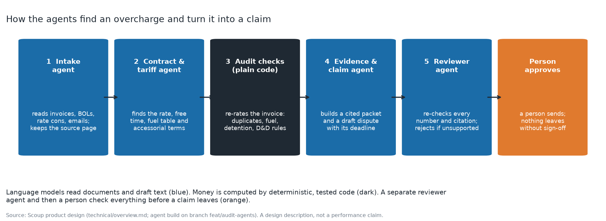
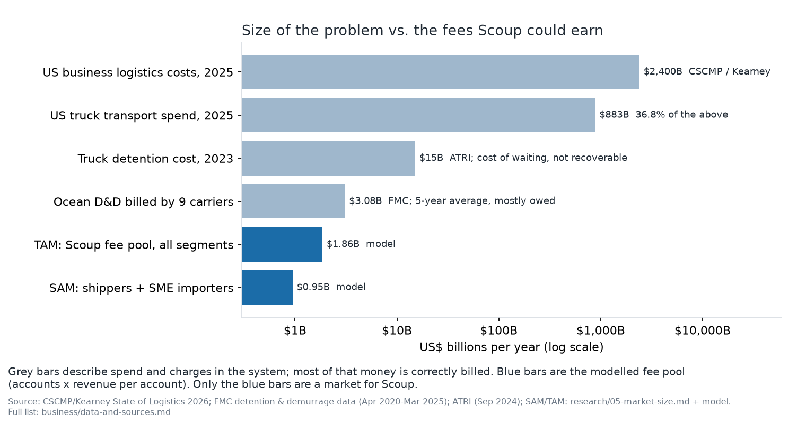

# Scoup investor brief

> **Draft, 22 October 2026. Not an offer of securities.** Scoup is pre-revenue: no customers,
> no pilots, no measured recovery rate. The product has run only on synthetic and public
> reference data. Company figures are plan inputs or model outputs and are labelled. Outside
> figures are footnoted and listed in [`data-and-sources.md`](data-and-sources.md). This brief
> replaces the October 2026 memorandum draft, whose withdrawn claims (neural-mesh speed
> figures, unreproduced classifier scores) are not repeated here.

## In one paragraph

Companies that ship freight pay thousands of small, complicated bills: truck detention,
lumper fees, fuel surcharges, ocean container charges. Checking them by hand costs more than
most errors are worth, so the errors get paid. Scoup uses five software agents to check every
invoice against the contract, the carrier's tariff, the government diesel index and the
federal rules for ocean invoices, and to turn each real overcharge into a cited claim. A
person approves every claim. Customers pay a share of what comes back, then a platform fee.

## What the agents do

*Figure 1. Language models read and draft; plain code computes the money; a reviewer agent and
a person check each claim. Source: Scoup product design; not a performance claim.*

| Agent | Job | Why it matters to the customer |
|---|---|---|
| Intake | Reads every invoice, bill of lading, rate confirmation and email; records the source page of every fact | Nothing is sampled; every number can be traced |
| Contract and tariff | Finds the rate, free time, fuel table and accessorial terms that apply | The check is against what was agreed, not a rule of thumb |
| Audit checks (plain code) | Re-rates the invoice: duplicates, fuel surcharge vs. EIA week, detention clock, D&D invoice rules | The dollar figure is exact and repeatable, so it holds up in a dispute |
| Evidence and claim | Builds the cited packet and draft dispute, sets the deadline | Claims go out inside the window: 180 days for a truck bill,[^13710] 30+ days for D&D[^cfr] |
| Reviewer | Re-checks every number and citation; rejects what it cannot trace | A second, independent check before a person sees it |

**Worked example (synthetic).** An invoice bills 2.5 hours of detention at $75 an hour,
$187.50. The rate confirmation gives 2 hours free, then $75 an hour billed by the minute. The gate log
shows the truck held 1 hour 50 minutes past free time. The audit checks compute $137.50; the
claim agent drafts a $50 short-pay with the clause, gate log and calculation attached; the
reviewer confirms each citation; the customer's AP lead sends it. No real invoice was used.

**What is measured so far.** On public carrier tariff names (not invoices), an internal test
of the charge-name classifier improved as its word list grew. That is a synthetic,
public-data result, not independently reproduced, and says nothing about real invoices. No
agent accuracy, recovery rate or review time has been measured on customer data.

## Why now

Three things changed. Document-reading AI became good enough to read messy invoices and
contracts. Federal rules for ocean D&D invoices (46 CFR Part 541) set content and timing
requirements a machine can check.[^cfr] And trucking margins are thin, which raises the value
of every recovered dollar.

## Scale of the money involved

*Figure 2. Grey bars: spend and charges in the system, mostly billed correctly. Blue bars: the
fee pool Scoup could earn. Sources: CSCMP/Kearney 2026, ATRI 2024, FMC 2025, model.*

- US logistics costs: $2.40 trillion in 2025, 36.8% trucking.[^cscmp]
- Truck detention cost: $15.1 billion in 2023; fewer than half of detention invoices
  paid.[^atri]
- Ocean D&D collected by nine carriers: about $15.4 billion, April 2020 to March 2025.[^fmc]
- Scoup's fee pool: about $0.95 billion a year for shippers and importers, $1.86 billion with
  carriers and brokers (accounts x revenue per account; see `market-analysis.md`).

## Business model

| Base case, per account | Year 1 | Year 3 | Year 5 | Year 7 |
|---|---|---|---|---|
| Recovered for the customer | $52K | $85K | $105K | $115K |
| Scoup revenue | $13.0K | $21.9K | $27.6K | $30.8K |

Year 3 unit economics (base): 64% gross margin; 20% churn; acquisition cost about $14.9K;
lifetime gross profit 4.7x acquisition cost; repaid in about 13 months. The plan assumes
$0.68 of sales cost per $1 of new ARR against a 2024 median of $2.00;[^bm] at the median the
ratio is 1.6x. Full detail in [`business-model.md`](business-model.md).

*Figure 3. Revenue per account: platform fee plus a share of recoveries. Source:
scoup-financial-model.xlsx, recalculated 22 Oct 2026.*

## Plan and financing

| Base case ($M) | Y1 | Y2 | Y3 | Y4 | Y5 | Y6 | Y7 |
|---|---|---|---|---|---|---|---|
| Accounts at year end | 6 | 35 | 103 | 202 | 327 | 462 | 605 |
| Revenue | 0.04 | 0.37 | 1.51 | 3.72 | 7.30 | 11.52 | 16.43 |
| ARR at year end | 0.08 | 0.63 | 2.26 | 4.93 | 9.03 | 13.49 | 18.63 |
| EBITDA | -0.92 | -1.54 | -2.14 | -2.59 | -2.01 | -0.72 | 1.30 |

*Source: scoup-financial-model.xlsx, Base sheet, recalculated 22 Oct 2026. A plan, not a
forecast.*

Proposed rounds (model): **$7.5M seed** in two tranches ($4.0M at close, $3.5M at a
milestone) and an **$8.5M Series A** at $2.5M ARR, which the base case reaches in month 38.
The downside case needs a hiring freeze to stay within the seed; see `../financial/model.md`.

*Figure 4. Seven-year plan in three cases. Source: scoup-financial-model.xlsx.*

## Competition

Loop (AI freight audit; $95M Series C in April 2026)[^loop], Cass ($190.8M revenue in
2025)[^cass], Intelligent Audit (subscription pricing; small-business parcel product)[^ia],
Trax, CTSI-Global, nVision, and BlueCargo for ocean D&D. The incumbents audit and pay invoices
at scale; none markets a cited, per-charge dispute for mid-market shippers across truck and
ocean bills. Loop and Intelligent Audit could close that gap; Scoup's answer is speed and
focus, not a technology lead.

## What we will prove with the seed, in order

1. The error rate and recoverable dollars on real design-partner files.
2. Review minutes per claim with the agents in the loop, and therefore gross margin.
3. That customers pay a share of recoveries, then a platform fee.
4. Acquisition cost for the first ten accounts.

If (1) shows recoverable money under about 0.25% of freight spend, we stop or change segment
before spending the second tranche.

## Team

Founder-led from Norway, selling to US customers. The largest gap is freight-audit operating
experience; a freight-operations lead is the first hire. See `hiring/README.md`.

---

[^13710]: 49 U.S.C. § 13710(a)(3)(B), https://www.law.cornell.edu/uscode/text/49/13710, accessed 2026-10-22.
[^cfr]: 46 CFR Part 541 (541.5, 541.7, 541.8), https://www.ecfr.gov/current/title-46/chapter-IV/subchapter-B/part-541, current through 2026-10-15, checked 2026-10-19.
[^cscmp]: CSCMP / Kearney, State of Logistics 2026, via SCDigest, https://www.scdigest.com/firstthoughts/26-06-26.php?cid=23144, published 2026-06-26, accessed 2026-10-22.
[^atri]: ATRI, https://truckingresearch.org/2024/09/new-research-documents-substantial-financial-and-safety-impacts-from-truck-driver-detention/, published 2024-09-10, accessed 2026-10-19.
[^fmc]: Federal Maritime Commission, https://www.fmc.gov/detention-and-demurrage/, accessed 2026-10-19.
[^bm]: Benchmarkit, 2025 SaaS Performance Metrics, https://www.benchmarkit.ai/2025benchmarks, accessed 2026-10-22.
[^loop]: Loop, https://www.loop.com/article/loop-raises-95m-series-c-to-scale-its-ai-platform-across-the-supply-chain, published 2026-04-17, accessed 2026-10-22.
[^cass]: Cass Information Systems, 8-K exhibit 99.1, https://www.sec.gov/Archives/edgar/data/708781/000070878126000002/cass-20251231xexx991.htm, published 2026-01-22, accessed 2026-10-22.
[^ia]: Intelligent Audit, FAQ, https://www.intelligentaudit.com/faq, accessed 2026-10-22.