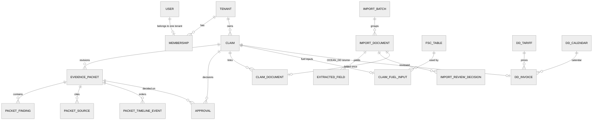

# Data model

> **Status.** Pre-product, synthetic data only, never deployed. Source: `api/prisma/schema.prisma` (1,002
> lines) and the 11 SQL migrations in `api/prisma/migrations/` on branch `feat/hardening` (`ed3d126`). Prisma
> describes columns; the SQL migrations add what Prisma cannot express (RLS policies, grants, CHECKs, triggers,
> `SECURITY DEFINER` functions). When the two disagree, the migrations are what the database enforces.

The schema has 35 models in 7 groups. Money is always an integer number of US cents (`Int`, column suffix
`_cents`), never a float. Timestamps are `timestamptz(3)`. Primary keys are UUIDs. Every tenant child table
references its parent through a composite key `[id, tenantId]`, so a row cannot point at a parent in another
tenant.

## 1. Conventions that apply everywhere

| Convention | Where it is enforced | Effect |
|---|---|---|
| `tenant_id` on every tenant row | Prisma extension (`api/src/db/tenant.ts`) and RLS policy `tenant_id = fr_current_tenant()` | Rows outside the transaction's tenant are invisible and unwritable |
| Composite foreign keys `[x_id, tenant_id] -> [id, tenant_id]` | Prisma `@relation(fields: [..., tenantId])` plus `@@unique([id, tenantId])` | Cross-tenant references are impossible at the database level |
| Append-only tables | `fr_append_only()` triggers on UPDATE, DELETE and TRUNCATE | History cannot be edited, even by the schema owner outside the dev-only reset path |
| Guarded mutable tables | `*_update_guard` triggers | Only named columns may change, along defined transitions |
| `version` integer on editable configuration | Service compares it; some triggers require `version + 1` | Optimistic concurrency: a stale write answers 409 |
| `created_by_id` / `updated_by_id` | Service writes them from the request context | Feeds four-eyes author checks |

## 2. Entity-relationship view (core claim flow)

## 3. Tables by group

### 3.1 Identity and access

| Table (model) | Tenant-scoped | Purpose | Notable fields and rules |
|---|---|---|---|
| `tenants` (`Tenant`) | is the tenant | Customer organisation | `slug` unique, `status` ACTIVE/SUSPENDED; read-only through the tenant client |
| `users` (`User`) | no (global) | Person account | `email` unique, `password_hash` (argon2id), `status`, optional `platform_role`, `password_changed_at` |
| `memberships` (`Membership`) | yes, plus system mode | A user's single tenant and role | `user_id` unique (one tenant per user); `role` OWNER to VIEWER |
| `invites` (`Invite`) | yes, plus system mode | Pending invitation | `token_hash` unique (raw token never stored), `expires_at`, `accepted_at`, `revoked_at` |
| `refresh_tokens` (`RefreshToken`) | no | Rotating refresh tokens | `token_hash` (HMAC), `family_id`, `used_at` (reuse revokes the family), `family_expires_at` (30-day cap) |
| `mfa_secrets` (`MfaSecret`) | no | TOTP secret | AES-GCM `ciphertext`, `nonce`, `key_id`; `last_used_step` blocks replay |
| `mfa_recovery_codes` (`MfaRecoveryCode`) | no | One-time recovery codes | `code_hash`, `used_at` |
| `password_resets` (`PasswordReset`) | no | Reset tokens | `token_hash`, `expires_at`, `used_at` |
| `login_attempts` (`LoginAttempt`) | no | Login outcome log | keyed by `email_hash`; append-only |
| `login_lockouts` (`LoginLockout`) | no | Failure counter | per `email_hash`, `locked_until` |
| `mail_outbox` (`MailOutbox`) | no | Dev and test mail transport | refused as a transport in production |

### 3.2 Claims, packets and decisions

| Table | Purpose | Notable fields and rules |
|---|---|---|
| `claims` (`Claim`) | One dispute case | `claim_number` unique per tenant; `kind` FREIGHT/OCEAN_DD (trigger `claims_kind_guard` blocks changes); `perspective` SHIPPER/CARRIER; `status` (trigger `claims_status_guard`); `amount_claimed_cents`, `recoverable_cents`, `pending_review_cents`; `carrier_name`, `shipper_name`, `load_number`, `invoice_number`, `invoice_date`; `assignee_id`; `version`; `created_at`, `updated_at` |
| `evidence_packets` (`EvidencePacket`) | One revision of a claim's packet | `revision` unique per claim; `status` adds SUPERSEDED; `demand_letter`, `disclaimer`; `recoverable_cents`, `pending_review_cents`; `content_hash`; `verifier_status` NOT_RUN/PASSED/FAILED/NEEDS_REVIEW; `created_by_id`; `created_at`. Only `status` may change (`evidence_packets_update_guard`); an analysis revision needs an author (`evidence_packets_analysis_guard`); no DELETE |
| `packet_findings` (`PacketFinding`) | A rule result inside a packet | `rule_id`, `title`, `direction` OVERCHARGE/UNDERBILLED, `amount_cents`, `calculation` (JSON steps), `confidence` decimal(4,3) (a fixed rule setting, not a measured probability), `needs_human_review`, `citations`, clause fields. Append-only |
| `packet_sources` (`PacketSource`) | A document cited by a packet | `filename`, `doc_type`, `sha256`, `size_bytes`, `ordinal`. Append-only |
| `packet_timeline_events` (`PacketTimelineEvent`) | Ordered timeline | `occurred_at`, `kind` (APPOINTMENT, ARRIVAL, DEPARTURE, INVOICE, RATE_CONFIRMATION, NOTE), `label`, `source_id`. Append-only |
| `approvals` (`Approval`) | Every human decision on a packet | `action` EDIT/APPROVE/REJECT/SEND_READY, `reason` (required), `from_status`, `to_status`, `content_hash`, `actor_id`, `actor_role`, `packet_revision`, `created_at`. Append-only; `approvals_four_eyes_guard` and `approvals_four_eyes_ext_guard` refuse APPROVE or REJECT by an author |

### 3.3 Imports and documents

| Table | Purpose | Notable fields and rules |
|---|---|---|
| `import_batches` (`ImportBatch`) | A group of uploaded files | `source` UPLOAD/EMAIL (email ingest is designed in `docs/design/email-ingest.md`, not built), `created_by_id`. Append-only |
| `import_documents` (`ImportDocument`) | One uploaded file | `sha256` unique per batch, `detected_type` PDF/PNG/JPEG/CSV/TXT, `doc_type` with `doc_type_basis`, `status` RECEIVED/NEEDS_REVIEW/ACCEPTED/REJECTED/FAILED, `review_reasons`, `storage_key` (CHECK: starts with `t/<tenant_id>/`), provider and parser versions. Guarded updates, no DELETE |
| `extracted_fields` (`ExtractedField`) | One field pulled from a document | `key`, `kind`, `value`, `raw_value`, `corrected_value`, `confidence`, `needs_review`, `status` PROPOSED/CONFIRMED/CORRECTED/REJECTED, `origin` EXTRACTED/MANUAL, location (`page`, `line`, `start_col`, `end_col`, `source_row`, `excerpt`). Guarded updates, no DELETE |
| `import_review_decisions` (`ImportReviewDecision`) | Every review action | `action` CONFIRM/CORRECT/REJECT/ADD/SET_TYPE/ACCEPT/REJECT_DOC, `reason`, before and after value **hashes** (never the values), `actor_id`. Append-only; four-eyes guard on ACCEPT |
| `claim_documents` (`ClaimDocument`) | Link from an accepted document to a claim | A document links to at most one claim. Append-only |

### 3.4 Audit, flags and evaluation

| Table | Scope | Purpose | Notable fields and rules |
|---|---|---|---|
| `audit_events` (`AuditEvent`) | per chain (`t:<tenantId>` or `platform`) | Hash-chained audit log | `seq` contiguous per `chain_key`; `action` (one of the names in `packages/shared/src/audit-actions.ts`); `target_type`, `target_id`, whitelisted `metadata`, `prev_hash`, `hash`. Append-only; index on `(tenant_id, target_type, target_id)` serves the four-eyes readers |
| `feature_flags` (`FeatureFlag`) | global | Kill switches for intelligence features | 7 keys in `packages/shared/src/feature-flags.ts`; `version` must rise by 1; no INSERT or DELETE |
| `eval_runs` (`EvalRun`) | global | One evaluation run on a synthetic set | pass^k counts, Wilson interval, `git_sha`, provider and parser versions. Append-only |
| `eval_case_results` (`EvalCaseResult`) | global | Per-case result of a run | `runs_passed`, `k`, `distinct_outputs`, `first_failure_code`. Append-only |

### 3.5 Machine access

| Table | Purpose | Notable fields and rules |
|---|---|---|
| `api_keys` (`ApiKey`) | Tenant API key | `key_id` (16 hex, unique, the public part), `secret_hash` (HMAC-SHA256 with a pepper held outside the DB), `scopes`, `expires_at`, `last_used_at`, `revoked_at`, `revoked_by_id`, `revoke_reason`, `created_by_id`. Guarded updates, no DELETE |

### 3.6 Intelligence

| Table | Scope | Purpose | Notable fields and rules |
|---|---|---|---|
| `charge_labels` (`ChargeLabel`) | tenant | Team label memory for charge-line wording | `normalized_text` unique per tenant, `category`, `description`, `version`; capped per tenant; label authors count for four-eyes |
| `fsc_tables` (`FscTable`) | tenant | Customer fuel-surcharge tables | `kind`, `unit`, `price_series`, `effective_offset_days`, `params` (JSONB), `archived_at`, `version` |
| `claim_fuel_inputs` (`ClaimFuelInput`) | tenant | Ship date and miles for a claim's fuel check | One per claim; `fsc_table_id` with `ON DELETE RESTRICT` |
| `price_imports` (`PriceImport`) | global | Provenance of a public price-series import | `series_key`, `source_url` (CHECK: two pinned FRED URLs), `sha256`, `row_count`. Append-only; `freight_app` has SELECT only |
| `price_observations` (`PriceObservation`) | global | Weekly or monthly price values | Key `(import_id, period_date)`, `value` decimal(10,3). Append-only |

### 3.7 Ocean demurrage and detention

| Table | Purpose | Notable fields and rules |
|---|---|---|
| `dd_tariffs` (`DdTariff`) | Carrier or terminal D&D tariff | `carrier`, `charge_type`, `direction`, `data` (JSON free time and tiers), `version` |
| `dd_calendars` (`DdCalendar`) | Terminal holiday calendar | `data` (JSON), `version` |
| `dd_invoices` (`DdInvoice`) | A D&D invoice under audit | `status` DRAFT or AUDITED (AUDITED rows are immutable, trigger `dd_invoices_guard`); `invoice_number` with `billing_party_name` unique per tenant; `invoice_date`; `total_due_cents`; `data` (JSON containers, events and `dueDate`, size-capped by CHECK); `tariff_id`; `calendar_id`; `claim_id` (unique); `audited_at`; `audit_snapshot` |

## 4. Status machines

| Column | States | Allowed moves (enforced by trigger) |
|---|---|---|
| `claims.status` | AWAITING_ANALYSIS, PENDING_REVIEW, APPROVED, REJECTED, SEND_READY | AWAITING_ANALYSIS to PENDING_REVIEW (analyze); PENDING_REVIEW to APPROVED or REJECTED; APPROVED to SEND_READY (terminal); an edit returns the claim to PENDING_REVIEW with a new packet revision (`claims_status_guard`) |
| `evidence_packets.status` | PENDING_REVIEW, APPROVED, REJECTED, SEND_READY, SUPERSEDED | Same transitions; an edit creates a new revision and supersedes the old one; no other column may change (`evidence_packets_update_guard`) |
| `import_documents.status` | RECEIVED, NEEDS_REVIEW, ACCEPTED, REJECTED, FAILED | `import_documents_update_guard`; ACCEPT needs a reviewer who did not upload or edit the document |
| `dd_invoices.status` | DRAFT, AUDITED | AUDITED rows are immutable (`dd_invoices_guard`) |

## 5. What the schema does not hold

These absences matter for product claims and for the executive dashboard
([../exec-dashboard-spec.md](../exec-dashboard-spec.md)).

- **No outcome after send-ready.** Nothing records that a demand went out, that a carrier answered, what
  amount was credited or paid, or when. `SEND_READY` is the last state, so "recovered dollars" in the sense of
  money actually returned cannot be computed from this schema.
- **No dispute deadline.** No column holds a filing deadline or a contract dispute window. The ocean D&D
  engine knows the 46 CFR 541.8(a) minimum of 30 calendar days from the invoice date
  (`DD_DISPUTE_MIN_DAYS` in `packages/shared/src/ocean-dd/constants.ts`) and reads the invoice's
  `dueDate` from `dd_invoices.data`. Freight claims carry only `claims.invoice_date`.
- **No lane.** Claims and extracted fields have no origin or destination. The BOL `facility` field
  (`bol.facility` in `api/src/imports/parse/deterministic.ts`) is the closest location datum.
- **No team or business unit.** There is no Team model, so every tenant role sees every claim of its tenant
  (assumption A4 in `ARCHITECTURE.md`).
- **No billing or contract data.** No plan, subscription, invoice or contingency-fee table exists.
