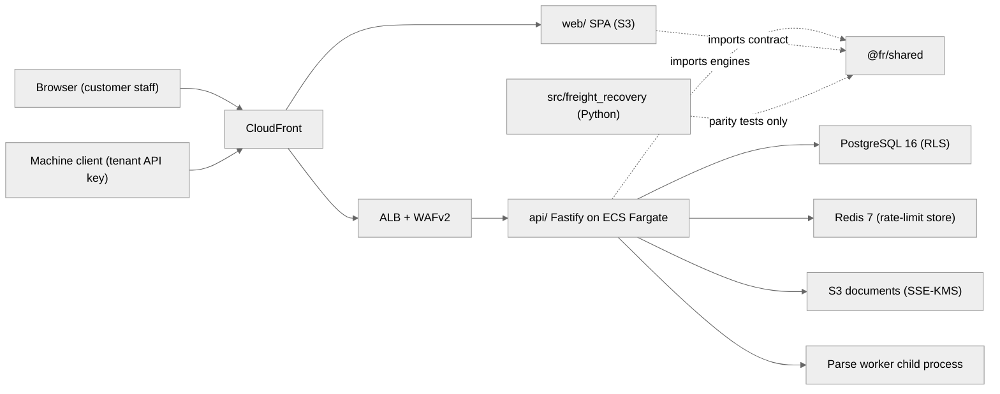

# scoup.ai architecture overview (as built)

> **Status.** Pre-product. Synthetic data only, never deployed, no paying customers. Everything below
> describes code on branch `feat/hardening` of the TypeScript monorepo
> (`ventures/freight-recovery-build`, head `ed3d126`, read on 2026-10-17). Where a control has only been
> verified locally, we say so. Nothing in this document is a claim about accuracy, security in production or
> recovery rates; none of those has been measured.

scoup.ai (repository name `freight-recovery`) assembles evidence packets and draft demand letters for freight
billing disputes: truck detention and accessorial overcharges, fuel-surcharge errors and ocean demurrage and
detention (D&D) invoices. A person always reviews and approves a packet before anything counts as
send-ready, and the product never sends a demand or moves money itself.

This document is the map. The detailed, step-by-step design record is the 4,099-line `ARCHITECTURE.md` in the
build worktree, and the threat model is `technical/web-platform-security.md`. We cite both by section rather
than repeat them.

## 1. System context

The system has two codebases that live side by side in one repository. The owner decided that the Python
reference core stays and that everything customer-facing is TypeScript (see
[ADR 0003](../adr/0003-python-core-kept-as-reference.md)).

| Part | Path | Language and stack | Role today |
|---|---|---|---|
| Web API | `api/` | Node 22, Fastify 5.12, Prisma 7.10, PostgreSQL 16, Zod 4, Pino | The product backend: auth, tenancy, imports, analysis, approvals, exports, intelligence, ocean D&D |
| Web app | `web/` | React 19.3, Vite, React Router 7, TanStack Query 5, Zustand 5 | The single-page app customers would use |
| Shared contract | `packages/shared/` (`@fr/shared`) | TypeScript, Zod only | RBAC matrix, DTO schemas, canonical JSON, and the pure rule engines (analysis, charge-intel, fuel, outlook, ocean-dd) |
| Python reference core | `src/freight_recovery/` | Python 3.11+, FastAPI, SQLAlchemy 2, Alembic | Reference implementation of ingest, extraction, rules and evidence; the TS port is checked against it for exact parity |
| Pilot dashboard | `webapp/` | Vite + React | Reference only, frozen |
| Infrastructure | `infra/*.tf` | Terraform (AWS) | `fmt` and `validate` only, never applied |
| Developer portal | `developer-portal/` | MkDocs Material | Documents the **Python** API only (see [dev-portal-drift.md](dev-portal-drift.md)) |



The AWS side of the diagram is the Terraform design in `infra/`; it has never been applied. The local stack
(`compose.web.yml`) uses MinIO, `postgres:16.15-alpine` and `redis:7-alpine` in its place.

## 2. Module map

### 2.1 API (`api/src/`)

Each feature folder registers its routes in `api/src/app.ts` (`buildApp`). Every route goes through
`defineRoute` in `api/src/http/route.ts`, which refuses to boot the app when a route has no access
declaration. The full route list is in [api-surface.md](api-surface.md).

| Folder | Responsibility | Key files |
|---|---|---|
| `http/` | One `onRequest` security pipeline (rate limit, Origin, CSRF, authN, permission), route declaration, error mapping, DB-guard to HTTP mapping, client address behind CloudFront | `security.ts`, `route.ts`, `errors.ts`, `db-guard.ts`, `client-ip.ts`, `strict-body.ts` |
| `security/` | argon2id passwords, HS256 JWT with per-purpose keys, TOTP, CSRF tokens, HKDF/AES-GCM, lockout math, password policy | `password.ts`, `jwt.ts`, `totp.ts`, `csrf.ts`, `crypto.ts`, `lockout.ts` |
| `auth/` | Login, MFA, refresh rotation with reuse detection, recovery, invites, user management, API-key authentication, dev mail outbox | `routes.ts`, `service.ts`, `session.ts`, `users-routes.ts`, `api-key-auth.ts` |
| `apikeys/` | Tenant API keys: create, list, revoke; key material and HMAC verification | `routes.ts`, `service.ts`, `key-material.ts` |
| `claims/` | Claim list and detail, packet viewer, review state machine, approve/reject/send, analyze (single and bulk), content hash | `routes.ts`, `service.ts`, `state-machine.ts`, `content-hash.ts`, `analysis.ts` |
| `imports/` | Upload pipeline, MIME sniffing, sandboxed parsing, review queue, commit to claims | `routes.ts`, `service.ts`, `review-service.ts`, `commit-service.ts`, `sandbox/*`, `parse/*` |
| `exports/` | Streaming CSV/XLSX exports of claims, packets and outcomes with formula neutralisation | `routes.ts`, `rows.ts`, `writers.ts`, `neutralize.ts` |
| `intelligence/` | Worklist (`priority-v1`), similar claims, provenance, charge-line suggestions and team labels, fuel tables and fuel check, cost outlook | `routes.ts`, `service.ts`, `priority.ts`, `charge-routes.ts`, `fuel-routes.ts`, `outlook-routes.ts` |
| `ocean-dd/` | D&D tariffs, terminal calendars, invoices and the audit run that creates an `OCEAN_DD` claim with packet revision 1 | `routes.ts`, `service.ts`, `audit-run.ts` |
| `audit/` | Hash-chained audit log, append under advisory lock, verifier, four-eyes author readers | `audit.ts`, `chain.ts`, `routes.ts`, `label-authors.ts`, `dd-editors.ts` |
| `platform/` | Health, platform dashboard (pipeline stats, telemetry, logs, flags, eval runs, platform audit), SUPER_ADMIN cross-tenant read, price store and importer CLI | `routes.ts`, `dashboard-routes.ts`, `cross-tenant.ts`, `flags.ts`, `price-store.ts`, `prices-cli.ts` |
| `db/` | Tenant client (fail-closed Prisma extension), system-mode transactions, advisory-lock helpers | `tenant.ts`, `system.ts`, `client.ts`, `*-locks.ts` |
| `eval/` | Offline evaluation CLIs (`eval`, `eval:charges`, `eval:outlook`) that gate CI on synthetic fixtures | `cli.ts`, `runner.ts`, `charges.ts`, `outlook.ts` |
| `observability/`, `logging.ts` | Metrics registry, in-memory log ring buffer, Pino logger with key scrubbing | `metrics.ts`, `ring-buffer.ts` |
| `storage/` | S3 client with tenant-prefix checks on every call | `s3.ts` |

### 2.2 Shared contract (`packages/shared/src/`)

`@fr/shared` has one runtime dependency (Zod). It holds two kinds of code. The first is the contract both
sides import: `rbac.ts` (roles, the frozen permission matrix, `can`), `dto.ts` and the per-feature
`*-dto.ts` schemas, `audit-actions.ts`, `feature-flags.ts`, `canonical-json.ts`, `money.ts`, `decimal.ts`,
`text-sanitize.ts`, `honest-copy.ts` and `transparency-copy.ts`. The second is the set of pure, deterministic
engines: `analysis/` (the TS port of the Python rules, letter and Markdown), `charge-intel/` (the
`charge-knn-v1` classifier and seed set), `fuel/`, `outlook/` and `ocean-dd/` (free time, seven audit rules,
CSV parser, letter, 46 CFR text). Engines take values and return values. They never touch the database or the
network, and that property is what makes the parity tests and the eval gates possible.

### 2.3 Web app (`web/src/`)

`app-root.tsx` lazy-loads one page per feature. `api/client.ts` keeps the access token in memory only, adds
the CSRF header and runs a single-flight refresh across tabs. The web app imports the RBAC matrix only to hide
controls; the API enforces every permission itself.

| Route | Feature folder | Page |
|---|---|---|
| `/login`, `/login/mfa`, `/login/mfa-setup`, `/forgot`, `/reset`, `/invite` | `features/auth` | Sign-in, MFA, recovery, invite acceptance |
| `/claims`, `/claims/:id` | `features/claims` | Claims table and claim sheet (packet, analyze, documents, intelligence tabs) |
| `/approvals` | `features/approvals` | Human approval queue |
| `/import`, `/import/review` | `features/imports` | Upload and document review queue |
| `/intelligence` | `features/intelligence` | Prioritised worklist |
| `/outlook` | `features/outlook` | Cost outlook from public price data |
| `/ocean` | `features/ocean-dd` | D&D invoices, tariffs, calendars, CSV import |
| `/settings/fuel-tables`, `/settings/api-keys` | `features/fuel`, `features/apikeys` | Tenant settings |
| `/dev/*` | `features/dev` | Platform dashboard (pipeline, telemetry, logs, flags, evaluation, audit) |

There is no executive or summary page today. [../exec-dashboard-spec.md](../exec-dashboard-spec.md) specifies
one.

### 2.4 Python reference core (`src/freight_recovery/`)

The Python service is a complete small product of its own: `ingest/`, `extraction/` (a deterministic
`Key: Value` stub behind an `ExtractionProvider` interface), `rules/` (detention and invoice checks in
`Decimal`), `evidence/` (packet and draft letter), `sandbox/`, `db/`, `storage/`, `api/main.py` and
`admin.py`. In the TS platform it has one job: it is the oracle for parity.
`api/test/parity/rules.parity.test.ts` and `extract.parity.test.ts` run `tools/parity/*.py` and require exact
string equality with the TS engines, apart from the registered divergences (D1 to D8 for extraction, RD1 to
RD13 for rules) listed in `ARCHITECTURE.md`. In CI a missing Python interpreter fails the suite.

### 2.5 Infrastructure (`infra/`)

The Terraform files describe CloudFront with a response-headers policy, an S3 bucket for the SPA (origin
access control), an ALB reachable only from CloudFront with an origin-verify header, WAFv2, ECS Fargate in
private subnets with VPC endpoints and no NAT, RDS PostgreSQL 16 with `rds.force_ssl=1`, ElastiCache Redis 7
with TLS, an S3 documents bucket with SSE-KMS and a task role limited to the `t/*` prefix, KMS keys and seven
Secrets Manager containers whose values are set out of band. Migrations run as a one-off ECS task. Nothing
has been applied, and CI runs `terraform fmt -check` and `validate` only.

## 3. Dependency direction

Dependencies point one way, and lint rules plus architecture tests keep them that way.

```
web/  ---->  @fr/shared  <----  api/
                                  |
                                  +--> PostgreSQL  (through db/tenant.ts or db/system.ts only)
                                  +--> S3          (through storage/s3.ts only)
                                  +--> parse worker (child process, imports/sandbox/)
src/freight_recovery (Python): called by parity tests only, never at runtime
```

- `@fr/shared` imports nothing from `api/` or `web/`, and its engines import nothing that does I/O.
- Feature folders in `api/src` reach the database only through a `TenantDb` handle from `db/tenant.ts`.
  `db/system.ts` (system-mode transactions) is restricted by lint to auth bootstrap, the evaluation recorder,
  the price importer and the platform statistics function.
- Platform modules may not import tenant models or tenant tables and may not read `email` (architecture
  tests, threat model T38).
- The API never calls the Python service at runtime. The TS engines are the production path.

## 4. Tenancy and row-level security

Tenancy is three layers, and each is built to fail closed on its own. The reasoning is in
[ADR 0002](../adr/0002-rls-fail-closed-tenancy.md).

1. **PostgreSQL RLS.** Every tenant table has `ENABLE` and `FORCE ROW LEVEL SECURITY` with
   `USING/WITH CHECK (tenant_id = fr_current_tenant())`. With no `app.tenant_id` set in the transaction, a
   query sees zero rows. Across the 11 migrations, 26 tables carry `FORCE ROW LEVEL SECURITY`: the 20 tenant
   tables (of which `memberships` and `invites` also admit system mode for the auth bootstrap), `audit_events`,
   `feature_flags`, the two eval tables and the two global price tables. The API connects as `freight_app`
   (`NOSUPERUSER NOBYPASSRLS NOINHERIT`, not the owner, DML grants only, column-level grants on packets and
   flags). `freight_owner` owns the schema and runs migrations.
2. **Fail-closed Prisma extension** (`api/src/db/tenant.ts`). Only the 20 models in `TENANT_MODELS` are
   reachable. The extension injects `tenantId` into every `where` and every `create`, throws on a conflicting
   value and removes raw SQL from the tenant client. A model added later throws `TenantScopeError` until
   someone classifies it.
3. **Request context.** User, role, tenant status and refresh-family liveness are reloaded from the database
   on every request (`auth/session.ts`), never taken from token claims, headers or the body. Platform users get
   `db = null`.

Composite foreign keys (`[id, tenantId]` references on every child table) stop a row from pointing at another
tenant's parent even if application code tries. Object storage repeats the check: a CHECK forces
`import_documents.storage_key` to start with `t/<own tenant_id>/`, and every `ObjectStore` call re-checks the
prefix. Another tenant's id always answers 404.

## 5. Authentication and authorisation

Two kinds of caller exist, and the `Authorization` header alone decides which path a request takes
(`api/src/http/security.ts`).

| Caller | Credential | Path |
|---|---|---|
| Person in the web app | Access JWT (10 min, HS256, held in JS memory) plus the `fr_rt` refresh cookie (`HttpOnly; Secure; SameSite=Strict; Path=/api/v1/auth`) | CSRF double-submit plus Origin check on unsafe methods; TOTP MFA mandatory for OWNER, ADMIN, PLATFORM_DEV and SUPER_ADMIN; refresh rotation with family revocation on reuse; lockout of `min(30 x 2^(f-5), 900)` seconds after 5 failures |
| Machine client | `Authorization: Bearer fr_live_<keyId>_<secret>` | Per-IP failure gate, constant-time HMAC compare, revocation and expiry read on every request, route opt-in, scope check, then a re-check that the key creator's **current** role still holds the scope's permission ([ADR 0006](../adr/0006-scoped-tenant-api-keys.md)) |

Authorisation is one frozen matrix in `packages/shared/src/rbac.ts`: six tenant roles (OWNER, ADMIN,
MANAGER, REVIEWER, ANALYST, VIEWER), two platform roles (PLATFORM_DEV, SUPER_ADMIN) and 30 permissions.
Platform roles hold no tenant data permission. An API key carries at most three scopes (`claims.read`,
`exports.claims`, `imports.write`), and 9 of the 97 routes accept keys. AuthN and authZ run in `onRequest`,
before the body is parsed, so a forbidden caller gets 403 even when the body is invalid.

Two kinds of decision need a second person ([ADR 0005](../adr/0005-four-eyes-separation-of-duties.md)).
Anyone who authored any packet revision of a claim, a team charge label that influenced its analysis, or the
ocean D&D invoice behind it cannot approve or reject that claim. The uploader or a field editor of an
imported document cannot accept it. The service check is the primary control, and database triggers back it
up.

## 6. Trust boundaries

| # | Boundary | What crosses it | Control at the boundary |
|---|---|---|---|
| B1 | Internet to CloudFront and ALB | All HTTP traffic | WAFv2 managed rules and size limits, ALB reachable only from CloudFront with an origin-verify header, TLS 1.2/1.3 (IaC only, unverified in AWS) |
| B2 | HTTP to handler | Requests from browsers and machine clients | `http/security.ts` pipeline; Zod validation in `preHandler`; per-route body limits; strict outgoing schemas on platform routes |
| B3 | API process to parse worker | Untrusted document bytes | One child process per job with wall-clock, memory, output, page and pixel limits and a clean environment (`imports/sandbox/`). This is process isolation, not an OS sandbox |
| B4 | API to PostgreSQL | All tenant data | `freight_app` without BYPASSRLS, RLS with FORCE, the tenant extension, and triggers for state machines, append-only tables and four-eyes |
| B5 | API to S3 | Original documents and extracted text | Tenant prefix `t/<tenant_id>/`, SSE-KMS required by bucket policy, task role scoped to `t/*` |
| B6 | Tenant data to platform staff | Operational data | Platform roles have no tenant DB handle; only `fr_platform_pipeline_stats` crosses tenants and it returns counts and durations; a SUPER_ADMIN cross-tenant read is read-only, needs a reason and is audited into the target tenant's chain first |
| B7 | Product to the outside world | Demand letters, money | Nothing crosses today. "Send" only marks a packet send-ready after a content-hash match; no email, portal submission or payment exists |

## 7. Audit trail

Every mutating handler appends to a per-tenant hash chain in the same transaction as the business change
(`api/src/audit/audit.ts`): `hash_n = SHA-256(hash_{n-1} + "\n" + canonicalJson(event_n))`, under
`pg_advisory_xact_lock`. If the append fails, the request returns 500 and nothing changes. Triggers block
UPDATE, DELETE and TRUNCATE on `audit_events`, `approvals`, `login_attempts` and the packet child tables.
`GET /api/v1/audit/verify` recomputes the chain. The threat model (T10) records the residual risk: nothing
anchors chain heads outside the database yet.

## 8. What is not verified

The hardening notes in `ARCHITECTURE.md` list what ran: unit, integration and acceptance suites on Node
22.23.3, locally on Windows, against fresh PostgreSQL 16.15 and MinIO clusters. GitHub CI for the latest
commits, local Terraform `fmt`/`validate`, container images, the compose stack, Playwright end-to-end tests and
any AWS deployment remain unverified. No external penetration test or compliance review has taken place.
