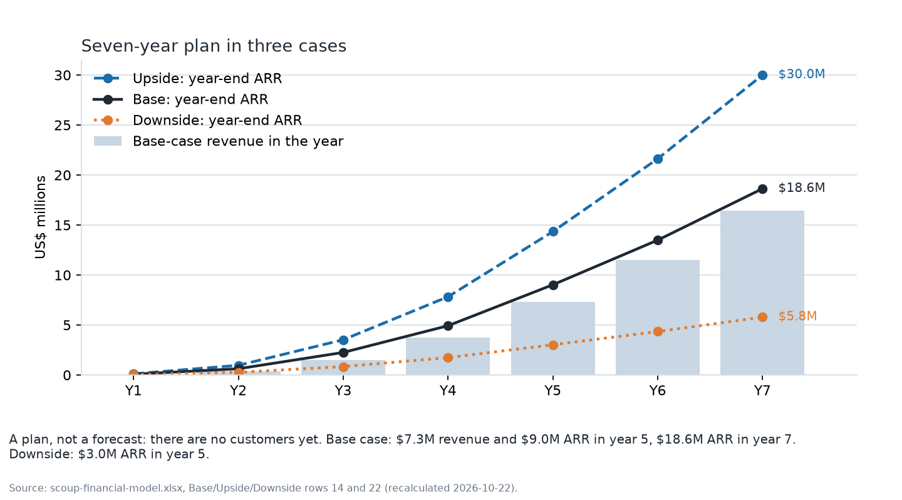
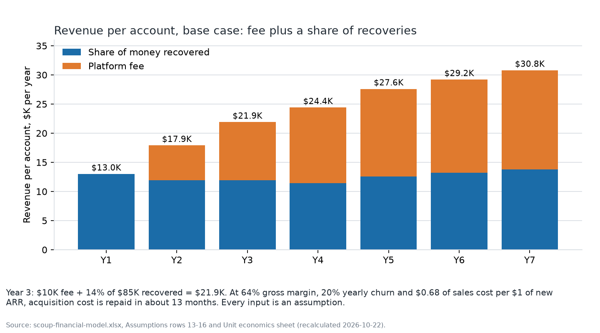

# Scoup financial model

> **Status, 22 October 2026: a plan, not a forecast.** Scoup has no revenue and no
> customers. The planning model is
> [`../business/investor-pack/scoup-financial-model.xlsx`](../business/investor-pack/scoup-financial-model.xlsx).
> Its inputs are assumptions unless the workbook's "Sources (verified)" sheet says otherwise.
> Outside figures: [`../business/data-and-sources.md`](../business/data-and-sources.md).

## 1. Which workbook is the model

| Workbook | Role |
|---|---|
| `business/investor-pack/scoup-financial-model.xlsx` | **Planning model** quoted in all investor documents. Seven years, three cases, monthly financing logic, about 870 formulas. |
| `financial/model/freight-recovery-financial-model.xlsx` and the CSVs beside it | **Superseded** five-year scaffold ($40K contract value, $2-3M seed). Kept for history; not used. |
| `financial/model.xlsx` on branch `docs/finance` | A third, segment-split model (shippers, importers, carriers). Not reconciled with the planning model; the owner should pick one. |

The planning model was recalculated on 22 October 2026 without Excel, using
`business/tools/recalc_model.py`. Excel recalculates it on open.

## 2. Revenue per account

Revenue per account = platform fee + money recovered for the customer x Scoup's share.

| $K per account | Y1 | Y2 | Y3 | Y4 | Y5 | Y6 | Y7 |
|---|---|---|---|---|---|---|---|
| Platform fee | 0 | 6 | 10 | 13 | 15 | 16 | 17 |
| Recovered for the customer | 52 | 70 | 85 | 95 | 105 | 110 | 115 |
| Scoup's share | 25% | 17% | 14% | 12% | 12% | 12% | 12% |
| **Revenue per account (base)** | **13.0** | **17.9** | **21.9** | **24.4** | **27.6** | **29.2** | **30.8** |

Upside is 1.15x base and downside 0.8x. Year-1 recovery ($52K) is a mid-size importer-shipper:
about $36K of non-compliant container charges plus $16K of fuel-surcharge overbilling. With the
sourced import-volume figure the container part is nearer $32.9K (see data-and-sources,
section 11); the input has not been changed and is an owner decision.

## 3. Three cases

| $M | Y1 | Y2 | Y3 | Y4 | Y5 | Y6 | Y7 |
|---|---|---|---|---|---|---|---|
| **Base** accounts | 6 | 35 | 103 | 202 | 327 | 462 | 605 |
| Base revenue | 0.04 | 0.37 | 1.51 | 3.72 | 7.30 | 11.52 | 16.43 |
| Base ARR (year end) | 0.08 | 0.63 | 2.26 | 4.93 | 9.03 | 13.49 | 18.63 |
| Base EBITDA | -0.92 | -1.54 | -2.14 | -2.59 | -2.01 | -0.72 | 1.30 |
| **Upside** ARR | 0.12 | 0.97 | 3.53 | 7.83 | 14.35 | 21.63 | 30.00 |
| Upside EBITDA | -0.91 | -1.46 | -1.66 | -1.32 | 0.84 | 4.32 | 8.92 |
| **Downside** ARR | 0.04 | 0.27 | 0.84 | 1.74 | 3.03 | 4.35 | 5.79 |
| Downside EBITDA | -0.93 | -1.57 | -2.53 | -3.76 | -4.90 | -5.71 | -6.21 |

*Source: workbook Base, Upside and Downside sheets, recalculated 22 Oct 2026.*

*Figure 1. Year-end ARR in three cases, with base-case revenue as bars. Source: the workbook.*

## 4. Unit economics (base, year 3)

| Metric | Value |
|---|---|
| Revenue per account | $21.9K |
| Gross margin | 64% |
| Annual churn / average lifetime | 20% / 5 years |
| Lifetime gross profit | $70.1K |
| Sales and marketing per $1 of new ARR (plan) | $0.68 |
| Acquisition cost per account | $14.9K |
| Lifetime gross profit / acquisition cost | 4.7x |
| Months to repay acquisition cost | 12.8 |
| Same ratio at the 2024 median of $2.00 per $1 of new ARR[^bm] | 1.6x |

*Figure 2. Revenue per account, fee plus share. Source: the workbook.*

The plan's sales efficiency is about three times better than the median software company.
That is the input most likely to be wrong.

## 5. Financing

| | Base | Upside | Downside |
|---|---|---|---|
| Month ARR reaches $2.5M | 38 | 32 | 56 |
| Seed need incl. 20% buffer | $7.59M | $5.10M | $17.57M (no cost response) |
| Series A need incl. buffer | $5.58M | $0.38M | $16.26M |

*Recalculated 22 Oct 2026 (the workbook's Financing formulas use a lookup the Python engine
cannot evaluate, so the same logic is in `business/tools/recalc_model.py`).*

Proposed rounds in the workbook: **$7.5M seed** ($4.0M at close, $3.5M at a milestone) and
**$8.5M Series A** at $2.5M ARR. The $2.5M milestone sits just under Carta's 2025 median of
$2.8M ARR at Series A.[^carta] The downside case does not fit inside the seed unless hiring and
spending are frozen at year-2 levels when the tranche-2 milestone is missed; the workbook's
note says the frozen downside reaches the milestone in month 55 and needs $7.6M (that note was
not recalculated in this pass).

Use of the seed (workbook): G&A $1.15M, product and engineering $1.70M, security $0.71M, sales
and marketing $1.95M, claims operations $0.63M, 20% reserve $1.23M, unallocated $0.14M.

## 6. What the model does not know

1. The real error rate and recoverable dollars per account.
2. Review minutes per claim with the agents, and so the real gross margin.
3. Whether customers accept a share of recoveries and then a platform fee.
4. Real acquisition cost and churn.

Until these are measured on design-partner files, show this model only as "assumptions, not
forecast".

[^bm]: Benchmarkit, 2025 SaaS Performance Metrics, https://www.benchmarkit.ai/2025benchmarks, accessed 2026-10-22.
[^carta]: Carta, "ARR at Series A", https://carta.com/data/newsletter-arr-at-series-a/, accessed via search index 2026-10-22 (secondary).