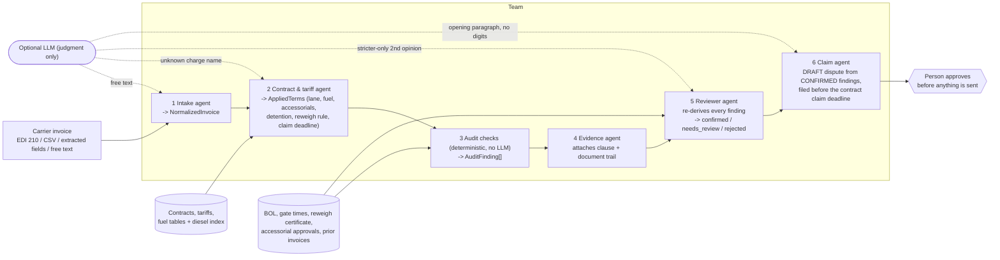

# Freight overcharge-audit agents

> **Status (2026-10-22):** code in `packages/shared/src/audit-agents/` (`@fr/shared/audit-agents`), unit-tested, **not yet wired into the API or the web app**. All accuracy figures below are measured on **SYNTHETIC data** generated by the same code base. They show that the rules do what they are designed to do. They are **not** a measurement on real carrier invoices, and they must not be quoted as real-world accuracy.

The team checks carrier freight invoices against the shipper's contract and tariff and flags overcharges. **Deterministic code does all money math; language-model agents only do judgment** (reading free text, mapping an unfamiliar charge name, a second-opinion review, the wording of the claim letter). The deterministic path runs offline and is complete without any model.

## Agent flow

## What each agent does

| # | Agent | Input -> output (zod schema, `types.ts`) | Deterministic part | Optional LLM part (validated, can fall back) |
|---|---|---|---|---|
| 1 | Intake (`intake.ts`, `.claude/agents/freight-intake.md`) | invoice -> `NormalizedInvoice` | Parses an X12 EDI 210 subset (B3, N9, G62, N1/N4, LX/L5/L0/L1/L7, L3), a flat CSV, or pre-extracted fields | Only for free text no parser accepts; answer must validate against the schema and is marked "confirm the fields" |
| 2 | Contract & tariff (`contract.ts`, `freight-contract.md`) | invoice + contracts -> `AppliedTerms` | Contract by carrier and effective dates; lane by origin, destination and mode; fuel, accessorial schedule, detention, reweigh rule; claim deadline = invoice date + contract claim window | Maps a charge name that matches no schedule code or name; may answer only a code from the schedule, or null |
| 3 | Audit checks (`checks.ts`) | invoice + terms + evidence + prior invoices + fuel index -> `AuditFinding[]` | All checks below; exact decimal arithmetic | none |
| 4 | Evidence (`evidence.ts`) | findings -> findings with citations | Adds contract clause, invoice line, BOL, prior invoice to each finding | none |
| 5 | Reviewer (`reviewer.ts`, `freight-reviewer.md`) | findings -> `ReviewVerdict[]` | Re-derives each finding: billed - expected = amount; cited lines and clauses exist; rule preconditions still hold; no line claimed twice; claim window open; review-only and low-confidence findings never auto-confirmed | Second opinion that can only make a verdict stricter |
| 6 | Claim (`evidence.ts`, `freight-evidence-claim.md`) | reviewed findings -> `ClaimDraft` | Letter lists only CONFIRMED findings with billed, expected and basis; total; deadline; banner "DRAFT - FOR HUMAN REVIEW. NOT SENT. NOT LEGAL ADVICE." | Opening paragraph; discarded if it contains any digit |

The orchestrator is `runAuditTeam` (`orchestrator.ts`). The project-scope Claude Code definitions in `.claude/agents/` (`freight-audit-lead` plus the four judgment agents) drive the same code through `packages/shared/src/audit-agents/cli.ts`. Invoice and document text is fenced as untrusted data in every model prompt. No model output is used as money.

## Checks and the rules they cite

Reused unchanged from the existing engine (`@fr/shared/analysis`, `@fr/shared/fuel`): `INV-LINEHAUL-RATE` (TL linehaul vs contract lane), `INV-DUPLICATE` (repeated line, review only), `INV-ACCESSORIAL-UNAUTH` (known accessorial not in the contract, review only), `INV-TOTAL-MISMATCH` (stated total vs lines), `DET-OVERBILLED` (detention vs gate times, free time, rate, cap), and the step-7 fuel-table evaluation and diesel-week rule.

Added by this team:

| Rule | Finds | Default verdict |
|---|---|---|
| `AUD-DUP-INVOICE` | Same carrier and the same PRO, BOL, or load and ship date already billed on an earlier invoice | confirmed if the amount is the same; review if it differs (could be a corrected rebill) |
| `AUD-LINE-MATH` | Line amount differs from printed quantity x rate | confirmed |
| `AUD-FSC-BASE` | Fuel percent applied to linehaul plus accessorials instead of linehaul | confirmed |
| `AUD-FSC-ON-OVERCHARGE` | Fuel percent applied to an overbilled linehaul (follows a rate, class or reweigh overcharge) | confirmed |
| `AUD-FSC-WRONG-WEEK` | Fuel table evaluated at the wrong week of the diesel index | confirmed |
| `AUD-FSC-RATE`, `AUD-FSC-NOT-IN-CONTRACT` | Fuel above contract terms for an unidentified cause; fuel billed on a contract without fuel | review; confirmed |
| `AUD-REWEIGH` | LTL billed weight above BOL weight with no reweigh certificate (the contract requires one) | confirmed |
| `AUD-CLASS`, `AUD-LTL-RATE`, `AUD-MIN-CHARGE` | LTL re-rate: wrong class, rate per cwt above tariff, minimum charge above contract | confirmed |
| `AUD-ACC-UNAUTH`, `AUD-ACC-RATE` | Accessorial that requires per-load approval billed without one; accessorial above the contract cap | confirmed |
| `AUD-ACC-NOT-IN-CONTRACT`, `AUD-DET-NO-EVIDENCE`, `AUD-DET-NOT-IN-CONTRACT` | Charge not on the schedule; detention with no gate times; detention with no contract terms | review |

Double counting is prevented in code: line-arithmetic excess is removed before other rules run, LTL re-rating splits one linehaul difference into disjoint weight and rate parts, and a full duplicate invoice suppresses all other findings on that invoice.

## How dollars are recovered

1. The shipper (or Scoup on its behalf) loads carrier invoices, the contracts and tariffs, and the shipment evidence (BOL, gate times, approvals, prior invoices).
2. The team flags overcharges. Only findings the reviewer **confirms** go into the claim; review items are listed separately and are not claimed until a person accepts them.
3. A person approves the draft claim and files it with the carrier before the contract claim deadline (computed per contract; a finding past its deadline is rejected).
4. The carrier pays by credit memo, refund, or a short-pay deduction on the next payment. Each claimed line carries billed, expected, the contract clause and the documents, which is what a carrier needs to accept it.

Nothing in this code sends a claim, moves money or contacts a carrier.

## Measured accuracy (SYNTHETIC data only)

Set: `buildSyntheticSet` in `synthetic.ts`, seed 20261022. Invented carriers ("Synthetic Carrier A/B/C"), contracts (`SYN-*`), lanes and a made-up weekly diesel series. 135 invoices: 45 clean and 90 with one injected overcharge each (10 each of: duplicate invoice, fuel surcharge on the wrong base, unauthorized detention, reweigh without evidence, rate above contract, arithmetic error, fuel on the wrong index week, unauthorized accessorial, wrong freight class). Invoices are fed through all three intake paths (EDI 210, CSV, fields). Clean cases include hard negatives: a reweigh with a certificate, a minimum charge correctly applied, an FAK lane billed at the FAK class, detention earned and billed correctly, an approved lumper, and two stop-offs printed on identical lines.

| Metric (deterministic team, no LLM) | Result |
|---|---|
| Clean invoices with a **confirmed** (claimed) finding | **0 of 45** |
| Precision of confirmed findings | **120 / 120 = 1.00** |
| Recall: injected overcharges with a confirmed correct finding | **90 / 90 = 1.00** (every kind 10/10) |
| Claimed dollars equal the injected dollars to the cent | **90 / 90** |
| Clean invoices with a finding routed to **human review** | 5 of 45 (all "two stop-offs on identical lines", `INV-DUPLICATE`, $75 each; not claimed) |
| Precision of all flagged findings (confirmed + review) | 120 / 125 = 0.96 |

The same results hold for seeds 1 to 10 (1,350 invoices). Reproduce: `npx tsx packages/shared/src/audit-agents/cli.ts --eval` (or `--eval <seed>`); the unit test `audit-agents.test.ts` fails if any clean invoice gets a confirmed finding or any injected overcharge is missed.

**What these numbers do not show.** The generator and the checks were written by the same team, so the injected errors match the rules' definitions; perfect scores here are expected, not impressive. The set does not test PDF/OCR extraction quality, real contract wording and exceptions, carrier-specific charge codes, multi-stop or multi-invoice shipments, corrected rebills, or the LLM agents (they are tested only with scripted answers). Real-world precision and recall are unknown until the team runs on a design partner's closed audit files with known outcomes.

## Open gaps

- Not yet connected to the API (`/v1` analysis) or the web app; contracts and lanes have no storage or editor yet.
- EDI 210 support is a subset; EDI 211/214 and carrier-specific charge codes are not mapped.
- Lane matching is exact on "City ST"; zip/zone-based tariffs are not implemented.
- No pass^k evaluation of the LLM agents and no live-model test; the default model id is `claude-sonnet-5-5` (`AUDIT_AGENT_MODEL`).
- Claim filing, carrier responses and payment reconciliation are outside this module.